# MiMakeLargePageTable

- RVA: `0x004F9198`–`0x004F94C7` (길이 `815` bytes)
- VA: `0x00000001404F9198`
- 실행 섹션: `.text`
- PDB 이름 있음: `예`; PDB Function 태그: `아니요`
- unwind 정보 RVA: `0x000BF85C`
- 디코드: `202`개 명령, `815/815` bytes 표시
- 미해석 바이트: `0` (있으면 어셈블리에 `.byte`로 보존)

> 이 문서는 커널 이미지의 기계어와 PDB 기호를 분석해 생성했습니다. 4번과 5번은 함수 원형과 자료형을 바이너리 사용 방식에서 추정한 C 해석이며 원본 소스 복구 결과는 아닙니다.

## 1. Dependencies

- 직접 호출 지점: **11**; 고유 호출 대상: **10**
- 직접 호출자로 확인된 함수: **1**
- RIP 상대 이미지 참조: **2**

### Outgoing calls
- `0x004F91F3` → [MiGetLeafVa](../27/MiGetLeafVa_function_0027C0A0.md) (function, `0x0027C0A0`)
- `0x004F9253` → [MiDemotePfnListChain](../69/MiDemotePfnListChain_function_00698B5C.md) (function, `0x00698B5C`)
- `0x004F92AE` → [MiGetContainingPageTable](../34/MiGetContainingPageTable_function_003467F0.md) (function, `0x003467F0`)
- `0x004F92DF` → [KeYieldProcessorEx](../3F/KeYieldProcessorEx_function_003FBD00.md) (function, `0x003FBD00`)
- `0x004F92F8` → [MiMakeDemandZeroPte](../33/MiMakeDemandZeroPte_function_00337A00.md) (function, `0x00337A00`)
- `0x004F932B` → [MiSetPfnContainingFrame](../36/MiSetPfnContainingFrame_function_00363FC0.md) (function, `0x00363FC0`)
- `0x004F936B` → [MiMakeValidPte](../2C/MiMakeValidPte_function_002C5590.md) (function, `0x002C5590`)
- `0x004F938E` → [MiTransformValidPteInPlace](../37/MiTransformValidPteInPlace_function_003765E0.md) (function, `0x003765E0`)
- `0x004F93EE` → [MiCheckLinearProtectedPteAccessedBit](../29/MiCheckLinearProtectedPteAccessedBit_function_00292D80.md) (function, `0x00292D80`)
- `0x004F942D` → [KeYieldProcessorEx](../3F/KeYieldProcessorEx_function_003FBD00.md) (function, `0x003FBD00`)
- `0x004F9479` → [MiIncreaseUsedPtes](../24/MiIncreaseUsedPtes_function_00243630.md) (function, `0x00243630`)

### Direct callers
- [MiCreateSystemPageTable](../45/MiCreateSystemPageTable_function_004518D0.md) at `0x00451AAA`

### Static image references
- `0x004F91FE` → RVA `0x00000000` (`image boundary/outside`; read)
- `0x004F93B3` → RVA `0x00FC6A88` (`ALMOSTRO`; read)

## 2. Other-region calls and transfers

- 다른 실행 섹션으로 향하는 call: **0**
- 별도 외부 분기/꼬리 이동을 확인하지 못했습니다.

## 3. Assembly (complete function range)

```asm
004F9198  48 89 5C 24 18                  mov qword ptr [rsp + 0x18], rbx
004F919D  48 89 54 24 10                  mov qword ptr [rsp + 0x10], rdx
004F91A2  55                              push rbp
004F91A3  56                              push rsi
004F91A4  57                              push rdi
004F91A5  41 54                           push r12
004F91A7  41 55                           push r13
004F91A9  41 56                           push r14
004F91AB  41 57                           push r15
004F91AD  48 83 EC 50                     sub rsp, 0x50
004F91B1  4C 8B B1 B8 00 00 00            mov r14, qword ptr [rcx + 0xb8]
004F91B8  45 8B E8                        mov r13d, r8d
004F91BB  48 8B EA                        mov rbp, rdx
004F91BE  4C 89 74 24 38                  mov qword ptr [rsp + 0x38], r14
004F91C3  4C 8B D1                        mov r10, rcx
004F91C6  41 8B 86 80 00 00 00            mov eax, dword ptr [r14 + 0x80]
004F91CD  84 C0                           test al, al
004F91CF  0F 89 D7 02 00 00               jns 0x1404f94ac
004F91D5  41 83 F8 02                     cmp r8d, 2
004F91D9  75 05                           jne 0x1404f91e0
004F91DB  45 33 C9                        xor r9d, r9d
004F91DE  EB 0D                           jmp 0x1404f91ed
004F91E0  41 83 FD 01                     cmp r13d, 1
004F91E4  0F 85 C2 02 00 00               jne 0x1404f94ac
004F91EA  45 8B CD                        mov r9d, r13d
004F91ED  48 8B CD                        mov rcx, rbp
004F91F0  48 8B FD                        mov rdi, rbp
004F91F3  E8 A8 2E D8 FF                  call 0x14027c0a0
004F91F8  4C 8B D8                        mov r11, rax
004F91FB  45 8B F9                        mov r15d, r9d
004F91FE  48 8D 05 FB 6D B0 FF            lea rax, [rip - 0x4f9205]
004F9205  4C 89 7C 24 40                  mov qword ptr [rsp + 0x40], r15
004F920A  4A 8B 8C F8 60 1C 01 00         mov rcx, qword ptr [rax + r15*8 + 0x11c60]
004F9212  48 C1 E1 0C                     shl rcx, 0xc
004F9216  48 8D 41 FF                     lea rax, [rcx - 1]
004F921A  49 85 C3                        test r11, rax
004F921D  0F 85 89 02 00 00               jne 0x1404f94ac
004F9223  49 8D 43 FF                     lea rax, [r11 - 1]
004F9227  48 03 C1                        add rax, rcx
004F922A  49 3B 42 30                     cmp rax, qword ptr [r10 + 0x30]
004F922E  0F 87 78 02 00 00               ja 0x1404f94ac
004F9234  4B 8D 04 7F                     lea rax, [r15 + r15*2]
004F9238  49 8D 34 C6                     lea rsi, [r14 + rax*8]
004F923C  48 8B 1E                        mov rbx, qword ptr [rsi]
004F923F  48 3B DE                        cmp rbx, rsi
004F9242  75 20                           jne 0x1404f9264
004F9244  45 85 C9                        test r9d, r9d
004F9247  0F 84 5F 02 00 00               je 0x1404f94ac
004F924D  41 8B D1                        mov edx, r9d
004F9250  49 8B CE                        mov rcx, r14
004F9253  E8 04 F9 19 00                  call 0x140698b5c
004F9258  48 8B 1E                        mov rbx, qword ptr [rsi]
004F925B  48 3B DE                        cmp rbx, rsi
004F925E  0F 84 48 02 00 00               je 0x1404f94ac
004F9264  48 39 73 08                     cmp qword ptr [rbx + 8], rsi
004F9268  0F 85 37 02 00 00               jne 0x1404f94a5
004F926E  48 8B 03                        mov rax, qword ptr [rbx]
004F9271  48 39 58 08                     cmp qword ptr [rax + 8], rbx
004F9275  0F 85 2A 02 00 00               jne 0x1404f94a5
004F927B  48 89 06                        mov qword ptr [rsi], rax
004F927E  48 89 70 08                     mov qword ptr [rax + 8], rsi
004F9282  48 FF 4E 10                     dec qword ptr [rsi + 0x10]
004F9286  49 BA 00 00 00 00 00 DE FF FF   movabs r10, 0xffffde0000000000
004F9290  49 8B C2                        mov rax, r10
004F9293  4C 8B E3                        mov r12, rbx
004F9296  48 8B CD                        mov rcx, rbp
004F9299  4C 2B E0                        sub r12, rax
004F929C  48 B8 AB AA AA AA AA AA AA AA   movabs rax, 0xaaaaaaaaaaaaaaab
004F92A6  49 C1 FC 04                     sar r12, 4
004F92AA  4C 0F AF E0                     imul r12, rax
004F92AE  E8 3D D5 E4 FF                  call 0x1403467f0
004F92B3  48 89 44 24 30                  mov qword ptr [rsp + 0x30], rax
004F92B8  48 8D 34 40                     lea rsi, [rax + rax*2]
004F92BC  48 C1 E6 04                     shl rsi, 4
004F92C0  49 8B C2                        mov rax, r10
004F92C3  48 03 F0                        add rsi, rax
004F92C6  83 A4 24 A8 00 00 00 00         and dword ptr [rsp + 0xa8], 0
004F92CE  F0 48 0F BA 6B 18 3F            lock bts qword ptr [rbx + 0x18], 0x3f
004F92D5  73 18                           jae 0x1404f92ef
004F92D7  48 8D 8C 24 A8 00 00 00         lea rcx, [rsp + 0xa8]
004F92DF  E8 1C 2A F0 FF                  call 0x1403fbd00
004F92E4  48 8B 43 18                     mov rax, qword ptr [rbx + 0x18]
004F92E8  48 85 C0                        test rax, rax
004F92EB  78 EA                           js 0x1404f92d7
004F92ED  EB DF                           jmp 0x1404f92ce
004F92EF  B9 04 00 00 00                  mov ecx, 4
004F92F4  48 89 6B 08                     mov qword ptr [rbx + 8], rbp
004F92F8  E8 03 E7 E3 FF                  call 0x140337a00
004F92FD  48 89 43 10                     mov qword ptr [rbx + 0x10], rax
004F9301  48 8B CB                        mov rcx, rbx
004F9304  8B 43 20                        mov eax, dword ptr [rbx + 0x20]
004F9307  48 8B 54 24 30                  mov rdx, qword ptr [rsp + 0x30]
004F930C  89 84 24 90 00 00 00            mov dword ptr [rsp + 0x90], eax
004F9313  C1 E8 10                        shr eax, 0x10
004F9316  24 FE                           and al, 0xfe
004F9318  0C 06                           or al, 6
004F931A  88 84 24 92 00 00 00            mov byte ptr [rsp + 0x92], al
004F9321  8B 84 24 90 00 00 00            mov eax, dword ptr [rsp + 0x90]
004F9328  89 43 20                        mov dword ptr [rbx + 0x20], eax
004F932B  E8 90 AC E6 FF                  call 0x140363fc0
004F9330  48 B8 FF FF FF FF FF FF FF 7F   movabs rax, 0x7fffffffffffffff
004F933A  F0 48 21 43 18                  lock and qword ptr [rbx + 0x18], rax
004F933F  48 8D 1D BA 6C B0 FF            lea rbx, [rip - 0x4f9346]
004F9346  33 ED                           xor ebp, ebp
004F9348  4A 8B 84 FB A8 45 01 00         mov rax, qword ptr [rbx + r15*8 + 0x145a8]
004F9350  45 33 FF                        xor r15d, r15d
004F9353  48 85 C0                        test rax, rax
004F9356  0F 84 B7 00 00 00               je 0x1404f9413
004F935C  4C 8B F0                        mov r14, rax
004F935F  41 B8 04 00 00 84               mov r8d, 0x84000004
004F9365  49 8B D4                        mov rdx, r12
004F9368  48 8B CF                        mov rcx, rdi
004F936B  E8 20 C2 DC FF                  call 0x1402c5590
004F9370  48 8B D8                        mov rbx, rax
004F9373  48 8B 07                        mov rax, qword ptr [rdi]
004F9376  A8 01                           test al, 1
004F9378  74 1B                           je 0x1404f9395
004F937A  41 B9 60 00 00 00               mov r9d, 0x60
004F9380  44 89 6C 24 20                  mov dword ptr [rsp + 0x20], r13d
004F9385  4C 8B C3                        mov r8, rbx
004F9388  48 8B D7                        mov rdx, rdi
004F938B  48 8B CF                        mov rcx, rdi
004F938E  E8 4D D2 E7 FF                  call 0x1403765e0
004F9393  EB 61                           jmp 0x1404f93f6
004F9395  48 85 C0                        test rax, rax
004F9398  8D 4D 01                        lea ecx, [rbp + 1]
004F939B  0F 45 CD                        cmovne ecx, ebp
004F939E  25 00 0C 00 00                  and eax, 0xc00
004F93A3  48 3D 00 08 00 00               cmp rax, 0x800
004F93A9  8B E9                           mov ebp, ecx
004F93AB  49 8D 4F 01                     lea rcx, [r15 + 1]
004F93AF  49 0F 44 CF                     cmove rcx, r15
004F93B3  48 0F BA 25 CC D6 AC 00 24      bt qword ptr [rip + 0xacd6cc], 0x24
004F93BC  4C 8B F9                        mov r15, rcx
004F93BF  73 32                           jae 0x1404f93f3
004F93C1  F6 C3 20                        test bl, 0x20
004F93C4  75 2D                           jne 0x1404f93f3
004F93C6  48 B8 00 00 00 00 80 F6 FF FF   movabs rax, 0xfffff68000000000
004F93D0  48 B9 00 00 00 00 40 00 00 00   movabs rcx, 0x4000000000
004F93DA  48 03 C1                        add rax, rcx
004F93DD  48 3B F8                        cmp rdi, rax
004F93E0  72 11                           jb 0x1404f93f3
004F93E2  41 B8 80 00 00 00               mov r8d, 0x80
004F93E8  48 8B D3                        mov rdx, rbx
004F93EB  48 8B CF                        mov rcx, rdi
004F93EE  E8 8D 99 D9 FF                  call 0x140292d80
004F93F3  48 89 1F                        mov qword ptr [rdi], rbx
004F93F6  49 FF C4                        inc r12
004F93F9  48 83 C7 08                     add rdi, 8
004F93FD  49 83 EE 01                     sub r14, 1
004F9401  0F 85 58 FF FF FF               jne 0x1404f935f
004F9407  4C 8B 74 24 38                  mov r14, qword ptr [rsp + 0x38]
004F940C  48 8D 1D ED 6B B0 FF            lea rbx, [rip - 0x4f9413]
004F9413  8B C5                           mov eax, ebp
004F9415  49 0B C7                        or rax, r15
004F9418  74 73                           je 0x1404f948d
004F941A  83 64 24 30 00                  and dword ptr [rsp + 0x30], 0
004F941F  F0 48 0F BA 6E 18 3F            lock bts qword ptr [rsi + 0x18], 0x3f
004F9426  73 15                           jae 0x1404f943d
004F9428  48 8D 4C 24 30                  lea rcx, [rsp + 0x30]
004F942D  E8 CE 28 F0 FF                  call 0x1403fbd00
004F9432  48 8B 46 18                     mov rax, qword ptr [rsi + 0x18]
004F9436  48 85 C0                        test rax, rax
004F9439  78 ED                           js 0x1404f9428
004F943B  EB E2                           jmp 0x1404f941f
004F943D  4D 85 FF                        test r15, r15
004F9440  74 22                           je 0x1404f9464
004F9442  48 8B 46 18                     mov rax, qword ptr [rsi + 0x18]
004F9446  4A 8D 0C 38                     lea rcx, [rax + r15]
004F944A  48 8B D1                        mov rdx, rcx
004F944D  48 33 D0                        xor rdx, rax
004F9450  48 B8 00 00 00 00 00 00 00 C0   movabs rax, 0xc000000000000000
004F945A  48 23 D0                        and rdx, rax
004F945D  48 33 D1                        xor rdx, rcx
004F9460  48 89 56 18                     mov qword ptr [rsi + 0x18], rdx
004F9464  85 ED                           test ebp, ebp
004F9466  74 16                           je 0x1404f947e
004F9468  48 8B 94 24 98 00 00 00         mov rdx, qword ptr [rsp + 0x98]
004F9470  41 B9 03 00 00 00               mov r9d, 3
004F9476  44 8B C5                        mov r8d, ebp
004F9479  E8 B2 A1 D4 FF                  call 0x140243630
004F947E  48 B8 FF FF FF FF FF FF FF 7F   movabs rax, 0x7fffffffffffffff
004F9488  F0 48 21 46 18                  lock and qword ptr [rsi + 0x18], rax
004F948D  48 8B 4C 24 40                  mov rcx, qword ptr [rsp + 0x40]
004F9492  B8 01 00 00 00                  mov eax, 1
004F9497  48 8B 8C CB 60 1C 01 00         mov rcx, qword ptr [rbx + rcx*8 + 0x11c60]
004F949F  49 01 4E 70                     add qword ptr [r14 + 0x70], rcx
004F94A3  EB 09                           jmp 0x1404f94ae
004F94A5  B9 03 00 00 00                  mov ecx, 3
004F94AA  CD 29                           int 0x29
004F94AC  33 C0                           xor eax, eax
004F94AE  48 8B 9C 24 A0 00 00 00         mov rbx, qword ptr [rsp + 0xa0]
004F94B6  48 83 C4 50                     add rsp, 0x50
004F94BA  41 5F                           pop r15
004F94BC  41 5E                           pop r14
004F94BE  41 5D                           pop r13
004F94C0  41 5C                           pop r12
004F94C2  5F                              pop rdi
004F94C3  5E                              pop rsi
004F94C4  5D                              pop rbp
004F94C5  C3                              ret
004F94C6  CC                              int3
```

## 4. C-style interpretation (structured pseudocode)

```c
__int64 __fastcall MiMakeLargePageTable(__int64 a1, __int64 a2, int a3, int a4)
{
    __int64 result;
    __int64 v_r12;
    __int64 v_r14;
    __int64 v_r15;
    __int64 v_rbp;
    __int64 v_rdi;
    __int64 v_rsi;
    __int64 v_rsp;
    unsigned __int64 v_stack_m48;
    unsigned __int64 v_stack_m50;
    unsigned __int64 v_stack_m58;
    unsigned int v_stack_m68;
    unsigned __int64 v_stack_p10;
    unsigned __int64 v_stack_p18;
    unsigned int v_stack_p20;
    unsigned int v_stack_p8;
    unsigned __int8 v_stack_pA;

    v_stack_p18 = v_rbx;
    v_stack_p10 = a2;
    v_rsp = (v_rsp) - (80);
    v_stack_m50 = *(unsigned __int64 *)(a1 + 184);
    if (!sign_flag) goto loc_004F94AC;
    if (a3 != 2) goto loc_004F91E0;
    a4 = 0;
    goto loc_004F91ED;
loc_004F91E0:
    if (((unsigned int)((unsigned int)(a3))) != 1) goto loc_004F94AC;
loc_004F91ED:
    result = MiGetLeafVa(a2, a2, a3, (unsigned int)((unsigned int)((unsigned int)(a3))));
    v_stack_m48 = (unsigned int)((unsigned int)((unsigned int)((unsigned int)((unsigned int)(a3)))));
    a1 = (*(unsigned __int64 *)(v_rip - 5214725 + (unsigned int)((unsigned int)((unsigned int)((unsigned int)((unsigned int)(a3))))) * 8 + 72800)) << (12);
    if (((result) & (a1 - 1)) != 0) goto loc_004F94AC;
    result = (result - 1) + (a1);
    if (result > (*(unsigned __int64 *)(a1 + 48))) goto loc_004F94AC;
    if ((*(unsigned __int64 *)(*(unsigned __int64 *)(a1 + 184) + (unsigned int)((unsigned int)((unsigned int)((unsigned int)((unsigned int)(a3))))) + (unsigned int)((unsigned int)((unsigned int)((unsigned int)((unsigned int)(a3))))) * 2 * 8)) != (*(unsigned __int64 *)(a1 + 184) + (unsigned int)((unsigned int)((unsigned int)((unsigned int)((unsigned int)(a3))))) + (unsigned int)((unsigned int)((unsigned int)((unsigned int)((unsigned int)(a3))))) * 2 * 8)) goto loc_004F9264;
    if ((unsigned int)((unsigned int)((unsigned int)((unsigned int)(a3)))) == 0) goto loc_004F94AC;
    result = MiDemotePfnListChain(*(unsigned __int64 *)(a1 + 184), (unsigned int)((unsigned int)((unsigned int)((unsigned int)((unsigned int)(a3))))), a3, (unsigned int)((unsigned int)((unsigned int)(a3))));
    if ((*(unsigned __int64 *)(*(unsigned __int64 *)(a1 + 184) + (unsigned int)((unsigned int)((unsigned int)((unsigned int)((unsigned int)(a3))))) + (unsigned int)((unsigned int)((unsigned int)((unsigned int)((unsigned int)(a3))))) * 2 * 8)) == (*(unsigned __int64 *)(a1 + 184) + (unsigned int)((unsigned int)((unsigned int)((unsigned int)((unsigned int)(a3))))) + (unsigned int)((unsigned int)((unsigned int)((unsigned int)((unsigned int)(a3))))) * 2 * 8)) goto loc_004F94AC;
loc_004F9264:
    if ((*(unsigned __int64 *)(*(unsigned __int64 *)(*(unsigned __int64 *)(a1 + 184) + (unsigned int)((unsigned int)((unsigned int)((unsigned int)((unsigned int)(a3))))) + (unsigned int)((unsigned int)((unsigned int)((unsigned int)((unsigned int)(a3))))) * 2 * 8) + 8)) != (*(unsigned __int64 *)(a1 + 184) + (unsigned int)((unsigned int)((unsigned int)((unsigned int)((unsigned int)(a3))))) + (unsigned int)((unsigned int)((unsigned int)((unsigned int)((unsigned int)(a3))))) * 2 * 8)) goto loc_004F94A5;
    if ((*(unsigned __int64 *)(*(unsigned __int64 *)(*(unsigned __int64 *)(*(unsigned __int64 *)(a1 + 184) + (unsigned int)((unsigned int)((unsigned int)((unsigned int)((unsigned int)(a3))))) + (unsigned int)((unsigned int)((unsigned int)((unsigned int)((unsigned int)(a3))))) * 2 * 8)) + 8)) != (*(unsigned __int64 *)(*(unsigned __int64 *)(a1 + 184) + (unsigned int)((unsigned int)((unsigned int)((unsigned int)((unsigned int)(a3))))) + (unsigned int)((unsigned int)((unsigned int)((unsigned int)((unsigned int)(a3))))) * 2 * 8))) goto loc_004F94A5;
    *(unsigned __int64 *)(*(unsigned __int64 *)(a1 + 184) + (unsigned int)((unsigned int)((unsigned int)((unsigned int)((unsigned int)(a3))))) + (unsigned int)((unsigned int)((unsigned int)((unsigned int)((unsigned int)(a3))))) * 2 * 8) = *(unsigned __int64 *)(*(unsigned __int64 *)(*(unsigned __int64 *)(a1 + 184) + (unsigned int)((unsigned int)((unsigned int)((unsigned int)((unsigned int)(a3))))) + (unsigned int)((unsigned int)((unsigned int)((unsigned int)((unsigned int)(a3))))) * 2 * 8));
    *(unsigned __int64 *)(*(unsigned __int64 *)(*(unsigned __int64 *)(*(unsigned __int64 *)(a1 + 184) + (unsigned int)((unsigned int)((unsigned int)((unsigned int)((unsigned int)(a3))))) + (unsigned int)((unsigned int)((unsigned int)((unsigned int)((unsigned int)(a3))))) * 2 * 8)) + 8) = *(unsigned __int64 *)(a1 + 184) + (unsigned int)((unsigned int)((unsigned int)((unsigned int)((unsigned int)(a3))))) + (unsigned int)((unsigned int)((unsigned int)((unsigned int)((unsigned int)(a3))))) * 2 * 8;
    v_r12 = (*(unsigned __int64 *)(*(unsigned __int64 *)(a1 + 184) + (unsigned int)((unsigned int)((unsigned int)((unsigned int)((unsigned int)(a3))))) + (unsigned int)((unsigned int)((unsigned int)((unsigned int)((unsigned int)(a3))))) * 2 * 8)) - (a1);
    v_r12 = (v_r12) >> (4);
    v_r12 = (v_r12) * (a1);
    result = MiGetContainingPageTable(a2, (unsigned int)((unsigned int)((unsigned int)((unsigned int)((unsigned int)(a3))))), a3, (unsigned int)((unsigned int)((unsigned int)(a3))));
    v_stack_m58 = result;
    v_rsi = (result + result * 2) << (4);
    v_rsi = (v_rsi) + (a1);
loc_004F92CE:
    if (condition_is_above_or_equal) goto loc_004F92EF;
loc_004F92D7:
    result = KeYieldProcessorEx(v_stack_p20, (unsigned int)((unsigned int)((unsigned int)((unsigned int)((unsigned int)(a3))))), a3, (unsigned int)((unsigned int)((unsigned int)(a3))));
    if (sign_flag) goto loc_004F92D7;
    goto loc_004F92CE;
loc_004F92EF:
    *(unsigned __int64 *)(*(unsigned __int64 *)(*(unsigned __int64 *)(a1 + 184) + (unsigned int)((unsigned int)((unsigned int)((unsigned int)((unsigned int)(a3))))) + (unsigned int)((unsigned int)((unsigned int)((unsigned int)((unsigned int)(a3))))) * 2 * 8) + 8) = a2;
    result = MiMakeDemandZeroPte(4, (unsigned int)((unsigned int)((unsigned int)((unsigned int)((unsigned int)(a3))))), a3, (unsigned int)((unsigned int)((unsigned int)(a3))));
    *(unsigned __int64 *)(*(unsigned __int64 *)(*(unsigned __int64 *)(a1 + 184) + (unsigned int)((unsigned int)((unsigned int)((unsigned int)((unsigned int)(a3))))) + (unsigned int)((unsigned int)((unsigned int)((unsigned int)((unsigned int)(a3))))) * 2 * 8) + 16) = result;
    v_stack_p8 = (unsigned int)((unsigned int)(*(unsigned int *)(*(unsigned __int64 *)(*(unsigned __int64 *)(a1 + 184) + (unsigned int)((unsigned int)((unsigned int)((unsigned int)((unsigned int)(a3))))) + (unsigned int)((unsigned int)((unsigned int)((unsigned int)((unsigned int)(a3))))) * 2 * 8) + 32)));
    result = (unsigned int)(((unsigned int)(*(unsigned int *)(*(unsigned __int64 *)(*(unsigned __int64 *)(a1 + 184) + (unsigned int)((unsigned int)((unsigned int)((unsigned int)((unsigned int)(a3))))) + (unsigned int)((unsigned int)((unsigned int)((unsigned int)((unsigned int)(a3))))) * 2 * 8) + 32))) >> (16));
    result = (unsigned __int8)((result) & (254));
    result = (unsigned __int8)((result) | (6));
    v_stack_pA = (unsigned __int8)(result);
    *(unsigned int *)(*(unsigned __int64 *)(*(unsigned __int64 *)(a1 + 184) + (unsigned int)((unsigned int)((unsigned int)((unsigned int)((unsigned int)(a3))))) + (unsigned int)((unsigned int)((unsigned int)((unsigned int)((unsigned int)(a3))))) * 2 * 8) + 32) = (unsigned int)((unsigned int)(v_stack_p8));
    result = MiSetPfnContainingFrame(*(unsigned __int64 *)(*(unsigned __int64 *)(a1 + 184) + (unsigned int)((unsigned int)((unsigned int)((unsigned int)((unsigned int)(a3))))) + (unsigned int)((unsigned int)((unsigned int)((unsigned int)((unsigned int)(a3))))) * 2 * 8), v_stack_m58, a3, (unsigned int)((unsigned int)((unsigned int)(a3))));
    v_rbp = 0;
    v_r15 = 0;
    if (*(unsigned __int64 *)(v_rip - 5215046 + (unsigned int)((unsigned int)((unsigned int)((unsigned int)((unsigned int)(a3))))) * 8 + 83368) == 0) goto loc_004F9413;
loc_004F935F:
    result = MiMakeValidPte(a2, v_r12, (unsigned int)(0x84000004ULL), (unsigned int)((unsigned int)((unsigned int)(a3))));
    if ((((unsigned __int8)(*(unsigned __int64 *)(a2))) & (1)) == 0) goto loc_004F9395;
    v_stack_m68 = (unsigned int)((unsigned int)(a3));
    result = MiTransformValidPteInPlace(a2, a2, result, 96);
    goto loc_004F93F6;
loc_004F9395:
    a1 = v_rbp + 1;
    if (result != 0) { a1 = 0; }
    result = (unsigned int)((result) & (0xC00ULL));
    a1 = v_r15 + 1;
    if (result == 0x800ULL) { a1 = 0; }
    if (result >= 0x800ULL) goto loc_004F93F3;
    if ((((unsigned __int8)(result)) & (32)) != 0) goto loc_004F93F3;
    result = (result) + (a1);
    if (a2 >= result) {
        a3 = 128;
        a2 = result;
        a1 = a2;
        result = MiCheckLinearProtectedPteAccessedBit(a1, a2, a3, 96);
    }
    *(unsigned __int64 *)(a2) = result;
loc_004F93F6:
    v_r12 = (v_r12) + 1;
    v_rdi = (a2) + (8);
    v_r14 = (*(unsigned __int64 *)(v_rip - 5215046 + (unsigned int)((unsigned int)((unsigned int)((unsigned int)((unsigned int)(a3))))) * 8 + 83368)) - (1);
    if (condition_is_not_equal) goto loc_004F935F;
loc_004F9413:
    result = ((unsigned int)((unsigned int)((unsigned int)((unsigned int)(a1))))) | (a1);
    if (condition_is_equal) goto loc_004F948D;
loc_004F941F:
    if (condition_is_above_or_equal) goto loc_004F943D;
loc_004F9428:
    result = KeYieldProcessorEx(v_stack_m58, a2, a3, 96);
    if (sign_flag) goto loc_004F9428;
    goto loc_004F941F;
loc_004F943D:
    result = *(unsigned __int64 *)(v_rsi + 24);
    if (a1 != 0) {
        result = *(unsigned __int64 *)(v_rsi + 24);
        a1 = result + a1 * 1;
        a2 = a1;
        a2 = (a2) ^ (result);
        a2 = (a2) & (result);
        a2 = (a2) ^ (a1);
        *(unsigned __int64 *)(v_rsi + 24) = a2;
    }
    if ((unsigned int)((unsigned int)((unsigned int)(a1))) != 0) {
        a2 = v_stack_p10;
        a4 = 3;
        a3 = (unsigned int)((unsigned int)((unsigned int)(a1)));
        result = MiIncreaseUsedPtes(a1, a2, a3, a4);
    }
loc_004F948D:
    goto loc_004F94AE;
loc_004F94A5:
loc_004F94AC:
    result = 0;
loc_004F94AE:
    v_rsp = (v_rsp) + (80);
    return result;
}
```

## 5. (Beta) C Style

```c
int64_t MiMakeLargePageTable(void *Arg1, int64_t Arg2, int32_t Arg3, int32_t Arg4)
{
    uint8_t *arg1 = (uint8_t *)Arg1;

    int64_t result;
    int64_t local_r12;
    int64_t local_r14;
    int64_t local_r15;
    int64_t local_rbp;
    int64_t local_rdi;
    int64_t local_rsi;
    int64_t local_rsp;
    uint64_t v_stack_m48;
    uint64_t v_stack_m50;
    uint64_t v_stack_m58;
    uint32_t v_stack_m68;
    uint64_t v_stack_p10;
    uint64_t v_stack_p18;
    uint32_t v_stack_p20;
    uint32_t v_stack_p8;
    uint8_t v_stack_pA;

    v_stack_p18 = local_rbx;
    v_stack_p10 = Arg2;
    local_rsp = (local_rsp) - (80);
    v_stack_m50 = *(uint64_t *)(arg1 + 0xB8);
    if (!sign_flag) goto loc_004F94AC;
    if (Arg3 != 2) goto loc_004F91E0;
    Arg4 = 0;
    goto loc_004F91ED;
loc_004F91E0:
    if (((uint32_t)((uint32_t)(Arg3))) != 1) goto loc_004F94AC;
loc_004F91ED:
    result = MiGetLeafVa(Arg2, Arg2, Arg3, (uint32_t)((uint32_t)((uint32_t)(Arg3))));
    v_stack_m48 = (uint32_t)((uint32_t)((uint32_t)((uint32_t)((uint32_t)(Arg3)))));
    Arg1 = (*(uint64_t *)(v_rip - 0x4F9205 + (uint32_t)((uint32_t)((uint32_t)((uint32_t)((uint32_t)(Arg3))))) * 8 + 0x11C60)) << (12);
    if (((result) & (Arg1 - 1)) != 0) goto loc_004F94AC;
    result = (result - 1) + (Arg1);
    if (result > (*(uint64_t *)(arg1 + 0x30))) goto loc_004F94AC;
    if ((*(uint64_t *)(*(uint64_t *)(arg1 + 0xB8) + (uint32_t)((uint32_t)((uint32_t)((uint32_t)((uint32_t)(Arg3))))) + (uint32_t)((uint32_t)((uint32_t)((uint32_t)((uint32_t)(Arg3))))) * 2 * 8)) != (*(uint64_t *)(arg1 + 0xB8) + (uint32_t)((uint32_t)((uint32_t)((uint32_t)((uint32_t)(Arg3))))) + (uint32_t)((uint32_t)((uint32_t)((uint32_t)((uint32_t)(Arg3))))) * 2 * 8)) goto loc_004F9264;
    if ((uint32_t)((uint32_t)((uint32_t)((uint32_t)(Arg3)))) == 0) goto loc_004F94AC;
    result = MiDemotePfnListChain(*(uint64_t *)(arg1 + 0xB8), (uint32_t)((uint32_t)((uint32_t)((uint32_t)((uint32_t)(Arg3))))), Arg3, (uint32_t)((uint32_t)((uint32_t)(Arg3))));
    if ((*(uint64_t *)(*(uint64_t *)(arg1 + 0xB8) + (uint32_t)((uint32_t)((uint32_t)((uint32_t)((uint32_t)(Arg3))))) + (uint32_t)((uint32_t)((uint32_t)((uint32_t)((uint32_t)(Arg3))))) * 2 * 8)) == (*(uint64_t *)(arg1 + 0xB8) + (uint32_t)((uint32_t)((uint32_t)((uint32_t)((uint32_t)(Arg3))))) + (uint32_t)((uint32_t)((uint32_t)((uint32_t)((uint32_t)(Arg3))))) * 2 * 8)) goto loc_004F94AC;
loc_004F9264:
    if ((*(uint64_t *)(*(uint64_t *)(*(uint64_t *)(arg1 + 0xB8) + (uint32_t)((uint32_t)((uint32_t)((uint32_t)((uint32_t)(Arg3))))) + (uint32_t)((uint32_t)((uint32_t)((uint32_t)((uint32_t)(Arg3))))) * 2 * 8) + 0x8)) != (*(uint64_t *)(arg1 + 0xB8) + (uint32_t)((uint32_t)((uint32_t)((uint32_t)((uint32_t)(Arg3))))) + (uint32_t)((uint32_t)((uint32_t)((uint32_t)((uint32_t)(Arg3))))) * 2 * 8)) goto loc_004F94A5;
    if ((*(uint64_t *)(*(uint64_t *)(*(uint64_t *)(*(uint64_t *)(arg1 + 0xB8) + (uint32_t)((uint32_t)((uint32_t)((uint32_t)((uint32_t)(Arg3))))) + (uint32_t)((uint32_t)((uint32_t)((uint32_t)((uint32_t)(Arg3))))) * 2 * 8)) + 0x8)) != (*(uint64_t *)(*(uint64_t *)(arg1 + 0xB8) + (uint32_t)((uint32_t)((uint32_t)((uint32_t)((uint32_t)(Arg3))))) + (uint32_t)((uint32_t)((uint32_t)((uint32_t)((uint32_t)(Arg3))))) * 2 * 8))) goto loc_004F94A5;
    *(uint64_t *)(*(uint64_t *)(arg1 + 0xB8) + (uint32_t)((uint32_t)((uint32_t)((uint32_t)((uint32_t)(Arg3))))) + (uint32_t)((uint32_t)((uint32_t)((uint32_t)((uint32_t)(Arg3))))) * 2 * 8) = *(uint64_t *)(*(uint64_t *)(*(uint64_t *)(arg1 + 0xB8) + (uint32_t)((uint32_t)((uint32_t)((uint32_t)((uint32_t)(Arg3))))) + (uint32_t)((uint32_t)((uint32_t)((uint32_t)((uint32_t)(Arg3))))) * 2 * 8));
    *(uint64_t *)(*(uint64_t *)(*(uint64_t *)(*(uint64_t *)(arg1 + 0xB8) + (uint32_t)((uint32_t)((uint32_t)((uint32_t)((uint32_t)(Arg3))))) + (uint32_t)((uint32_t)((uint32_t)((uint32_t)((uint32_t)(Arg3))))) * 2 * 8)) + 0x8) = *(uint64_t *)(arg1 + 0xB8) + (uint32_t)((uint32_t)((uint32_t)((uint32_t)((uint32_t)(Arg3))))) + (uint32_t)((uint32_t)((uint32_t)((uint32_t)((uint32_t)(Arg3))))) * 2 * 8;
    local_r12 = (*(uint64_t *)(*(uint64_t *)(arg1 + 0xB8) + (uint32_t)((uint32_t)((uint32_t)((uint32_t)((uint32_t)(Arg3))))) + (uint32_t)((uint32_t)((uint32_t)((uint32_t)((uint32_t)(Arg3))))) * 2 * 8)) - (Arg1);
    local_r12 = (local_r12) >> (4);
    local_r12 = (local_r12) * (Arg1);
    result = MiGetContainingPageTable(Arg2, (uint32_t)((uint32_t)((uint32_t)((uint32_t)((uint32_t)(Arg3))))), Arg3, (uint32_t)((uint32_t)((uint32_t)(Arg3))));
    v_stack_m58 = result;
    local_rsi = (result + result * 2) << (4);
    local_rsi = (local_rsi) + (Arg1);
loc_004F92CE:
    if (condition_is_above_or_equal) goto loc_004F92EF;
loc_004F92D7:
    result = KeYieldProcessorEx(v_stack_p20, (uint32_t)((uint32_t)((uint32_t)((uint32_t)((uint32_t)(Arg3))))), Arg3, (uint32_t)((uint32_t)((uint32_t)(Arg3))));
    if (sign_flag) goto loc_004F92D7;
    goto loc_004F92CE;
loc_004F92EF:
    *(uint64_t *)(*(uint64_t *)(*(uint64_t *)(arg1 + 0xB8) + (uint32_t)((uint32_t)((uint32_t)((uint32_t)((uint32_t)(Arg3))))) + (uint32_t)((uint32_t)((uint32_t)((uint32_t)((uint32_t)(Arg3))))) * 2 * 8) + 0x8) = Arg2;
    result = MiMakeDemandZeroPte(4, (uint32_t)((uint32_t)((uint32_t)((uint32_t)((uint32_t)(Arg3))))), Arg3, (uint32_t)((uint32_t)((uint32_t)(Arg3))));
    *(uint64_t *)(*(uint64_t *)(*(uint64_t *)(arg1 + 0xB8) + (uint32_t)((uint32_t)((uint32_t)((uint32_t)((uint32_t)(Arg3))))) + (uint32_t)((uint32_t)((uint32_t)((uint32_t)((uint32_t)(Arg3))))) * 2 * 8) + 0x10) = result;
    v_stack_p8 = (uint32_t)((uint32_t)(*(uint32_t *)(*(uint64_t *)(*(uint64_t *)(arg1 + 0xB8) + (uint32_t)((uint32_t)((uint32_t)((uint32_t)((uint32_t)(Arg3))))) + (uint32_t)((uint32_t)((uint32_t)((uint32_t)((uint32_t)(Arg3))))) * 2 * 8) + 0x20)));
    result = (uint32_t)(((uint32_t)(*(uint32_t *)(*(uint64_t *)(*(uint64_t *)(arg1 + 0xB8) + (uint32_t)((uint32_t)((uint32_t)((uint32_t)((uint32_t)(Arg3))))) + (uint32_t)((uint32_t)((uint32_t)((uint32_t)((uint32_t)(Arg3))))) * 2 * 8) + 0x20))) >> (16));
    result = (uint8_t)((result) & (254));
    result = (uint8_t)((result) | (6));
    v_stack_pA = (uint8_t)(result);
    *(uint32_t *)(*(uint64_t *)(*(uint64_t *)(arg1 + 0xB8) + (uint32_t)((uint32_t)((uint32_t)((uint32_t)((uint32_t)(Arg3))))) + (uint32_t)((uint32_t)((uint32_t)((uint32_t)((uint32_t)(Arg3))))) * 2 * 8) + 0x20) = (uint32_t)((uint32_t)(v_stack_p8));
    result = MiSetPfnContainingFrame(*(uint64_t *)(*(uint64_t *)(arg1 + 0xB8) + (uint32_t)((uint32_t)((uint32_t)((uint32_t)((uint32_t)(Arg3))))) + (uint32_t)((uint32_t)((uint32_t)((uint32_t)((uint32_t)(Arg3))))) * 2 * 8), v_stack_m58, Arg3, (uint32_t)((uint32_t)((uint32_t)(Arg3))));
    local_rbp = 0;
    local_r15 = 0;
    if (*(uint64_t *)(v_rip - 0x4F9346 + (uint32_t)((uint32_t)((uint32_t)((uint32_t)((uint32_t)(Arg3))))) * 8 + 0x145A8) == 0) goto loc_004F9413;
loc_004F935F:
    result = MiMakeValidPte(Arg2, local_r12, (uint32_t)(0x84000004ULL), (uint32_t)((uint32_t)((uint32_t)(Arg3))));
    if ((((uint8_t)(*(uint64_t *)(Arg2))) & (1)) == 0) goto loc_004F9395;
    v_stack_m68 = (uint32_t)((uint32_t)(Arg3));
    result = MiTransformValidPteInPlace(Arg2, Arg2, result, 96);
    goto loc_004F93F6;
loc_004F9395:
    Arg1 = local_rbp + 1;
    if (result != 0) { Arg1 = 0; }
    result = (uint32_t)((result) & (0xC00ULL));
    Arg1 = local_r15 + 1;
    if (result == 0x800ULL) { Arg1 = 0; }
    if (result >= 0x800ULL) goto loc_004F93F3;
    if ((((uint8_t)(result)) & (32)) != 0) goto loc_004F93F3;
    result = (result) + (Arg1);
    if (Arg2 >= result) {
        Arg3 = 128;
        Arg2 = result;
        Arg1 = Arg2;
        result = MiCheckLinearProtectedPteAccessedBit(Arg1, Arg2, Arg3, 96);
    }
    *(uint64_t *)(Arg2) = result;
loc_004F93F6:
    local_r12 = (local_r12) + 1;
    local_rdi = (Arg2) + (8);
    local_r14 = (*(uint64_t *)(v_rip - 0x4F9346 + (uint32_t)((uint32_t)((uint32_t)((uint32_t)((uint32_t)(Arg3))))) * 8 + 0x145A8)) - (1);
    if (condition_is_not_equal) goto loc_004F935F;
loc_004F9413:
    result = ((uint32_t)((uint32_t)((uint32_t)((uint32_t)(Arg1))))) | (Arg1);
    if (condition_is_equal) goto loc_004F948D;
loc_004F941F:
    if (condition_is_above_or_equal) goto loc_004F943D;
loc_004F9428:
    result = KeYieldProcessorEx(v_stack_m58, Arg2, Arg3, 96);
    if (sign_flag) goto loc_004F9428;
    goto loc_004F941F;
loc_004F943D:
    result = *(uint64_t *)(local_rsi + 0x18);
    if (Arg1 != NULL) {
        result = *(uint64_t *)(local_rsi + 0x18);
        Arg1 = result + Arg1 * 1;
        Arg2 = Arg1;
        Arg2 = (Arg2) ^ (result);
        Arg2 = (Arg2) & (result);
        Arg2 = (Arg2) ^ (Arg1);
        *(uint64_t *)(local_rsi + 0x18) = Arg2;
    }
    if ((uint32_t)((uint32_t)((uint32_t)(Arg1))) != 0) {
        Arg2 = v_stack_p10;
        Arg4 = 3;
        Arg3 = (uint32_t)((uint32_t)((uint32_t)(Arg1)));
        result = MiIncreaseUsedPtes(Arg1, Arg2, Arg3, Arg4);
    }
loc_004F948D:
    goto loc_004F94AE;
loc_004F94A5:
loc_004F94AC:
    result = 0;
loc_004F94AE:
    local_rsp = (local_rsp) + (80);
    return result;
}
```

### 관측된 메모리 오프셋

구조체 형식이 확인되지 않은 접근은 인자 기준의 오프셋으로만 기록했습니다.

| 기준 인자 | 오프셋 표현 | 폭 (bit) | 접근 |
|---|---:|---:|---|
| `Arg1` | `+ 0xB8` | `64` | `R` |

## 6. Execution-region graph

[열기: 2D/3D 그래프와 함수 탐색 컨트롤 패널](../../../control-panel.html?section=text&rva=0x004F9198&view=graph)

- 2D 그래프는 위에서 아래로 흐르고, 3D 그래프는 빈 공간을 드래그해 회전합니다. Shift+드래그는 이동, 휠은 확대·축소, 함수 노드 선택은 대상 보고서 이동입니다.

### Static fallback

```mermaid
flowchart TD
  bb_004F9198[BB_004F9198]
  bb_004F91D5[BB_004F91D5]
  bb_004F91DB[BB_004F91DB]
  bb_004F91E0[BB_004F91E0]
  bb_004F91EA[BB_004F91EA]
  bb_004F91ED[BB_004F91ED]
  bb_004F9223[BB_004F9223]
  bb_004F9234[BB_004F9234]
  bb_004F9244[BB_004F9244]
  bb_004F924D[BB_004F924D]
  bb_004F9264[BB_004F9264]
  bb_004F926E[BB_004F926E]
  bb_004F927B[BB_004F927B]
  bb_004F92CE[BB_004F92CE]
  bb_004F92D7[BB_004F92D7]
  bb_004F92ED[BB_004F92ED]
  bb_004F92EF[BB_004F92EF]
  bb_004F935C[BB_004F935C]
  bb_004F935F[BB_004F935F]
  bb_004F937A[BB_004F937A]
  bb_004F9395[BB_004F9395]
  bb_004F93C1[BB_004F93C1]
  bb_004F93C6[BB_004F93C6]
  bb_004F93E2[BB_004F93E2]
  bb_004F93F3[BB_004F93F3]
  bb_004F93F6[BB_004F93F6]
  bb_004F9407[BB_004F9407]
  bb_004F9413[BB_004F9413]
  bb_004F941A[BB_004F941A]
  bb_004F941F[BB_004F941F]
  bb_004F9428[BB_004F9428]
  bb_004F943B[BB_004F943B]
  bb_004F943D[BB_004F943D]
  bb_004F9442[BB_004F9442]
  bb_004F9464[BB_004F9464]
  bb_004F9468[BB_004F9468]
  bb_004F947E[BB_004F947E]
  bb_004F948D[BB_004F948D]
  bb_004F94A5[BB_004F94A5]
  bb_004F94AC[BB_004F94AC]
  bb_004F94AE[BB_004F94AE]
  bb_004F94C6[BB_004F94C6]
  bb_004F9198 -->|branch| bb_004F94AC
  bb_004F9198 -->|fallthrough| bb_004F91D5
  bb_004F91D5 -->|branch| bb_004F91E0
  bb_004F91D5 -->|fallthrough| bb_004F91DB
  bb_004F91DB -->|branch| bb_004F91ED
  bb_004F91E0 -->|branch| bb_004F94AC
  bb_004F91E0 -->|fallthrough| bb_004F91EA
  bb_004F91EA -->|flow| bb_004F91ED
  bb_004F91ED -->|branch| bb_004F94AC
  bb_004F91ED -->|fallthrough| bb_004F9223
  bb_004F9223 -->|branch| bb_004F94AC
  bb_004F9223 -->|fallthrough| bb_004F9234
  bb_004F9234 -->|branch| bb_004F9264
  bb_004F9234 -->|fallthrough| bb_004F9244
  bb_004F9244 -->|branch| bb_004F94AC
  bb_004F9244 -->|fallthrough| bb_004F924D
  bb_004F924D -->|branch| bb_004F94AC
  bb_004F924D -->|fallthrough| bb_004F9264
  bb_004F9264 -->|branch| bb_004F94A5
  bb_004F9264 -->|fallthrough| bb_004F926E
  bb_004F926E -->|branch| bb_004F94A5
  bb_004F926E -->|fallthrough| bb_004F927B
  bb_004F927B -->|flow| bb_004F92CE
  bb_004F92CE -->|branch| bb_004F92EF
  bb_004F92CE -->|fallthrough| bb_004F92D7
  bb_004F92D7 -->|branch| bb_004F92D7
  bb_004F92D7 -->|fallthrough| bb_004F92ED
  bb_004F92ED -->|branch| bb_004F92CE
  bb_004F92EF -->|branch| bb_004F9413
  bb_004F92EF -->|fallthrough| bb_004F935C
  bb_004F935C -->|flow| bb_004F935F
  bb_004F935F -->|branch| bb_004F9395
  bb_004F935F -->|fallthrough| bb_004F937A
  bb_004F937A -->|branch| bb_004F93F6
  bb_004F9395 -->|branch| bb_004F93F3
  bb_004F9395 -->|fallthrough| bb_004F93C1
  bb_004F93C1 -->|branch| bb_004F93F3
  bb_004F93C1 -->|fallthrough| bb_004F93C6
  bb_004F93C6 -->|branch| bb_004F93F3
  bb_004F93C6 -->|fallthrough| bb_004F93E2
  bb_004F93E2 -->|flow| bb_004F93F3
  bb_004F93F3 -->|flow| bb_004F93F6
  bb_004F93F6 -->|branch| bb_004F935F
  bb_004F93F6 -->|fallthrough| bb_004F9407
  bb_004F9407 -->|flow| bb_004F9413
  bb_004F9413 -->|branch| bb_004F948D
  bb_004F9413 -->|fallthrough| bb_004F941A
  bb_004F941A -->|flow| bb_004F941F
  bb_004F941F -->|branch| bb_004F943D
  bb_004F941F -->|fallthrough| bb_004F9428
  bb_004F9428 -->|branch| bb_004F9428
  bb_004F9428 -->|fallthrough| bb_004F943B
  bb_004F943B -->|branch| bb_004F941F
  bb_004F943D -->|branch| bb_004F9464
  bb_004F943D -->|fallthrough| bb_004F9442
  bb_004F9442 -->|flow| bb_004F9464
  bb_004F9464 -->|branch| bb_004F947E
  bb_004F9464 -->|fallthrough| bb_004F9468
  bb_004F9468 -->|flow| bb_004F947E
  bb_004F947E -->|flow| bb_004F948D
  bb_004F948D -->|branch| bb_004F94AE
  bb_004F94A5 -->|flow| bb_004F94AC
  bb_004F94AC -->|flow| bb_004F94AE
```


