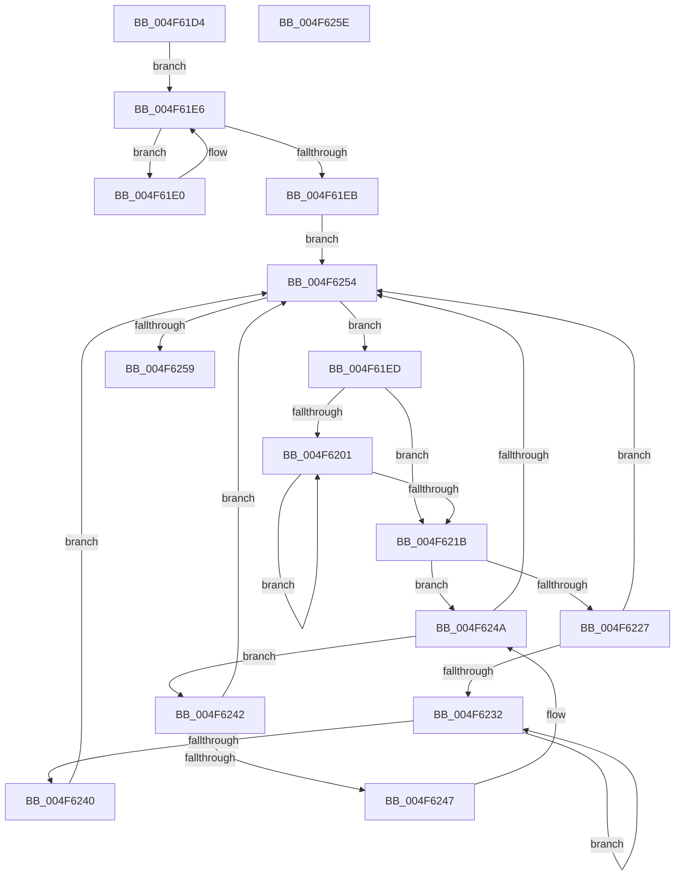

# MiMirrorDiscardTreePageContents

- RVA: `0x004F61D4`–`0x004F625F` (길이 `139` bytes)
- VA: `0x00000001404F61D4`
- 실행 섹션: `.text`
- PDB 이름 있음: `예`; PDB Function 태그: `아니요`
- unwind 정보 RVA: `0x0005C788`
- 디코드: `45`개 명령, `139/139` bytes 표시
- 미해석 바이트: `0` (있으면 어셈블리에 `.byte`로 보존)

> 이 문서는 커널 이미지의 기계어와 PDB 기호를 분석해 생성했습니다. 4번과 5번은 함수 원형과 자료형을 바이너리 사용 방식에서 추정한 C 해석이며 원본 소스 복구 결과는 아닙니다.

## 1. Dependencies

- 직접 호출 지점: **1**; 고유 호출 대상: **1**
- 직접 호출자로 확인된 함수: **1**
- RIP 상대 이미지 참조: **0**

### Outgoing calls
- `0x004F61F0` → [MiGetZeroingContext](../43/MiGetZeroingContext_function_00434FB0.md) (function, `0x00434FB0`)

### Direct callers
- [MiMirrorBlackPhase](../67/MiMirrorBlackPhase_function_00678B4C.md) at `0x00678BD8`
- [MiMirrorBlackPhase](../67/MiMirrorBlackPhase_function_00678B4C.md) at `0x00678BE4`

### Static image references
- 디코드된 RIP-relative 메모리 참조가 없습니다.

## 2. Other-region calls and transfers

- 다른 실행 섹션으로 향하는 call: **0**
- 별도 외부 분기/꼬리 이동을 확인하지 못했습니다.

## 3. Assembly (complete function range)

```asm
004F61D4  48 83 EC 28                     sub rsp, 0x28
004F61D8  48 8B 01                        mov rax, qword ptr [rcx]
004F61DB  45 33 C0                        xor r8d, r8d
004F61DE  EB 06                           jmp 0x1404f61e6
004F61E0  4C 8B C0                        mov r8, rax
004F61E3  48 8B 00                        mov rax, qword ptr [rax]
004F61E6  48 85 C0                        test rax, rax
004F61E9  75 F5                           jne 0x1404f61e0
004F61EB  EB 67                           jmp 0x1404f6254
004F61ED  49 8B C8                        mov rcx, r8
004F61F0  E8 BB ED F3 FF                  call 0x140434fb0
004F61F5  45 33 C9                        xor r9d, r9d
004F61F8  44 39 88 18 01 00 00            cmp dword ptr [rax + 0x118], r9d
004F61FF  76 1A                           jbe 0x1404f621b
004F6201  4A 8B 4C C8 18                  mov rcx, qword ptr [rax + r9*8 + 0x18]
004F6206  48 83 C9 02                     or rcx, 2
004F620A  4A 89 4C C8 18                  mov qword ptr [rax + r9*8 + 0x18], rcx
004F620F  41 FF C1                        inc r9d
004F6212  44 3B 88 18 01 00 00            cmp r9d, dword ptr [rax + 0x118]
004F6219  72 E6                           jb 0x1404f6201
004F621B  49 8B 40 08                     mov rax, qword ptr [r8 + 8]
004F621F  49 8B C8                        mov rcx, r8
004F6222  48 85 C0                        test rax, rax
004F6225  74 23                           je 0x1404f624a
004F6227  48 8B 08                        mov rcx, qword ptr [rax]
004F622A  4C 8B C0                        mov r8, rax
004F622D  48 85 C9                        test rcx, rcx
004F6230  74 22                           je 0x1404f6254
004F6232  48 8B 01                        mov rax, qword ptr [rcx]
004F6235  4C 8B C1                        mov r8, rcx
004F6238  48 8B C8                        mov rcx, rax
004F623B  48 85 C0                        test rax, rax
004F623E  75 F2                           jne 0x1404f6232
004F6240  EB 12                           jmp 0x1404f6254
004F6242  49 39 08                        cmp qword ptr [r8], rcx
004F6245  74 0D                           je 0x1404f6254
004F6247  49 8B C8                        mov rcx, r8
004F624A  4D 8B 40 10                     mov r8, qword ptr [r8 + 0x10]
004F624E  49 83 E0 FC                     and r8, 0xfffffffffffffffc
004F6252  75 EE                           jne 0x1404f6242
004F6254  4D 85 C0                        test r8, r8
004F6257  75 94                           jne 0x1404f61ed
004F6259  48 83 C4 28                     add rsp, 0x28
004F625D  C3                              ret
004F625E  CC                              int3
```

## 4. C-style interpretation (structured pseudocode)

```c
__int64 __fastcall MiMirrorDiscardTreePageContents(__int64 a1, __int64 a2, int a3, int a4)
{
    __int64 result;
    __int64 v_rsp;

    v_rsp = (v_rsp) - (40);
    a3 = 0;
    goto loc_004F61E6;
loc_004F61E0:
loc_004F61E6:
    if (*(unsigned __int64 *)(*(unsigned __int64 *)(a1)) != 0) goto loc_004F61E0;
    goto loc_004F6254;
loc_004F61ED:
    result = MiGetZeroingContext(*(unsigned __int64 *)(a1), a2, *(unsigned __int64 *)(a1), a4);
    a4 = 0;
    if ((*(unsigned int *)(result + 280)) <= 0) goto loc_004F621B;
loc_004F6201:
    a1 = (*(unsigned __int64 *)(result + a4 * 8 + 24)) | (2);
    *(unsigned __int64 *)(result + a4 * 8 + 24) = a1;
    a4 = (unsigned int)((a4) + 1);
    if (a4 < (*(unsigned int *)(result + 280))) goto loc_004F6201;
loc_004F621B:
    if (*(unsigned __int64 *)(*(unsigned __int64 *)(a1) + 8) == 0) goto loc_004F624A;
    if (*(unsigned __int64 *)(*(unsigned __int64 *)(*(unsigned __int64 *)(a1) + 8)) == 0) goto loc_004F6254;
loc_004F6232:
    if (*(unsigned __int64 *)(*(unsigned __int64 *)(*(unsigned __int64 *)(*(unsigned __int64 *)(a1) + 8))) != 0) goto loc_004F6232;
    goto loc_004F6254;
loc_004F6242:
    if ((*(unsigned __int64 *)(*(unsigned __int64 *)(*(unsigned __int64 *)(*(unsigned __int64 *)(a1) + 8)))) == (*(unsigned __int64 *)(*(unsigned __int64 *)(*(unsigned __int64 *)(*(unsigned __int64 *)(a1) + 8))))) goto loc_004F6254;
loc_004F624A:
    a3 = (*(unsigned __int64 *)(*(unsigned __int64 *)(*(unsigned __int64 *)(*(unsigned __int64 *)(a1) + 8)) + 16)) & (-4);
    if (condition_is_not_equal) goto loc_004F6242;
loc_004F6254:
    if (a3 != 0) goto loc_004F61ED;
    v_rsp = (v_rsp) + (40);
    return *(unsigned __int64 *)(*(unsigned __int64 *)(*(unsigned __int64 *)(*(unsigned __int64 *)(a1) + 8)));
}
```

## 5. (Beta) C Style

```c
int64_t MiMirrorDiscardTreePageContents(void *Arg1, int64_t Arg2, int32_t Arg3, int32_t Arg4)
{
    uint8_t *arg1 = (uint8_t *)Arg1;

    int64_t result;
    int64_t local_rsp;

    local_rsp = (local_rsp) - (40);
    Arg3 = 0;
    goto loc_004F61E6;
loc_004F61E0:
loc_004F61E6:
    if (*(uint64_t *)(*(uint64_t *)(arg1)) != 0) goto loc_004F61E0;
    goto loc_004F6254;
loc_004F61ED:
    result = MiGetZeroingContext(*(uint64_t *)(arg1), Arg2, *(uint64_t *)(arg1), Arg4);
    Arg4 = 0;
    if ((*(uint32_t *)(result + 0x118)) <= 0) goto loc_004F621B;
loc_004F6201:
    Arg1 = (*(uint64_t *)(result + Arg4 * 8 + 0x18)) | (2);
    *(void **)(result + Arg4 * 8 + 0x18) = Arg1;
    Arg4 = (uint32_t)((Arg4) + 1);
    if (Arg4 < (*(uint32_t *)(result + 0x118))) goto loc_004F6201;
loc_004F621B:
    if (*(uint64_t *)(*(uint64_t *)(arg1) + 0x8) == 0) goto loc_004F624A;
    if (*(uint64_t *)(*(uint64_t *)(*(uint64_t *)(arg1) + 0x8)) == 0) goto loc_004F6254;
loc_004F6232:
    if (*(uint64_t *)(*(uint64_t *)(*(uint64_t *)(*(uint64_t *)(arg1) + 0x8))) != 0) goto loc_004F6232;
    goto loc_004F6254;
loc_004F6242:
    if ((*(uint64_t *)(*(uint64_t *)(*(uint64_t *)(*(uint64_t *)(arg1) + 0x8)))) == (*(uint64_t *)(*(uint64_t *)(*(uint64_t *)(*(uint64_t *)(arg1) + 0x8))))) goto loc_004F6254;
loc_004F624A:
    Arg3 = (*(uint64_t *)(*(uint64_t *)(*(uint64_t *)(*(uint64_t *)(arg1) + 0x8)) + 0x10)) & (-4);
    if (condition_is_not_equal) goto loc_004F6242;
loc_004F6254:
    if (Arg3 != 0) goto loc_004F61ED;
    local_rsp = (local_rsp) + (40);
    return *(uint64_t *)(*(uint64_t *)(*(uint64_t *)(*(uint64_t *)(arg1) + 0x8)));
}
```

### 관측된 메모리 오프셋

구조체 형식이 확인되지 않은 접근은 인자 기준의 오프셋으로만 기록했습니다.

| 기준 인자 | 오프셋 표현 | 폭 (bit) | 접근 |
|---|---:|---:|---|
| `Arg1` | `+ 0x0` | `64` | `R` |

## 6. Execution-region graph

[열기: 2D/3D 그래프와 함수 탐색 컨트롤 패널](../../../control-panel.html?section=text&rva=0x004F61D4&view=graph)

- 2D 그래프는 위에서 아래로 흐르고, 3D 그래프는 빈 공간을 드래그해 회전합니다. Shift+드래그는 이동, 휠은 확대·축소, 함수 노드 선택은 대상 보고서 이동입니다.

### Static fallback


