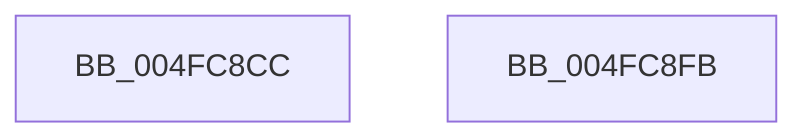

# MiMirrorNodeFreeZeroPages

- RVA: `0x004FC8CC`–`0x004FC8FC` (길이 `48` bytes)
- VA: `0x00000001404FC8CC`
- 실행 섹션: `.text`
- PDB 이름 있음: `예`; PDB Function 태그: `아니요`
- unwind 정보 RVA: `0x0005D2F4`
- 디코드: `12`개 명령, `48/48` bytes 표시
- 미해석 바이트: `0` (있으면 어셈블리에 `.byte`로 보존)

> 이 문서는 커널 이미지의 기계어와 PDB 기호를 분석해 생성했습니다. 4번과 5번은 함수 원형과 자료형을 바이너리 사용 방식에서 추정한 C 해석이며 원본 소스 복구 결과는 아닙니다.

## 1. Dependencies

- 직접 호출 지점: **1**; 고유 호출 대상: **1**
- 직접 호출자로 확인된 함수: **2**
- RIP 상대 이미지 참조: **1**

### Outgoing calls
- `0x004FC8F1` → [MiWalkAllFreeZeroLists](../4B/MiWalkAllFreeZeroLists_function_004BB6C8.md) (function, `0x004BB6C8`)

### Direct callers
- [MiMirrorReduceBlackWrites](../2B/MiMirrorReduceBlackWrites_function_002B7C50.md) at `0x002B7C92`
- [MiWalkPagesOnLists](../3B/MiWalkPagesOnLists_function_003B6AA4.md) at `0x003B6EF6`

### Static image references
- `0x004FC8DD` → RVA `0x00471DF0` (`MiMirrorZeroFreeListsCallback`; read)

## 2. Other-region calls and transfers

- 다른 실행 섹션으로 향하는 call: **0**
- 별도 외부 분기/꼬리 이동을 확인하지 못했습니다.

## 3. Assembly (complete function range)

```asm
004FC8CC  48 83 EC 38                     sub rsp, 0x38
004FC8D0  83 64 24 2C 00                  and dword ptr [rsp + 0x2c], 0
004FC8D5  48 8B C2                        mov rax, rdx
004FC8D8  48 89 4C 24 20                  mov qword ptr [rsp + 0x20], rcx
004FC8DD  48 8D 15 0C 55 F7 FF            lea rdx, [rip - 0x8aaf4]
004FC8E4  44 89 44 24 28                  mov dword ptr [rsp + 0x28], r8d
004FC8E9  48 8B C8                        mov rcx, rax
004FC8EC  4C 8D 44 24 20                  lea r8, [rsp + 0x20]
004FC8F1  E8 D2 ED FB FF                  call 0x1404bb6c8
004FC8F6  48 83 C4 38                     add rsp, 0x38
004FC8FA  C3                              ret
004FC8FB  CC                              int3
```

## 4. C-style interpretation (structured pseudocode)

```c
__int64 __fastcall MiMirrorNodeFreeZeroPages(__int64 a1, __int64 a2, int a3)
{
    __int64 result;
    __int64 v_rsp;
    unsigned int v_stack_m10;
    unsigned __int64 v_stack_m18;
    unsigned int v_stack_mC;

    v_rsp = (v_rsp) - (56);
    v_stack_m18 = a1;
    v_stack_m10 = a3;
    result = MiWalkAllFreeZeroLists(a2, v_rip - 568052, v_stack_m18, a4);
    v_rsp = (v_rsp) + (56);
    return result;
}
```

## 5. (Beta) C Style

```c
int64_t MiMirrorNodeFreeZeroPages(int64_t Arg1, int64_t Arg2, int32_t Arg3)
{
    int64_t result;
    int64_t local_rsp;
    uint32_t v_stack_m10;
    uint64_t v_stack_m18;
    uint32_t v_stack_mC;

    local_rsp = (local_rsp) - (56);
    v_stack_m18 = Arg1;
    v_stack_m10 = Arg3;
    result = MiWalkAllFreeZeroLists(Arg2, v_rip - 568052, v_stack_m18, a4);
    local_rsp = (local_rsp) + (56);
    return result;
}
```

## 6. Execution-region graph

[열기: 2D/3D 그래프와 함수 탐색 컨트롤 패널](../../../control-panel.html?section=text&rva=0x004FC8CC&view=graph)

- 2D 그래프는 위에서 아래로 흐르고, 3D 그래프는 빈 공간을 드래그해 회전합니다. Shift+드래그는 이동, 휠은 확대·축소, 함수 노드 선택은 대상 보고서 이동입니다.

### Static fallback


