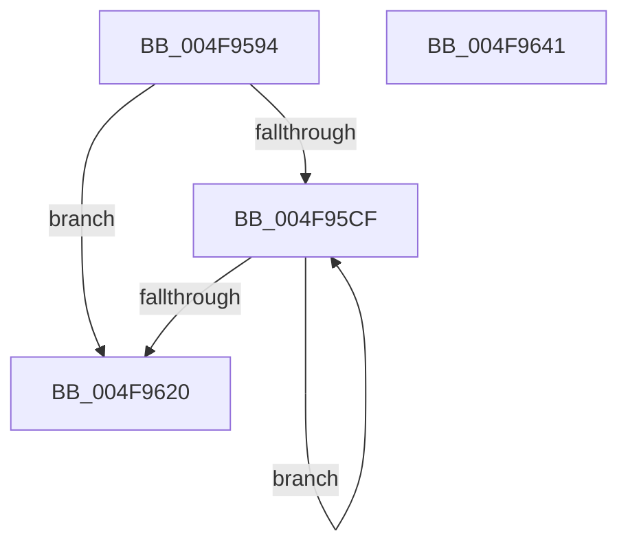

# MiPerformFinalZeroing

- RVA: `0x004F9594`–`0x004F9642` (길이 `174` bytes)
- VA: `0x00000001404F9594`
- 실행 섹션: `.text`
- PDB 이름 있음: `예`; PDB Function 태그: `아니요`
- unwind 정보 RVA: `0x00060300`
- 디코드: `48`개 명령, `174/174` bytes 표시
- 미해석 바이트: `0` (있으면 어셈블리에 `.byte`로 보존)

> 이 문서는 커널 이미지의 기계어와 PDB 기호를 분석해 생성했습니다. 4번과 5번은 함수 원형과 자료형을 바이너리 사용 방식에서 추정한 C 해석이며 원본 소스 복구 결과는 아닙니다.

## 1. Dependencies

- 직접 호출 지점: **4**; 고유 호출 대상: **4**
- 직접 호출자로 확인된 함수: **2**
- RIP 상대 이미지 참조: **1**

### Outgoing calls
- `0x004F95BB` → [MiChangePageAttributeBatch](../2A/MiChangePageAttributeBatch_function_002A06E0.md) (function, `0x002A06E0`)
- `0x004F95E8` → [MiGetPteLink](../29/MiGetPteLink_function_0029FC60.md) (function, `0x0029FC60`)
- `0x004F95FB` → [MiZeroPhysicalPage](../33/MiZeroPhysicalPage_function_00332590.md) (function, `0x00332590`)
- `0x004F960B` → [MiSetPfnTbFlushStamp](../2B/MiSetPfnTbFlushStamp_function_002B7A70.md) (function, `0x002B7A70`)

### Direct callers
- [sub_002B79A7](../2B/Unknown_function_002B79A7.md) at `0x002B79E3`
- [MiGetPageChain](../33/MiGetPageChain_function_00330130.md) at `0x0033068F`
- [MiGetPageChain](../33/MiGetPageChain_function_00330130.md) at `0x003308A9`
- [MiGetPageChain](../33/MiGetPageChain_function_00330130.md) at `0x003308B6`

### Static image references
- `0x004F9610` → RVA `0x00010880` (`.rdata`; read)

## 2. Other-region calls and transfers

- 다른 실행 섹션으로 향하는 call: **0**
- 별도 외부 분기/꼬리 이동을 확인하지 못했습니다.

## 3. Assembly (complete function range)

```asm
004F9594  48 89 5C 24 08                  mov qword ptr [rsp + 8], rbx
004F9599  48 89 6C 24 10                  mov qword ptr [rsp + 0x10], rbp
004F959E  48 89 74 24 18                  mov qword ptr [rsp + 0x18], rsi
004F95A3  57                              push rdi
004F95A4  41 56                           push r14
004F95A6  41 57                           push r15
004F95A8  48 83 EC 20                     sub rsp, 0x20
004F95AC  4C 8B 31                        mov r14, qword ptr [rcx]
004F95AF  45 8B C8                        mov r9d, r8d
004F95B2  49 83 C8 FF                     or r8, 0xffffffffffffffff
004F95B6  8B EA                           mov ebp, edx
004F95B8  48 8B F1                        mov rsi, rcx
004F95BB  E8 20 71 DA FF                  call 0x1402a06e0
004F95C0  49 BF FF FF FF FF 7F 00 00 00   movabs r15, 0x7fffffffff
004F95CA  4D 3B F7                        cmp r14, r15
004F95CD  74 51                           je 0x1404f9620
004F95CF  4B 8D 3C 76                     lea rdi, [r14 + r14*2]
004F95D3  48 C1 E7 04                     shl rdi, 4
004F95D7  48 B8 00 00 00 00 00 DE FF FF   movabs rax, 0xffffde0000000000
004F95E1  48 03 F8                        add rdi, rax
004F95E4  48 8B 4F 10                     mov rcx, qword ptr [rdi + 0x10]
004F95E8  E8 73 66 DA FF                  call 0x14029fc60
004F95ED  33 C9                           xor ecx, ecx
004F95EF  44 8B CD                        mov r9d, ebp
004F95F2  45 33 C0                        xor r8d, r8d
004F95F5  49 8B D6                        mov rdx, r14
004F95F8  48 8B D8                        mov rbx, rax
004F95FB  E8 90 8F E3 FF                  call 0x140332590
004F9600  45 33 C0                        xor r8d, r8d
004F9603  33 D2                           xor edx, edx
004F9605  48 8B CF                        mov rcx, rdi
004F9608  4C 8B F3                        mov r14, rbx
004F960B  E8 60 E4 DB FF                  call 0x1402b7a70
004F9610  48 8B 0D 69 72 B1 FF            mov rcx, qword ptr [rip - 0x4e8d97]
004F9617  48 89 4F 10                     mov qword ptr [rdi + 0x10], rcx
004F961B  49 3B DF                        cmp rbx, r15
004F961E  75 AF                           jne 0x1404f95cf
004F9620  48 83 66 08 00                  and qword ptr [rsi + 8], 0
004F9625  48 8B 5C 24 40                  mov rbx, qword ptr [rsp + 0x40]
004F962A  48 8B 6C 24 48                  mov rbp, qword ptr [rsp + 0x48]
004F962F  4C 89 3E                        mov qword ptr [rsi], r15
004F9632  48 8B 74 24 50                  mov rsi, qword ptr [rsp + 0x50]
004F9637  48 83 C4 20                     add rsp, 0x20
004F963B  41 5F                           pop r15
004F963D  41 5E                           pop r14
004F963F  5F                              pop rdi
004F9640  C3                              ret
004F9641  CC                              int3
```

## 4. C-style interpretation (structured pseudocode)

```c
__int64 __fastcall MiPerformFinalZeroing(__int64 a1, int a2, __int64 a3)
{
    __int64 result;
    __int64 v_rdi;
    __int64 v_rsp;
    unsigned __int64 v_stack_p10;
    unsigned __int64 v_stack_p18;
    unsigned __int64 v_stack_p8;

    v_stack_p8 = v_rbx;
    v_stack_p10 = v_rbp;
    v_stack_p18 = v_rsi;
    v_rsp = (v_rsp) - (32);
    a3 = (a3) | (-1);
    result = MiChangePageAttributeBatch(a1, a2, a3, (unsigned int)((unsigned int)(a3)));
    if ((*(unsigned __int64 *)(a1)) == v_r15) goto loc_004F9620;
loc_004F95CF:
    v_rdi = (*(unsigned __int64 *)(a1) + *(unsigned __int64 *)(a1) * 2) << (4);
    v_rdi = (v_rdi) + (result);
    result = MiGetPteLink(*(unsigned __int64 *)(v_rdi + 16), a2, a3, (unsigned int)((unsigned int)(a3)));
    a1 = 0;
    a3 = 0;
    result = MiZeroPhysicalPage(a1, *(unsigned __int64 *)(a1), a3, (unsigned int)((unsigned int)((unsigned int)(a2))));
    a3 = 0;
    a2 = 0;
    result = MiSetPfnTbFlushStamp(v_rdi, a2, a3, (unsigned int)((unsigned int)((unsigned int)(a2))));
    *(unsigned __int64 *)(v_rdi + 16) = *(unsigned __int64 *)(v_rip - 5148055);
    if (result != v_r15) goto loc_004F95CF;
loc_004F9620:
    *(unsigned __int64 *)(a1) = v_r15;
    v_rsp = (v_rsp) + (32);
    return result;
}
```

## 5. (Beta) C Style

```c
int64_t MiPerformFinalZeroing(void *Arg1, int32_t Arg2, int64_t Arg3)
{
    uint8_t *arg1 = (uint8_t *)Arg1;

    int64_t result;
    int64_t local_rdi;
    int64_t local_rsp;
    uint64_t v_stack_p10;
    uint64_t v_stack_p18;
    uint64_t v_stack_p8;

    v_stack_p8 = local_rbx;
    v_stack_p10 = local_rbp;
    v_stack_p18 = local_rsi;
    local_rsp = (local_rsp) - (32);
    Arg3 = (Arg3) | (-1);
    result = MiChangePageAttributeBatch(Arg1, Arg2, Arg3, (uint32_t)((uint32_t)(Arg3)));
    if ((*(uint64_t *)(arg1)) == local_r15) goto loc_004F9620;
loc_004F95CF:
    local_rdi = (*(uint64_t *)(arg1) + *(uint64_t *)(arg1) * 2) << (4);
    local_rdi = (local_rdi) + (result);
    result = MiGetPteLink(*(uint64_t *)(local_rdi + 0x10), Arg2, Arg3, (uint32_t)((uint32_t)(Arg3)));
    Arg1 = 0;
    Arg3 = 0;
    result = MiZeroPhysicalPage(Arg1, *(uint64_t *)(arg1), Arg3, (uint32_t)((uint32_t)((uint32_t)(Arg2))));
    Arg3 = 0;
    Arg2 = 0;
    result = MiSetPfnTbFlushStamp(local_rdi, Arg2, Arg3, (uint32_t)((uint32_t)((uint32_t)(Arg2))));
    *(uint64_t *)(local_rdi + 0x10) = *(uint64_t *)(v_rip - 0x4E8D97);
    if (result != local_r15) goto loc_004F95CF;
loc_004F9620:
    *(uint64_t *)(arg1) = local_r15;
    local_rsp = (local_rsp) + (32);
    return result;
}
```

### 관측된 메모리 오프셋

구조체 형식이 확인되지 않은 접근은 인자 기준의 오프셋으로만 기록했습니다.

| 기준 인자 | 오프셋 표현 | 폭 (bit) | 접근 |
|---|---:|---:|---|
| `Arg1` | `+ 0x0` | `64` | `R` |
| `Arg1` | `+ 0x0` | `64` | `W` |
| `Arg1` | `+ 0x8` | `64` | `R/W` |

## 6. Execution-region graph

[열기: 2D/3D 그래프와 함수 탐색 컨트롤 패널](../../../control-panel.html?section=text&rva=0x004F9594&view=graph)

- 2D 그래프는 위에서 아래로 흐르고, 3D 그래프는 빈 공간을 드래그해 회전합니다. Shift+드래그는 이동, 휠은 확대·축소, 함수 노드 선택은 대상 보고서 이동입니다.

### Static fallback


