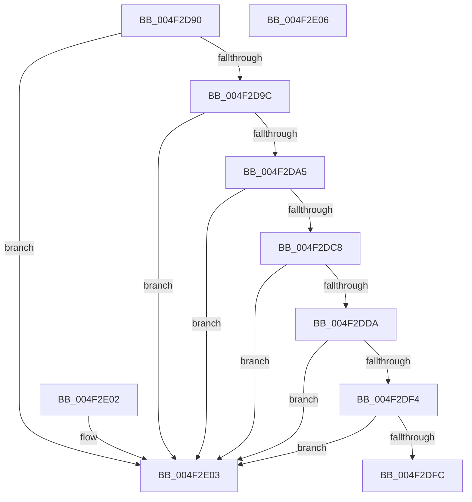

# MiPfnIsPageTable

- RVA: `0x004F2D90`–`0x004F2E07` (길이 `119` bytes)
- VA: `0x00000001404F2D90`
- 실행 섹션: `.text`
- PDB 이름 있음: `예`; PDB Function 태그: `아니요`
- unwind 정보 RVA: `0x000DB714`
- 디코드: `36`개 명령, `119/119` bytes 표시
- 미해석 바이트: `0` (있으면 어셈블리에 `.byte`로 보존)

> 이 문서는 커널 이미지의 기계어와 PDB 기호를 분석해 생성했습니다. 4번과 5번은 함수 원형과 자료형을 바이너리 사용 방식에서 추정한 C 해석이며 원본 소스 복구 결과는 아닙니다.

## 1. Dependencies

- 직접 호출 지점: **0**; 고유 호출 대상: **0**
- 직접 호출자로 확인된 함수: **3**
- RIP 상대 이미지 참조: **0**

### Outgoing calls
- 직접 디코드된 call 명령이 없습니다.

### Direct callers
- [MiCopyPfnEntryEx](../2B/MiCopyPfnEntryEx_function_002B2670.md) at `0x002B278C`
- [MiValidFault](../32/MiValidFault_function_003280B4.md) at `0x003283F0`
- [MiPfnIsActivePageTable](../4A/MiPfnIsActivePageTable_function_004AFFAC.md) at `0x004AFFB3`

### Static image references
- 디코드된 RIP-relative 메모리 참조가 없습니다.

## 2. Other-region calls and transfers

- 다른 실행 섹션으로 향하는 call: **0**
- 별도 외부 분기/꼬리 이동을 확인하지 못했습니다.

## 3. Assembly (complete function range)

```asm
004F2D90  8B 41 20                        mov eax, dword ptr [rcx + 0x20]
004F2D93  C1 E8 10                        shr eax, 0x10
004F2D96  24 07                           and al, 7
004F2D98  3C 06                           cmp al, 6
004F2D9A  75 67                           jne 0x1404f2e03
004F2D9C  48 8B 41 28                     mov rax, qword ptr [rcx + 0x28]
004F2DA0  48 85 C0                        test rax, rax
004F2DA3  78 5E                           js 0x1404f2e03
004F2DA5  48 8B 49 08                     mov rcx, qword ptr [rcx + 8]
004F2DA9  48 B8 00 00 00 00 00 00 00 80   movabs rax, 0x8000000000000000
004F2DB3  48 0B C8                        or rcx, rax
004F2DB6  49 B8 00 00 00 00 80 F6 FF FF   movabs r8, 0xfffff68000000000
004F2DC0  49 8B C0                        mov rax, r8
004F2DC3  48 3B C8                        cmp rcx, rax
004F2DC6  72 3B                           jb 0x1404f2e03
004F2DC8  48 BA FF FF FF FF FF F6 FF FF   movabs rdx, 0xfffff6ffffffffff
004F2DD2  48 8B C2                        mov rax, rdx
004F2DD5  48 3B C8                        cmp rcx, rax
004F2DD8  77 29                           ja 0x1404f2e03
004F2DDA  48 C1 E1 19                     shl rcx, 0x19
004F2DDE  49 8B C0                        mov rax, r8
004F2DE1  48 C1 E0 19                     shl rax, 0x19
004F2DE5  48 2B C8                        sub rcx, rax
004F2DE8  48 C1 F9 10                     sar rcx, 0x10
004F2DEC  49 8B C0                        mov rax, r8
004F2DEF  48 3B C8                        cmp rcx, rax
004F2DF2  72 0F                           jb 0x1404f2e03
004F2DF4  48 8B C2                        mov rax, rdx
004F2DF7  48 3B C8                        cmp rcx, rax
004F2DFA  77 07                           ja 0x1404f2e03
004F2DFC  B8 01 00 00 00                  mov eax, 1
004F2E01  C3                              ret
004F2E02  CC                              int3
004F2E03  33 C0                           xor eax, eax
004F2E05  C3                              ret
004F2E06  CC                              int3
```

## 4. C-style interpretation (structured pseudocode)

```c
__int64 __fastcall MiPfnIsPageTable(__int64 a1)
{
    __int64 result;

    result = (unsigned int)(((unsigned int)(*(unsigned int *)(a1 + 32))) >> (16));
    result = (unsigned __int8)((result) & (7));
    if (((unsigned __int8)(result)) != 6) goto loc_004F2E03;
    if (sign_flag) goto loc_004F2E03;
    a1 = (*(unsigned __int64 *)(a1 + 8)) | (*(unsigned __int64 *)(a1 + 40));
    if (a1 < a3) goto loc_004F2E03;
    if (a1 > a2) goto loc_004F2E03;
    a1 = (a1) << (25);
    result = (a3) << (25);
    a1 = (a1) - (result);
    a1 = (a1) >> (16);
    if (a1 < a3) goto loc_004F2E03;
    if (a1 > a2) goto loc_004F2E03;
    return 1;
loc_004F2E03:
    result = 0;
    return result;
}
```

## 5. (Beta) C Style

```c
int64_t MiPfnIsPageTable(void *Arg1)
{
    uint8_t *arg1 = (uint8_t *)Arg1;

    int64_t result;

    result = (uint32_t)(((uint32_t)(*(uint32_t *)(arg1 + 0x20))) >> (16));
    result = (uint8_t)((result) & (7));
    if (((uint8_t)(result)) != 6) goto loc_004F2E03;
    if (sign_flag) goto loc_004F2E03;
    Arg1 = (*(uint64_t *)(arg1 + 0x8)) | (*(uint64_t *)(arg1 + 0x28));
    if (Arg1 < a3) goto loc_004F2E03;
    if (Arg1 > a2) goto loc_004F2E03;
    Arg1 = (Arg1) << (25);
    result = (a3) << (25);
    Arg1 = (Arg1) - (result);
    Arg1 = (Arg1) >> (16);
    if (Arg1 < a3) goto loc_004F2E03;
    if (Arg1 > a2) goto loc_004F2E03;
    return 1;
loc_004F2E03:
    result = 0;
    return result;
}
```

### 관측된 메모리 오프셋

구조체 형식이 확인되지 않은 접근은 인자 기준의 오프셋으로만 기록했습니다.

| 기준 인자 | 오프셋 표현 | 폭 (bit) | 접근 |
|---|---:|---:|---|
| `Arg1` | `+ 0x8` | `64` | `R` |
| `Arg1` | `+ 0x20` | `32` | `R` |
| `Arg1` | `+ 0x28` | `64` | `R` |

## 6. Execution-region graph

[열기: 2D/3D 그래프와 함수 탐색 컨트롤 패널](../../../control-panel.html?section=text&rva=0x004F2D90&view=graph)

- 2D 그래프는 위에서 아래로 흐르고, 3D 그래프는 빈 공간을 드래그해 회전합니다. Shift+드래그는 이동, 휠은 확대·축소, 함수 노드 선택은 대상 보고서 이동입니다.

### Static fallback


