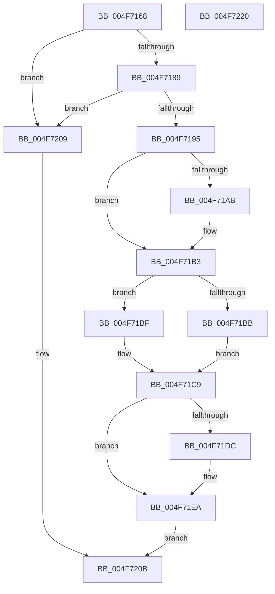

# MiQueueWorkingSetRequest

- RVA: `0x004F7168`–`0x004F7221` (길이 `185` bytes)
- VA: `0x00000001404F7168`
- 실행 섹션: `.text`
- PDB 이름 있음: `예`; PDB Function 태그: `아니요`
- unwind 정보 RVA: `0x00066400`
- 디코드: `54`개 명령, `185/185` bytes 표시
- 미해석 바이트: `0` (있으면 어셈블리에 `.byte`로 보존)

> 이 문서는 커널 이미지의 기계어와 PDB 기호를 분석해 생성했습니다. 4번과 5번은 함수 원형과 자료형을 바이너리 사용 방식에서 추정한 C 해석이며 원본 소스 복구 결과는 아닙니다.

## 1. Dependencies

- 직접 호출 지점: **5**; 고유 호출 대상: **5**
- 직접 호출자로 확인된 함수: **4**
- RIP 상대 이미지 참조: **1**

### Outgoing calls
- `0x004F719C` → [ExAcquireSpinLockExclusive](../24/ExAcquireSpinLockExclusive_function_00248690.md) (function, `0x00248690`)
- `0x004F71AE` → [KeResetEvent](../24/KeResetEvent_function_00248350.md) (function, `0x00248350`)
- `0x004F71D3` → [MiReleaseSpinLockExclusive](../24/MiReleaseSpinLockExclusive_function_002482C0.md) (function, `0x002482C0`)
- `0x004F71E5` → [KeSetEvent](../33/KeSetEvent_function_0033F310.md) (function, `0x0033F310`)
- `0x004F71FD` → [KeWaitForSingleObject](../20/KeWaitForSingleObject_function_0020E6B0.md) (function, `0x0020E6B0`)

### Direct callers
- [MiTrimNoStealPagesFromWorkingSets](../4B/MiTrimNoStealPagesFromWorkingSets_function_004BB268.md) at `0x004BB2A4`
- [MiCaptureAllWorkingSetAccessBits](MiCaptureAllWorkingSetAccessBits_function_004F7148.md) at `0x004F7156`
- [MiEmptyAllWorkingSets](../67/MiEmptyAllWorkingSets_function_0067E6C8.md) at `0x0067E6E4`
- [MmTrimFilePagesFromWorkingSets](../67/MmTrimFilePagesFromWorkingSets_function_0067EFB8.md) at `0x0067EFD3`

### Static image references
- `0x004F7195` → RVA `0x00E374C0` (`.data`; read)

## 2. Other-region calls and transfers

- 다른 실행 섹션으로 향하는 call: **0**
- 별도 외부 분기/꼬리 이동을 확인하지 못했습니다.

## 3. Assembly (complete function range)

```asm
004F7168  48 89 5C 24 08                  mov qword ptr [rsp + 8], rbx
004F716D  48 89 6C 24 10                  mov qword ptr [rsp + 0x10], rbp
004F7172  48 89 74 24 18                  mov qword ptr [rsp + 0x18], rsi
004F7177  57                              push rdi
004F7178  48 83 EC 30                     sub rsp, 0x30
004F717C  8B 41 04                        mov eax, dword ptr [rcx + 4]
004F717F  8B F2                           mov esi, edx
004F7181  A8 10                           test al, 0x10
004F7183  0F 85 80 00 00 00               jne 0x1404f7209
004F7189  48 8B 99 C0 44 00 00            mov rbx, qword ptr [rcx + 0x44c0]
004F7190  48 85 DB                        test rbx, rbx
004F7193  74 74                           je 0x1404f7209
004F7195  48 8D 0D 24 03 94 00            lea rcx, [rip + 0x940324]
004F719C  E8 EF 14 D5 FF                  call 0x140248690
004F71A1  8B 7B 28                        mov edi, dword ptr [rbx + 0x28]
004F71A4  40 8A E8                        mov bpl, al
004F71A7  85 FF                           test edi, edi
004F71A9  75 08                           jne 0x1404f71b3
004F71AB  48 8B CB                        mov rcx, rbx
004F71AE  E8 9D 11 D5 FF                  call 0x140248350
004F71B3  8B CF                           mov ecx, edi
004F71B5  23 CE                           and ecx, esi
004F71B7  3B CE                           cmp ecx, esi
004F71B9  75 04                           jne 0x1404f71bf
004F71BB  33 FF                           xor edi, edi
004F71BD  EB 0A                           jmp 0x1404f71c9
004F71BF  0B FE                           or edi, esi
004F71C1  89 7B 28                        mov dword ptr [rbx + 0x28], edi
004F71C4  BF 01 00 00 00                  mov edi, 1
004F71C9  40 8A D5                        mov dl, bpl
004F71CC  48 8D 0D ED 02 94 00            lea rcx, [rip + 0x9402ed]
004F71D3  E8 E8 10 D5 FF                  call 0x1402482c0
004F71D8  85 FF                           test edi, edi
004F71DA  74 0E                           je 0x1404f71ea
004F71DC  48 8D 4B 60                     lea rcx, [rbx + 0x60]
004F71E0  45 33 C0                        xor r8d, r8d
004F71E3  33 D2                           xor edx, edx
004F71E5  E8 26 81 E4 FF                  call 0x14033f310
004F71EA  48 83 64 24 20 00               and qword ptr [rsp + 0x20], 0
004F71F0  45 33 C9                        xor r9d, r9d
004F71F3  45 33 C0                        xor r8d, r8d
004F71F6  48 8B CB                        mov rcx, rbx
004F71F9  41 8D 51 12                     lea edx, [r9 + 0x12]
004F71FD  E8 AE 74 D1 FF                  call 0x14020e6b0
004F7202  B8 01 00 00 00                  mov eax, 1
004F7207  EB 02                           jmp 0x1404f720b
004F7209  33 C0                           xor eax, eax
004F720B  48 8B 5C 24 40                  mov rbx, qword ptr [rsp + 0x40]
004F7210  48 8B 6C 24 48                  mov rbp, qword ptr [rsp + 0x48]
004F7215  48 8B 74 24 50                  mov rsi, qword ptr [rsp + 0x50]
004F721A  48 83 C4 30                     add rsp, 0x30
004F721E  5F                              pop rdi
004F721F  C3                              ret
004F7220  CC                              int3
```

## 4. C-style interpretation (structured pseudocode)

```c
__int64 __fastcall MiQueueWorkingSetRequest(__int64 a1, int a2, int a3, int a4)
{
    __int64 result;
    __int64 v_rdi;
    __int64 v_rsp;
    unsigned __int64 v_stack_m18;
    unsigned __int64 v_stack_p10;
    unsigned __int64 v_stack_p18;
    unsigned __int64 v_stack_p8;

    v_stack_p8 = v_rbx;
    v_stack_p10 = v_rbp;
    v_stack_p18 = v_rsi;
    v_rsp = (v_rsp) - (48);
    if ((((unsigned __int8)((unsigned int)(*(unsigned int *)(a1 + 4)))) & (16)) != 0) goto loc_004F7209;
    if (*(unsigned __int64 *)(a1 + 17600) == 0) goto loc_004F7209;
    result = ExAcquireSpinLockExclusive(v_rip + 9700132, a2, a3, a4);
    if ((unsigned int)((unsigned int)(*(unsigned int *)(*(unsigned __int64 *)(a1 + 17600) + 40))) == 0) {
        a1 = *(unsigned __int64 *)(a1 + 17600);
        result = KeResetEvent(a1, a2, a3, a4);
    }
    a1 = (unsigned int)(((unsigned int)((unsigned int)((unsigned int)(*(unsigned int *)(*(unsigned __int64 *)(a1 + 17600) + 40))))) & ((unsigned int)((unsigned int)(a2))));
    if (((unsigned int)(a1)) != ((unsigned int)((unsigned int)(a2)))) goto loc_004F71BF;
    v_rdi = 0;
    goto loc_004F71C9;
loc_004F71BF:
    v_rdi = (unsigned int)((v_rdi) | ((unsigned int)((unsigned int)(a2))));
    *(unsigned int *)(*(unsigned __int64 *)(a1 + 17600) + 40) = (unsigned int)(v_rdi);
loc_004F71C9:
    result = MiReleaseSpinLockExclusive(v_rip + 9700077, (unsigned __int8)((unsigned __int8)(result)), a3, a4);
    if (1 != 0) {
        a1 = *(unsigned __int64 *)(a1 + 17600) + 96;
        a3 = 0;
        a2 = 0;
        result = KeSetEvent(a1, a2, a3, a4);
    }
    a4 = 0;
    a3 = 0;
    result = KeWaitForSingleObject(*(unsigned __int64 *)(a1 + 17600), a4 + 18, a3, a4);
    goto loc_004F720B;
loc_004F7209:
    result = 0;
loc_004F720B:
    v_rsp = (v_rsp) + (48);
    return result;
}
```

## 5. (Beta) C Style

```c
int64_t MiQueueWorkingSetRequest(void *Arg1, int32_t Arg2, int32_t Arg3, int32_t Arg4)
{
    uint8_t *arg1 = (uint8_t *)Arg1;

    int64_t result;
    int64_t local_rdi;
    int64_t local_rsp;
    uint64_t v_stack_m18;
    uint64_t v_stack_p10;
    uint64_t v_stack_p18;
    uint64_t v_stack_p8;

    v_stack_p8 = local_rbx;
    v_stack_p10 = local_rbp;
    v_stack_p18 = local_rsi;
    local_rsp = (local_rsp) - (48);
    if ((((uint8_t)((uint32_t)(*(uint32_t *)(arg1 + 0x4)))) & (16)) != 0) goto loc_004F7209;
    if (*(uint64_t *)(arg1 + 0x44C0) == 0) goto loc_004F7209;
    result = ExAcquireSpinLockExclusive(v_rip + 9700132, Arg2, Arg3, Arg4);
    if ((uint32_t)((uint32_t)(*(uint32_t *)(*(uint64_t *)(arg1 + 0x44C0) + 0x28))) == 0) {
        Arg1 = *(uint64_t *)(arg1 + 0x44C0);
        result = KeResetEvent(Arg1, Arg2, Arg3, Arg4);
    }
    Arg1 = (uint32_t)(((uint32_t)((uint32_t)((uint32_t)(*(uint32_t *)(*(uint64_t *)(arg1 + 0x44C0) + 0x28))))) & ((uint32_t)((uint32_t)(Arg2))));
    if (((uint32_t)(Arg1)) != ((uint32_t)((uint32_t)(Arg2)))) goto loc_004F71BF;
    local_rdi = 0;
    goto loc_004F71C9;
loc_004F71BF:
    local_rdi = (uint32_t)((local_rdi) | ((uint32_t)((uint32_t)(Arg2))));
    *(uint32_t *)(*(uint64_t *)(arg1 + 0x44C0) + 0x28) = (uint32_t)(local_rdi);
loc_004F71C9:
    result = MiReleaseSpinLockExclusive(v_rip + 9700077, (uint8_t)((uint8_t)(result)), Arg3, Arg4);
    if (1 != 0) {
        Arg1 = *(uint64_t *)(arg1 + 0x44C0) + 96;
        Arg3 = 0;
        Arg2 = 0;
        result = KeSetEvent(Arg1, Arg2, Arg3, Arg4);
    }
    Arg4 = 0;
    Arg3 = 0;
    result = KeWaitForSingleObject(*(uint64_t *)(arg1 + 0x44C0), Arg4 + 18, Arg3, Arg4);
    goto loc_004F720B;
loc_004F7209:
    result = 0;
loc_004F720B:
    local_rsp = (local_rsp) + (48);
    return result;
}
```

### 관측된 메모리 오프셋

구조체 형식이 확인되지 않은 접근은 인자 기준의 오프셋으로만 기록했습니다.

| 기준 인자 | 오프셋 표현 | 폭 (bit) | 접근 |
|---|---:|---:|---|
| `Arg1` | `+ 0x4` | `32` | `R` |
| `Arg1` | `+ 0x44C0` | `64` | `R` |

## 6. Execution-region graph

[열기: 2D/3D 그래프와 함수 탐색 컨트롤 패널](../../../control-panel.html?section=text&rva=0x004F7168&view=graph)

- 2D 그래프는 위에서 아래로 흐르고, 3D 그래프는 빈 공간을 드래그해 회전합니다. Shift+드래그는 이동, 휠은 확대·축소, 함수 노드 선택은 대상 보고서 이동입니다.

### Static fallback


