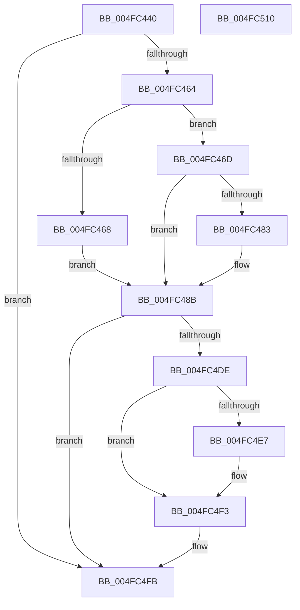

# MiRemoveFaultNode

- RVA: `0x004FC440`–`0x004FC511` (길이 `209` bytes)
- VA: `0x00000001404FC440`
- 실행 섹션: `.text`
- PDB 이름 있음: `예`; PDB Function 태그: `아니요`
- unwind 정보 RVA: `0x0005C954`
- 디코드: `51`개 명령, `209/209` bytes 표시
- 미해석 바이트: `0` (있으면 어셈블리에 `.byte`로 보존)

> 이 문서는 커널 이미지의 기계어와 PDB 기호를 분석해 생성했습니다. 4번과 5번은 함수 원형과 자료형을 바이너리 사용 방식에서 추정한 C 해석이며 원본 소스 복구 결과는 아닙니다.

## 1. Dependencies

- 직접 호출 지점: **5**; 고유 호출 대상: **5**
- 직접 호출자로 확인된 함수: **2**
- RIP 상대 이미지 참조: **5**

### Outgoing calls
- `0x004FC486` → [KiRaiseIrqlProcessIrqlFlags](KiRaiseIrqlProcessIrqlFlags_function_004F56FC.md) (function, `0x004F56FC`)
- `0x004FC4A8` → [ExAcquireSpinLockExclusiveAtDpcLevel](../24/ExAcquireSpinLockExclusiveAtDpcLevel_function_00248E80.md) (function, `0x00248E80`)
- `0x004FC4C4` → [RtlAvlRemoveNode](../29/RtlAvlRemoveNode_function_00296650.md) (function, `0x00296650`)
- `0x004FC4CC` → [ExReleaseSpinLockExclusiveFromDpcLevel](../24/ExReleaseSpinLockExclusiveFromDpcLevel_function_002497E0.md) (function, `0x002497E0`)
- `0x004FC4EE` → [KiLowerIrqlProcessIrqlFlags](KiLowerIrqlProcessIrqlFlags_function_004F5698.md) (function, `0x004F5698`)

### Direct callers
- [MiDereferenceHugeContext](../4D/MiDereferenceHugeContext_function_004D9664.md) at `0x004D97E6`
- [MiScrubLargePage](../69/MiScrubLargePage_function_006942E8.md) at `0x006947B7`
- [MiScrubLargePage](../69/MiScrubLargePage_function_006942E8.md) at `0x00694821`

### Static image references
- `0x004FC47A` → RVA `0x00FC6D20` (`ALMOSTRO`; read)
- `0x004FC491` → RVA `0x00E2FF20` (`.data`; read)
- `0x004FC49A` → RVA `0x00E2FF30` (`.data`; read)
- `0x004FC4AD` → RVA `0x00E2FF28` (`.data`; read)
- `0x004FC4B6` → RVA `0x00E2FF38` (`.data`; read)

## 2. Other-region calls and transfers

- 다른 실행 섹션으로 향하는 call: **0**
- 별도 외부 분기/꼬리 이동을 확인하지 못했습니다.

## 3. Assembly (complete function range)

```asm
004FC440  48 89 5C 24 08                  mov qword ptr [rsp + 8], rbx
004FC445  48 89 6C 24 10                  mov qword ptr [rsp + 0x10], rbp
004FC44A  48 89 74 24 18                  mov qword ptr [rsp + 0x18], rsi
004FC44F  57                              push rdi
004FC450  48 83 EC 20                     sub rsp, 0x20
004FC454  80 B9 45 01 00 00 00            cmp byte ptr [rcx + 0x145], 0
004FC45B  48 8B E9                        mov rbp, rcx
004FC45E  0F 84 97 00 00 00               je 0x1404fc4fb
004FC464  85 D2                           test edx, edx
004FC466  74 05                           je 0x1404fc46d
004FC468  40 B6 11                        mov sil, 0x11
004FC46B  EB 1E                           jmp 0x1404fc48b
004FC46D  44 0F 20 C6                     mov rsi, cr8
004FC471  BA 02 00 00 00                  mov edx, 2
004FC476  44 0F 22 C2                     mov cr8, rdx
004FC47A  83 3D 9F A8 AC 00 00            cmp dword ptr [rip + 0xaca89f], 0
004FC481  74 08                           je 0x1404fc48b
004FC483  40 8A CE                        mov cl, sil
004FC486  E8 71 92 FF FF                  call 0x1404f56fc
004FC48B  8A 9D 46 01 00 00               mov bl, byte ptr [rbp + 0x146]
004FC491  48 8D 05 88 3A 93 00            lea rax, [rip + 0x933a88]
004FC498  84 DB                           test bl, bl
004FC49A  48 8D 3D 8F 3A 93 00            lea rdi, [rip + 0x933a8f]
004FC4A1  48 0F 45 F8                     cmovne rdi, rax
004FC4A5  48 8B CF                        mov rcx, rdi
004FC4A8  E8 D3 C9 D4 FF                  call 0x140248e80
004FC4AD  48 8D 05 74 3A 93 00            lea rax, [rip + 0x933a74]
004FC4B4  84 DB                           test bl, bl
004FC4B6  48 8D 0D 7B 3A 93 00            lea rcx, [rip + 0x933a7b]
004FC4BD  48 8B D5                        mov rdx, rbp
004FC4C0  48 0F 45 C8                     cmovne rcx, rax
004FC4C4  E8 87 A1 D9 FF                  call 0x140296650
004FC4C9  48 8B CF                        mov rcx, rdi
004FC4CC  E8 0F D3 D4 FF                  call 0x1402497e0
004FC4D1  C6 85 45 01 00 00 00            mov byte ptr [rbp + 0x145], 0
004FC4D8  40 80 FE 11                     cmp sil, 0x11
004FC4DC  74 1D                           je 0x1404fc4fb
004FC4DE  83 3D 3B A8 AC 00 00            cmp dword ptr [rip + 0xaca83b], 0
004FC4E5  74 0C                           je 0x1404fc4f3
004FC4E7  44 0F 20 C1                     mov rcx, cr8
004FC4EB  40 8A D6                        mov dl, sil
004FC4EE  E8 A5 91 FF FF                  call 0x1404f5698
004FC4F3  40 0F B6 C6                     movzx eax, sil
004FC4F7  44 0F 22 C0                     mov cr8, rax
004FC4FB  48 8B 5C 24 30                  mov rbx, qword ptr [rsp + 0x30]
004FC500  48 8B 6C 24 38                  mov rbp, qword ptr [rsp + 0x38]
004FC505  48 8B 74 24 40                  mov rsi, qword ptr [rsp + 0x40]
004FC50A  48 83 C4 20                     add rsp, 0x20
004FC50E  5F                              pop rdi
004FC50F  C3                              ret
004FC510  CC                              int3
```

## 4. C-style interpretation (structured pseudocode)

```c
__int64 __fastcall MiRemoveFaultNode(__int64 a1, int a2)
{
    __int64 result;
    __int64 v_rdi;
    __int64 v_rsp;
    unsigned __int64 v_stack_p10;
    unsigned __int64 v_stack_p18;
    unsigned __int64 v_stack_p8;

    v_stack_p8 = v_rbx;
    v_stack_p10 = v_rbp;
    v_stack_p18 = v_rsi;
    v_rsp = (v_rsp) - (32);
    if ((*(unsigned __int8 *)(a1 + 325)) == 0) goto loc_004FC4FB;
    if (a2 == 0) goto loc_004FC46D;
    goto loc_004FC48B;
loc_004FC46D:
    if ((*(unsigned int *)(v_rip + 11315359)) != 0) {
        a1 = (unsigned __int8)(v_cr8);
        result = KiRaiseIrqlProcessIrqlFlags(a1, 2, a3, a4);
    }
    v_rdi = v_rip + 9648783;
    if ((unsigned __int8)(*(unsigned __int8 *)(a1 + 326)) != 0) { v_rdi = v_rip + 9648776; }
    result = ExAcquireSpinLockExclusiveAtDpcLevel(v_rdi, 2, a3, a4);
    a1 = v_rip + 9648763;
    if ((unsigned __int8)(*(unsigned __int8 *)(a1 + 326)) != 0) { a1 = v_rip + 9648756; }
    result = RtlAvlRemoveNode(a1, a1, a3, a4);
    result = ExReleaseSpinLockExclusiveFromDpcLevel(v_rdi, a1, a3, a4);
    *(unsigned __int8 *)(a1 + 325) = 0;
    if (((unsigned __int8)(v_cr8)) == 17) goto loc_004FC4FB;
    if ((*(unsigned int *)(v_rip + 11315259)) != 0) {
        a1 = 2;
        a2 = (unsigned __int8)(v_cr8);
        result = KiLowerIrqlProcessIrqlFlags(a1, a2, a3, a4);
    }
loc_004FC4FB:
    v_rsp = (v_rsp) + (32);
    return (unsigned __int8)(v_cr8);
}
```

## 5. (Beta) C Style

```c
int64_t MiRemoveFaultNode(void *Arg1, int32_t Arg2)
{
    uint8_t *arg1 = (uint8_t *)Arg1;

    int64_t result;
    int64_t local_rdi;
    int64_t local_rsp;
    uint64_t v_stack_p10;
    uint64_t v_stack_p18;
    uint64_t v_stack_p8;

    v_stack_p8 = local_rbx;
    v_stack_p10 = local_rbp;
    v_stack_p18 = local_rsi;
    local_rsp = (local_rsp) - (32);
    if ((*(uint8_t *)(arg1 + 0x145)) == 0) goto loc_004FC4FB;
    if (Arg2 == 0) goto loc_004FC46D;
    goto loc_004FC48B;
loc_004FC46D:
    if ((*(uint32_t *)(v_rip + 0xACA89F)) != 0) {
        Arg1 = (uint8_t)(v_cr8);
        result = KiRaiseIrqlProcessIrqlFlags(Arg1, 2, a3, a4);
    }
    local_rdi = v_rip + 9648783;
    if ((uint8_t)(*(uint8_t *)(arg1 + 0x146)) != 0) { local_rdi = v_rip + 9648776; }
    result = ExAcquireSpinLockExclusiveAtDpcLevel(local_rdi, 2, a3, a4);
    Arg1 = v_rip + 9648763;
    if ((uint8_t)(*(uint8_t *)(arg1 + 0x146)) != 0) { Arg1 = v_rip + 9648756; }
    result = RtlAvlRemoveNode(Arg1, Arg1, a3, a4);
    result = ExReleaseSpinLockExclusiveFromDpcLevel(local_rdi, Arg1, a3, a4);
    *(uint8_t *)(arg1 + 0x145) = 0;
    if (((uint8_t)(v_cr8)) == 17) goto loc_004FC4FB;
    if ((*(uint32_t *)(v_rip + 0xACA83B)) != 0) {
        Arg1 = 2;
        Arg2 = (uint8_t)(v_cr8);
        result = KiLowerIrqlProcessIrqlFlags(Arg1, Arg2, a3, a4);
    }
loc_004FC4FB:
    local_rsp = (local_rsp) + (32);
    return (uint8_t)(v_cr8);
}
```

### 관측된 메모리 오프셋

구조체 형식이 확인되지 않은 접근은 인자 기준의 오프셋으로만 기록했습니다.

| 기준 인자 | 오프셋 표현 | 폭 (bit) | 접근 |
|---|---:|---:|---|
| `Arg1` | `+ 0x145` | `8` | `R` |
| `Arg1` | `+ 0x145` | `8` | `W` |
| `Arg1` | `+ 0x146` | `8` | `R` |

## 6. Execution-region graph

[열기: 2D/3D 그래프와 함수 탐색 컨트롤 패널](../../../control-panel.html?section=text&rva=0x004FC440&view=graph)

- 2D 그래프는 위에서 아래로 흐르고, 3D 그래프는 빈 공간을 드래그해 회전합니다. Shift+드래그는 이동, 휠은 확대·축소, 함수 노드 선택은 대상 보고서 이동입니다.

### Static fallback


