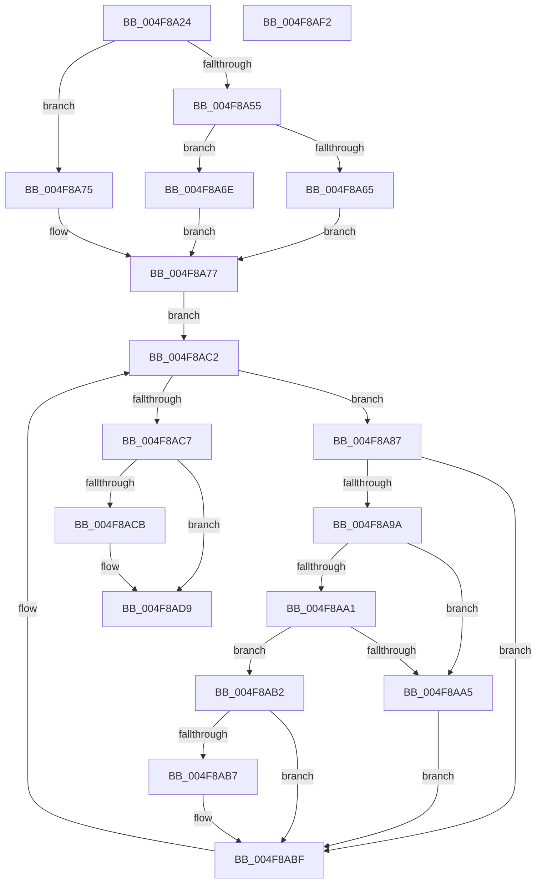

# MiReplicatePteChange

- RVA: `0x004F8A24`–`0x004F8AF3` (길이 `207` bytes)
- VA: `0x00000001404F8A24`
- 실행 섹션: `.text`
- PDB 이름 있음: `예`; PDB Function 태그: `아니요`
- unwind 정보 RVA: `0x000BF7E0`
- 디코드: `57`개 명령, `207/207` bytes 표시
- 미해석 바이트: `0` (있으면 어셈블리에 `.byte`로 보존)

> 이 문서는 커널 이미지의 기계어와 PDB 기호를 분석해 생성했습니다. 4번과 5번은 함수 원형과 자료형을 바이너리 사용 방식에서 추정한 C 해석이며 원본 소스 복구 결과는 아닙니다.

## 1. Dependencies

- 직접 호출 지점: **4**; 고유 호출 대상: **4**
- 직접 호출자로 확인된 함수: **6**
- RIP 상대 이미지 참조: **2**

### Outgoing calls
- `0x004F8A67` → [ExAcquireSpinLockExclusiveAtDpcLevel](../24/ExAcquireSpinLockExclusiveAtDpcLevel_function_00248E80.md) (function, `0x00248E80`)
- `0x004F8A6E` → [ExAcquireSpinLockExclusive](../24/ExAcquireSpinLockExclusive_function_00248690.md) (function, `0x00248690`)
- `0x004F8ABA` → [MiReplicatePteChangeToProcess](../69/MiReplicatePteChangeToProcess_function_00693D24.md) (function, `0x00693D24`)
- `0x004F8AD4` → [MiReleaseSpinLockExclusive](../24/MiReleaseSpinLockExclusive_function_002482C0.md) (function, `0x002482C0`)

### Direct callers
- [MiUnlockNestedPageTableWritePte](../23/MiUnlockNestedPageTableWritePte_function_0023F4E4.md) at `0x0023F6E5`
- [MiRewritePteWithLockBit](../32/MiRewritePteWithLockBit_function_00322FEC.md) at `0x00323248`
- [MiAllocateWsle](../33/MiAllocateWsle_function_003332C0.md) at `0x00333D82`
- [MiDeleteSystemPageTable](../49/MiDeleteSystemPageTable_function_004916B0.md) at `0x004918B8`
- [sub_006F15CE](../6F/Unknown_function_006F15CE.md) at `0x006F1728`
- [MiInitializeShadowPageTable](../../page/80/MiInitializeShadowPageTable_function_0080778C.md) at `0x0080796D`

### Static image references
- `0x004F8A59` → RVA `0x00E374C0` (`.data`; read)
- `0x004F8A77` → RVA `0x00E2DB58` (`.data`; read)

## 2. Other-region calls and transfers

- 다른 실행 섹션으로 향하는 call: **0**
- 별도 외부 분기/꼬리 이동을 확인하지 못했습니다.

## 3. Assembly (complete function range)

```asm
004F8A24  48 89 5C 24 08                  mov qword ptr [rsp + 8], rbx
004F8A29  48 89 6C 24 10                  mov qword ptr [rsp + 0x10], rbp
004F8A2E  48 89 74 24 18                  mov qword ptr [rsp + 0x18], rsi
004F8A33  57                              push rdi
004F8A34  41 55                           push r13
004F8A36  41 56                           push r14
004F8A38  48 83 EC 20                     sub rsp, 0x20
004F8A3C  65 48 8B 04 25 88 01 00 00      mov rax, qword ptr gs:[0x188]
004F8A45  8B F2                           mov esi, edx
004F8A47  4C 8B F1                        mov r14, rcx
004F8A4A  48 8B A8 B8 00 00 00            mov rbp, qword ptr [rax + 0xb8]
004F8A51  85 D2                           test edx, edx
004F8A53  75 20                           jne 0x1404f8a75
004F8A55  44 0F 20 C3                     mov rbx, cr8
004F8A59  48 8D 0D 60 EA 93 00            lea rcx, [rip + 0x93ea60]
004F8A60  80 FB 02                        cmp bl, 2
004F8A63  75 09                           jne 0x1404f8a6e
004F8A65  B3 11                           mov bl, 0x11
004F8A67  E8 14 04 D5 FF                  call 0x140248e80
004F8A6C  EB 09                           jmp 0x1404f8a77
004F8A6E  E8 1D FC D4 FF                  call 0x140248690
004F8A73  EB 02                           jmp 0x1404f8a77
004F8A75  B3 11                           mov bl, 0x11
004F8A77  48 8B 3D DA 50 93 00            mov rdi, qword ptr [rip + 0x9350da]
004F8A7E  4C 8D 2D D3 50 93 00            lea r13, [rip + 0x9350d3]
004F8A85  EB 3B                           jmp 0x1404f8ac2
004F8A87  48 8D 8F C0 FA FF FF            lea rcx, [rdi - 0x540]
004F8A8E  8B 81 F4 01 00 00               mov eax, dword ptr [rcx + 0x1f4]
004F8A94  0F BA E0 17                     bt eax, 0x17
004F8A98  72 25                           jb 0x1404f8abf
004F8A9A  A9 00 0C 00 00                  test eax, 0xc00
004F8A9F  74 04                           je 0x1404f8aa5
004F8AA1  84 C0                           test al, al
004F8AA3  79 0D                           jns 0x1404f8ab2
004F8AA5  F0 81 89 F4 01 00 00 00 00 80 00  lock or dword ptr [rcx + 0x1f4], 0x800000
004F8AB0  EB 0D                           jmp 0x1404f8abf
004F8AB2  48 3B CD                        cmp rcx, rbp
004F8AB5  74 08                           je 0x1404f8abf
004F8AB7  49 8B D6                        mov rdx, r14
004F8ABA  E8 65 B2 19 00                  call 0x140693d24
004F8ABF  48 8B 3F                        mov rdi, qword ptr [rdi]
004F8AC2  49 3B FD                        cmp rdi, r13
004F8AC5  75 C0                           jne 0x1404f8a87
004F8AC7  85 F6                           test esi, esi
004F8AC9  75 0E                           jne 0x1404f8ad9
004F8ACB  8A D3                           mov dl, bl
004F8ACD  48 8D 0D EC E9 93 00            lea rcx, [rip + 0x93e9ec]
004F8AD4  E8 E7 F7 D4 FF                  call 0x1402482c0
004F8AD9  48 8B 5C 24 40                  mov rbx, qword ptr [rsp + 0x40]
004F8ADE  48 8B 6C 24 48                  mov rbp, qword ptr [rsp + 0x48]
004F8AE3  48 8B 74 24 50                  mov rsi, qword ptr [rsp + 0x50]
004F8AE8  48 83 C4 20                     add rsp, 0x20
004F8AEC  41 5E                           pop r14
004F8AEE  41 5D                           pop r13
004F8AF0  5F                              pop rdi
004F8AF1  C3                              ret
004F8AF2  CC                              int3
```

## 4. C-style interpretation (structured pseudocode)

```c
__int64 __fastcall MiReplicatePteChange(__int64 a1, int a2)
{
    __int64 result;
    __int64 v_rsp;
    unsigned __int64 v_stack_p10;
    unsigned __int64 v_stack_p18;
    unsigned __int64 v_stack_p8;

    v_stack_p8 = v_rbx;
    v_stack_p10 = v_rbp;
    v_stack_p18 = v_rsi;
    v_rsp = (v_rsp) - (32);
    if (a2 != 0) goto loc_004F8A75;
    if (((unsigned __int8)(v_cr8)) != 2) goto loc_004F8A6E;
    result = ExAcquireSpinLockExclusiveAtDpcLevel(v_rip + 9693792, a2, a3, a4);
    goto loc_004F8A77;
loc_004F8A6E:
    result = ExAcquireSpinLockExclusive(v_rip + 9693792, a2, a3, a4);
    goto loc_004F8A77;
loc_004F8A75:
loc_004F8A77:
    goto loc_004F8AC2;
loc_004F8A87:
    if (((unsigned __int8)(v_cr8)) < 2) goto loc_004F8ABF;
    if ((((unsigned int)((unsigned int)(*(unsigned int *)(*(unsigned __int64 *)(v_rip + 9654490) - 1344 + 500)))) & (0xC00ULL)) == 0) goto loc_004F8AA5;
    if (!sign_flag) goto loc_004F8AB2;
loc_004F8AA5:
    goto loc_004F8ABF;
loc_004F8AB2:
    result = (unsigned int)(*(unsigned int *)(*(unsigned __int64 *)(v_rip + 9654490) - 1344 + 500));
    if ((*(unsigned __int64 *)(v_rip + 9654490) - 1344) != (*(unsigned __int64 *)(*(unsigned __int64 *)(gs_base + (0 + 392)) + 184))) {
        a2 = a1;
        result = MiReplicatePteChangeToProcess(*(unsigned __int64 *)(v_rip + 9654490) - 1344, a2, a3, a4);
    }
loc_004F8AC2:
    if ((*(unsigned __int64 *)(*(unsigned __int64 *)(v_rip + 9654490))) != (v_rip + 9654483)) goto loc_004F8A87;
    if ((unsigned int)((unsigned int)(a2)) == 0) {
        a2 = 17;
        a1 = v_rip + 9693676;
        result = MiReleaseSpinLockExclusive(a1, a2, a3, a4);
    }
    v_rsp = (v_rsp) + (32);
    return result;
}
```

## 5. (Beta) C Style

```c
int64_t MiReplicatePteChange(int64_t Arg1, int32_t Arg2)
{
    int64_t result;
    int64_t local_rsp;
    uint64_t v_stack_p10;
    uint64_t v_stack_p18;
    uint64_t v_stack_p8;

    v_stack_p8 = local_rbx;
    v_stack_p10 = local_rbp;
    v_stack_p18 = local_rsi;
    local_rsp = (local_rsp) - (32);
    if (Arg2 != 0) goto loc_004F8A75;
    if (((uint8_t)(v_cr8)) != 2) goto loc_004F8A6E;
    result = ExAcquireSpinLockExclusiveAtDpcLevel(v_rip + 9693792, Arg2, a3, a4);
    goto loc_004F8A77;
loc_004F8A6E:
    result = ExAcquireSpinLockExclusive(v_rip + 9693792, Arg2, a3, a4);
    goto loc_004F8A77;
loc_004F8A75:
loc_004F8A77:
    goto loc_004F8AC2;
loc_004F8A87:
    if (((uint8_t)(v_cr8)) < 2) goto loc_004F8ABF;
    if ((((uint32_t)((uint32_t)(*(uint32_t *)(*(uint64_t *)(v_rip + 0x9350DA) - 0x540 + 0x1F4)))) & (0xC00ULL)) == 0) goto loc_004F8AA5;
    if (!sign_flag) goto loc_004F8AB2;
loc_004F8AA5:
    goto loc_004F8ABF;
loc_004F8AB2:
    result = (uint32_t)(*(uint32_t *)(*(uint64_t *)(v_rip + 0x9350DA) - 0x540 + 0x1F4));
    if ((*(uint64_t *)(v_rip + 0x9350DA) - 1344) != (*(uint64_t *)(*(uint64_t *)(gs_base + (0 + 0x188)) + 0xB8))) {
        Arg2 = Arg1;
        result = MiReplicatePteChangeToProcess(*(uint64_t *)(v_rip + 0x9350DA) - 1344, Arg2, a3, a4);
    }
loc_004F8AC2:
    if ((*(uint64_t *)(*(uint64_t *)(v_rip + 0x9350DA))) != (v_rip + 9654483)) goto loc_004F8A87;
    if ((uint32_t)((uint32_t)(Arg2)) == 0) {
        Arg2 = 17;
        Arg1 = v_rip + 9693676;
        result = MiReleaseSpinLockExclusive(Arg1, Arg2, a3, a4);
    }
    local_rsp = (local_rsp) + (32);
    return result;
}
```

## 6. Execution-region graph

[열기: 2D/3D 그래프와 함수 탐색 컨트롤 패널](../../../control-panel.html?section=text&rva=0x004F8A24&view=graph)

- 2D 그래프는 위에서 아래로 흐르고, 3D 그래프는 빈 공간을 드래그해 회전합니다. Shift+드래그는 이동, 휠은 확대·축소, 함수 노드 선택은 대상 보고서 이동입니다.

### Static fallback


