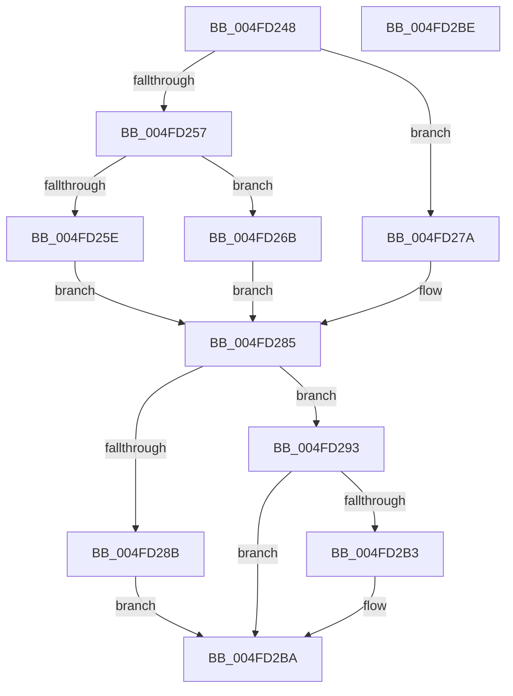

# MiRestrictSystemCodeProtection

- RVA: `0x004FD248`–`0x004FD2BF` (길이 `119` bytes)
- VA: `0x00000001404FD248`
- 실행 섹션: `.text`
- PDB 이름 있음: `예`; PDB Function 태그: `아니요`
- unwind 정보 RVA: `0x000DB714`
- 디코드: `36`개 명령, `119/119` bytes 표시
- 미해석 바이트: `0` (있으면 어셈블리에 `.byte`로 보존)

> 이 문서는 커널 이미지의 기계어와 PDB 기호를 분석해 생성했습니다. 4번과 5번은 함수 원형과 자료형을 바이너리 사용 방식에서 추정한 C 해석이며 원본 소스 복구 결과는 아닙니다.

## 1. Dependencies

- 직접 호출 지점: **0**; 고유 호출 대상: **0**
- 직접 호출자로 확인된 함수: **2**
- RIP 상대 이미지 참조: **0**

### Outgoing calls
- 직접 디코드된 call 명령이 없습니다.

### Direct callers
- [MiSetSystemCodeProtection](../38/MiSetSystemCodeProtection_function_00384420.md) at `0x00384B7B`
- [MiProtectLargeKernelHalRange](../../page/7F/MiProtectLargeKernelHalRange_function_007F8D20.md) at `0x007F8DE9`

### Static image references
- 디코드된 RIP-relative 메모리 참조가 없습니다.

## 2. Other-region calls and transfers

- 다른 실행 섹션으로 향하는 call: **0**
- 별도 외부 분기/꼬리 이동을 확인하지 못했습니다.

## 3. Assembly (complete function range)

```asm
004FD248  41 BB 04 00 00 00               mov r11d, 4
004FD24E  45 8D 53 FD                     lea r10d, [r11 - 3]
004FD252  41 84 CA                        test r10b, cl
004FD255  74 23                           je 0x1404fd27a
004FD257  48 0F BA E1 0B                  bt rcx, 0xb
004FD25C  73 0D                           jae 0x1404fd26b
004FD25E  48 85 C9                        test rcx, rcx
004FD261  45 8D 4B 02                     lea r9d, [r11 + 2]
004FD265  45 0F 48 CB                     cmovs r9d, r11d
004FD269  EB 1A                           jmp 0x1404fd285
004FD26B  48 85 C9                        test rcx, rcx
004FD26E  41 B9 03 00 00 00               mov r9d, 3
004FD274  45 0F 48 CA                     cmovs r9d, r10d
004FD278  EB 0B                           jmp 0x1404fd285
004FD27A  4C 8B C9                        mov r9, rcx
004FD27D  49 C1 E9 05                     shr r9, 5
004FD281  41 83 E1 1F                     and r9d, 0x1f
004FD285  41 F6 C1 07                     test r9b, 7
004FD289  75 08                           jne 0x1404fd293
004FD28B  41 B8 18 00 00 00               mov r8d, 0x18
004FD291  EB 27                           jmp 0x1404fd2ba
004FD293  44 8B C2                        mov r8d, edx
004FD296  41 83 E0 FD                     and r8d, 0xfffffffd
004FD29A  41 F6 C1 02                     test r9b, 2
004FD29E  44 0F 45 C2                     cmovne r8d, edx
004FD2A2  41 F6 C0 07                     test r8b, 7
004FD2A6  0F 95 C2                        setne dl
004FD2A9  45 84 CB                        test r11b, r9b
004FD2AC  0F 94 C1                        sete cl
004FD2AF  84 D1                           test cl, dl
004FD2B1  74 07                           je 0x1404fd2ba
004FD2B3  41 83 E0 02                     and r8d, 2
004FD2B7  45 0B C2                        or r8d, r10d
004FD2BA  41 8B C0                        mov eax, r8d
004FD2BD  C3                              ret
004FD2BE  CC                              int3
```

## 4. C-style interpretation (structured pseudocode)

```c
__int64 __fastcall MiRestrictSystemCodeProtection(__int64 a1, int a2)
{
    if ((((unsigned __int8)(4 - 3)) & ((unsigned __int8)(a1))) == 0) goto loc_004FD27A;
    if (condition_is_above_or_equal) goto loc_004FD26B;
    a4 = 4 + 2;
    if (sign_flag) { a4 = 4; }
    goto loc_004FD285;
loc_004FD26B:
    a4 = 3;
    if (sign_flag) { a4 = (unsigned int)(4 - 3); }
    goto loc_004FD285;
loc_004FD27A:
    a4 = (a1) >> (5);
    a4 = (unsigned int)((a4) & (31));
loc_004FD285:
    if ((((unsigned __int8)(a4)) & (7)) != 0) goto loc_004FD293;
    goto loc_004FD2BA;
loc_004FD293:
    a3 = (unsigned int)(((unsigned int)(a2)) & (0xFFFFFFFDULL));
    if ((((unsigned __int8)(a4)) & (2)) != 0) { a3 = a2; }
    a2 = ((((unsigned __int8)(a3)) & (7)) != 0) ? 1 : 0;
    a1 = (((4) & ((unsigned __int8)(a4))) == 0) ? 1 : 0;
    if ((((unsigned __int8)(a1)) & ((unsigned __int8)(a2))) != 0) {
        a3 = (unsigned int)((a3) & (2));
        a3 = (unsigned int)((a3) | ((unsigned int)(4 - 3)));
    }
    return (unsigned int)((unsigned int)(a3));
}
```

## 5. (Beta) C Style

```c
int64_t MiRestrictSystemCodeProtection(int64_t Arg1, int32_t Arg2)
{
    if ((((uint8_t)(4 - 3)) & ((uint8_t)(Arg1))) == 0) goto loc_004FD27A;
    if (condition_is_above_or_equal) goto loc_004FD26B;
    a4 = 4 + 2;
    if (sign_flag) { a4 = 4; }
    goto loc_004FD285;
loc_004FD26B:
    a4 = 3;
    if (sign_flag) { a4 = (uint32_t)(4 - 3); }
    goto loc_004FD285;
loc_004FD27A:
    a4 = (Arg1) >> (5);
    a4 = (uint32_t)((a4) & (31));
loc_004FD285:
    if ((((uint8_t)(a4)) & (7)) != 0) goto loc_004FD293;
    goto loc_004FD2BA;
loc_004FD293:
    a3 = (uint32_t)(((uint32_t)(Arg2)) & (0xFFFFFFFDULL));
    if ((((uint8_t)(a4)) & (2)) != 0) { a3 = Arg2; }
    Arg2 = ((((uint8_t)(a3)) & (7)) != 0) ? 1 : 0;
    Arg1 = (((4) & ((uint8_t)(a4))) == 0) ? 1 : 0;
    if ((((uint8_t)(Arg1)) & ((uint8_t)(Arg2))) != 0) {
        a3 = (uint32_t)((a3) & (2));
        a3 = (uint32_t)((a3) | ((uint32_t)(4 - 3)));
    }
    return (uint32_t)((uint32_t)(a3));
}
```

## 6. Execution-region graph

[열기: 2D/3D 그래프와 함수 탐색 컨트롤 패널](../../../control-panel.html?section=text&rva=0x004FD248&view=graph)

- 2D 그래프는 위에서 아래로 흐르고, 3D 그래프는 빈 공간을 드래그해 회전합니다. Shift+드래그는 이동, 휠은 확대·축소, 함수 노드 선택은 대상 보고서 이동입니다.

### Static fallback


