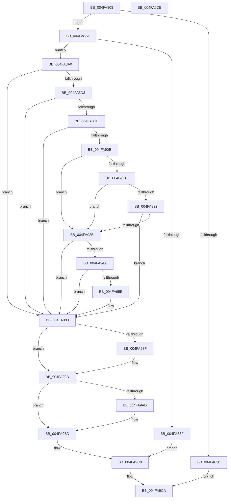

# MiSplitReducedCommitClonePage

- RVA: `0x004FA808`–`0x004FA9DC` (길이 `468` bytes)
- VA: `0x00000001404FA808`
- 실행 섹션: `.text`
- PDB 이름 있음: `예`; PDB Function 태그: `아니요`
- unwind 정보 RVA: `0x000BF984`
- 디코드: `123`개 명령, `468/468` bytes 표시
- 미해석 바이트: `0` (있으면 어셈블리에 `.byte`로 보존)

> 이 문서는 커널 이미지의 기계어와 PDB 기호를 분석해 생성했습니다. 4번과 5번은 함수 원형과 자료형을 바이너리 사용 방식에서 추정한 C 해석이며 원본 소스 복구 결과는 아닙니다.

## 1. Dependencies

- 직접 호출 지점: **14**; 고유 호출 대상: **11**
- 직접 호출자로 확인된 함수: **1**
- RIP 상대 이미지 참조: **0**

### Outgoing calls
- `0x004FA827` → [MiProcessCommitIntact](../40/MiProcessCommitIntact_function_004093C0.md) (function, `0x004093C0`)
- `0x004FA83D` → [MiUnlockProbePacketWorkingSet](../23/MiUnlockProbePacketWorkingSet_function_0023B800.md) (function, `0x0023B800`)
- `0x004FA879` → [LOCK_PAGE_TABLE_COMMITMENT](../2A/LOCK_PAGE_TABLE_COMMITMENT_function_002A6090.md) (function, `0x002A6090`)
- `0x004FA884` → [MiChargeFullProcessCommitment](../../page/88/MiChargeFullProcessCommitment_function_00887630.md) (function, `0x00887630`)
- `0x004FA896` → [UNLOCK_PAGE_TABLE_COMMITMENT](../2E/UNLOCK_PAGE_TABLE_COMMITMENT_function_002E27D0.md) (function, `0x002E27D0`)
- `0x004FA8A8` → [MiLockProbePacketWorkingSet](../40/MiLockProbePacketWorkingSet_function_0040E500.md) (function, `0x0040E500`)
- `0x004FA8BC` → [MiLockLowestValidPageTableEx](../28/MiLockLowestValidPageTableEx_function_00280D10.md) (function, `0x00280D10`)
- `0x004FA940` → [MiLocateCloneAddress](../3D/MiLocateCloneAddress_function_003D26B4.md) (function, `0x003D26B4`)
- `0x004FA976` → [MiCopyOnWrite](../36/MiCopyOnWrite_function_00362A0C.md) (function, `0x00362A0C`)
- `0x004FA986` → [MiUnlockProbePacketWorkingSet](../23/MiUnlockProbePacketWorkingSet_function_0023B800.md) (function, `0x0023B800`)
- `0x004FA998` → [MiReturnFullProcessCommitment](../../page/9E/MiReturnFullProcessCommitment_function_009E5D58.md) (function, `0x009E5D58`)
- `0x004FA9A4` → [UNLOCK_PAGE_TABLE_COMMITMENT](../2E/UNLOCK_PAGE_TABLE_COMMITMENT_function_002E27D0.md) (function, `0x002E27D0`)
- `0x004FA9B8` → [MiCopyOnWriteCheckConditions](../2A/MiCopyOnWriteCheckConditions_function_002A750C.md) (function, `0x002A750C`)
- `0x004FA9C3` → [MiLockProbePacketWorkingSet](../40/MiLockProbePacketWorkingSet_function_0040E500.md) (function, `0x0040E500`)

### Direct callers
- [sub_0023DA90](../23/Unknown_function_0023DA90.md) at `0x0023DACB`

### Static image references
- 디코드된 RIP-relative 메모리 참조가 없습니다.

## 2. Other-region calls and transfers

- 다른 실행 섹션으로 향하는 call: **2**
  - `0x004FA884` → [MiChargeFullProcessCommitment](../../page/88/MiChargeFullProcessCommitment_function_00887630.md) (`.text` → `PAGE`)
  - `0x004FA998` → [MiReturnFullProcessCommitment](../../page/9E/MiReturnFullProcessCommitment_function_009E5D58.md) (`.text` → `PAGE`)
- 별도 외부 분기/꼬리 이동을 확인하지 못했습니다.

## 3. Assembly (complete function range)

```asm
004FA808  48 89 5C 24 18                  mov qword ptr [rsp + 0x18], rbx
004FA80D  55                              push rbp
004FA80E  56                              push rsi
004FA80F  57                              push rdi
004FA810  41 56                           push r14
004FA812  41 57                           push r15
004FA814  48 83 EC 30                     sub rsp, 0x30
004FA818  48 8B D9                        mov rbx, rcx
004FA81B  45 33 FF                        xor r15d, r15d
004FA81E  48 8B 49 08                     mov rcx, qword ptr [rcx + 8]
004FA822  4C 89 7C 24 60                  mov qword ptr [rsp + 0x60], r15
004FA827  E8 94 EB F0 FF                  call 0x1404093c0
004FA82C  85 C0                           test eax, eax
004FA82E  75 0A                           jne 0x1404fa83a
004FA830  B8 05 00 00 C0                  mov eax, 0xc0000005
004FA835  E9 90 01 00 00                  jmp 0x1404fa9ca
004FA83A  48 8B CB                        mov rcx, rbx
004FA83D  E8 BE 0F D4 FF                  call 0x14023b800
004FA842  48 8B 73 08                     mov rsi, qword ptr [rbx + 8]
004FA846  48 B8 F8 FF FF FF 7F 00 00 00   movabs rax, 0x7ffffffff8
004FA850  48 C1 EE 09                     shr rsi, 9
004FA854  BD 01 00 00 00                  mov ebp, 1
004FA859  48 23 F0                        and rsi, rax
004FA85C  48 B8 00 00 00 00 80 F6 FF FF   movabs rax, 0xfffff68000000000
004FA866  65 4C 8B 34 25 88 01 00 00      mov r14, qword ptr gs:[0x188]
004FA86F  48 03 F0                        add rsi, rax
004FA872  48 8B 53 58                     mov rdx, qword ptr [rbx + 0x58]
004FA876  49 8B CE                        mov rcx, r14
004FA879  E8 12 B8 DA FF                  call 0x1402a6090
004FA87E  48 8B 4B 58                     mov rcx, qword ptr [rbx + 0x58]
004FA882  8B D5                           mov edx, ebp
004FA884  E8 A7 CD 38 00                  call 0x140887630
004FA889  8B F8                           mov edi, eax
004FA88B  85 C0                           test eax, eax
004FA88D  79 11                           jns 0x1404fa8a0
004FA88F  48 8B 53 58                     mov rdx, qword ptr [rbx + 0x58]
004FA893  49 8B CE                        mov rcx, r14
004FA896  E8 35 7F DE FF                  call 0x1402e27d0
004FA89B  E9 20 01 00 00                  jmp 0x1404fa9c0
004FA8A0  48 8B CB                        mov rcx, rbx
004FA8A3  4C 89 7C 24 68                  mov qword ptr [rsp + 0x68], r15
004FA8A8  E8 53 3C F1 FF                  call 0x14040e500
004FA8AD  48 8B 4B 68                     mov rcx, qword ptr [rbx + 0x68]
004FA8B1  4C 8D 44 24 60                  lea r8, [rsp + 0x60]
004FA8B6  45 33 C9                        xor r9d, r9d
004FA8B9  48 8B D6                        mov rdx, rsi
004FA8BC  E8 4F 64 D8 FF                  call 0x140280d10
004FA8C1  48 89 43 28                     mov qword ptr [rbx + 0x28], rax
004FA8C5  48 8B 44 24 60                  mov rax, qword ptr [rsp + 0x60]
004FA8CA  48 3B C6                        cmp rax, rsi
004FA8CD  0F 85 B0 00 00 00               jne 0x1404fa983
004FA8D3  48 8B 00                        mov rax, qword ptr [rax]
004FA8D6  40 84 C5                        test bpl, al
004FA8D9  0F 84 A4 00 00 00               je 0x1404fa983
004FA8DF  48 C1 E8 0C                     shr rax, 0xc
004FA8E3  48 B9 FF FF FF FF FF 00 00 00   movabs rcx, 0xffffffffff
004FA8ED  48 23 C1                        and rax, rcx
004FA8F0  48 8D 14 40                     lea rdx, [rax + rax*2]
004FA8F4  48 C1 E2 04                     shl rdx, 4
004FA8F8  48 B8 00 00 00 00 00 DE FF FF   movabs rax, 0xffffde0000000000
004FA902  48 03 D0                        add rdx, rax
004FA905  48 8B 42 28                     mov rax, qword ptr [rdx + 0x28]
004FA909  48 85 C0                        test rax, rax
004FA90C  79 75                           jns 0x1404fa983
004FA90E  48 8B 42 28                     mov rax, qword ptr [rdx + 0x28]
004FA912  48 0F BA E0 28                  bt rax, 0x28
004FA917  72 12                           jb 0x1404fa92b
004FA919  48 8B 42 08                     mov rax, qword ptr [rdx + 8]
004FA91D  48 85 C0                        test rax, rax
004FA920  78 09                           js 0x1404fa92b
004FA922  48 8B 42 08                     mov rax, qword ptr [rdx + 8]
004FA926  48 85 C0                        test rax, rax
004FA929  75 58                           jne 0x1404fa983
004FA92B  48 8B 52 08                     mov rdx, qword ptr [rdx + 8]
004FA92F  48 B8 00 00 00 00 00 00 00 80   movabs rax, 0x8000000000000000
004FA939  48 8B 4B 58                     mov rcx, qword ptr [rbx + 0x58]
004FA93D  48 0B D0                        or rdx, rax
004FA940  E8 6F 7D ED FF                  call 0x1403d26b4
004FA945  48 85 C0                        test rax, rax
004FA948  74 39                           je 0x1404fa983
004FA94A  48 8B 89 10 04 00 00            mov rcx, qword ptr [rcx + 0x410]
004FA951  48 8B 40 60                     mov rax, qword ptr [rax + 0x60]
004FA955  48 39 81 28 04 00 00            cmp qword ptr [rcx + 0x428], rax
004FA95C  76 25                           jbe 0x1404fa983
004FA95E  48 8B 4B 08                     mov rcx, qword ptr [rbx + 8]
004FA962  48 8D 44 24 68                  lea rax, [rsp + 0x68]
004FA967  45 33 C9                        xor r9d, r9d
004FA96A  48 89 44 24 20                  mov qword ptr [rsp + 0x20], rax
004FA96F  49 83 C8 FF                     or r8, 0xffffffffffffffff
004FA973  48 8B D6                        mov rdx, rsi
004FA976  E8 91 80 E6 FF                  call 0x140362a0c
004FA97B  85 C0                           test eax, eax
004FA97D  8B F8                           mov edi, eax
004FA97F  41 0F 49 EF                     cmovns ebp, r15d
004FA983  48 8B CB                        mov rcx, rbx
004FA986  E8 75 0E D4 FF                  call 0x14023b800
004FA98B  85 ED                           test ebp, ebp
004FA98D  74 0E                           je 0x1404fa99d
004FA98F  48 8B 4B 58                     mov rcx, qword ptr [rbx + 0x58]
004FA993  BA 01 00 00 00                  mov edx, 1
004FA998  E8 BB B3 4E 00                  call 0x1409e5d58
004FA99D  48 8B 53 58                     mov rdx, qword ptr [rbx + 0x58]
004FA9A1  49 8B CE                        mov rcx, r14
004FA9A4  E8 27 7E DE FF                  call 0x1402e27d0
004FA9A9  85 FF                           test edi, edi
004FA9AB  79 10                           jns 0x1404fa9bd
004FA9AD  4C 8B 44 24 68                  mov r8, qword ptr [rsp + 0x68]
004FA9B2  8B D7                           mov edx, edi
004FA9B4  48 8B 4B 68                     mov rcx, qword ptr [rbx + 0x68]
004FA9B8  E8 4F CB DA FF                  call 0x1402a750c
004FA9BD  41 8B FF                        mov edi, r15d
004FA9C0  48 8B CB                        mov rcx, rbx
004FA9C3  E8 38 3B F1 FF                  call 0x14040e500
004FA9C8  8B C7                           mov eax, edi
004FA9CA  48 8B 5C 24 70                  mov rbx, qword ptr [rsp + 0x70]
004FA9CF  48 83 C4 30                     add rsp, 0x30
004FA9D3  41 5F                           pop r15
004FA9D5  41 5E                           pop r14
004FA9D7  5F                              pop rdi
004FA9D8  5E                              pop rsi
004FA9D9  5D                              pop rbp
004FA9DA  C3                              ret
004FA9DB  CC                              int3
```

## 4. C-style interpretation (structured pseudocode)

```c
__int64 __fastcall MiSplitReducedCommitClonePage(__int64 a1, __int64 a2, __int64 a3, int a4)
{
    __int64 result;
    __int64 v_r15;
    __int64 v_rbp;
    __int64 v_rdi;
    __int64 v_rsi;
    __int64 v_rsp;
    unsigned __int64 v_stack_m38;
    unsigned __int64 v_stack_p10;
    unsigned __int64 v_stack_p18;
    unsigned __int64 v_stack_p8;

    v_stack_p18 = v_rbx;
    v_rsp = (v_rsp) - (48);
    v_r15 = 0;
    v_stack_p8 = 0;
    result = MiProcessCommitIntact(*(unsigned __int64 *)(a1 + 8), a2, a3, a4);
    if ((unsigned int)(result) != 0) goto loc_004FA83A;
    goto loc_004FA9CA;
loc_004FA83A:
    result = MiUnlockProbePacketWorkingSet(a1, a2, a3, a4);
    v_rsi = (*(unsigned __int64 *)(a1 + 8)) >> (9);
    v_rsi = (v_rsi) & (result);
    v_rsi = (v_rsi) + (result);
    result = LOCK_PAGE_TABLE_COMMITMENT(*(unsigned __int64 *)(gs_base + (0 + 392)), *(unsigned __int64 *)(a1 + 88), a3, a4);
    result = MiChargeFullProcessCommitment(*(unsigned __int64 *)(a1 + 88), 1, a3, a4);
    if (!sign_flag) goto loc_004FA8A0;
    result = UNLOCK_PAGE_TABLE_COMMITMENT(*(unsigned __int64 *)(gs_base + (0 + 392)), *(unsigned __int64 *)(a1 + 88), a3, a4);
    goto loc_004FA9C0;
loc_004FA8A0:
    v_stack_p10 = 0;
    result = MiLockProbePacketWorkingSet(a1, *(unsigned __int64 *)(a1 + 88), a3, a4);
    a4 = 0;
    result = MiLockLowestValidPageTableEx(*(unsigned __int64 *)(a1 + 104), v_rsi, v_stack_p8, a4);
    *(unsigned __int64 *)(a1 + 40) = result;
    if (v_stack_p8 != v_rsi) goto loc_004FA983;
    if (((1) & ((unsigned __int8)(*(unsigned __int64 *)(v_stack_p8)))) == 0) goto loc_004FA983;
    result = (*(unsigned __int64 *)(v_stack_p8)) >> (12);
    result = (result) & (*(unsigned __int64 *)(a1 + 104));
    a2 = (result + result * 2) << (4);
    a2 = (a2) + (result);
    if (!sign_flag) goto loc_004FA983;
    if (condition_is_below) goto loc_004FA92B;
    if (sign_flag) goto loc_004FA92B;
    if (*(unsigned __int64 *)(a2 + 8) != 0) goto loc_004FA983;
loc_004FA92B:
    a2 = (*(unsigned __int64 *)(a2 + 8)) | (*(unsigned __int64 *)(a2 + 8));
    result = MiLocateCloneAddress(*(unsigned __int64 *)(a1 + 88), a2, v_stack_p8, a4);
    if (result == 0) goto loc_004FA983;
    result = *(unsigned __int64 *)(result + 96);
    v_rdi = (unsigned int)((unsigned int)(result));
    v_rbp = 1;
    if ((*(unsigned __int64 *)(*(unsigned __int64 *)(*(unsigned __int64 *)(a1 + 88) + 1040) + 1064)) >= = (*(unsigned __int64 *)(result + 96))) {
        a1 = *(unsigned __int64 *)(a1 + 8);
        result = v_stack_p10;
        a4 = 0;
        v_stack_m38 = result;
        a3 = (v_stack_p8) | (-1);
        a2 = v_rsi;
        result = MiCopyOnWrite(a1, a2, a3, a4);
        v_rdi = (unsigned int)(result);
        v_rbp = 1;
        if (!sign_flag) { v_rbp = 0; }
    }
    result = MiUnlockProbePacketWorkingSet(a1, a2, a3, a4);
    if ((unsigned int)(v_rbp) != 0) {
        a1 = *(unsigned __int64 *)(a1 + 88);
        a2 = 1;
        result = MiReturnFullProcessCommitment(a1, a2, a3, a4);
    }
    result = UNLOCK_PAGE_TABLE_COMMITMENT(*(unsigned __int64 *)(gs_base + (0 + 392)), *(unsigned __int64 *)(a1 + 88), a3, a4);
    if (sign_flag) {
        a3 = v_stack_p10;
        a2 = (unsigned int)(v_rdi);
        a1 = *(unsigned __int64 *)(a1 + 104);
        result = MiCopyOnWriteCheckConditions(a1, a2, a3, a4);
    }
loc_004FA9C0:
    result = MiLockProbePacketWorkingSet(a1, a2, a3, a4);
loc_004FA9CA:
    v_rsp = (v_rsp) + (48);
    return 0;
}
```

## 5. (Beta) C Style

```c
int64_t MiSplitReducedCommitClonePage(void *Arg1, int64_t Arg2, int64_t Arg3, int32_t Arg4)
{
    uint8_t *arg1 = (uint8_t *)Arg1;

    int64_t result;
    int64_t local_r15;
    int64_t local_rbp;
    int64_t local_rdi;
    int64_t local_rsi;
    int64_t local_rsp;
    uint64_t v_stack_m38;
    uint64_t v_stack_p10;
    uint64_t v_stack_p18;
    uint64_t v_stack_p8;

    v_stack_p18 = local_rbx;
    local_rsp = (local_rsp) - (48);
    local_r15 = 0;
    v_stack_p8 = 0;
    result = MiProcessCommitIntact(*(uint64_t *)(arg1 + 0x8), Arg2, Arg3, Arg4);
    if ((uint32_t)(result) != 0) goto loc_004FA83A;
    goto loc_004FA9CA;
loc_004FA83A:
    result = MiUnlockProbePacketWorkingSet(Arg1, Arg2, Arg3, Arg4);
    local_rsi = (*(uint64_t *)(arg1 + 0x8)) >> (9);
    local_rsi = (local_rsi) & (result);
    local_rsi = (local_rsi) + (result);
    result = LOCK_PAGE_TABLE_COMMITMENT(*(uint64_t *)(gs_base + (0 + 0x188)), *(uint64_t *)(arg1 + 0x58), Arg3, Arg4);
    result = MiChargeFullProcessCommitment(*(uint64_t *)(arg1 + 0x58), 1, Arg3, Arg4);
    if (!sign_flag) goto loc_004FA8A0;
    result = UNLOCK_PAGE_TABLE_COMMITMENT(*(uint64_t *)(gs_base + (0 + 0x188)), *(uint64_t *)(arg1 + 0x58), Arg3, Arg4);
    goto loc_004FA9C0;
loc_004FA8A0:
    v_stack_p10 = 0;
    result = MiLockProbePacketWorkingSet(Arg1, *(uint64_t *)(arg1 + 0x58), Arg3, Arg4);
    Arg4 = 0;
    result = MiLockLowestValidPageTableEx(*(uint64_t *)(arg1 + 0x68), local_rsi, v_stack_p8, Arg4);
    *(uint64_t *)(arg1 + 0x28) = result;
    if (v_stack_p8 != local_rsi) goto loc_004FA983;
    if (((1) & ((uint8_t)(*(uint64_t *)(v_stack_p8)))) == 0) goto loc_004FA983;
    result = (*(uint64_t *)(v_stack_p8)) >> (12);
    result = (result) & (*(uint64_t *)(arg1 + 0x68));
    Arg2 = (result + result * 2) << (4);
    Arg2 = (Arg2) + (result);
    if (!sign_flag) goto loc_004FA983;
    if (condition_is_below) goto loc_004FA92B;
    if (sign_flag) goto loc_004FA92B;
    if (*(uint64_t *)(Arg2 + 0x8) != 0) goto loc_004FA983;
loc_004FA92B:
    Arg2 = (*(uint64_t *)(Arg2 + 0x8)) | (*(uint64_t *)(Arg2 + 0x8));
    result = MiLocateCloneAddress(*(uint64_t *)(arg1 + 0x58), Arg2, v_stack_p8, Arg4);
    if (result == 0) goto loc_004FA983;
    result = *(uint64_t *)(result + 0x60);
    local_rdi = (uint32_t)((uint32_t)(result));
    local_rbp = 1;
    if ((*(uint64_t *)(*(uint64_t *)(*(uint64_t *)(arg1 + 0x58) + 0x410) + 0x428)) >= = (*(uint64_t *)(result + 0x60))) {
        Arg1 = *(uint64_t *)(arg1 + 0x8);
        result = v_stack_p10;
        Arg4 = 0;
        v_stack_m38 = result;
        Arg3 = (v_stack_p8) | (-1);
        Arg2 = local_rsi;
        result = MiCopyOnWrite(Arg1, Arg2, Arg3, Arg4);
        local_rdi = (uint32_t)(result);
        local_rbp = 1;
        if (!sign_flag) { local_rbp = 0; }
    }
    result = MiUnlockProbePacketWorkingSet(Arg1, Arg2, Arg3, Arg4);
    if ((uint32_t)(local_rbp) != 0) {
        Arg1 = *(uint64_t *)(arg1 + 0x58);
        Arg2 = 1;
        result = MiReturnFullProcessCommitment(Arg1, Arg2, Arg3, Arg4);
    }
    result = UNLOCK_PAGE_TABLE_COMMITMENT(*(uint64_t *)(gs_base + (0 + 0x188)), *(uint64_t *)(arg1 + 0x58), Arg3, Arg4);
    if (sign_flag) {
        Arg3 = v_stack_p10;
        Arg2 = (uint32_t)(local_rdi);
        Arg1 = *(uint64_t *)(arg1 + 0x68);
        result = MiCopyOnWriteCheckConditions(Arg1, Arg2, Arg3, Arg4);
    }
loc_004FA9C0:
    result = MiLockProbePacketWorkingSet(Arg1, Arg2, Arg3, Arg4);
loc_004FA9CA:
    local_rsp = (local_rsp) + (48);
    return 0;
}
```

### 관측된 메모리 오프셋

구조체 형식이 확인되지 않은 접근은 인자 기준의 오프셋으로만 기록했습니다.

| 기준 인자 | 오프셋 표현 | 폭 (bit) | 접근 |
|---|---:|---:|---|
| `Arg1` | `+ 0x8` | `64` | `R` |
| `Arg1` | `+ 0x28` | `64` | `W` |
| `Arg1` | `+ 0x58` | `64` | `R` |
| `Arg1` | `+ 0x68` | `64` | `R` |

## 6. Execution-region graph

[열기: 2D/3D 그래프와 함수 탐색 컨트롤 패널](../../../control-panel.html?section=text&rva=0x004FA808&view=graph)

- 2D 그래프는 위에서 아래로 흐르고, 3D 그래프는 빈 공간을 드래그해 회전합니다. Shift+드래그는 이동, 휠은 확대·축소, 함수 노드 선택은 대상 보고서 이동입니다.

### Static fallback


