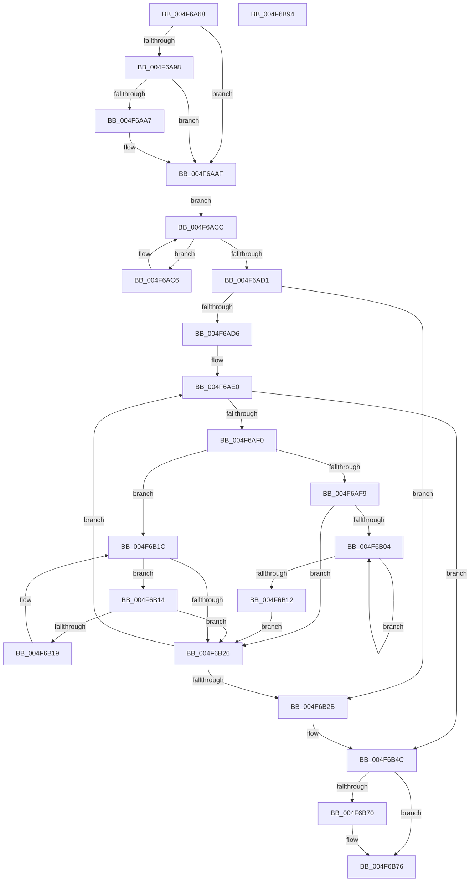

# MiStopHugePageAccessor

- RVA: `0x004F6A68`–`0x004F6B95` (길이 `301` bytes)
- VA: `0x00000001404F6A68`
- 실행 섹션: `.text`
- PDB 이름 있음: `예`; PDB Function 태그: `아니요`
- unwind 정보 RVA: `0x0005D7BC`
- 디코드: `86`개 명령, `301/301` bytes 표시
- 미해석 바이트: `0` (있으면 어셈블리에 `.byte`로 보존)

> 이 문서는 커널 이미지의 기계어와 PDB 기호를 분석해 생성했습니다. 4번과 5번은 함수 원형과 자료형을 바이너리 사용 방식에서 추정한 C 해석이며 원본 소스 복구 결과는 아닙니다.

## 1. Dependencies

- 직접 호출 지점: **5**; 고유 호출 대상: **5**
- 직접 호출자로 확인된 함수: **2**
- RIP 상대 이미지 참조: **3**

### Outgoing calls
- `0x004F6AA7` → [MiLockHugeRangeColorHeadAtDpc](MiLockHugeRangeColorHeadAtDpc_function_004FAD14.md) (function, `0x004FAD14`)
- `0x004F6AB6` → [ExAcquireSpinLockSharedAtDpcLevel](../24/ExAcquireSpinLockSharedAtDpcLevel_function_00248E30.md) (function, `0x00248E30`)
- `0x004F6AE6` → [MiLocatePageCollisionByPfn](../33/MiLocatePageCollisionByPfn_function_00337CC0.md) (function, `0x00337CC0`)
- `0x004F6B46` → [KeBugCheckEx](KeBugCheckEx_function_004FD660.md) (function, `0x004FD660`)
- `0x004F6B66` → [ExReleaseSpinLockSharedFromDpcLevel](../24/ExReleaseSpinLockSharedFromDpcLevel_function_0024A590.md) (function, `0x0024A590`)

### Direct callers
- [MiPageFreeToZero](../33/MiPageFreeToZero_function_00337A30.md) at `0x00337C55`
- [MiStopPageAccessor](../43/MiStopPageAccessor_function_00436BB8.md) at `0x00436CB2`

### Static image references
- `0x004F6A86` → RVA `0x00E300C0` (`.data`; read)
- `0x004F6AAF` → RVA `0x00E2FF30` (`.data`; read)
- `0x004F6ABB` → RVA `0x00E2FF38` (`.data`; read)

## 2. Other-region calls and transfers

- 다른 실행 섹션으로 향하는 call: **0**
- 별도 외부 분기/꼬리 이동을 확인하지 못했습니다.

## 3. Assembly (complete function range)

```asm
004F6A68  48 8B C4                        mov rax, rsp
004F6A6B  48 89 58 08                     mov qword ptr [rax + 8], rbx
004F6A6F  48 89 68 10                     mov qword ptr [rax + 0x10], rbp
004F6A73  48 89 70 18                     mov qword ptr [rax + 0x18], rsi
004F6A77  48 89 78 20                     mov qword ptr [rax + 0x20], rdi
004F6A7B  41 56                           push r14
004F6A7D  48 83 EC 30                     sub rsp, 0x30
004F6A81  48 8B D9                        mov rbx, rcx
004F6A84  33 ED                           xor ebp, ebp
004F6A86  48 2B 1D 33 96 93 00            sub rbx, qword ptr [rip + 0x939633]
004F6A8D  48 8B F1                        mov rsi, rcx
004F6A90  48 C1 FB 03                     sar rbx, 3
004F6A94  85 D2                           test edx, edx
004F6A96  75 17                           jne 0x1404f6aaf
004F6A98  48 8B 01                        mov rax, qword ptr [rcx]
004F6A9B  83 E0 07                        and eax, 7
004F6A9E  48 FF C8                        dec rax
004F6AA1  48 83 F8 01                     cmp rax, 1
004F6AA5  77 08                           ja 0x1404f6aaf
004F6AA7  E8 68 42 00 00                  call 0x1404fad14
004F6AAC  48 8B E8                        mov rbp, rax
004F6AAF  48 8D 0D 7A 94 93 00            lea rcx, [rip + 0x93947a]
004F6AB6  E8 75 23 D5 FF                  call 0x140248e30
004F6ABB  48 8B 0D 76 94 93 00            mov rcx, qword ptr [rip + 0x939476]
004F6AC2  33 FF                           xor edi, edi
004F6AC4  EB 06                           jmp 0x1404f6acc
004F6AC6  48 8B F9                        mov rdi, rcx
004F6AC9  48 8B 09                        mov rcx, qword ptr [rcx]
004F6ACC  48 85 C9                        test rcx, rcx
004F6ACF  75 F5                           jne 0x1404f6ac6
004F6AD1  48 85 FF                        test rdi, rdi
004F6AD4  74 55                           je 0x1404f6b2b
004F6AD6  4C 8B F3                        mov r14, rbx
004F6AD9  41 81 E6 FF FF 3F 00            and r14d, 0x3fffff
004F6AE0  49 8B D6                        mov rdx, r14
004F6AE3  48 8B CF                        mov rcx, rdi
004F6AE6  E8 D5 11 E4 FF                  call 0x140337cc0
004F6AEB  48 85 C0                        test rax, rax
004F6AEE  75 5C                           jne 0x1404f6b4c
004F6AF0  48 8B 47 08                     mov rax, qword ptr [rdi + 8]
004F6AF4  48 85 C0                        test rax, rax
004F6AF7  74 23                           je 0x1404f6b1c
004F6AF9  48 8B 08                        mov rcx, qword ptr [rax]
004F6AFC  48 8B F8                        mov rdi, rax
004F6AFF  48 85 C9                        test rcx, rcx
004F6B02  74 22                           je 0x1404f6b26
004F6B04  48 8B 01                        mov rax, qword ptr [rcx]
004F6B07  48 8B F9                        mov rdi, rcx
004F6B0A  48 8B C8                        mov rcx, rax
004F6B0D  48 85 C0                        test rax, rax
004F6B10  75 F2                           jne 0x1404f6b04
004F6B12  EB 12                           jmp 0x1404f6b26
004F6B14  48 39 0F                        cmp qword ptr [rdi], rcx
004F6B17  74 0D                           je 0x1404f6b26
004F6B19  48 8B CF                        mov rcx, rdi
004F6B1C  48 8B 7F 10                     mov rdi, qword ptr [rdi + 0x10]
004F6B20  48 83 E7 FC                     and rdi, 0xfffffffffffffffc
004F6B24  75 EE                           jne 0x1404f6b14
004F6B26  48 85 FF                        test rdi, rdi
004F6B29  75 B5                           jne 0x1404f6ae0
004F6B2B  4C 8B 0E                        mov r9, qword ptr [rsi]
004F6B2E  81 E3 FF FF 3F 00               and ebx, 0x3fffff
004F6B34  4C 8B C6                        mov r8, rsi
004F6B37  48 89 5C 24 20                  mov qword ptr [rsp + 0x20], rbx
004F6B3C  BA 02 15 00 00                  mov edx, 0x1502
004F6B41  B9 1A 00 00 00                  mov ecx, 0x1a
004F6B46  E8 15 6B 00 00                  call 0x1404fd660
004F6B4B  CC                              int3
004F6B4C  48 8B 16                        mov rdx, qword ptr [rsi]
004F6B4F  48 8D 0D DA 93 93 00            lea rcx, [rip + 0x9393da]
004F6B56  48 B8 FF FF FF FF FF FF FF F7   movabs rax, 0xf7ffffffffffffff
004F6B60  48 23 D0                        and rdx, rax
004F6B63  48 89 16                        mov qword ptr [rsi], rdx
004F6B66  E8 25 3A D5 FF                  call 0x14024a590
004F6B6B  48 85 ED                        test rbp, rbp
004F6B6E  74 06                           je 0x1404f6b76
004F6B70  F0 48 83 65 00 F7               lock and qword ptr [rbp], 0xfffffffffffffff7
004F6B76  48 8B 5C 24 40                  mov rbx, qword ptr [rsp + 0x40]
004F6B7B  48 8B C7                        mov rax, rdi
004F6B7E  48 8B 7C 24 58                  mov rdi, qword ptr [rsp + 0x58]
004F6B83  48 8B 6C 24 48                  mov rbp, qword ptr [rsp + 0x48]
004F6B88  48 8B 74 24 50                  mov rsi, qword ptr [rsp + 0x50]
004F6B8D  48 83 C4 30                     add rsp, 0x30
004F6B91  41 5E                           pop r14
004F6B93  C3                              ret
004F6B94  CC                              int3
```

## 4. C-style interpretation (structured pseudocode)

```c
__int64 __fastcall MiStopHugePageAccessor(__int64 a1, int a2)
{
    __int64 result;
    __int64 v_r14;
    __int64 v_rbp;
    __int64 v_rbx;
    __int64 v_rdi;
    __int64 v_rsp;
    unsigned __int64 v_stack_m18;
    unsigned __int64 v_stack_p10;
    unsigned __int64 v_stack_p18;
    unsigned __int64 v_stack_p20;
    unsigned __int64 v_stack_p8;

    *(unsigned __int64 *)(v_rsp + 8) = v_rbx;
    *(unsigned __int64 *)(v_rsp + 16) = v_rbp;
    *(unsigned __int64 *)(v_rsp + 24) = v_rsi;
    *(unsigned __int64 *)(v_rsp + 32) = v_rdi;
    v_rsp = (v_rsp) - (48);
    v_rbp = 0;
    v_rbx = (a1) - (*(unsigned __int64 *)(v_rip + 9672243));
    v_rbx = (v_rbx) >> (3);
    if (a2 != 0) goto loc_004F6AAF;
    result = (unsigned int)((*(unsigned __int64 *)(a1)) & (7));
    result = (result) - 1;
    if (result <= 1) {
        result = MiLockHugeRangeColorHeadAtDpc(a1, a2, a3, a4);
        v_rbp = result;
    }
    result = ExAcquireSpinLockSharedAtDpcLevel(v_rip + 9671802, a2, a3, a4);
    v_rdi = 0;
    goto loc_004F6ACC;
loc_004F6AC6:
loc_004F6ACC:
    if (*(unsigned __int64 *)(*(unsigned __int64 *)(v_rip + 9671798)) != 0) goto loc_004F6AC6;
    if (*(unsigned __int64 *)(v_rip + 9671798) == 0) goto loc_004F6B2B;
    v_r14 = (unsigned int)((v_rbx) & (0x3FFFFFULL));
loc_004F6AE0:
    result = MiLocatePageCollisionByPfn(*(unsigned __int64 *)(v_rip + 9671798), v_r14, a3, a4);
    if (result != 0) goto loc_004F6B4C;
    if (*(unsigned __int64 *)(*(unsigned __int64 *)(v_rip + 9671798) + 8) == 0) goto loc_004F6B1C;
    if (*(unsigned __int64 *)(*(unsigned __int64 *)(*(unsigned __int64 *)(v_rip + 9671798) + 8)) == 0) goto loc_004F6B26;
loc_004F6B04:
    if (*(unsigned __int64 *)(*(unsigned __int64 *)(*(unsigned __int64 *)(*(unsigned __int64 *)(v_rip + 9671798) + 8))) != 0) goto loc_004F6B04;
    goto loc_004F6B26;
loc_004F6B14:
    if ((*(unsigned __int64 *)(*(unsigned __int64 *)(*(unsigned __int64 *)(*(unsigned __int64 *)(v_rip + 9671798) + 8)))) == (*(unsigned __int64 *)(*(unsigned __int64 *)(*(unsigned __int64 *)(*(unsigned __int64 *)(v_rip + 9671798) + 8))))) goto loc_004F6B26;
loc_004F6B1C:
    v_rdi = (*(unsigned __int64 *)(*(unsigned __int64 *)(*(unsigned __int64 *)(*(unsigned __int64 *)(v_rip + 9671798) + 8)) + 16)) & (-4);
    if (condition_is_not_equal) goto loc_004F6B14;
loc_004F6B26:
    if (v_rdi != 0) goto loc_004F6AE0;
loc_004F6B2B:
    v_rbx = (unsigned int)((v_rbx) & (0x3FFFFFULL));
    v_stack_m18 = v_rbx;
    result = KeBugCheckEx(26, (unsigned int)(0x1502ULL), a1, *(unsigned __int64 *)(a1));
loc_004F6B4C:
    a2 = (*(unsigned __int64 *)(a1)) & (result);
    *(unsigned __int64 *)(a1) = a2;
    result = ExReleaseSpinLockSharedFromDpcLevel(v_rip + 9671642, a2, a1, *(unsigned __int64 *)(a1));
    if (v_rbp != 0) {
    }
    v_rsp = (v_rsp) + (48);
    return v_rdi;
}
```

## 5. (Beta) C Style

```c
int64_t MiStopHugePageAccessor(void *Arg1, int32_t Arg2)
{
    uint8_t *arg1 = (uint8_t *)Arg1;

    int64_t result;
    int64_t local_r14;
    int64_t local_rbp;
    int64_t local_rbx;
    int64_t local_rdi;
    int64_t local_rsp;
    uint64_t v_stack_m18;
    uint64_t v_stack_p10;
    uint64_t v_stack_p18;
    uint64_t v_stack_p20;
    uint64_t v_stack_p8;

    *(uint64_t *)(local_rsp + 0x8) = local_rbx;
    *(uint64_t *)(local_rsp + 0x10) = local_rbp;
    *(uint64_t *)(local_rsp + 0x18) = local_rsi;
    *(uint64_t *)(local_rsp + 0x20) = local_rdi;
    local_rsp = (local_rsp) - (48);
    local_rbp = 0;
    local_rbx = (Arg1) - (*(uint64_t *)(v_rip + 0x939633));
    local_rbx = (local_rbx) >> (3);
    if (Arg2 != 0) goto loc_004F6AAF;
    result = (uint32_t)((*(uint64_t *)(arg1)) & (7));
    result = (result) - 1;
    if (result <= 1) {
        result = MiLockHugeRangeColorHeadAtDpc(Arg1, Arg2, a3, a4);
        local_rbp = result;
    }
    result = ExAcquireSpinLockSharedAtDpcLevel(v_rip + 9671802, Arg2, a3, a4);
    local_rdi = 0;
    goto loc_004F6ACC;
loc_004F6AC6:
loc_004F6ACC:
    if (*(uint64_t *)(*(uint64_t *)(v_rip + 0x939476)) != 0) goto loc_004F6AC6;
    if (*(uint64_t *)(v_rip + 0x939476) == 0) goto loc_004F6B2B;
    local_r14 = (uint32_t)((local_rbx) & (0x3FFFFFULL));
loc_004F6AE0:
    result = MiLocatePageCollisionByPfn(*(uint64_t *)(v_rip + 0x939476), local_r14, a3, a4);
    if (result != 0) goto loc_004F6B4C;
    if (*(uint64_t *)(*(uint64_t *)(v_rip + 0x939476) + 0x8) == 0) goto loc_004F6B1C;
    if (*(uint64_t *)(*(uint64_t *)(*(uint64_t *)(v_rip + 0x939476) + 0x8)) == 0) goto loc_004F6B26;
loc_004F6B04:
    if (*(uint64_t *)(*(uint64_t *)(*(uint64_t *)(*(uint64_t *)(v_rip + 0x939476) + 0x8))) != 0) goto loc_004F6B04;
    goto loc_004F6B26;
loc_004F6B14:
    if ((*(uint64_t *)(*(uint64_t *)(*(uint64_t *)(*(uint64_t *)(v_rip + 0x939476) + 0x8)))) == (*(uint64_t *)(*(uint64_t *)(*(uint64_t *)(*(uint64_t *)(v_rip + 0x939476) + 0x8))))) goto loc_004F6B26;
loc_004F6B1C:
    local_rdi = (*(uint64_t *)(*(uint64_t *)(*(uint64_t *)(*(uint64_t *)(v_rip + 0x939476) + 0x8)) + 0x10)) & (-4);
    if (condition_is_not_equal) goto loc_004F6B14;
loc_004F6B26:
    if (local_rdi != 0) goto loc_004F6AE0;
loc_004F6B2B:
    local_rbx = (uint32_t)((local_rbx) & (0x3FFFFFULL));
    v_stack_m18 = local_rbx;
    result = KeBugCheckEx(26, (uint32_t)(0x1502ULL), Arg1, *(uint64_t *)(arg1));
loc_004F6B4C:
    Arg2 = (*(uint64_t *)(arg1)) & (result);
    *(uint64_t *)(arg1) = Arg2;
    result = ExReleaseSpinLockSharedFromDpcLevel(v_rip + 9671642, Arg2, Arg1, *(uint64_t *)(arg1));
    if (local_rbp != 0) {
    }
    local_rsp = (local_rsp) + (48);
    return local_rdi;
}
```

### 관측된 메모리 오프셋

구조체 형식이 확인되지 않은 접근은 인자 기준의 오프셋으로만 기록했습니다.

| 기준 인자 | 오프셋 표현 | 폭 (bit) | 접근 |
|---|---:|---:|---|
| `Arg1` | `+ 0x0` | `64` | `R` |
| `Arg1` | `+ 0x0` | `64` | `W` |

## 6. Execution-region graph

[열기: 2D/3D 그래프와 함수 탐색 컨트롤 패널](../../../control-panel.html?section=text&rva=0x004F6A68&view=graph)

- 2D 그래프는 위에서 아래로 흐르고, 3D 그래프는 빈 공간을 드래그해 회전합니다. Shift+드래그는 이동, 휠은 확대·축소, 함수 노드 선택은 대상 보고서 이동입니다.

### Static fallback


