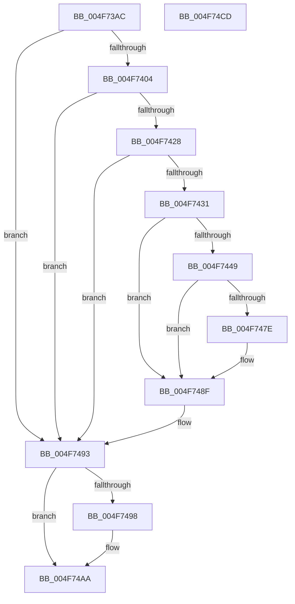

# MiStoreExtendVirtualPagefile

- RVA: `0x004F73AC`–`0x004F74CE` (길이 `290` bytes)
- VA: `0x00000001404F73AC`
- 실행 섹션: `.text`
- PDB 이름 있음: `예`; PDB Function 태그: `아니요`
- unwind 정보 RVA: `0x0005D7BC`
- 디코드: `73`개 명령, `290/290` bytes 표시
- 미해석 바이트: `0` (있으면 어셈블리에 `.byte`로 보존)

> 이 문서는 커널 이미지의 기계어와 PDB 기호를 분석해 생성했습니다. 4번과 5번은 함수 원형과 자료형을 바이너리 사용 방식에서 추정한 C 해석이며 원본 소스 복구 결과는 아닙니다.

## 1. Dependencies

- 직접 호출 지점: **6**; 고유 호출 대상: **6**
- 직접 호출자로 확인된 함수: **2**
- RIP 상대 이미지 참조: **2**

### Outgoing calls
- `0x004F7440` → [MiAttemptChangePagingFileMaximum](../67/MiAttemptChangePagingFileMaximum_function_0067FE7C.md) (function, `0x0067FE7C`)
- `0x004F746D` → [KiSetTimerEx](../23/KiSetTimerEx_function_00232CB0.md) (function, `0x00232CB0`)
- `0x004F7475` → [MiIsStoreVirtualPagefileFull](../4A/MiIsStoreVirtualPagefileFull_function_004ACB9C.md) (function, `0x004ACB9C`)
- `0x004F748A` → [KeSetEvent](../33/KeSetEvent_function_0033F310.md) (function, `0x0033F310`)
- `0x004F74A5` → [MiFinishPageFileExtension](../4D/MiFinishPageFileExtension_function_004D5EB4.md) (function, `0x004D5EB4`)
- `0x004F74AD` → [KeLeaveCriticalRegionThread](../25/KeLeaveCriticalRegionThread_function_0025EFF0.md) (function, `0x0025EFF0`)

### Direct callers
- [MiStoreWriteModifiedPages](../2B/MiStoreWriteModifiedPages_function_002B46C4.md) at `0x002B53BF`
- [MiPageFileNoFreeSpace](../47/MiPageFileNoFreeSpace_function_0047E45C.md) at `0x0047E509`

### Static image references
- `0x004F73DF` → RVA `0x00FC520C` (`ALMOSTRO`; read)
- `0x004F7463` → RVA `0x00010AA0` (`.rdata`; read)

## 2. Other-region calls and transfers

- 다른 실행 섹션으로 향하는 call: **0**
- 별도 외부 분기/꼬리 이동을 확인하지 못했습니다.

## 3. Assembly (complete function range)

```asm
004F73AC  48 8B C4                        mov rax, rsp
004F73AF  48 89 58 08                     mov qword ptr [rax + 8], rbx
004F73B3  48 89 68 10                     mov qword ptr [rax + 0x10], rbp
004F73B7  48 89 70 18                     mov qword ptr [rax + 0x18], rsi
004F73BB  48 89 78 20                     mov qword ptr [rax + 0x20], rdi
004F73BF  41 56                           push r14
004F73C1  48 83 EC 30                     sub rsp, 0x30
004F73C5  65 48 8B 2C 25 88 01 00 00      mov rbp, qword ptr gs:[0x188]
004F73CE  48 8B FA                        mov rdi, rdx
004F73D1  48 8B D9                        mov rbx, rcx
004F73D4  66 FF 8D E4 01 00 00            dec word ptr [rbp + 0x1e4]
004F73DB  90                              nop
004F73DC  8B 42 0C                        mov eax, dword ptr [rdx + 0xc]
004F73DF  8B 35 27 DE AC 00               mov esi, dword ptr [rip + 0xacde27]
004F73E5  B8 00 40 00 00                  mov eax, 0x4000
004F73EA  44 8B 42 04                     mov r8d, dword ptr [rdx + 4]
004F73EE  3B F0                           cmp esi, eax
004F73F0  44 8B 32                        mov r14d, dword ptr [rdx]
004F73F3  0F 42 F0                        cmovb esi, eax
004F73F6  41 8B C0                        mov eax, r8d
004F73F9  41 2B C6                        sub eax, r14d
004F73FC  3B C6                           cmp eax, esi
004F73FE  0F 83 8F 00 00 00               jae 0x1404f7493
004F7404  48 8B 81 C8 41 00 00            mov rax, qword ptr [rcx + 0x41c8]
004F740B  8B 91 BC 04 00 00               mov edx, dword ptr [rcx + 0x4bc]
004F7411  48 05 FF FF 03 00               add rax, 0x3ffff
004F7417  48 25 00 00 FC FF               and rax, 0xfffffffffffc0000
004F741D  48 3B C2                        cmp rax, rdx
004F7420  0F 46 D0                        cmovbe edx, eax
004F7423  41 3B D0                        cmp edx, r8d
004F7426  76 6B                           jbe 0x1404f7493
004F7428  83 B9 D0 04 00 00 00            cmp dword ptr [rcx + 0x4d0], 0
004F742F  75 62                           jne 0x1404f7493
004F7431  41 8D 80 00 00 04 00            lea eax, [r8 + 0x40000]
004F7438  48 8B CF                        mov rcx, rdi
004F743B  3B C2                           cmp eax, edx
004F743D  0F 46 D0                        cmovbe edx, eax
004F7440  E8 37 8A 18 00                  call 0x14067fe7c
004F7445  85 C0                           test eax, eax
004F7447  79 46                           jns 0x1404f748f
004F7449  48 83 64 24 20 00               and qword ptr [rsp + 0x20], 0
004F744F  48 8D 8B D8 04 00 00            lea rcx, [rbx + 0x4d8]
004F7456  C7 83 D0 04 00 00 01 00 00 00   mov dword ptr [rbx + 0x4d0], 1
004F7460  45 33 C9                        xor r9d, r9d
004F7463  48 8B 15 36 96 B1 FF            mov rdx, qword ptr [rip - 0x4e69ca]
004F746A  45 33 C0                        xor r8d, r8d
004F746D  E8 3E B8 D3 FF                  call 0x140232cb0
004F7472  48 8B CB                        mov rcx, rbx
004F7475  E8 22 57 FB FF                  call 0x1404acb9c
004F747A  85 C0                           test eax, eax
004F747C  74 11                           je 0x1404f748f
004F747E  48 8D 8B A0 03 00 00            lea rcx, [rbx + 0x3a0]
004F7485  45 33 C0                        xor r8d, r8d
004F7488  33 D2                           xor edx, edx
004F748A  E8 81 7E E4 FF                  call 0x14033f310
004F748F  44 8B 47 04                     mov r8d, dword ptr [rdi + 4]
004F7493  45 2B C6                        sub r8d, r14d
004F7496  74 12                           je 0x1404f74aa
004F7498  41 3B F0                        cmp esi, r8d
004F749B  48 8B D7                        mov rdx, rdi
004F749E  48 8B CB                        mov rcx, rbx
004F74A1  44 0F 46 C6                     cmovbe r8d, esi
004F74A5  E8 0A EA FD FF                  call 0x1404d5eb4
004F74AA  48 8B CD                        mov rcx, rbp
004F74AD  E8 3E 7B D6 FF                  call 0x14025eff0
004F74B2  48 8B 5C 24 40                  mov rbx, qword ptr [rsp + 0x40]
004F74B7  48 8B 6C 24 48                  mov rbp, qword ptr [rsp + 0x48]
004F74BC  48 8B 74 24 50                  mov rsi, qword ptr [rsp + 0x50]
004F74C1  48 8B 7C 24 58                  mov rdi, qword ptr [rsp + 0x58]
004F74C6  48 83 C4 30                     add rsp, 0x30
004F74CA  41 5E                           pop r14
004F74CC  C3                              ret
004F74CD  CC                              int3
```

## 4. C-style interpretation (structured pseudocode)

```c
__int64 __fastcall MiStoreExtendVirtualPagefile(__int64 a1, __int64 a2, __int64 a3, int a4)
{
    __int64 result;
    __int64 v_rsi;
    __int64 v_rsp;
    unsigned __int64 v_stack_m18;
    unsigned __int64 v_stack_p10;
    unsigned __int64 v_stack_p18;
    unsigned __int64 v_stack_p20;
    unsigned __int64 v_stack_p8;

    *(unsigned __int64 *)(v_rsp + 8) = v_rbx;
    *(unsigned __int64 *)(v_rsp + 16) = v_rbp;
    *(unsigned __int64 *)(v_rsp + 24) = v_rsi;
    *(unsigned __int64 *)(v_rsp + 32) = v_rdi;
    v_rsp = (v_rsp) - (48);
    v_rsi = (unsigned int)(*(unsigned int *)(v_rip + 11329063));
    if (((unsigned int)((unsigned int)(*(unsigned int *)(v_rip + 11329063)))) < ((unsigned int)((unsigned int)(0x4000ULL)))) { v_rsi = (unsigned int)((unsigned int)(0x4000ULL)); }
    result = (unsigned int)(((unsigned int)((unsigned int)((unsigned int)(*(unsigned int *)(a2 + 4))))) - ((unsigned int)((unsigned int)(*(unsigned int *)(a2)))));
    if (((unsigned int)(result)) >= ((unsigned int)(v_rsi))) goto loc_004F7493;
    result = (*(unsigned __int64 *)(a1 + 16840)) + (0x3FFFFULL);
    result = (result) & (0xFFFFFFFFFFFC0000ULL);
    a2 = (unsigned int)(*(unsigned int *)(a1 + 1212));
    if (result <= ((unsigned int)(*(unsigned int *)(a1 + 1212)))) { a2 = (unsigned int)(result); }
    if (((unsigned int)(a2)) <= ((unsigned int)((unsigned int)(*(unsigned int *)(a2 + 4))))) goto loc_004F7493;
    if ((*(unsigned int *)(a1 + 1232)) != 0) goto loc_004F7493;
    if (((unsigned int)((unsigned int)(*(unsigned int *)(a2 + 4)) + 262144)) <= ((unsigned int)(a2))) { a2 = (unsigned int)((unsigned int)(*(unsigned int *)(a2 + 4)) + 262144); }
    result = MiAttemptChangePagingFileMaximum(a2, a2, (unsigned int)(*(unsigned int *)(a2 + 4)), a4);
    if (!sign_flag) goto loc_004F748F;
    *(unsigned int *)(a1 + 1232) = 1;
    a4 = 0;
    a3 = 0;
    result = KiSetTimerEx(a1 + 1240, *(unsigned __int64 *)(v_rip - 5138890), a3, a4);
    result = MiIsStoreVirtualPagefileFull(a1, *(unsigned __int64 *)(v_rip - 5138890), a3, a4);
    if ((unsigned int)(result) != 0) {
        a1 = a1 + 928;
        a3 = 0;
        a2 = 0;
        result = KeSetEvent(a1, a2, a3, a4);
    }
loc_004F7493:
    a3 = (unsigned int)(((unsigned int)(*(unsigned int *)(a2 + 4))) - ((unsigned int)((unsigned int)(*(unsigned int *)(a2)))));
    if (!(condition_is_equal)) {
        a2 = 0;
        a1 = a1;
        if (((unsigned int)(v_rsi)) <= ((unsigned int)(a3))) { a3 = (unsigned int)(v_rsi); }
        result = MiFinishPageFileExtension(a1, a2, a3, a4);
    }
    result = KeLeaveCriticalRegionThread(*(unsigned __int64 *)(gs_base + (0 + 392)), a2, a3, a4);
    v_rsp = (v_rsp) + (48);
    return result;
}
```

## 5. (Beta) C Style

```c
int64_t MiStoreExtendVirtualPagefile(void *Arg1, void *Arg2, int64_t Arg3, int32_t Arg4)
{
    uint8_t *arg1 = (uint8_t *)Arg1;
    uint8_t *arg2 = (uint8_t *)Arg2;

    int64_t result;
    int64_t local_rsi;
    int64_t local_rsp;
    uint64_t v_stack_m18;
    uint64_t v_stack_p10;
    uint64_t v_stack_p18;
    uint64_t v_stack_p20;
    uint64_t v_stack_p8;

    *(uint64_t *)(local_rsp + 0x8) = local_rbx;
    *(uint64_t *)(local_rsp + 0x10) = local_rbp;
    *(uint64_t *)(local_rsp + 0x18) = local_rsi;
    *(uint64_t *)(local_rsp + 0x20) = local_rdi;
    local_rsp = (local_rsp) - (48);
    local_rsi = (uint32_t)(*(uint32_t *)(v_rip + 0xACDE27));
    if (((uint32_t)((uint32_t)(*(uint32_t *)(v_rip + 0xACDE27)))) < ((uint32_t)((uint32_t)(0x4000ULL)))) { local_rsi = (uint32_t)((uint32_t)(0x4000ULL)); }
    result = (uint32_t)(((uint32_t)((uint32_t)((uint32_t)(*(uint32_t *)(arg2 + 0x4))))) - ((uint32_t)((uint32_t)(*(uint32_t *)(arg2)))));
    if (((uint32_t)(result)) >= ((uint32_t)(local_rsi))) goto loc_004F7493;
    result = (*(uint64_t *)(arg1 + 0x41C8)) + (0x3FFFFULL);
    result = (result) & (0xFFFFFFFFFFFC0000ULL);
    Arg2 = (uint32_t)(*(uint32_t *)(arg1 + 0x4BC));
    if (result <= ((uint32_t)(*(uint32_t *)(arg1 + 0x4BC)))) { Arg2 = (uint32_t)(result); }
    if (((uint32_t)(Arg2)) <= ((uint32_t)((uint32_t)(*(uint32_t *)(arg2 + 0x4))))) goto loc_004F7493;
    if ((*(uint32_t *)(arg1 + 0x4D0)) != 0) goto loc_004F7493;
    if (((uint32_t)((uint32_t)(*(uint32_t *)(arg2 + 0x4)) + 262144)) <= ((uint32_t)(Arg2))) { Arg2 = (uint32_t)((uint32_t)(*(uint32_t *)(arg2 + 0x4)) + 262144); }
    result = MiAttemptChangePagingFileMaximum(Arg2, Arg2, (uint32_t)(*(uint32_t *)(arg2 + 0x4)), Arg4);
    if (!sign_flag) goto loc_004F748F;
    *(uint32_t *)(arg1 + 0x4D0) = 1;
    Arg4 = 0;
    Arg3 = 0;
    result = KiSetTimerEx(Arg1 + 1240, *(uint64_t *)(v_rip - 0x4E69CA), Arg3, Arg4);
    result = MiIsStoreVirtualPagefileFull(Arg1, *(uint64_t *)(v_rip - 0x4E69CA), Arg3, Arg4);
    if ((uint32_t)(result) != 0) {
        Arg1 = Arg1 + 928;
        Arg3 = 0;
        Arg2 = 0;
        result = KeSetEvent(Arg1, Arg2, Arg3, Arg4);
    }
loc_004F7493:
    Arg3 = (uint32_t)(((uint32_t)(*(uint32_t *)(arg2 + 0x4))) - ((uint32_t)((uint32_t)(*(uint32_t *)(arg2)))));
    if (!(condition_is_equal)) {
        Arg2 = 0;
        Arg1 = Arg1;
        if (((uint32_t)(local_rsi)) <= ((uint32_t)(Arg3))) { Arg3 = (uint32_t)(local_rsi); }
        result = MiFinishPageFileExtension(Arg1, Arg2, Arg3, Arg4);
    }
    result = KeLeaveCriticalRegionThread(*(uint64_t *)(gs_base + (0 + 0x188)), Arg2, Arg3, Arg4);
    local_rsp = (local_rsp) + (48);
    return result;
}
```

### 관측된 메모리 오프셋

구조체 형식이 확인되지 않은 접근은 인자 기준의 오프셋으로만 기록했습니다.

| 기준 인자 | 오프셋 표현 | 폭 (bit) | 접근 |
|---|---:|---:|---|
| `Arg1` | `+ 0x3A0` | `64` | `R` |
| `Arg1` | `+ 0x4BC` | `32` | `R` |
| `Arg1` | `+ 0x4D0` | `32` | `R` |
| `Arg1` | `+ 0x4D0` | `32` | `W` |
| `Arg1` | `+ 0x4D8` | `64` | `R` |
| `Arg1` | `+ 0x41C8` | `64` | `R` |
| `Arg2` | `+ 0x0` | `32` | `R` |
| `Arg2` | `+ 0x4` | `32` | `R` |
| `Arg2` | `+ 0xC` | `32` | `R` |

## 6. Execution-region graph

[열기: 2D/3D 그래프와 함수 탐색 컨트롤 패널](../../../control-panel.html?section=text&rva=0x004F73AC&view=graph)

- 2D 그래프는 위에서 아래로 흐르고, 3D 그래프는 빈 공간을 드래그해 회전합니다. Shift+드래그는 이동, 휠은 확대·축소, 함수 노드 선택은 대상 보고서 이동입니다.

### Static fallback


