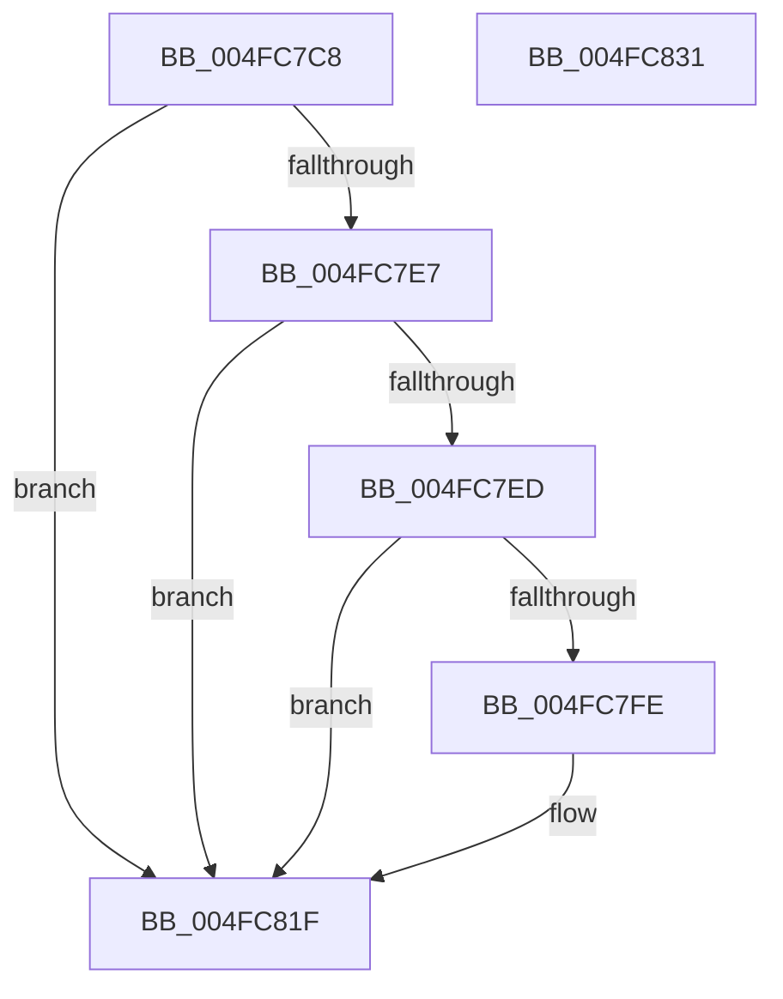

# MiStoreLogFullPagefile

- RVA: `0x004FC7C8`–`0x004FC832` (길이 `106` bytes)
- VA: `0x00000001404FC7C8`
- 실행 섹션: `.text`
- PDB 이름 있음: `예`; PDB Function 태그: `아니요`
- unwind 정보 RVA: `0x000A02F8`
- 디코드: `27`개 명령, `106/106` bytes 표시
- 미해석 바이트: `0` (있으면 어셈블리에 `.byte`로 보존)

> 이 문서는 커널 이미지의 기계어와 PDB 기호를 분석해 생성했습니다. 4번과 5번은 함수 원형과 자료형을 바이너리 사용 방식에서 추정한 C 해석이며 원본 소스 복구 결과는 아닙니다.

## 1. Dependencies

- 직접 호출 지점: **3**; 고유 호출 대상: **3**
- 직접 호출자로 확인된 함수: **1**
- RIP 상대 이미지 참조: **3**

### Outgoing calls
- `0x004FC7F5` → [tlgKeywordOn](../42/tlgKeywordOn_function_0042EAA0.md) (function, `0x0042EAA0`)
- `0x004FC81A` → [tlgWriteEx_EtwWriteEx](../4A/tlgWriteEx_EtwWriteEx_function_004AA348.md) (function, `0x004AA348`)
- `0x004FC827` → [_security_check_cookie](../6A/_security_check_cookie_function_006AC640.md) (function, `0x006AC640`)

### Direct callers
- [MiStoreWriteModifiedPages](../2B/MiStoreWriteModifiedPages_function_002B46C4.md) at `0x002B53CB`

### Static image references
- `0x004FC7CC` → RVA `0x00E0A740` (`.data`; read)
- `0x004FC7DB` → RVA `0x00E37618` (`.data`; read)
- `0x004FC813` → RVA `0x00059AC9` (`.rdata`; read)

## 2. Other-region calls and transfers

- 다른 실행 섹션으로 향하는 call: **0**
- 별도 외부 분기/꼬리 이동을 확인하지 못했습니다.

## 3. Assembly (complete function range)

```asm
004FC7C8  48 83 EC 78                     sub rsp, 0x78
004FC7CC  48 8B 05 6D DF 90 00            mov rax, qword ptr [rip + 0x90df6d]
004FC7D3  48 33 C4                        xor rax, rsp
004FC7D6  48 89 44 24 60                  mov qword ptr [rsp + 0x60], rax
004FC7DB  4C 8B 05 36 AE 93 00            mov r8, qword ptr [rip + 0x93ae36]
004FC7E2  4D 85 C0                        test r8, r8
004FC7E5  74 38                           je 0x1404fc81f
004FC7E7  41 83 38 05                     cmp dword ptr [r8], 5
004FC7EB  76 32                           jbe 0x1404fc81f
004FC7ED  BA 02 00 00 00                  mov edx, 2
004FC7F2  49 8B C8                        mov rcx, r8
004FC7F5  E8 A6 22 F3 FF                  call 0x14042eaa0
004FC7FA  84 C0                           test al, al
004FC7FC  74 21                           je 0x1404fc81f
004FC7FE  48 8D 44 24 40                  lea rax, [rsp + 0x40]
004FC803  49 8B C8                        mov rcx, r8
004FC806  48 89 44 24 38                  mov qword ptr [rsp + 0x38], rax
004FC80B  44 8D 4A FF                     lea r9d, [rdx - 1]
004FC80F  89 54 24 30                     mov dword ptr [rsp + 0x30], edx
004FC813  48 8D 15 AF D2 B5 FF            lea rdx, [rip - 0x4a2d51]
004FC81A  E8 29 DB FA FF                  call 0x1404aa348
004FC81F  48 8B 4C 24 60                  mov rcx, qword ptr [rsp + 0x60]
004FC824  48 33 CC                        xor rcx, rsp
004FC827  E8 14 FE 1A 00                  call 0x1406ac640
004FC82C  48 83 C4 78                     add rsp, 0x78
004FC830  C3                              ret
004FC831  CC                              int3
```

## 4. C-style interpretation (structured pseudocode)

```c
__int64 __fastcall MiStoreLogFullPagefile(void)
{
    __int64 result;
    __int64 v_rsp;
    unsigned __int64 v_stack_m18;
    unsigned __int64 v_stack_m38;
    unsigned __int64 v_stack_m40;
    unsigned int v_stack_m48;

    v_rsp = (v_rsp) - (120);
    result = (*(unsigned __int64 *)(v_rip + 9494381)) ^ (v_rsp);
    v_stack_m18 = result;
    if (*(unsigned __int64 *)(v_rip + 9678390) == 0) goto loc_004FC81F;
    if ((*(unsigned int *)(*(unsigned __int64 *)(v_rip + 9678390))) <= 5) goto loc_004FC81F;
    result = tlgKeywordOn(*(unsigned __int64 *)(v_rip + 9678390), 2, *(unsigned __int64 *)(v_rip + 9678390), a4);
    if ((unsigned __int8)(result) != 0) {
        result = v_stack_m38;
        a1 = *(unsigned __int64 *)(v_rip + 9678390);
        v_stack_m40 = result;
        a4 = 2 - 1;
        v_stack_m48 = 2;
        a2 = v_rip - 4861265;
        result = tlgWriteEx_EtwWriteEx(a1, a2, *(unsigned __int64 *)(v_rip + 9678390), a4);
    }
    a1 = (v_stack_m18) ^ (v_rsp);
    result = _security_check_cookie(a1, a2, *(unsigned __int64 *)(v_rip + 9678390), a4);
    v_rsp = (v_rsp) + (120);
    return result;
}
```

## 5. (Beta) C Style

```c
void MiStoreLogFullPagefile(void)
{
    int64_t result;
    int64_t local_rsp;
    uint64_t v_stack_m18;
    uint64_t v_stack_m38;
    uint64_t v_stack_m40;
    uint32_t v_stack_m48;

    local_rsp = (local_rsp) - (120);
    result = (*(uint64_t *)(v_rip + 0x90DF6D)) ^ (local_rsp);
    v_stack_m18 = result;
    if (*(uint64_t *)(v_rip + 0x93AE36) == 0) goto loc_004FC81F;
    if ((*(uint32_t *)(*(uint64_t *)(v_rip + 0x93AE36))) <= 5) goto loc_004FC81F;
    result = tlgKeywordOn(*(uint64_t *)(v_rip + 0x93AE36), 2, *(uint64_t *)(v_rip + 0x93AE36), a4);
    if ((uint8_t)(result) != 0) {
        result = v_stack_m38;
        a1 = *(uint64_t *)(v_rip + 0x93AE36);
        v_stack_m40 = result;
        a4 = 2 - 1;
        v_stack_m48 = 2;
        a2 = v_rip - 4861265;
        result = tlgWriteEx_EtwWriteEx(a1, a2, *(uint64_t *)(v_rip + 0x93AE36), a4);
    }
    a1 = (v_stack_m18) ^ (local_rsp);
    result = _security_check_cookie(a1, a2, *(uint64_t *)(v_rip + 0x93AE36), a4);
    local_rsp = (local_rsp) + (120);
    return result;
}
```

## 6. Execution-region graph

[열기: 2D/3D 그래프와 함수 탐색 컨트롤 패널](../../../control-panel.html?section=text&rva=0x004FC7C8&view=graph)

- 2D 그래프는 위에서 아래로 흐르고, 3D 그래프는 빈 공간을 드래그해 회전합니다. Shift+드래그는 이동, 휠은 확대·축소, 함수 노드 선택은 대상 보고서 이동입니다.

### Static fallback


