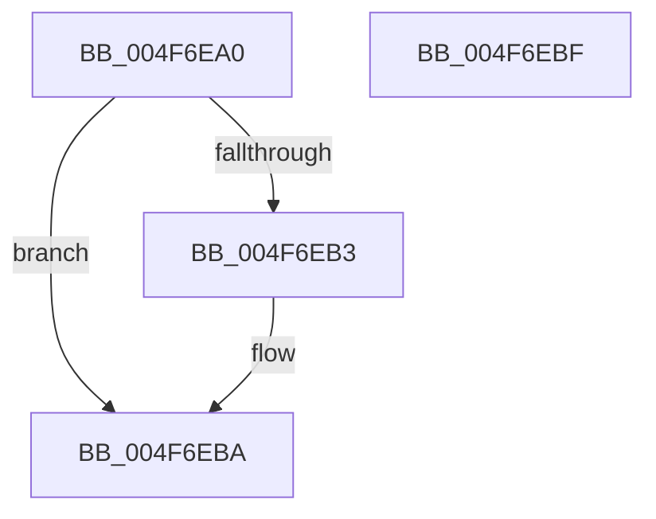

# MiUpdateChargedWsles

- RVA: `0x004F6EA0`–`0x004F6EC0` (길이 `32` bytes)
- VA: `0x00000001404F6EA0`
- 실행 섹션: `.text`
- PDB 이름 있음: `예`; PDB Function 태그: `아니요`
- unwind 정보 RVA: `0x000DB714`
- 디코드: `9`개 명령, `32/32` bytes 표시
- 미해석 바이트: `0` (있으면 어셈블리에 `.byte`로 보존)

> 이 문서는 커널 이미지의 기계어와 PDB 기호를 분석해 생성했습니다. 4번과 5번은 함수 원형과 자료형을 바이너리 사용 방식에서 추정한 C 해석이며 원본 소스 복구 결과는 아닙니다.

## 1. Dependencies

- 직접 호출 지점: **0**; 고유 호출 대상: **0**
- 직접 호출자로 확인된 함수: **6**
- RIP 상대 이미지 참조: **1**

### Outgoing calls
- 직접 디코드된 call 명령이 없습니다.

### Direct callers
- [MiMakeHyperRangeAccessible](../27/MiMakeHyperRangeAccessible_function_0027CE10.md) at `0x0027D26F`
- [MiMakeZeroedPageTablesEx](../3B/MiMakeZeroedPageTablesEx_function_003B59FC.md) at `0x003B5E07`
- [MiCommitPageTablesForVad](../../page/88/MiCommitPageTablesForVad_function_00886D50.md) at `0x008870C5`
- [MiComputeProcessUserVa](../../page/8C/MiComputeProcessUserVa_function_008CFB8C.md) at `0x008CFCB9`
- [sub_009E5C69](../../page/9E/Unknown_function_009E5C69.md) at `0x009E5C72`
- [MiDeleteVadBitmap](../../page/A4/MiDeleteVadBitmap_function_00A45F18.md) at `0x00A4607D`

### Static image references
- `0x004F6EAA` → RVA `0x00E38870` (`.data`; read)

## 2. Other-region calls and transfers

- 다른 실행 섹션으로 향하는 call: **0**
- 별도 외부 분기/꼬리 이동을 확인하지 못했습니다.

## 3. Assembly (complete function range)

```asm
004F6EA0  8B 81 B8 00 00 00               mov eax, dword ptr [rcx + 0xb8]
004F6EA6  24 0F                           and al, 0xf
004F6EA8  3C 01                           cmp al, 1
004F6EAA  48 8D 05 BF 19 94 00            lea rax, [rip + 0x9419bf]
004F6EB1  74 07                           je 0x1404f6eba
004F6EB3  48 8D 81 F0 00 00 00            lea rax, [rcx + 0xf0]
004F6EBA  F0 48 01 10                     lock add qword ptr [rax], rdx
004F6EBE  C3                              ret
004F6EBF  CC                              int3
```

## 4. C-style interpretation (structured pseudocode)

```c
__int64 __fastcall MiUpdateChargedWsles(__int64 a1, __int64 a2)
{
    __int64 result;

    result = (unsigned __int8)(((unsigned int)(*(unsigned int *)(a1 + 184))) & (15));
    result = v_rip + 9705919;
    if (((unsigned __int8)(result)) != 1) {
        result = a1 + 240;
    }
    return result;
}
```

## 5. (Beta) C Style

```c
int64_t MiUpdateChargedWsles(void *Arg1, int64_t Arg2)
{
    uint8_t *arg1 = (uint8_t *)Arg1;

    int64_t result;

    result = (uint8_t)(((uint32_t)(*(uint32_t *)(arg1 + 0xB8))) & (15));
    result = v_rip + 9705919;
    if (((uint8_t)(result)) != 1) {
        result = Arg1 + 240;
    }
    return result;
}
```

### 관측된 메모리 오프셋

구조체 형식이 확인되지 않은 접근은 인자 기준의 오프셋으로만 기록했습니다.

| 기준 인자 | 오프셋 표현 | 폭 (bit) | 접근 |
|---|---:|---:|---|
| `Arg1` | `+ 0xB8` | `32` | `R` |
| `Arg1` | `+ 0xF0` | `64` | `R` |

## 6. Execution-region graph

[열기: 2D/3D 그래프와 함수 탐색 컨트롤 패널](../../../control-panel.html?section=text&rva=0x004F6EA0&view=graph)

- 2D 그래프는 위에서 아래로 흐르고, 3D 그래프는 빈 공간을 드래그해 회전합니다. Shift+드래그는 이동, 휠은 확대·축소, 함수 노드 선택은 대상 보고서 이동입니다.

### Static fallback


