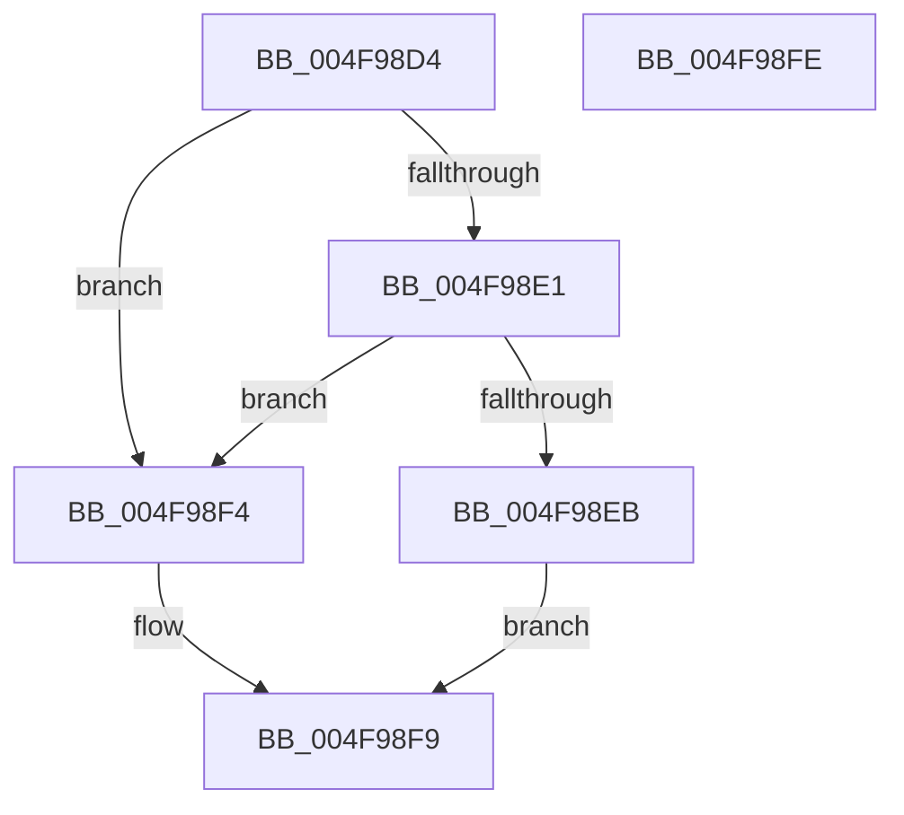

# MmMapMemoryDumpMdlEx2

- RVA: `0x004F98D4`–`0x004F98FF` (길이 `43` bytes)
- VA: `0x00000001404F98D4`
- 실행 섹션: `.text`
- PDB 이름 있음: `예`; PDB Function 태그: `아니요`
- unwind 정보 RVA: `0x0005C788`
- 디코드: `14`개 명령, `43/43` bytes 표시
- 미해석 바이트: `0` (있으면 어셈블리에 `.byte`로 보존)

> 이 문서는 커널 이미지의 기계어와 PDB 기호를 분석해 생성했습니다. 4번과 5번은 함수 원형과 자료형을 바이너리 사용 방식에서 추정한 C 해석이며 원본 소스 복구 결과는 아닙니다.

## 1. Dependencies

- 직접 호출 지점: **1**; 고유 호출 대상: **1**
- 직접 호출자로 확인된 함수: **2**
- RIP 상대 이미지 참조: **0**

### Outgoing calls
- `0x004F98EB` → [MiMapMemoryDumpMdl](../4A/MiMapMemoryDumpMdl_function_004A619C.md) (function, `0x004A619C`)

### Direct callers
- [PopGetNextTable](../5D/PopGetNextTable_function_005D4C54.md) at `0x005D4F5D`
- [PopDecompressHiberBlocks](../../pagelk/B6/PopDecompressHiberBlocks_function_00B6D074.md) at `0x00B6D2A4`

### Static image references
- 디코드된 RIP-relative 메모리 참조가 없습니다.

## 2. Other-region calls and transfers

- 다른 실행 섹션으로 향하는 call: **0**
- 별도 외부 분기/꼬리 이동을 확인하지 못했습니다.

## 3. Assembly (complete function range)

```asm
004F98D4  48 83 EC 28                     sub rsp, 0x28
004F98D8  41 F7 C1 FC FF FF FF            test r9d, 0xfffffffc
004F98DF  75 13                           jne 0x1404f98f4
004F98E1  41 8B C1                        mov eax, r9d
004F98E4  83 E0 03                        and eax, 3
004F98E7  3C 03                           cmp al, 3
004F98E9  74 09                           je 0x1404f98f4
004F98EB  E8 AC C8 FA FF                  call 0x1404a619c
004F98F0  33 C0                           xor eax, eax
004F98F2  EB 05                           jmp 0x1404f98f9
004F98F4  B8 F2 00 00 C0                  mov eax, 0xc00000f2
004F98F9  48 83 C4 28                     add rsp, 0x28
004F98FD  C3                              ret
004F98FE  CC                              int3
```

## 4. C-style interpretation (structured pseudocode)

```c
__int64 __fastcall MmMapMemoryDumpMdlEx2(__int64 a1, __int64 a2, __int64 a3, int a4)
{
    __int64 result;
    __int64 v_rsp;

    v_rsp = (v_rsp) - (40);
    if (((a4) & (0xFFFFFFFCULL)) != 0) goto loc_004F98F4;
    result = (unsigned int)(((unsigned int)(a4)) & (3));
    if (((unsigned __int8)(result)) == 3) goto loc_004F98F4;
    result = MiMapMemoryDumpMdl(a1, a2, a3, a4);
    result = 0;
    goto loc_004F98F9;
loc_004F98F4:
loc_004F98F9:
    v_rsp = (v_rsp) + (40);
    return (unsigned int)(0xC00000F2ULL);
}
```

## 5. (Beta) C Style

```c
int64_t MmMapMemoryDumpMdlEx2(int64_t Arg1, int64_t Arg2, int64_t Arg3, int32_t Arg4)
{
    int64_t result;
    int64_t local_rsp;

    local_rsp = (local_rsp) - (40);
    if (((Arg4) & (0xFFFFFFFCULL)) != 0) goto loc_004F98F4;
    result = (uint32_t)(((uint32_t)(Arg4)) & (3));
    if (((uint8_t)(result)) == 3) goto loc_004F98F4;
    result = MiMapMemoryDumpMdl(Arg1, Arg2, Arg3, Arg4);
    result = 0;
    goto loc_004F98F9;
loc_004F98F4:
loc_004F98F9:
    local_rsp = (local_rsp) + (40);
    return (uint32_t)(0xC00000F2ULL);
}
```

## 6. Execution-region graph

[열기: 2D/3D 그래프와 함수 탐색 컨트롤 패널](../../../control-panel.html?section=text&rva=0x004F98D4&view=graph)

- 2D 그래프는 위에서 아래로 흐르고, 3D 그래프는 빈 공간을 드래그해 회전합니다. Shift+드래그는 이동, 휠은 확대·축소, 함수 노드 선택은 대상 보고서 이동입니다.

### Static fallback


