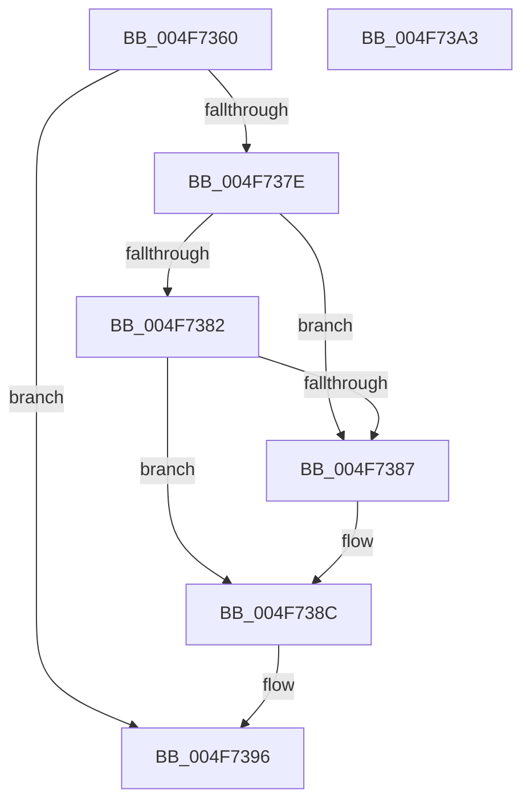

# MmVerifyCallbackFunctionCheckFlags

- RVA: `0x004F7360`–`0x004F73A4` (길이 `68` bytes)
- VA: `0x00000001404F7360`
- 실행 섹션: `.text`
- PDB 이름 있음: `예`; PDB Function 태그: `아니요`
- unwind 정보 RVA: `0x0005CAAC`
- 디코드: `23`개 명령, `68/68` bytes 표시
- 미해석 바이트: `0` (있으면 어셈블리에 `.byte`로 보존)

> 이 문서는 커널 이미지의 기계어와 PDB 기호를 분석해 생성했습니다. 4번과 5번은 함수 원형과 자료형을 바이너리 사용 방식에서 추정한 C 해석이며 원본 소스 복구 결과는 아닙니다.

## 1. Dependencies

- 직접 호출 지점: **2**; 고유 호출 대상: **2**
- 직접 호출자로 확인된 함수: **4**
- RIP 상대 이미지 참조: **0**

### Outgoing calls
- `0x004F7371` → [MiLockLoadedDataTableEntry](../2A/MiLockLoadedDataTableEntry_function_002A38F4.md) (function, `0x002A38F4`)
- `0x004F7391` → [MiUnlockLoadedDataTableEntry](../2A/MiUnlockLoadedDataTableEntry_function_002A385C.md) (function, `0x002A385C`)

### Direct callers
- [PsSetCreateThreadNotifyRoutineEx](../../page/78/PsSetCreateThreadNotifyRoutineEx_function_007877F0.md) at `0x00787821`
- [ObRegisterCallbacks](../../page/9D/ObRegisterCallbacks_function_009DAB00.md) at `0x009DAC25`
- [ObRegisterCallbacks](../../page/9D/ObRegisterCallbacks_function_009DAB00.md) at `0x009DAC3C`
- [PspSetCreateProcessNotifyRoutine](../../page/AA/PspSetCreateProcessNotifyRoutine_function_00AA75EC.md) at `0x00AA76AB`
- [MmVerifyCallbackFunction](../../page/AC/MmVerifyCallbackFunction_function_00AC1B84.md) at `0x00AC1B8D`

### Static image references
- 디코드된 RIP-relative 메모리 참조가 없습니다.

## 2. Other-region calls and transfers

- 다른 실행 섹션으로 향하는 call: **0**
- 별도 외부 분기/꼬리 이동을 확인하지 못했습니다.

## 3. Assembly (complete function range)

```asm
004F7360  48 89 5C 24 08                  mov qword ptr [rsp + 8], rbx
004F7365  57                              push rdi
004F7366  48 83 EC 20                     sub rsp, 0x20
004F736A  8B FA                           mov edi, edx
004F736C  33 DB                           xor ebx, ebx
004F736E  8D 53 01                        lea edx, [rbx + 1]
004F7371  E8 7E C5 DA FF                  call 0x1402a38f4
004F7376  48 8B C8                        mov rcx, rax
004F7379  48 85 C0                        test rax, rax
004F737C  74 18                           je 0x1404f7396
004F737E  85 FF                           test edi, edi
004F7380  74 05                           je 0x1404f7387
004F7382  85 78 68                        test dword ptr [rax + 0x68], edi
004F7385  74 05                           je 0x1404f738c
004F7387  BB 01 00 00 00                  mov ebx, 1
004F738C  BA 01 00 00 00                  mov edx, 1
004F7391  E8 C6 C4 DA FF                  call 0x1402a385c
004F7396  8B C3                           mov eax, ebx
004F7398  48 8B 5C 24 30                  mov rbx, qword ptr [rsp + 0x30]
004F739D  48 83 C4 20                     add rsp, 0x20
004F73A1  5F                              pop rdi
004F73A2  C3                              ret
004F73A3  CC                              int3
```

## 4. C-style interpretation (structured pseudocode)

```c
__int64 __fastcall MmVerifyCallbackFunctionCheckFlags(__int64 a1, int a2)
{
    __int64 result;
    __int64 v_rbx;
    __int64 v_rsp;
    unsigned __int64 v_stack_p8;

    v_stack_p8 = v_rbx;
    v_rsp = (v_rsp) - (32);
    v_rbx = 0;
    result = MiLockLoadedDataTableEntry(a1, v_rbx + 1, a3, a4);
    if (result == 0) goto loc_004F7396;
    if ((unsigned int)((unsigned int)(a2)) == 0) goto loc_004F7387;
    if (((*(unsigned int *)(result + 104)) & ((unsigned int)((unsigned int)(a2)))) != 0) {
        v_rbx = 1;
    }
    result = MiUnlockLoadedDataTableEntry(result, 1, a3, a4);
loc_004F7396:
    v_rsp = (v_rsp) + (32);
    return (unsigned int)((unsigned int)(v_rbx));
}
```

## 5. (Beta) C Style

```c
int64_t MmVerifyCallbackFunctionCheckFlags(int64_t Arg1, int32_t Arg2)
{
    int64_t result;
    int64_t local_rbx;
    int64_t local_rsp;
    uint64_t v_stack_p8;

    v_stack_p8 = local_rbx;
    local_rsp = (local_rsp) - (32);
    local_rbx = 0;
    result = MiLockLoadedDataTableEntry(Arg1, local_rbx + 1, a3, a4);
    if (result == 0) goto loc_004F7396;
    if ((uint32_t)((uint32_t)(Arg2)) == 0) goto loc_004F7387;
    if (((*(uint32_t *)(result + 0x68)) & ((uint32_t)((uint32_t)(Arg2)))) != 0) {
        local_rbx = 1;
    }
    result = MiUnlockLoadedDataTableEntry(result, 1, a3, a4);
loc_004F7396:
    local_rsp = (local_rsp) + (32);
    return (uint32_t)((uint32_t)(local_rbx));
}
```

## 6. Execution-region graph

[열기: 2D/3D 그래프와 함수 탐색 컨트롤 패널](../../../control-panel.html?section=text&rva=0x004F7360&view=graph)

- 2D 그래프는 위에서 아래로 흐르고, 3D 그래프는 빈 공간을 드래그해 회전합니다. Shift+드래그는 이동, 휠은 확대·축소, 함수 노드 선택은 대상 보고서 이동입니다.

### Static fallback


