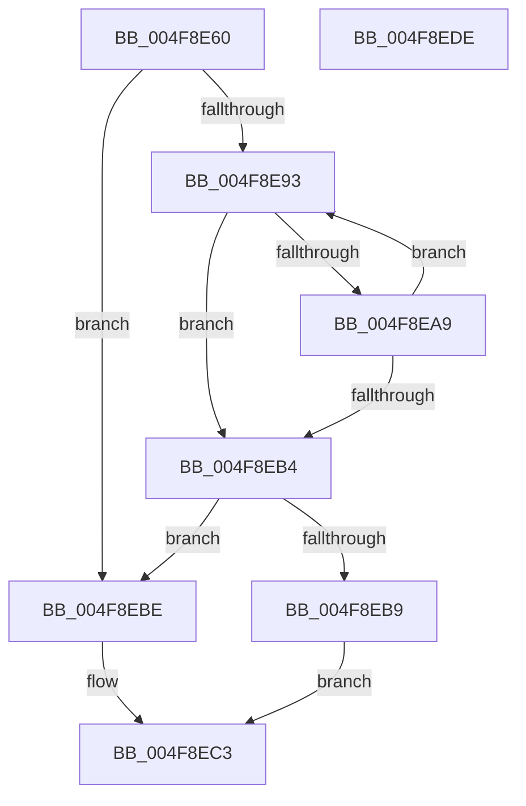

# PiDrvDbFindNode

- RVA: `0x004F8E60`–`0x004F8EDF` (길이 `127` bytes)
- VA: `0x00000001404F8E60`
- 실행 섹션: `.text`
- PDB 이름 있음: `예`; PDB Function 태그: `아니요`
- unwind 정보 RVA: `0x00060300`
- 디코드: `40`개 명령, `127/127` bytes 표시
- 미해석 바이트: `0` (있으면 어셈블리에 `.byte`로 보존)

> 이 문서는 커널 이미지의 기계어와 PDB 기호를 분석해 생성했습니다. 4번과 5번은 함수 원형과 자료형을 바이너리 사용 방식에서 추정한 C 해석이며 원본 소스 복구 결과는 아닙니다.

## 1. Dependencies

- 직접 호출 지점: **1**; 고유 호출 대상: **1**
- 직접 호출자로 확인된 함수: **4**
- RIP 상대 이미지 참조: **1**

### Outgoing calls
- `0x004F8EA0` → [RtlEqualUnicodeString](../../page/93/RtlEqualUnicodeString_function_00932A20.md) (function, `0x00932A20`)

### Direct callers
- [PiDrvDbUnmountNode](../../page/70/PiDrvDbUnmountNode_function_00704D48.md) at `0x00704D71`
- [PiDrvDbQuerySystemPathWin32](../../page/74/PiDrvDbQuerySystemPathWin32_function_007421F4.md) at `0x00742456`
- [PiDrvDbResolveKeyFilePaths](../../page/74/PiDrvDbResolveKeyFilePaths_function_0074326C.md) at `0x00743332`
- [PiDrvDbMountNode](../../page/AD/PiDrvDbMountNode_function_00AD4ECC.md) at `0x00AD4F27`

### Static image references
- `0x004F8E78` → RVA `0x00F8A870` (`.data`; read)

## 2. Other-region calls and transfers

- 다른 실행 섹션으로 향하는 call: **1**
  - `0x004F8EA0` → [RtlEqualUnicodeString](../../page/93/RtlEqualUnicodeString_function_00932A20.md) (`.text` → `PAGE`)
- 별도 외부 분기/꼬리 이동을 확인하지 못했습니다.

## 3. Assembly (complete function range)

```asm
004F8E60  48 89 5C 24 08                  mov qword ptr [rsp + 8], rbx
004F8E65  48 89 6C 24 10                  mov qword ptr [rsp + 0x10], rbp
004F8E6A  48 89 74 24 18                  mov qword ptr [rsp + 0x18], rsi
004F8E6F  57                              push rdi
004F8E70  41 56                           push r14
004F8E72  41 57                           push r15
004F8E74  48 83 EC 20                     sub rsp, 0x20
004F8E78  48 8B 3D F1 19 A9 00            mov rdi, qword ptr [rip + 0xa919f1]
004F8E7F  4C 8D 3D EA 19 A9 00            lea r15, [rip + 0xa919ea]
004F8E86  33 DB                           xor ebx, ebx
004F8E88  4C 8B F2                        mov r14, rdx
004F8E8B  48 8B E9                        mov rbp, rcx
004F8E8E  49 3B FF                        cmp rdi, r15
004F8E91  74 2B                           je 0x1404f8ebe
004F8E93  48 8D 4F 10                     lea rcx, [rdi + 0x10]
004F8E97  41 B0 01                        mov r8b, 1
004F8E9A  48 8B D5                        mov rdx, rbp
004F8E9D  48 8B F7                        mov rsi, rdi
004F8EA0  E8 7B 9B 43 00                  call 0x140932a20
004F8EA5  84 C0                           test al, al
004F8EA7  75 0B                           jne 0x1404f8eb4
004F8EA9  48 8B 3F                        mov rdi, qword ptr [rdi]
004F8EAC  48 8B F3                        mov rsi, rbx
004F8EAF  49 3B FF                        cmp rdi, r15
004F8EB2  75 DF                           jne 0x1404f8e93
004F8EB4  48 85 F6                        test rsi, rsi
004F8EB7  74 05                           je 0x1404f8ebe
004F8EB9  49 89 36                        mov qword ptr [r14], rsi
004F8EBC  EB 05                           jmp 0x1404f8ec3
004F8EBE  BB 25 02 00 C0                  mov ebx, 0xc0000225
004F8EC3  48 8B 6C 24 48                  mov rbp, qword ptr [rsp + 0x48]
004F8EC8  8B C3                           mov eax, ebx
004F8ECA  48 8B 5C 24 40                  mov rbx, qword ptr [rsp + 0x40]
004F8ECF  48 8B 74 24 50                  mov rsi, qword ptr [rsp + 0x50]
004F8ED4  48 83 C4 20                     add rsp, 0x20
004F8ED8  41 5F                           pop r15
004F8EDA  41 5E                           pop r14
004F8EDC  5F                              pop rdi
004F8EDD  C3                              ret
004F8EDE  CC                              int3
```

## 4. C-style interpretation (structured pseudocode)

```c
__int64 __fastcall PiDrvDbFindNode(__int64 a1, __int64 a2)
{
    __int64 result;
    __int64 v_rbx;
    __int64 v_rsp;
    unsigned __int64 v_stack_p10;
    unsigned __int64 v_stack_p18;
    unsigned __int64 v_stack_p8;

    v_stack_p8 = v_rbx;
    v_stack_p10 = v_rbp;
    v_stack_p18 = v_rsi;
    v_rsp = (v_rsp) - (32);
    v_rbx = 0;
    if ((*(unsigned __int64 *)(v_rip + 11082225)) == (v_rip + 11082218)) goto loc_004F8EBE;
loc_004F8E93:
    result = RtlEqualUnicodeString(*(unsigned __int64 *)(v_rip + 11082225) + 16, a1, 1, a4);
    if ((unsigned __int8)(result) != 0) goto loc_004F8EB4;
    if ((*(unsigned __int64 *)(*(unsigned __int64 *)(v_rip + 11082225))) != (v_rip + 11082218)) goto loc_004F8E93;
loc_004F8EB4:
    if (0 == 0) goto loc_004F8EBE;
    *(unsigned __int64 *)(a2) = 0;
    goto loc_004F8EC3;
loc_004F8EBE:
loc_004F8EC3:
    v_rsp = (v_rsp) + (32);
    return (unsigned int)((unsigned int)((unsigned int)(0xC0000225ULL)));
}
```

## 5. (Beta) C Style

```c
int64_t PiDrvDbFindNode(int64_t Arg1, void *Arg2)
{
    uint8_t *arg2 = (uint8_t *)Arg2;

    int64_t result;
    int64_t local_rbx;
    int64_t local_rsp;
    uint64_t v_stack_p10;
    uint64_t v_stack_p18;
    uint64_t v_stack_p8;

    v_stack_p8 = local_rbx;
    v_stack_p10 = local_rbp;
    v_stack_p18 = local_rsi;
    local_rsp = (local_rsp) - (32);
    local_rbx = 0;
    if ((*(uint64_t *)(v_rip + 0xA919F1)) == (v_rip + 11082218)) goto loc_004F8EBE;
loc_004F8E93:
    result = RtlEqualUnicodeString(*(uint64_t *)(v_rip + 0xA919F1) + 16, Arg1, 1, a4);
    if ((uint8_t)(result) != 0) goto loc_004F8EB4;
    if ((*(uint64_t *)(*(uint64_t *)(v_rip + 0xA919F1))) != (v_rip + 11082218)) goto loc_004F8E93;
loc_004F8EB4:
    if (0 == 0) goto loc_004F8EBE;
    *(uint64_t *)(arg2) = 0;
    goto loc_004F8EC3;
loc_004F8EBE:
loc_004F8EC3:
    local_rsp = (local_rsp) + (32);
    return (uint32_t)((uint32_t)((uint32_t)(0xC0000225ULL)));
}
```

### 관측된 메모리 오프셋

구조체 형식이 확인되지 않은 접근은 인자 기준의 오프셋으로만 기록했습니다.

| 기준 인자 | 오프셋 표현 | 폭 (bit) | 접근 |
|---|---:|---:|---|
| `Arg2` | `+ 0x0` | `64` | `W` |

## 6. Execution-region graph

[열기: 2D/3D 그래프와 함수 탐색 컨트롤 패널](../../../control-panel.html?section=text&rva=0x004F8E60&view=graph)

- 2D 그래프는 위에서 아래로 흐르고, 3D 그래프는 빈 공간을 드래그해 회전합니다. Shift+드래그는 이동, 휠은 확대·축소, 함수 노드 선택은 대상 보고서 이동입니다.

### Static fallback


