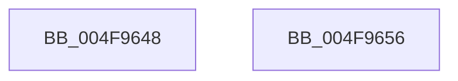

# PiListEntryToDependencyEdge

- RVA: `0x004F9648`–`0x004F9657` (길이 `15` bytes)
- VA: `0x00000001404F9648`
- 실행 섹션: `.text`
- PDB 이름 있음: `예`; PDB Function 태그: `아니요`
- unwind 정보 RVA: `0x000DB714`
- 디코드: `6`개 명령, `15/15` bytes 표시
- 미해석 바이트: `0` (있으면 어셈블리에 `.byte`로 보존)

> 이 문서는 커널 이미지의 기계어와 PDB 기호를 분석해 생성했습니다. 4번과 5번은 함수 원형과 자료형을 바이너리 사용 방식에서 추정한 C 해석이며 원본 소스 복구 결과는 아닙니다.

## 1. Dependencies

- 직접 호출 지점: **0**; 고유 호출 대상: **0**
- 직접 호출자로 확인된 함수: **11**
- RIP 상대 이미지 참조: **0**

### Outgoing calls
- 직접 디코드된 call 명령이 없습니다.

### Direct callers
- [PiEnumerateDependentListEntry](../../page/70/PiEnumerateDependentListEntry_function_00703008.md) at `0x00703014`
- [IoDuplicateDependency](../../page/72/IoDuplicateDependency_function_00727580.md) at `0x00727629`
- [PiEnumerateProviderListEntry](../../page/72/PiEnumerateProviderListEntry_function_007277E4.md) at `0x007277ED`
- [PipCheckValidNewDependencyEdge](../../page/72/PipCheckValidNewDependencyEdge_function_00727A80.md) at `0x00727AEA`
- [PipMergeDependencyEdgeList](../../page/72/PipMergeDependencyEdgeList_function_00727D4C.md) at `0x00727DBC`
- [PipMergeDependencyEdgeList](../../page/72/PipMergeDependencyEdgeList_function_00727D4C.md) at `0x00727DDA`
- [PnpNewDeviceNodeDependencyCheck](../../page/A0/PnpNewDeviceNodeDependencyCheck_function_00A062A0.md) at `0x00A06393`
- [PnpNewDeviceNodeDependencyCheck](../../page/A0/PnpNewDeviceNodeDependencyCheck_function_00A062A0.md) at `0x00A063B8`
- [PipAddDependentsToRebuildPowerRelationsQueue](../../page/A0/PipAddDependentsToRebuildPowerRelationsQueue_function_00A067D8.md) at `0x00A0680E`
- [PipDeleteAllDependencyRelations](../../page/A0/PipDeleteAllDependencyRelations_function_00A06950.md) at `0x00A069A2`
- [PipDeleteAllDependencyRelations](../../page/A0/PipDeleteAllDependencyRelations_function_00A06950.md) at `0x00A069C8`
- [PnpRequestDeviceRemovalWorker](../../page/A8/PnpRequestDeviceRemovalWorker_function_00A8F958.md) at `0x00A8FA11`
- [PipAttemptDependentsStart](../../page/A9/PipAttemptDependentsStart_function_00A9C888.md) at `0x00A9C8D4`
- [sub_00B33DD8](../../page/B3/Unknown_function_00B33DD8.md) at `0x00B33DFB`

### Static image references
- 디코드된 RIP-relative 메모리 참조가 없습니다.

## 2. Other-region calls and transfers

- 다른 실행 섹션으로 향하는 call: **0**
- 별도 외부 분기/꼬리 이동을 확인하지 못했습니다.

## 3. Assembly (complete function range)

```asm
004F9648  48 8D 41 F0                     lea rax, [rcx - 0x10]
004F964C  85 D2                           test edx, edx
004F964E  48 0F 45 C8                     cmovne rcx, rax
004F9652  48 8B C1                        mov rax, rcx
004F9655  C3                              ret
004F9656  CC                              int3
```

## 4. C-style interpretation (structured pseudocode)

```c
__int64 __fastcall PiListEntryToDependencyEdge(__int64 a1, int a2)
{
    if (a2 != 0) { a1 = a1 - 16; }
    return a1;
}
```

## 5. (Beta) C Style

```c
void *PiListEntryToDependencyEdge(void *Arg1, int32_t Arg2)
{
    uint8_t *arg1 = (uint8_t *)Arg1;

    if (Arg2 != 0) { Arg1 = Arg1 - 16; }
    return Arg1;
}
```

### 관측된 메모리 오프셋

구조체 형식이 확인되지 않은 접근은 인자 기준의 오프셋으로만 기록했습니다.

| 기준 인자 | 오프셋 표현 | 폭 (bit) | 접근 |
|---|---:|---:|---|
| `Arg1` | `- 0x10` | `64` | `R` |

## 6. Execution-region graph

[열기: 2D/3D 그래프와 함수 탐색 컨트롤 패널](../../../control-panel.html?section=text&rva=0x004F9648&view=graph)

- 2D 그래프는 위에서 아래로 흐르고, 3D 그래프는 빈 공간을 드래그해 회전합니다. Shift+드래그는 이동, 휠은 확대·축소, 함수 노드 선택은 대상 보고서 이동입니다.

### Static fallback


