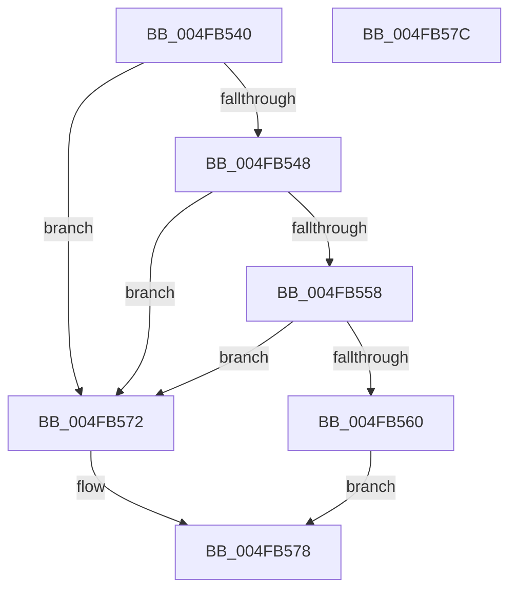

# PoDirectedDripsClearDeviceFlags

- RVA: `0x004FB540`–`0x004FB57D` (길이 `61` bytes)
- VA: `0x00000001404FB540`
- 실행 섹션: `.text`
- PDB 이름 있음: `예`; PDB Function 태그: `아니요`
- unwind 정보 RVA: `0x000DB714`
- 디코드: `18`개 명령, `61/61` bytes 표시
- 미해석 바이트: `0` (있으면 어셈블리에 `.byte`로 보존)

> 이 문서는 커널 이미지의 기계어와 PDB 기호를 분석해 생성했습니다. 4번과 5번은 함수 원형과 자료형을 바이너리 사용 방식에서 추정한 C 해석이며 원본 소스 복구 결과는 아닙니다.

## 1. Dependencies

- 직접 호출 지점: **0**; 고유 호출 대상: **0**
- 직접 호출자로 확인된 함수: **1**
- RIP 상대 이미지 참조: **0**

### Outgoing calls
- 직접 디코드된 call 명령이 없습니다.

### Direct callers
- [PopPowerInformationInternal](../../page/A8/PopPowerInformationInternal_function_00A8B7C0.md) at `0x00A8C8F7`

### Static image references
- 디코드된 RIP-relative 메모리 참조가 없습니다.

## 2. Other-region calls and transfers

- 다른 실행 섹션으로 향하는 call: **0**
- 별도 외부 분기/꼬리 이동을 확인하지 못했습니다.

## 3. Assembly (complete function range)

```asm
004FB540  45 33 C0                        xor r8d, r8d
004FB543  48 85 C9                        test rcx, rcx
004FB546  74 2A                           je 0x1404fb572
004FB548  48 8B 81 38 01 00 00            mov rax, qword ptr [rcx + 0x138]
004FB54F  48 8B 48 28                     mov rcx, qword ptr [rax + 0x28]
004FB553  48 85 C9                        test rcx, rcx
004FB556  74 1A                           je 0x1404fb572
004FB558  F7 C2 C0 FF FF FF               test edx, 0xffffffc0
004FB55E  75 12                           jne 0x1404fb572
004FB560  8B 81 F8 02 00 00               mov eax, dword ptr [rcx + 0x2f8]
004FB566  F7 D2                           not edx
004FB568  23 C2                           and eax, edx
004FB56A  89 81 F8 02 00 00               mov dword ptr [rcx + 0x2f8], eax
004FB570  EB 06                           jmp 0x1404fb578
004FB572  41 B8 0D 00 00 C0               mov r8d, 0xc000000d
004FB578  41 8B C0                        mov eax, r8d
004FB57B  C3                              ret
004FB57C  CC                              int3
```

## 4. C-style interpretation (structured pseudocode)

```c
__int64 __fastcall PoDirectedDripsClearDeviceFlags(__int64 a1, int a2, int a3)
{
    __int64 result;

    a3 = 0;
    if (a1 == 0) goto loc_004FB572;
    if (*(unsigned __int64 *)(*(unsigned __int64 *)(a1 + 312) + 40) == 0) goto loc_004FB572;
    if (((a2) & (0xFFFFFFC0ULL)) != 0) goto loc_004FB572;
    a2 = (unsigned int)(~(a2));
    result = (unsigned int)(((unsigned int)(*(unsigned int *)(*(unsigned __int64 *)(*(unsigned __int64 *)(a1 + 312) + 40) + 760))) & (a2));
    *(unsigned int *)(*(unsigned __int64 *)(*(unsigned __int64 *)(a1 + 312) + 40) + 760) = (unsigned int)(result);
    goto loc_004FB578;
loc_004FB572:
loc_004FB578:
    return (unsigned int)((unsigned int)((unsigned int)(0xC000000DULL)));
}
```

## 5. (Beta) C Style

```c
int64_t PoDirectedDripsClearDeviceFlags(int64_t Arg1, int32_t Arg2, int32_t Arg3)
{
    int64_t result;

    Arg3 = 0;
    if (Arg1 == 0) goto loc_004FB572;
    if (*(uint64_t *)(*(uint64_t *)(Arg1 + 0x138) + 0x28) == 0) goto loc_004FB572;
    if (((Arg2) & (0xFFFFFFC0ULL)) != 0) goto loc_004FB572;
    Arg2 = (uint32_t)(~(Arg2));
    result = (uint32_t)(((uint32_t)(*(uint32_t *)(*(uint64_t *)(*(uint64_t *)(Arg1 + 0x138) + 0x28) + 0x2F8))) & (Arg2));
    *(uint32_t *)(*(uint64_t *)(*(uint64_t *)(Arg1 + 0x138) + 0x28) + 0x2F8) = (uint32_t)(result);
    goto loc_004FB578;
loc_004FB572:
loc_004FB578:
    return (uint32_t)((uint32_t)((uint32_t)(0xC000000DULL)));
}
```

## 6. Execution-region graph

[열기: 2D/3D 그래프와 함수 탐색 컨트롤 패널](../../../control-panel.html?section=text&rva=0x004FB540&view=graph)

- 2D 그래프는 위에서 아래로 흐르고, 3D 그래프는 빈 공간을 드래그해 회전합니다. Shift+드래그는 이동, 휠은 확대·축소, 함수 노드 선택은 대상 보고서 이동입니다.

### Static fallback


