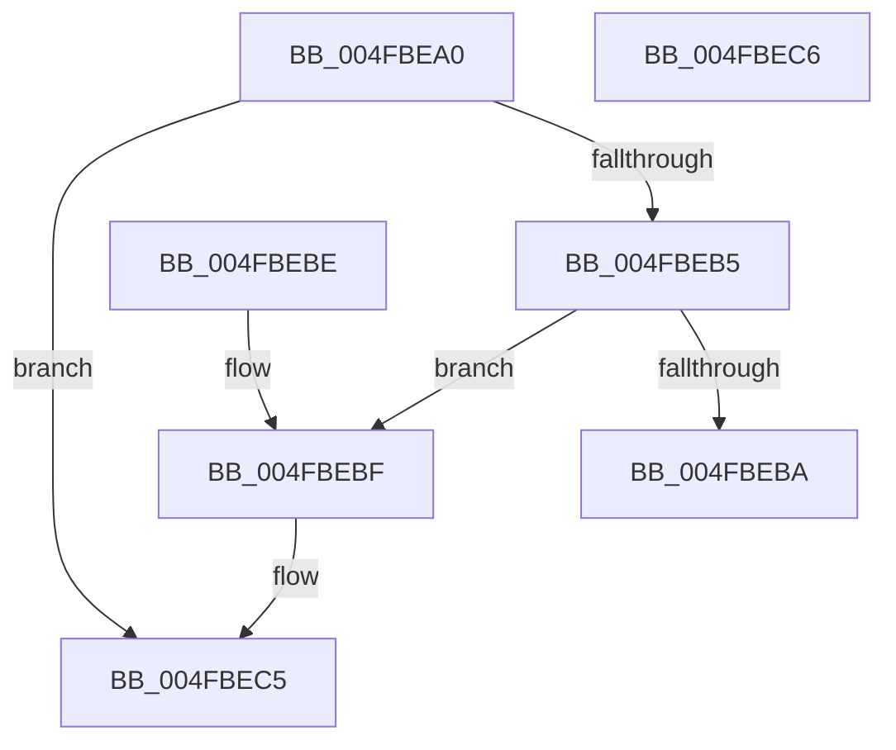

# PoGetProcessorIdleAccounting

- RVA: `0x004FBEA0`–`0x004FBEC7` (길이 `39` bytes)
- VA: `0x00000001404FBEA0`
- 실행 섹션: `.text`
- PDB 이름 있음: `예`; PDB Function 태그: `아니요`
- unwind 정보 RVA: `0x000DB714`
- 디코드: `13`개 명령, `39/39` bytes 표시
- 미해석 바이트: `0` (있으면 어셈블리에 `.byte`로 보존)

> 이 문서는 커널 이미지의 기계어와 PDB 기호를 분석해 생성했습니다. 4번과 5번은 함수 원형과 자료형을 바이너리 사용 방식에서 추정한 C 해석이며 원본 소스 복구 결과는 아닙니다.

## 1. Dependencies

- 직접 호출 지점: **0**; 고유 호출 대상: **0**
- 직접 호출자로 확인된 함수: **5**
- RIP 상대 이미지 참조: **0**

### Outgoing calls
- 직접 디코드된 call 명령이 없습니다.

### Direct callers
- [EmonOverflowHandlerInternalV1Enhanced](../55/EmonOverflowHandlerInternalV1Enhanced_function_0055D88C.md) at `0x0055DAA6`
- [EmonOverflowHandlerInternalV1Enhanced](../55/EmonOverflowHandlerInternalV1Enhanced_function_0055D88C.md) at `0x0055DB42`
- [EmonOverflowHandlerInternalV1Original](../55/EmonOverflowHandlerInternalV1Original_function_0055DCD8.md) at `0x0055DEDC`
- [EmonOverflowHandlerInternalV1Original](../55/EmonOverflowHandlerInternalV1Original_function_0055DCD8.md) at `0x0055DF78`
- [EmonOverflowHandlerInternalV2Enhanced](../55/EmonOverflowHandlerInternalV2Enhanced_function_0055E110.md) at `0x0055E38D`
- [EmonOverflowHandlerInternalV2Enhanced](../55/EmonOverflowHandlerInternalV2Enhanced_function_0055E110.md) at `0x0055E41F`
- [EmonOverflowHandlerInternalV2Original](../55/EmonOverflowHandlerInternalV2Original_function_0055E5BC.md) at `0x0055E824`
- [EmonOverflowHandlerInternalV2Original](../55/EmonOverflowHandlerInternalV2Original_function_0055E5BC.md) at `0x0055E8B6`
- [Amd64OverflowHandlerInternal](../56/Amd64OverflowHandlerInternal_function_0056D330.md) at `0x0056D569`
- [Amd64OverflowHandlerInternal](../56/Amd64OverflowHandlerInternal_function_0056D330.md) at `0x0056D62B`

### Static image references
- 디코드된 RIP-relative 메모리 참조가 없습니다.

## 2. Other-region calls and transfers

- 다른 실행 섹션으로 향하는 call: **0**
- 별도 외부 분기/꼬리 이동을 확인하지 못했습니다.

## 3. Assembly (complete function range)

```asm
004FBEA0  65 48 8B 04 25 20 00 00 00      mov rax, qword ptr gs:[0x20]
004FBEA9  48 8B 90 48 88 00 00            mov rdx, qword ptr [rax + 0x8848]
004FBEB0  48 85 C9                        test rcx, rcx
004FBEB3  74 10                           je 0x1404fbec5
004FBEB5  48 85 D2                        test rdx, rdx
004FBEB8  75 05                           jne 0x1404fbebf
004FBEBA  48 21 11                        and qword ptr [rcx], rdx
004FBEBD  C3                              ret
004FBEBE  CC                              int3
004FBEBF  8B 42 04                        mov eax, dword ptr [rdx + 4]
004FBEC2  48 89 01                        mov qword ptr [rcx], rax
004FBEC5  C3                              ret
004FBEC6  CC                              int3
```

## 4. C-style interpretation (structured pseudocode)

```c
__int64 __fastcall PoGetProcessorIdleAccounting(__int64 a1)
{
    if (a1 == 0) goto loc_004FBEC5;
    if (*(unsigned __int64 *)(*(unsigned __int64 *)(gs_base + (0 + 32)) + 34888) != 0) goto loc_004FBEBF;
    return *(unsigned __int64 *)(gs_base + (0 + 32));
loc_004FBEBF:
    *(unsigned __int64 *)(a1) = (unsigned int)(*(unsigned int *)(*(unsigned __int64 *)(*(unsigned __int64 *)(gs_base + (0 + 32)) + 34888) + 4));
loc_004FBEC5:
    return (unsigned int)(*(unsigned int *)(*(unsigned __int64 *)(*(unsigned __int64 *)(gs_base + (0 + 32)) + 34888) + 4));
}
```

## 5. (Beta) C Style

```c
int64_t PoGetProcessorIdleAccounting(int64_t Arg1)
{
    if (Arg1 == 0) goto loc_004FBEC5;
    if (*(uint64_t *)(*(uint64_t *)(gs_base + (0 + 0x20)) + 0x8848) != 0) goto loc_004FBEBF;
    return *(uint64_t *)(gs_base + (0 + 0x20));
loc_004FBEBF:
    *(uint64_t *)(Arg1) = (uint32_t)(*(uint32_t *)(*(uint64_t *)(*(uint64_t *)(gs_base + (0 + 0x20)) + 0x8848) + 0x4));
loc_004FBEC5:
    return (uint32_t)(*(uint32_t *)(*(uint64_t *)(*(uint64_t *)(gs_base + (0 + 0x20)) + 0x8848) + 0x4));
}
```

## 6. Execution-region graph

[열기: 2D/3D 그래프와 함수 탐색 컨트롤 패널](../../../control-panel.html?section=text&rva=0x004FBEA0&view=graph)

- 2D 그래프는 위에서 아래로 흐르고, 3D 그래프는 빈 공간을 드래그해 회전합니다. Shift+드래그는 이동, 휠은 확대·축소, 함수 노드 선택은 대상 보고서 이동입니다.

### Static fallback


