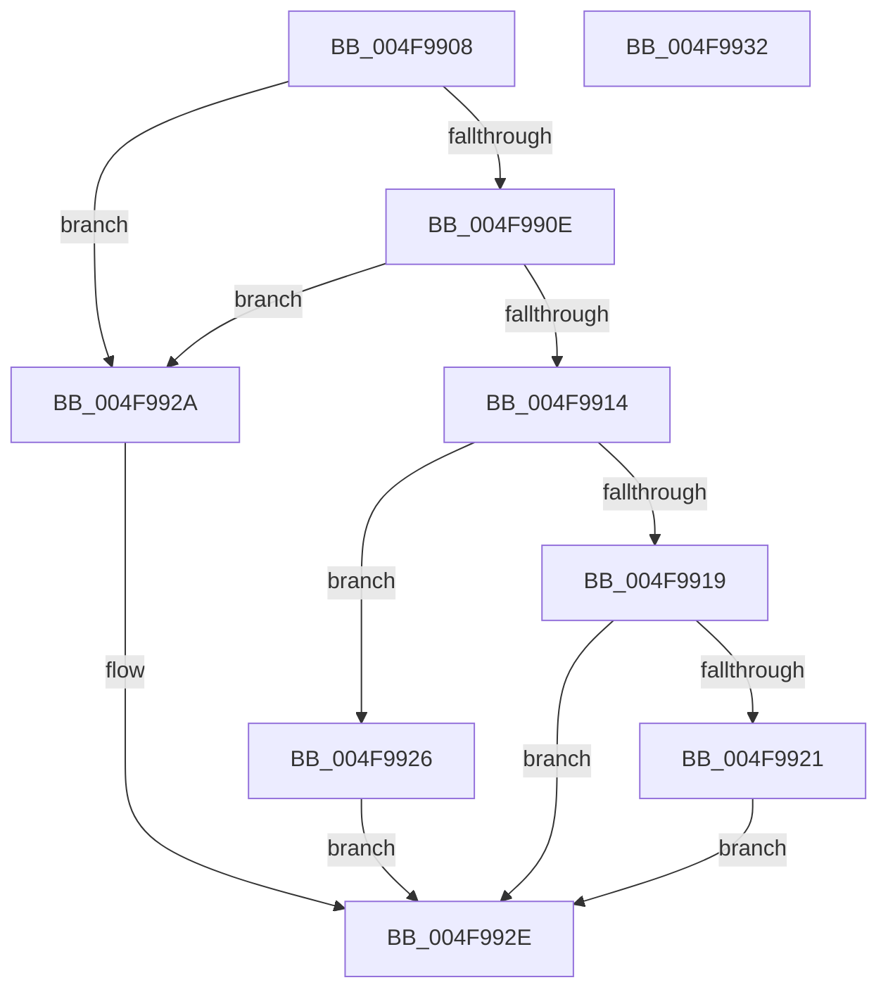

# PopCalculateTotalHwDripsResidency

- RVA: `0x004F9908`–`0x004F9933` (길이 `43` bytes)
- VA: `0x00000001404F9908`
- 실행 섹션: `.text`
- PDB 이름 있음: `예`; PDB Function 태그: `아니요`
- unwind 정보 RVA: `0x000DB714`
- 디코드: `17`개 명령, `43/43` bytes 표시
- 미해석 바이트: `0` (있으면 어셈블리에 `.byte`로 보존)

> 이 문서는 커널 이미지의 기계어와 PDB 기호를 분석해 생성했습니다. 4번과 5번은 함수 원형과 자료형을 바이너리 사용 방식에서 추정한 C 해석이며 원본 소스 복구 결과는 아닙니다.

## 1. Dependencies

- 직접 호출 지점: **0**; 고유 호출 대상: **0**
- 직접 호출자로 확인된 함수: **3**
- RIP 상대 이미지 참조: **0**

### Outgoing calls
- 직접 디코드된 call 명령이 없습니다.

### Direct callers
- [PopCalculateCsSummary](../43/PopCalculateCsSummary_function_0043A1B0.md) at `0x0043A2C2`
- [PopSleepstudyCaptureResiliencyStatistics](../../page/AD/PopSleepstudyCaptureResiliencyStatistics_function_00AD6B74.md) at `0x00AD6C31`
- [PopSleepstudyCaptureSessionStatistics](../../page/AD/PopSleepstudyCaptureSessionStatistics_function_00AD7554.md) at `0x00AD761C`

### Static image references
- 디코드된 RIP-relative 메모리 참조가 없습니다.

## 2. Other-region calls and transfers

- 다른 실행 섹션으로 향하는 call: **0**
- 별도 외부 분기/꼬리 이동을 확인하지 못했습니다.

## 3. Assembly (complete function range)

```asm
004F9908  48 83 F9 FF                     cmp rcx, -1
004F990C  74 1C                           je 0x1404f992a
004F990E  48 83 FA FF                     cmp rdx, -1
004F9912  74 16                           je 0x1404f992a
004F9914  48 3B D1                        cmp rdx, rcx
004F9917  72 0D                           jb 0x1404f9926
004F9919  48 2B D1                        sub rdx, rcx
004F991C  49 3B D0                        cmp rdx, r8
004F991F  76 0D                           jbe 0x1404f992e
004F9921  49 8B D0                        mov rdx, r8
004F9924  EB 08                           jmp 0x1404f992e
004F9926  33 D2                           xor edx, edx
004F9928  EB 04                           jmp 0x1404f992e
004F992A  48 83 CA FF                     or rdx, 0xffffffffffffffff
004F992E  48 8B C2                        mov rax, rdx
004F9931  C3                              ret
004F9932  CC                              int3
```

## 4. C-style interpretation (structured pseudocode)

```c
__int64 __fastcall PopCalculateTotalHwDripsResidency(__int64 a1, __int64 a2, __int64 a3)
{
    if (a1 == -1) goto loc_004F992A;
    if (a2 == -1) goto loc_004F992A;
    if (a2 < a1) goto loc_004F9926;
    a2 = (a2) - (a1);
    if (a2 <= a3) goto loc_004F992E;
    goto loc_004F992E;
loc_004F9926:
    a2 = 0;
    goto loc_004F992E;
loc_004F992A:
    a2 = (a2) | (-1);
loc_004F992E:
    return a2;
}
```

## 5. (Beta) C Style

```c
int64_t PopCalculateTotalHwDripsResidency(int64_t Arg1, int64_t Arg2, int64_t Arg3)
{
    if (Arg1 == -1) goto loc_004F992A;
    if (Arg2 == -1) goto loc_004F992A;
    if (Arg2 < Arg1) goto loc_004F9926;
    Arg2 = (Arg2) - (Arg1);
    if (Arg2 <= Arg3) goto loc_004F992E;
    goto loc_004F992E;
loc_004F9926:
    Arg2 = 0;
    goto loc_004F992E;
loc_004F992A:
    Arg2 = (Arg2) | (-1);
loc_004F992E:
    return Arg2;
}
```

## 6. Execution-region graph

[열기: 2D/3D 그래프와 함수 탐색 컨트롤 패널](../../../control-panel.html?section=text&rva=0x004F9908&view=graph)

- 2D 그래프는 위에서 아래로 흐르고, 3D 그래프는 빈 공간을 드래그해 회전합니다. Shift+드래그는 이동, 휠은 확대·축소, 함수 노드 선택은 대상 보고서 이동입니다.

### Static fallback


