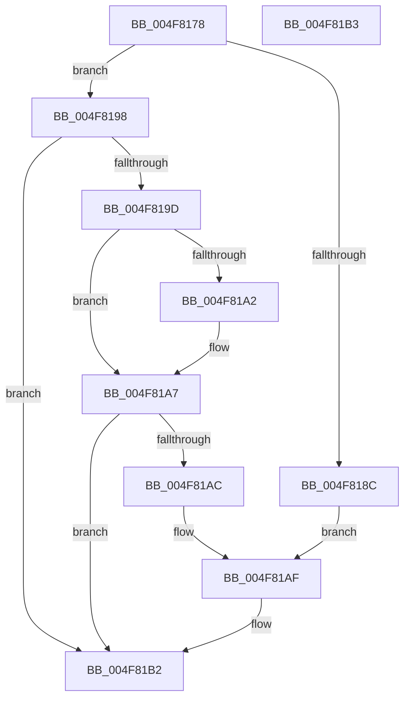

# PopComputeCounterShifts

- RVA: `0x004F8178`–`0x004F81B4` (길이 `60` bytes)
- VA: `0x00000001404F8178`
- 실행 섹션: `.text`
- PDB 이름 있음: `예`; PDB Function 태그: `아니요`
- unwind 정보 RVA: `0x000DB714`
- 디코드: `23`개 명령, `60/60` bytes 표시
- 미해석 바이트: `0` (있으면 어셈블리에 `.byte`로 보존)

> 이 문서는 커널 이미지의 기계어와 PDB 기호를 분석해 생성했습니다. 4번과 5번은 함수 원형과 자료형을 바이너리 사용 방식에서 추정한 C 해석이며 원본 소스 복구 결과는 아닙니다.

## 1. Dependencies

- 직접 호출 지점: **0**; 고유 호출 대상: **0**
- 직접 호출자로 확인된 함수: **1**
- RIP 상대 이미지 참조: **0**

### Outgoing calls
- 직접 디코드된 call 명령이 없습니다.

### Direct callers
- [PoInitSystem](../../init/C7/PoInitSystem_function_00C72358.md) at `0x00C723B9`
- [PoInitSystem](../../init/C7/PoInitSystem_function_00C72358.md) at `0x00C723D1`

### Static image references
- 디코드된 RIP-relative 메모리 참조가 없습니다.

## 2. Other-region calls and transfers

- 다른 실행 섹션으로 향하는 call: **0**
- 별도 외부 분기/꼬리 이동을 확인하지 못했습니다.

## 3. Assembly (complete function range)

```asm
004F8178  33 C0                           xor eax, eax
004F817A  89 02                           mov dword ptr [rdx], eax
004F817C  41 89 00                        mov dword ptr [r8], eax
004F817F  48 8B C1                        mov rax, rcx
004F8182  48 C1 E8 20                     shr rax, 0x20
004F8186  44 0F BD C8                     bsr r9d, eax
004F818A  74 0C                           je 0x1404f8198
004F818C  41 8D 41 12                     lea eax, [r9 + 0x12]
004F8190  89 02                           mov dword ptr [rdx], eax
004F8192  41 8D 41 0D                     lea eax, [r9 + 0xd]
004F8196  EB 17                           jmp 0x1404f81af
004F8198  0F BD C9                        bsr ecx, ecx
004F819B  74 15                           je 0x1404f81b2
004F819D  83 F9 0E                        cmp ecx, 0xe
004F81A0  76 05                           jbe 0x1404f81a7
004F81A2  8D 41 F2                        lea eax, [rcx - 0xe]
004F81A5  89 02                           mov dword ptr [rdx], eax
004F81A7  83 F9 13                        cmp ecx, 0x13
004F81AA  76 06                           jbe 0x1404f81b2
004F81AC  8D 41 ED                        lea eax, [rcx - 0x13]
004F81AF  41 89 00                        mov dword ptr [r8], eax
004F81B2  C3                              ret
004F81B3  CC                              int3
```

## 4. C-style interpretation (structured pseudocode)

```c
__int64 __fastcall PopComputeCounterShifts(__int64 a1, __int64 a2, __int64 a3)
{
    __int64 result;

    result = 0;
    *(unsigned int *)(a2) = 0;
    *(unsigned int *)(a3) = 0;
    result = (a1) >> (32);
    if (condition_is_equal) goto loc_004F8198;
    *(unsigned int *)(a2) = (unsigned int)(a4 + 18);
    goto loc_004F81AF;
loc_004F8198:
    if (condition_is_equal) goto loc_004F81B2;
    result = a4 + 13;
    if (((unsigned int)(a1)) >= = 14) {
        result = a1 - 14;
        *(unsigned int *)(a2) = (unsigned int)(result);
    }
    if (((unsigned int)(a1)) <= 19) goto loc_004F81B2;
loc_004F81AF:
    *(unsigned int *)(a3) = (unsigned int)(a1 - 19);
loc_004F81B2:
    return a1 - 19;
}
```

## 5. (Beta) C Style

```c
int64_t PopComputeCounterShifts(int64_t Arg1, void *Arg2, void *Arg3)
{
    uint8_t *arg2 = (uint8_t *)Arg2;
    uint8_t *arg3 = (uint8_t *)Arg3;

    int64_t result;

    result = 0;
    *(uint32_t *)(arg2) = 0;
    *(uint32_t *)(arg3) = 0;
    result = (Arg1) >> (32);
    if (condition_is_equal) goto loc_004F8198;
    *(uint32_t *)(arg2) = (uint32_t)(a4 + 18);
    goto loc_004F81AF;
loc_004F8198:
    if (condition_is_equal) goto loc_004F81B2;
    result = a4 + 13;
    if (((uint32_t)(Arg1)) >= = 14) {
        result = Arg1 - 14;
        *(uint32_t *)(arg2) = (uint32_t)(result);
    }
    if (((uint32_t)(Arg1)) <= 19) goto loc_004F81B2;
loc_004F81AF:
    *(uint32_t *)(arg3) = (uint32_t)(Arg1 - 19);
loc_004F81B2:
    return Arg1 - 19;
}
```

### 관측된 메모리 오프셋

구조체 형식이 확인되지 않은 접근은 인자 기준의 오프셋으로만 기록했습니다.

| 기준 인자 | 오프셋 표현 | 폭 (bit) | 접근 |
|---|---:|---:|---|
| `Arg2` | `+ 0x0` | `32` | `W` |
| `Arg3` | `+ 0x0` | `32` | `W` |

## 6. Execution-region graph

[열기: 2D/3D 그래프와 함수 탐색 컨트롤 패널](../../../control-panel.html?section=text&rva=0x004F8178&view=graph)

- 2D 그래프는 위에서 아래로 흐르고, 3D 그래프는 빈 공간을 드래그해 회전합니다. Shift+드래그는 이동, 휠은 확대·축소, 함수 노드 선택은 대상 보고서 이동입니다.

### Static fallback


