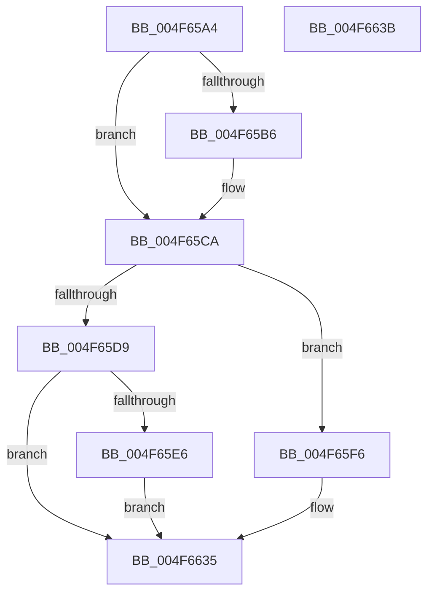

# PopFxAcpiForwardPepWorkRequest

- RVA: `0x004F65A4`–`0x004F663C` (길이 `152` bytes)
- VA: `0x00000001404F65A4`
- 실행 섹션: `.text`
- PDB 이름 있음: `예`; PDB Function 태그: `아니요`
- unwind 정보 RVA: `0x000697A4`
- 디코드: `41`개 명령, `152/152` bytes 표시
- 미해석 바이트: `0` (있으면 어셈블리에 `.byte`로 보존)

> 이 문서는 커널 이미지의 기계어와 PDB 기호를 분석해 생성했습니다. 4번과 5번은 함수 원형과 자료형을 바이너리 사용 방식에서 추정한 C 해석이며 원본 소스 복구 결과는 아닙니다.

## 1. Dependencies

- 직접 호출 지점: **4**; 고유 호출 대상: **4**
- 직접 호출자로 확인된 함수: **1**
- RIP 상대 이미지 참조: **2**

### Outgoing calls
- `0x004F65C4` → [PopFxBugCheck](../2B/PopFxBugCheck_function_002BFC6C.md) (function, `0x002BFC6C`)
- `0x004F65EF` → [KeSetEvent](../33/KeSetEvent_function_0033F310.md) (function, `0x0033F310`)
- `0x004F661D` → [guard_dispatch_icall](../6B/guard_dispatch_icall_function_006BAAD0.md) (function, `0x006BAAD0`)
- `0x004F6630` → [IoReleaseRemoveLockEx](../33/IoReleaseRemoveLockEx_function_0033D330.md) (function, `0x0033D330`)

### Direct callers
- [sub_002BD6E6](../2B/Unknown_function_002BD6E6.md) at `0x002BD93C`

### Static image references
- `0x004F6605` → RVA `0x00F070E8` (`.data`; read)
- `0x004F6611` → RVA `0x00F070E0` (`.data`; read)

## 2. Other-region calls and transfers

- 다른 실행 섹션으로 향하는 call: **0**
- 별도 외부 분기/꼬리 이동을 확인하지 못했습니다.

## 3. Assembly (complete function range)

```asm
004F65A4  40 53                           push rbx
004F65A6  48 83 EC 40                     sub rsp, 0x40
004F65AA  33 C0                           xor eax, eax
004F65AC  89 44 24 24                     mov dword ptr [rsp + 0x24], eax
004F65B0  48 39 41 50                     cmp qword ptr [rcx + 0x50], rax
004F65B4  75 14                           jne 0x1404f65ca
004F65B6  4C 63 02                        movsxd r8, dword ptr [rdx]
004F65B9  45 33 C9                        xor r9d, r9d
004F65BC  48 8B D1                        mov rdx, rcx
004F65BF  B9 68 06 00 00                  mov ecx, 0x668
004F65C4  E8 A3 96 DC FF                  call 0x1402bfc6c
004F65C9  CC                              int3
004F65CA  48 8D 99 38 01 00 00            lea rbx, [rcx + 0x138]
004F65D1  F0 FF 43 04                     lock inc dword ptr [rbx + 4]
004F65D5  38 03                           cmp byte ptr [rbx], al
004F65D7  74 1D                           je 0x1404f65f6
004F65D9  83 C8 FF                        or eax, 0xffffffff
004F65DC  F0 0F C1 43 04                  lock xadd dword ptr [rbx + 4], eax
004F65E1  83 F8 01                        cmp eax, 1
004F65E4  75 4F                           jne 0x1404f6635
004F65E6  48 8D 4B 08                     lea rcx, [rbx + 8]
004F65EA  45 33 C0                        xor r8d, r8d
004F65ED  33 D2                           xor edx, edx
004F65EF  E8 1C 8D E4 FF                  call 0x14033f310
004F65F4  EB 3F                           jmp 0x1404f6635
004F65F6  48 89 44 24 20                  mov qword ptr [rsp + 0x20], rax
004F65FB  48 8D 4C 24 20                  lea rcx, [rsp + 0x20]
004F6600  48 89 44 24 30                  mov qword ptr [rsp + 0x30], rax
004F6605  48 8B 05 DC 0A A1 00            mov rax, qword ptr [rip + 0xa10adc]
004F660C  48 89 44 24 28                  mov qword ptr [rsp + 0x28], rax
004F6611  48 8B 05 C8 0A A1 00            mov rax, qword ptr [rip + 0xa10ac8]
004F6618  48 89 54 24 38                  mov qword ptr [rsp + 0x38], rdx
004F661D  E8 AE 44 1C 00                  call 0x1406baad0
004F6622  BA 50 6F 46 77                  mov edx, 0x77466f50
004F6627  41 B8 20 00 00 00               mov r8d, 0x20
004F662D  48 8B CB                        mov rcx, rbx
004F6630  E8 FB 6C E4 FF                  call 0x14033d330
004F6635  48 83 C4 40                     add rsp, 0x40
004F6639  5B                              pop rbx
004F663A  C3                              ret
004F663B  CC                              int3
```

## 4. C-style interpretation (structured pseudocode)

```c
__int64 __fastcall PopFxAcpiForwardPepWorkRequest(__int64 a1, __int64 a2, __int64 a3, int a4)
{
    __int64 result;
    __int64 v_rsp;
    unsigned __int64 v_stack_m10;
    unsigned __int64 v_stack_m18;
    unsigned __int64 v_stack_m20;
    unsigned int v_stack_m24;
    unsigned __int64 v_stack_m28;

    v_rsp = (v_rsp) - (64);
    result = 0;
    v_stack_m24 = 0;
    if ((*(unsigned __int64 *)(a1 + 80)) == 0) {
        a3 = (int)(*(unsigned int *)(a2));
        a4 = 0;
        a2 = a1;
        a1 = 0x668ULL;
        result = PopFxBugCheck(a1, a2, a3, a4);
    }
    if ((*(unsigned __int8 *)(a1 + 312)) == ((unsigned __int8)(result))) goto loc_004F65F6;
    result = (unsigned int)((result) | (0xFFFFFFFFULL));
    if (((unsigned int)(result)) != 1) goto loc_004F6635;
    a3 = 0;
    a2 = 0;
    result = KeSetEvent(a1 + 312 + 8, a2, a3, a4);
    goto loc_004F6635;
loc_004F65F6:
    v_stack_m28 = result;
    v_stack_m18 = result;
    v_stack_m20 = *(unsigned __int64 *)(v_rip + 10554076);
    v_stack_m10 = 0;
    result = guard_dispatch_icall(v_stack_m28, a2, a3, a4);
    result = IoReleaseRemoveLockEx(a1 + 312, (unsigned int)(0x77466F50ULL), 32, a4);
loc_004F6635:
    v_rsp = (v_rsp) + (64);
    return result;
}
```

## 5. (Beta) C Style

```c
int64_t PopFxAcpiForwardPepWorkRequest(void *Arg1, void *Arg2, int64_t Arg3, int32_t Arg4)
{
    uint8_t *arg1 = (uint8_t *)Arg1;
    uint8_t *arg2 = (uint8_t *)Arg2;

    int64_t result;
    int64_t local_rsp;
    uint64_t v_stack_m10;
    uint64_t v_stack_m18;
    uint64_t v_stack_m20;
    uint32_t v_stack_m24;
    uint64_t v_stack_m28;

    local_rsp = (local_rsp) - (64);
    result = 0;
    v_stack_m24 = 0;
    if ((*(uint64_t *)(arg1 + 0x50)) == 0) {
        Arg3 = (int32_t)(*(uint32_t *)(arg2));
        Arg4 = 0;
        Arg2 = Arg1;
        Arg1 = 0x668ULL;
        result = PopFxBugCheck(Arg1, Arg2, Arg3, Arg4);
    }
    if ((*(uint8_t *)(arg1 + 0x138)) == ((uint8_t)(result))) goto loc_004F65F6;
    result = (uint32_t)((result) | (0xFFFFFFFFULL));
    if (((uint32_t)(result)) != 1) goto loc_004F6635;
    Arg3 = 0;
    Arg2 = 0;
    result = KeSetEvent(Arg1 + 312 + 8, Arg2, Arg3, Arg4);
    goto loc_004F6635;
loc_004F65F6:
    v_stack_m28 = result;
    v_stack_m18 = result;
    v_stack_m20 = *(uint64_t *)(v_rip + 0xA10ADC);
    v_stack_m10 = 0;
    result = guard_dispatch_icall(v_stack_m28, Arg2, Arg3, Arg4);
    result = IoReleaseRemoveLockEx(Arg1 + 312, (uint32_t)(0x77466F50ULL), 32, Arg4);
loc_004F6635:
    local_rsp = (local_rsp) + (64);
    return result;
}
```

### 관측된 메모리 오프셋

구조체 형식이 확인되지 않은 접근은 인자 기준의 오프셋으로만 기록했습니다.

| 기준 인자 | 오프셋 표현 | 폭 (bit) | 접근 |
|---|---:|---:|---|
| `Arg1` | `+ 0x50` | `64` | `R` |
| `Arg2` | `+ 0x0` | `32` | `R` |

## 6. Execution-region graph

[열기: 2D/3D 그래프와 함수 탐색 컨트롤 패널](../../../control-panel.html?section=text&rva=0x004F65A4&view=graph)

- 2D 그래프는 위에서 아래로 흐르고, 3D 그래프는 빈 공간을 드래그해 회전합니다. Shift+드래그는 이동, 휠은 확대·축소, 함수 노드 선택은 대상 보고서 이동입니다.

### Static fallback


