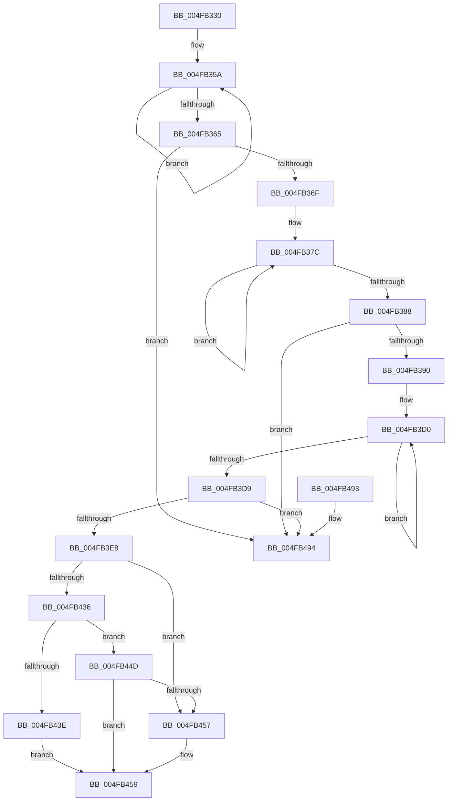

# PopFxCompleteDirectedPowerTransition

- RVA: `0x004FB330`–`0x004FB4A9` (길이 `377` bytes)
- VA: `0x00000001404FB330`
- 실행 섹션: `.text`
- PDB 이름 있음: `예`; PDB Function 태그: `아니요`
- unwind 정보 RVA: `0x000B7474`
- 디코드: `98`개 명령, `377/377` bytes 표시
- 미해석 바이트: `0` (있으면 어셈블리에 `.byte`로 보존)

> 이 문서는 커널 이미지의 기계어와 PDB 기호를 분석해 생성했습니다. 4번과 5번은 함수 원형과 자료형을 바이너리 사용 방식에서 추정한 C 해석이며 원본 소스 복구 결과는 아닙니다.

## 1. Dependencies

- 직접 호출 지점: **9**; 고유 호출 대상: **9**
- 직접 호출자로 확인된 함수: **2**
- RIP 상대 이미지 참조: **1**

### Outgoing calls
- `0x004FB397` → [PopFxDisableWorkOrderWatchdog](../2B/PopFxDisableWorkOrderWatchdog_function_002BC858.md) (function, `0x002BC858`)
- `0x004FB3A6` → [KeAcquireSpinLockRaiseToDpc](../20/KeAcquireSpinLockRaiseToDpc_function_00208470.md) (function, `0x00208470`)
- `0x004FB3BC` → [PopFxAddLogEntry](../39/PopFxAddLogEntry_function_00390B94.md) (function, `0x00390B94`)
- `0x004FB41B` → [KeReleaseSpinLock](../39/KeReleaseSpinLock_function_00392BA0.md) (function, `0x00392BA0`)
- `0x004FB427` → [PopDiagTraceFxDeviceDirectedCompletion](../4E/PopDiagTraceFxDeviceDirectedCompletion_function_004E04AC.md) (function, `0x004E04AC`)
- `0x004FB446` → [PopFxEnforceDirectedPowerTransition](../5D/PopFxEnforceDirectedPowerTransition_function_005D2ACC.md) (function, `0x005D2ACC`)
- `0x004FB462` → [PopCompleteDirectedPowerTransitionCallback](../48/PopCompleteDirectedPowerTransitionCallback_function_00483AD0.md) (function, `0x00483AD0`)
- `0x004FB46F` → [PopFxDereferenceDevice](../27/PopFxDereferenceDevice_function_0027038C.md) (function, `0x0027038C`)
- `0x004FB4A3` → [PopFxBugCheck](../2B/PopFxBugCheck_function_002BFC6C.md) (function, `0x002BFC6C`)

### Direct callers
- [PopFxDerefAndCompleteDirectedPowerTransition](../26/PopFxDerefAndCompleteDirectedPowerTransition_function_0026D8F8.md) at `0x0026D933`
- [PopFxHandleDirectedPowerTransition](../4C/PopFxHandleDirectedPowerTransition_function_004C405C.md) at `0x004C4111`

### Static image references
- `0x004FB42C` → RVA `0x00F0ED0C` (`.data`; read)

## 2. Other-region calls and transfers

- 다른 실행 섹션으로 향하는 call: **0**
- 별도 외부 분기/꼬리 이동을 확인하지 못했습니다.

## 3. Assembly (complete function range)

```asm
004FB330  48 8B C4                        mov rax, rsp
004FB333  48 89 58 08                     mov qword ptr [rax + 8], rbx
004FB337  48 89 68 10                     mov qword ptr [rax + 0x10], rbp
004FB33B  48 89 70 18                     mov qword ptr [rax + 0x18], rsi
004FB33F  48 89 78 20                     mov qword ptr [rax + 0x20], rdi
004FB343  41 54                           push r12
004FB345  41 56                           push r14
004FB347  41 57                           push r15
004FB349  48 83 EC 20                     sub rsp, 0x20
004FB34D  40 8A EA                        mov bpl, dl
004FB350  48 8B D9                        mov rbx, rcx
004FB353  0F 0D 49 20                     prefetchw byte ptr [rcx + 0x20]
004FB357  8B 41 20                        mov eax, dword ptr [rcx + 0x20]
004FB35A  44 8B C0                        mov r8d, eax
004FB35D  F0 44 0F B1 41 20               lock cmpxchg dword ptr [rcx + 0x20], r8d
004FB363  75 F5                           jne 0x1404fb35a
004FB365  0F BA E0 0D                     bt eax, 0xd
004FB369  0F 83 25 01 00 00               jae 0x1404fb494
004FB36F  0F 0D 89 B0 04 00 00            prefetchw byte ptr [rcx + 0x4b0]
004FB376  8B 81 B0 04 00 00               mov eax, dword ptr [rcx + 0x4b0]
004FB37C  8B C8                           mov ecx, eax
004FB37E  F0 0F B1 8B B0 04 00 00         lock cmpxchg dword ptr [rbx + 0x4b0], ecx
004FB386  75 F4                           jne 0x1404fb37c
004FB388  85 C0                           test eax, eax
004FB38A  0F 85 04 01 00 00               jne 0x1404fb494
004FB390  48 8D 8B F8 03 00 00            lea rcx, [rbx + 0x3f8]
004FB397  E8 BC 14 DC FF                  call 0x1402bc858
004FB39C  4C 8D BB A8 04 00 00            lea r15, [rbx + 0x4a8]
004FB3A3  49 8B CF                        mov rcx, r15
004FB3A6  E8 C5 D0 D0 FF                  call 0x140208470
004FB3AB  48 8B 4B 30                     mov rcx, qword ptr [rbx + 0x30]
004FB3AF  33 D2                           xor edx, edx
004FB3B1  44 8A E0                        mov r12b, al
004FB3B4  44 8D 4A 01                     lea r9d, [rdx + 1]
004FB3B8  44 8D 42 18                     lea r8d, [rdx + 0x18]
004FB3BC  E8 D3 57 E9 FF                  call 0x140390b94
004FB3C1  F0 81 63 20 FF DF FF FF         lock and dword ptr [rbx + 0x20], 0xffffdfff
004FB3C9  0F 0D 4B 20                     prefetchw byte ptr [rbx + 0x20]
004FB3CD  8B 43 20                        mov eax, dword ptr [rbx + 0x20]
004FB3D0  8B C8                           mov ecx, eax
004FB3D2  F0 0F B1 4B 20                  lock cmpxchg dword ptr [rbx + 0x20], ecx
004FB3D7  75 F7                           jne 0x1404fb3d0
004FB3D9  C1 E8 0C                        shr eax, 0xc
004FB3DC  41 23 C1                        and eax, r9d
004FB3DF  40 3A C5                        cmp al, bpl
004FB3E2  0F 85 AC 00 00 00               jne 0x1404fb494
004FB3E8  8B B3 C4 04 00 00               mov esi, dword ptr [rbx + 0x4c4]
004FB3EE  41 8A D4                        mov dl, r12b
004FB3F1  4C 8B B3 B8 04 00 00            mov r14, qword ptr [rbx + 0x4b8]
004FB3F8  8B C6                           mov eax, esi
004FB3FA  8B BB C0 04 00 00               mov edi, dword ptr [rbx + 0x4c0]
004FB400  83 E0 FD                        and eax, 0xfffffffd
004FB403  48 83 A3 B8 04 00 00 00         and qword ptr [rbx + 0x4b8], 0
004FB40B  49 8B CF                        mov rcx, r15
004FB40E  83 A3 C0 04 00 00 00            and dword ptr [rbx + 0x4c0], 0
004FB415  89 83 C4 04 00 00               mov dword ptr [rbx + 0x4c4], eax
004FB41B  E8 80 77 E9 FF                  call 0x140392ba0
004FB420  48 8B 4B 30                     mov rcx, qword ptr [rbx + 0x30]
004FB424  40 8A D5                        mov dl, bpl
004FB427  E8 80 50 FE FF                  call 0x1404e04ac
004FB42C  8A 05 DA 38 A1 00               mov al, byte ptr [rip + 0xa138da]
004FB432  84 C0                           test al, al
004FB434  75 21                           jne 0x1404fb457
004FB436  D1 EE                           shr esi, 1
004FB438  40 F6 C6 01                     test sil, 1
004FB43C  74 0F                           je 0x1404fb44d
004FB43E  44 8A C5                        mov r8b, bpl
004FB441  8B D7                           mov edx, edi
004FB443  48 8B CB                        mov rcx, rbx
004FB446  E8 81 76 0D 00                  call 0x1405d2acc
004FB44B  EB 0C                           jmp 0x1404fb459
004FB44D  8B 83 60 03 00 00               mov eax, dword ptr [rbx + 0x360]
004FB453  A8 01                           test al, 1
004FB455  74 02                           je 0x1404fb459
004FB457  33 FF                           xor edi, edi
004FB459  44 8B C7                        mov r8d, edi
004FB45C  49 8B D6                        mov rdx, r14
004FB45F  48 8B CB                        mov rcx, rbx
004FB462  E8 69 86 F8 FF                  call 0x140483ad0
004FB467  BA 05 00 00 00                  mov edx, 5
004FB46C  48 8B CB                        mov rcx, rbx
004FB46F  E8 18 4F D7 FF                  call 0x14027038c
004FB474  48 8B 5C 24 40                  mov rbx, qword ptr [rsp + 0x40]
004FB479  48 8B 6C 24 48                  mov rbp, qword ptr [rsp + 0x48]
004FB47E  48 8B 74 24 50                  mov rsi, qword ptr [rsp + 0x50]
004FB483  48 8B 7C 24 58                  mov rdi, qword ptr [rsp + 0x58]
004FB488  48 83 C4 20                     add rsp, 0x20
004FB48C  41 5F                           pop r15
004FB48E  41 5E                           pop r14
004FB490  41 5C                           pop r12
004FB492  C3                              ret
004FB493  CC                              int3
004FB494  45 33 C9                        xor r9d, r9d
004FB497  4C 8B C3                        mov r8, rbx
004FB49A  B9 10 09 00 00                  mov ecx, 0x910
004FB49F  41 8D 51 02                     lea edx, [r9 + 2]
004FB4A3  E8 C4 47 DC FF                  call 0x1402bfc6c
004FB4A8  CC                              int3
```

## 4. C-style interpretation (structured pseudocode)

```c
__int64 __fastcall PopFxCompleteDirectedPowerTransition(__int64 a1, int a2)
{
    __int64 result;
    __int64 v_rdi;
    __int64 v_rsi;
    __int64 v_rsp;
    unsigned __int64 v_stack_p10;
    unsigned __int64 v_stack_p18;
    unsigned __int64 v_stack_p20;
    unsigned __int64 v_stack_p8;

    *(unsigned __int64 *)(v_rsp + 8) = v_rbx;
    *(unsigned __int64 *)(v_rsp + 16) = v_rbp;
    *(unsigned __int64 *)(v_rsp + 24) = v_rsi;
    *(unsigned __int64 *)(v_rsp + 32) = v_rdi;
    v_rsp = (v_rsp) - (32);
loc_004FB35A:
    if (condition_is_not_equal) goto loc_004FB35A;
    if (condition_is_above_or_equal) goto loc_004FB494;
loc_004FB37C:
    if (condition_is_not_equal) goto loc_004FB37C;
    if ((unsigned int)((unsigned int)(*(unsigned int *)(a1 + 1200))) != 0) goto loc_004FB494;
    result = PopFxDisableWorkOrderWatchdog(a1 + 1016, a2, (unsigned int)((unsigned int)((unsigned int)(*(unsigned int *)(a1 + 32)))), a4);
    result = KeAcquireSpinLockRaiseToDpc(a1 + 1192, a2, (unsigned int)((unsigned int)((unsigned int)(*(unsigned int *)(a1 + 32)))), a4);
    a2 = 0;
    result = PopFxAddLogEntry(*(unsigned __int64 *)(a1 + 48), a2, a2 + 24, a2 + 1);
loc_004FB3D0:
    if (condition_is_not_equal) goto loc_004FB3D0;
    result = (unsigned int)(((unsigned int)(*(unsigned int *)(a1 + 32))) >> (12));
    result = (unsigned int)((result) & ((unsigned int)(a2 + 1)));
    if (((unsigned __int8)(result)) != ((unsigned __int8)((unsigned __int8)(a2)))) goto loc_004FB494;
    result = (unsigned int)(((unsigned int)((unsigned int)((unsigned int)(*(unsigned int *)(a1 + 1220))))) & (0xFFFFFFFDULL));
    *(unsigned int *)(a1 + 1220) = (unsigned int)(result);
    result = KeReleaseSpinLock(a1 + 1192, (unsigned __int8)((unsigned __int8)(result)), a2 + 24, a2 + 1);
    result = PopDiagTraceFxDeviceDirectedCompletion(*(unsigned __int64 *)(a1 + 48), (unsigned __int8)((unsigned __int8)(a2)), a2 + 24, a2 + 1);
    if ((unsigned __int8)(*(unsigned __int8 *)(v_rip + 10565850)) != 0) goto loc_004FB457;
    v_rsi = (unsigned int)(((unsigned int)(*(unsigned int *)(a1 + 1220))) >> (1));
    if ((((unsigned __int8)(v_rsi)) & (1)) == 0) goto loc_004FB44D;
    result = PopFxEnforceDirectedPowerTransition(a1, (unsigned int)((unsigned int)((unsigned int)(*(unsigned int *)(a1 + 1216)))), (unsigned __int8)((unsigned __int8)(a2)), a2 + 1);
    goto loc_004FB459;
loc_004FB44D:
    v_rdi = (unsigned int)(*(unsigned int *)(a1 + 1216));
    if ((((unsigned __int8)((unsigned int)(*(unsigned int *)(a1 + 864)))) & (1)) != 0) {
        v_rdi = 0;
    }
    result = PopCompleteDirectedPowerTransitionCallback(a1, *(unsigned __int64 *)(a1 + 1208), 0, a2 + 1);
    result = PopFxDereferenceDevice(a1, 5, 0, a2 + 1);
    v_rsp = (v_rsp) + (32);
    return result;
loc_004FB494:
    a4 = 0;
    result = PopFxBugCheck((unsigned int)(0x910ULL), a4 + 2, v_stack_p8, a4);
    return result;
}
```

## 5. (Beta) C Style

```c
int64_t PopFxCompleteDirectedPowerTransition(void *Arg1, int32_t Arg2)
{
    uint8_t *arg1 = (uint8_t *)Arg1;

    int64_t result;
    int64_t local_rdi;
    int64_t local_rsi;
    int64_t local_rsp;
    uint64_t v_stack_p10;
    uint64_t v_stack_p18;
    uint64_t v_stack_p20;
    uint64_t v_stack_p8;

    *(uint64_t *)(local_rsp + 0x8) = local_rbx;
    *(uint64_t *)(local_rsp + 0x10) = local_rbp;
    *(uint64_t *)(local_rsp + 0x18) = local_rsi;
    *(uint64_t *)(local_rsp + 0x20) = local_rdi;
    local_rsp = (local_rsp) - (32);
loc_004FB35A:
    if (condition_is_not_equal) goto loc_004FB35A;
    if (condition_is_above_or_equal) goto loc_004FB494;
loc_004FB37C:
    if (condition_is_not_equal) goto loc_004FB37C;
    if ((uint32_t)((uint32_t)(*(uint32_t *)(arg1 + 0x4B0))) != 0) goto loc_004FB494;
    result = PopFxDisableWorkOrderWatchdog(Arg1 + 1016, Arg2, (uint32_t)((uint32_t)((uint32_t)(*(uint32_t *)(arg1 + 0x20)))), a4);
    result = KeAcquireSpinLockRaiseToDpc(Arg1 + 1192, Arg2, (uint32_t)((uint32_t)((uint32_t)(*(uint32_t *)(arg1 + 0x20)))), a4);
    Arg2 = 0;
    result = PopFxAddLogEntry(*(uint64_t *)(arg1 + 0x30), Arg2, Arg2 + 24, Arg2 + 1);
loc_004FB3D0:
    if (condition_is_not_equal) goto loc_004FB3D0;
    result = (uint32_t)(((uint32_t)(*(uint32_t *)(arg1 + 0x20))) >> (12));
    result = (uint32_t)((result) & ((uint32_t)(Arg2 + 1)));
    if (((uint8_t)(result)) != ((uint8_t)((uint8_t)(Arg2)))) goto loc_004FB494;
    result = (uint32_t)(((uint32_t)((uint32_t)((uint32_t)(*(uint32_t *)(arg1 + 0x4C4))))) & (0xFFFFFFFDULL));
    *(uint32_t *)(arg1 + 0x4C4) = (uint32_t)(result);
    result = KeReleaseSpinLock(Arg1 + 1192, (uint8_t)((uint8_t)(result)), Arg2 + 24, Arg2 + 1);
    result = PopDiagTraceFxDeviceDirectedCompletion(*(uint64_t *)(arg1 + 0x30), (uint8_t)((uint8_t)(Arg2)), Arg2 + 24, Arg2 + 1);
    if ((uint8_t)(*(uint8_t *)(v_rip + 0xA138DA)) != 0) goto loc_004FB457;
    local_rsi = (uint32_t)(((uint32_t)(*(uint32_t *)(arg1 + 0x4C4))) >> (1));
    if ((((uint8_t)(local_rsi)) & (1)) == 0) goto loc_004FB44D;
    result = PopFxEnforceDirectedPowerTransition(Arg1, (uint32_t)((uint32_t)((uint32_t)(*(uint32_t *)(arg1 + 0x4C0)))), (uint8_t)((uint8_t)(Arg2)), Arg2 + 1);
    goto loc_004FB459;
loc_004FB44D:
    local_rdi = (uint32_t)(*(uint32_t *)(arg1 + 0x4C0));
    if ((((uint8_t)((uint32_t)(*(uint32_t *)(arg1 + 0x360)))) & (1)) != 0) {
        local_rdi = 0;
    }
    result = PopCompleteDirectedPowerTransitionCallback(Arg1, *(uint64_t *)(arg1 + 0x4B8), 0, Arg2 + 1);
    result = PopFxDereferenceDevice(Arg1, 5, 0, Arg2 + 1);
    local_rsp = (local_rsp) + (32);
    return result;
loc_004FB494:
    a4 = 0;
    result = PopFxBugCheck((uint32_t)(0x910ULL), a4 + 2, v_stack_p8, a4);
    return result;
}
```

### 관측된 메모리 오프셋

구조체 형식이 확인되지 않은 접근은 인자 기준의 오프셋으로만 기록했습니다.

| 기준 인자 | 오프셋 표현 | 폭 (bit) | 접근 |
|---|---:|---:|---|
| `Arg1` | `+ 0x20` | `8` | `R` |
| `Arg1` | `+ 0x20` | `32` | `R` |
| `Arg1` | `+ 0x20` | `32` | `R/W` |
| `Arg1` | `+ 0x30` | `64` | `R` |
| `Arg1` | `+ 0x360` | `32` | `R` |
| `Arg1` | `+ 0x3F8` | `64` | `R` |
| `Arg1` | `+ 0x4A8` | `64` | `R` |
| `Arg1` | `+ 0x4B0` | `8` | `R` |
| `Arg1` | `+ 0x4B0` | `32` | `R` |
| `Arg1` | `+ 0x4B8` | `64` | `R` |
| `Arg1` | `+ 0x4B8` | `64` | `R/W` |
| `Arg1` | `+ 0x4C0` | `32` | `R` |
| `Arg1` | `+ 0x4C0` | `32` | `R/W` |
| `Arg1` | `+ 0x4C4` | `32` | `R` |
| `Arg1` | `+ 0x4C4` | `32` | `W` |

## 6. Execution-region graph

[열기: 2D/3D 그래프와 함수 탐색 컨트롤 패널](../../../control-panel.html?section=text&rva=0x004FB330&view=graph)

- 2D 그래프는 위에서 아래로 흐르고, 3D 그래프는 빈 공간을 드래그해 회전합니다. Shift+드래그는 이동, 휠은 확대·축소, 함수 노드 선택은 대상 보고서 이동입니다.

### Static fallback


