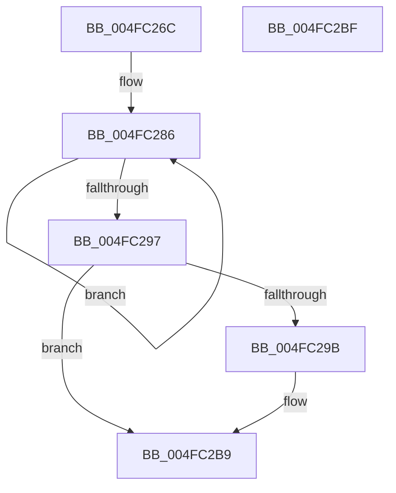

# PopFxDestroyDeviceCommon

- RVA: `0x004FC26C`–`0x004FC2C0` (길이 `84` bytes)
- VA: `0x00000001404FC26C`
- 실행 섹션: `.text`
- PDB 이름 있음: `예`; PDB Function 태그: `아니요`
- unwind 정보 RVA: `0x0005CF00`
- 디코드: `23`개 명령, `84/84` bytes 표시
- 미해석 바이트: `0` (있으면 어셈블리에 `.byte`로 보존)

> 이 문서는 커널 이미지의 기계어와 PDB 기호를 분석해 생성했습니다. 4번과 5번은 함수 원형과 자료형을 바이너리 사용 방식에서 추정한 C 해석이며 원본 소스 복구 결과는 아닙니다.

## 1. Dependencies

- 직접 호출 지점: **2**; 고유 호출 대상: **1**
- 직접 호출자로 확인된 함수: **3**
- RIP 상대 이미지 참조: **0**

### Outgoing calls
- `0x004FC2A7` → [ExFreePoolWithTag](../../poolcode/B8/ExFreePoolWithTag_function_00B82870.md) (function, `0x00B82870`)
- `0x004FC2B4` → [ExFreePoolWithTag](../../poolcode/B8/ExFreePoolWithTag_function_00B82870.md) (function, `0x00B82870`)

### Direct callers
- [PopFxDestroyDeviceDpm](../4E/PopFxDestroyDeviceDpm_function_004E394C.md) at `0x004E3A43`
- [PopFxAcpiRegisterDevice](../5D/PopFxAcpiRegisterDevice_function_005DD724.md) at `0x005DD805`
- [PopFxAcpiUnregisterDevice](../5D/PopFxAcpiUnregisterDevice_function_005DD830.md) at `0x005DD8C6`

### Static image references
- 디코드된 RIP-relative 메모리 참조가 없습니다.

## 2. Other-region calls and transfers

- 다른 실행 섹션으로 향하는 call: **2**
  - `0x004FC2A7` → [ExFreePoolWithTag](../../poolcode/B8/ExFreePoolWithTag_function_00B82870.md) (`.text` → `POOLCODE`)
  - `0x004FC2B4` → [ExFreePoolWithTag](../../poolcode/B8/ExFreePoolWithTag_function_00B82870.md) (`.text` → `POOLCODE`)
- 별도 외부 분기/꼬리 이동을 확인하지 못했습니다.

## 3. Assembly (complete function range)

```asm
004FC26C  40 53                           push rbx
004FC26E  48 83 EC 20                     sub rsp, 0x20
004FC272  48 8B D9                        mov rbx, rcx
004FC275  8B CA                           mov ecx, edx
004FC277  F7 D1                           not ecx
004FC279  0F 0D 8B E8 00 00 00            prefetchw byte ptr [rbx + 0xe8]
004FC280  8B 83 E8 00 00 00               mov eax, dword ptr [rbx + 0xe8]
004FC286  44 8B C0                        mov r8d, eax
004FC289  44 23 C1                        and r8d, ecx
004FC28C  F0 44 0F B1 83 E8 00 00 00      lock cmpxchg dword ptr [rbx + 0xe8], r8d
004FC295  75 EF                           jne 0x1404fc286
004FC297  3B C2                           cmp eax, edx
004FC299  75 1E                           jne 0x1404fc2b9
004FC29B  48 8B 8B E0 00 00 00            mov rcx, qword ptr [rbx + 0xe0]
004FC2A2  BA 50 46 58 4D                  mov edx, 0x4d584650
004FC2A7  E8 C4 65 68 00                  call 0x140b82870
004FC2AC  BA 50 46 58 4D                  mov edx, 0x4d584650
004FC2B1  48 8B CB                        mov rcx, rbx
004FC2B4  E8 B7 65 68 00                  call 0x140b82870
004FC2B9  48 83 C4 20                     add rsp, 0x20
004FC2BD  5B                              pop rbx
004FC2BE  C3                              ret
004FC2BF  CC                              int3
```

## 4. C-style interpretation (structured pseudocode)

```c
__int64 __fastcall PopFxDestroyDeviceCommon(__int64 a1, int a2)
{
    __int64 result;
    __int64 v_rsp;

    v_rsp = (v_rsp) - (32);
    a1 = (unsigned int)(~((unsigned int)(a2)));
loc_004FC286:
    a3 = (unsigned int)(((unsigned int)((unsigned int)((unsigned int)(*(unsigned int *)(a1 + 232))))) & ((unsigned int)(a1)));
    if (condition_is_not_equal) goto loc_004FC286;
    result = (unsigned int)(*(unsigned int *)(a1 + 232));
    if (((unsigned int)((unsigned int)(*(unsigned int *)(a1 + 232)))) == a2) {
        a1 = *(unsigned __int64 *)(a1 + 224);
        a2 = 0x4D584650ULL;
        result = ExFreePoolWithTag(a1, a2, a3, a4);
        a2 = 0x4D584650ULL;
        a1 = a1;
        result = ExFreePoolWithTag(a1, a2, a3, a4);
    }
    v_rsp = (v_rsp) + (32);
    return result;
}
```

## 5. (Beta) C Style

```c
int64_t PopFxDestroyDeviceCommon(void *Arg1, int32_t Arg2)
{
    uint8_t *arg1 = (uint8_t *)Arg1;

    int64_t result;
    int64_t local_rsp;

    local_rsp = (local_rsp) - (32);
    Arg1 = (uint32_t)(~((uint32_t)(Arg2)));
loc_004FC286:
    a3 = (uint32_t)(((uint32_t)((uint32_t)((uint32_t)(*(uint32_t *)(arg1 + 0xE8))))) & ((uint32_t)(Arg1)));
    if (condition_is_not_equal) goto loc_004FC286;
    result = (uint32_t)(*(uint32_t *)(arg1 + 0xE8));
    if (((uint32_t)((uint32_t)(*(uint32_t *)(arg1 + 0xE8)))) == Arg2) {
        Arg1 = *(uint64_t *)(arg1 + 0xE0);
        Arg2 = 0x4D584650ULL;
        result = ExFreePoolWithTag(Arg1, Arg2, a3, a4);
        Arg2 = 0x4D584650ULL;
        Arg1 = Arg1;
        result = ExFreePoolWithTag(Arg1, Arg2, a3, a4);
    }
    local_rsp = (local_rsp) + (32);
    return result;
}
```

### 관측된 메모리 오프셋

구조체 형식이 확인되지 않은 접근은 인자 기준의 오프셋으로만 기록했습니다.

| 기준 인자 | 오프셋 표현 | 폭 (bit) | 접근 |
|---|---:|---:|---|
| `Arg1` | `+ 0xE0` | `64` | `R` |
| `Arg1` | `+ 0xE8` | `8` | `R` |
| `Arg1` | `+ 0xE8` | `32` | `R` |

## 6. Execution-region graph

[열기: 2D/3D 그래프와 함수 탐색 컨트롤 패널](../../../control-panel.html?section=text&rva=0x004FC26C&view=graph)

- 2D 그래프는 위에서 아래로 흐르고, 3D 그래프는 빈 공간을 드래그해 회전합니다. Shift+드래그는 이동, 휠은 확대·축소, 함수 노드 선택은 대상 보고서 이동입니다.

### Static fallback


