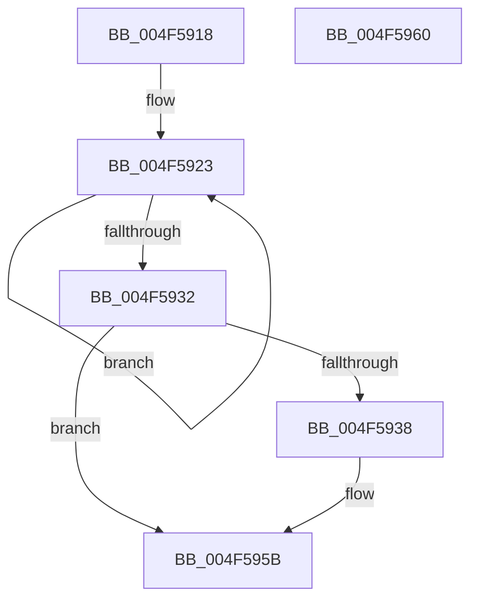

# PopFxNotifyPendingSIrpReady

- RVA: `0x004F5918`–`0x004F5961` (길이 `73` bytes)
- VA: `0x00000001404F5918`
- 실행 섹션: `.text`
- PDB 이름 있음: `예`; PDB Function 태그: `아니요`
- unwind 정보 RVA: `0x0005C788`
- 디코드: `19`개 명령, `73/73` bytes 표시
- 미해석 바이트: `0` (있으면 어셈블리에 `.byte`로 보존)

> 이 문서는 커널 이미지의 기계어와 PDB 기호를 분석해 생성했습니다. 4번과 5번은 함수 원형과 자료형을 바이너리 사용 방식에서 추정한 C 해석이며 원본 소스 복구 결과는 아닙니다.

## 1. Dependencies

- 직접 호출 지점: **1**; 고유 호출 대상: **1**
- 직접 호출자로 확인된 함수: **2**
- RIP 상대 이미지 참조: **0**

### Outgoing calls
- `0x004F5956` → [PopSystemIrpCompletion](../../pagelk/B7/PopSystemIrpCompletion_function_00B70CC0.md) (function, `0x00B70CC0`)

### Direct callers
- [PopFxHandleReportDevicePoweredOn](../26/PopFxHandleReportDevicePoweredOn_function_0026D980.md) at `0x0026DB6B`
- [PopHandleDevicePowerIrpCompletion](../26/PopHandleDevicePowerIrpCompletion_function_0026F030.md) at `0x0026F1B8`

### Static image references
- 디코드된 RIP-relative 메모리 참조가 없습니다.

## 2. Other-region calls and transfers

- 다른 실행 섹션으로 향하는 call: **1**
  - `0x004F5956` → [PopSystemIrpCompletion](../../pagelk/B7/PopSystemIrpCompletion_function_00B70CC0.md) (`.text` → `PAGELK`)
- 별도 외부 분기/꼬리 이동을 확인하지 못했습니다.

## 3. Assembly (complete function range)

```asm
004F5918  48 83 EC 28                     sub rsp, 0x28
004F591C  0F 0D 49 20                     prefetchw byte ptr [rcx + 0x20]
004F5920  8B 41 20                        mov eax, dword ptr [rcx + 0x20]
004F5923  8B D0                           mov edx, eax
004F5925  81 E2 FF F3 FF FF               and edx, 0xfffff3ff
004F592B  F0 0F B1 51 20                  lock cmpxchg dword ptr [rcx + 0x20], edx
004F5930  75 F1                           jne 0x1404f5923
004F5932  0F BA E0 0A                     bt eax, 0xa
004F5936  73 23                           jae 0x1404f595b
004F5938  48 8B 41 30                     mov rax, qword ptr [rcx + 0x30]
004F593C  33 C9                           xor ecx, ecx
004F593E  48 8B 90 18 01 00 00            mov rdx, qword ptr [rax + 0x118]
004F5945  48 0F BE 42 42                  movsx rax, byte ptr [rdx + 0x42]
004F594A  4C 8D 04 C0                     lea r8, [rax + rax*8]
004F594E  4E 8B 84 C2 C8 00 00 00         mov r8, qword ptr [rdx + r8*8 + 0xc8]
004F5956  E8 65 B3 67 00                  call 0x140b70cc0
004F595B  48 83 C4 28                     add rsp, 0x28
004F595F  C3                              ret
004F5960  CC                              int3
```

## 4. C-style interpretation (structured pseudocode)

```c
__int64 __fastcall PopFxNotifyPendingSIrpReady(__int64 a1)
{
    __int64 result;
    __int64 v_rsp;

    v_rsp = (v_rsp) - (40);
loc_004F5923:
    a2 = (unsigned int)(((unsigned int)((unsigned int)((unsigned int)(*(unsigned int *)(a1 + 32))))) & (0xFFFFF3FFULL));
    if (condition_is_not_equal) goto loc_004F5923;
    result = (unsigned int)(*(unsigned int *)(a1 + 32));
    if (!(condition_is_above_or_equal)) {
        result = *(unsigned __int64 *)(a1 + 48);
        a1 = 0;
        a2 = *(unsigned __int64 *)(result + 280);
        result = (__int8)(*(unsigned __int8 *)(a2 + 66));
        a3 = result + result * 8;
        a3 = *(unsigned __int64 *)(a2 + a3 * 8 + 200);
        result = PopSystemIrpCompletion(a1, a2, a3, a4);
    }
    v_rsp = (v_rsp) + (40);
    return result;
}
```

## 5. (Beta) C Style

```c
int64_t PopFxNotifyPendingSIrpReady(void *Arg1)
{
    uint8_t *arg1 = (uint8_t *)Arg1;

    int64_t result;
    int64_t local_rsp;

    local_rsp = (local_rsp) - (40);
loc_004F5923:
    a2 = (uint32_t)(((uint32_t)((uint32_t)((uint32_t)(*(uint32_t *)(arg1 + 0x20))))) & (0xFFFFF3FFULL));
    if (condition_is_not_equal) goto loc_004F5923;
    result = (uint32_t)(*(uint32_t *)(arg1 + 0x20));
    if (!(condition_is_above_or_equal)) {
        result = *(uint64_t *)(arg1 + 0x30);
        Arg1 = 0;
        a2 = *(uint64_t *)(result + 0x118);
        result = (int8_t)(*(uint8_t *)(a2 + 0x42));
        a3 = result + result * 8;
        a3 = *(uint64_t *)(a2 + a3 * 8 + 0xC8);
        result = PopSystemIrpCompletion(Arg1, a2, a3, a4);
    }
    local_rsp = (local_rsp) + (40);
    return result;
}
```

### 관측된 메모리 오프셋

구조체 형식이 확인되지 않은 접근은 인자 기준의 오프셋으로만 기록했습니다.

| 기준 인자 | 오프셋 표현 | 폭 (bit) | 접근 |
|---|---:|---:|---|
| `Arg1` | `+ 0x20` | `8` | `R` |
| `Arg1` | `+ 0x20` | `32` | `R` |
| `Arg1` | `+ 0x30` | `64` | `R` |

## 6. Execution-region graph

[열기: 2D/3D 그래프와 함수 탐색 컨트롤 패널](../../../control-panel.html?section=text&rva=0x004F5918&view=graph)

- 2D 그래프는 위에서 아래로 흐르고, 3D 그래프는 빈 공간을 드래그해 회전합니다. Shift+드래그는 이동, 휠은 확대·축소, 함수 노드 선택은 대상 보고서 이동입니다.

### Static fallback


