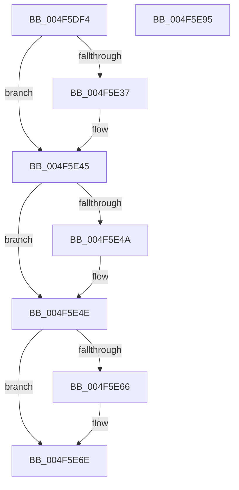

# PopFxPrepareDevicesForShutdown

- RVA: `0x004F5DF4`–`0x004F5E96` (길이 `162` bytes)
- VA: `0x00000001404F5DF4`
- 실행 섹션: `.text`
- PDB 이름 있음: `예`; PDB Function 태그: `아니요`
- unwind 정보 RVA: `0x00060BC4`
- 디코드: `41`개 명령, `162/162` bytes 표시
- 미해석 바이트: `0` (있으면 어셈블리에 `.byte`로 보존)

> 이 문서는 커널 이미지의 기계어와 PDB 기호를 분석해 생성했습니다. 4번과 5번은 함수 원형과 자료형을 바이너리 사용 방식에서 추정한 C 해석이며 원본 소스 복구 결과는 아닙니다.

## 1. Dependencies

- 직접 호출 지점: **6**; 고유 호출 대상: **6**
- 직접 호출자로 확인된 함수: **1**
- RIP 상대 이미지 참조: **3**

### Outgoing calls
- `0x004F5E27` → [KeAbPreAcquire](../21/KeAbPreAcquire_function_00210230.md) (function, `0x00210230`)
- `0x004F5E40` → [ExfAcquirePushLockExclusiveEx](../20/ExfAcquirePushLockExclusiveEx_function_0020FC90.md) (function, `0x0020FC90`)
- `0x004F5E69` → [ExfTryToWakePushLock](../26/ExfTryToWakePushLock_function_00265DD0.md) (function, `0x00265DD0`)
- `0x004F5E71` → [KeAbPostRelease](../2E/KeAbPostRelease_function_002E1600.md) (function, `0x002E1600`)
- `0x004F5E76` → [KeLeaveCriticalRegion](../25/KeLeaveCriticalRegion_function_0025D8B0.md) (function, `0x0025D8B0`)
- `0x004F5E80` → [PopFxActivateDevicesForSx](../4A/PopFxActivateDevicesForSx_function_004A0CAC.md) (function, `0x004A0CAC`)

### Direct callers
- [PopTransitionSystemPowerStateEx](../../pagelk/B7/PopTransitionSystemPowerStateEx_function_00B7E8C0.md) at `0x00B7FBE8`

### Static image references
- `0x004F5E0C` → RVA `0x00F0E408` (`.data`; read)
- `0x004F5E4E` → RVA `0x00E676B4` (`.data`; write)
- `0x004F5E55` → RVA `0x00F0E408` (`.data`; read/write)

## 2. Other-region calls and transfers

- 다른 실행 섹션으로 향하는 call: **0**
- 별도 외부 분기/꼬리 이동을 확인하지 못했습니다.

## 3. Assembly (complete function range)

```asm
004F5DF4  48 89 5C 24 08                  mov qword ptr [rsp + 8], rbx
004F5DF9  48 89 74 24 10                  mov qword ptr [rsp + 0x10], rsi
004F5DFE  57                              push rdi
004F5DFF  48 83 EC 20                     sub rsp, 0x20
004F5E03  65 48 8B 04 25 88 01 00 00      mov rax, qword ptr gs:[0x188]
004F5E0C  48 8D 35 F5 85 A1 00            lea rsi, [rip + 0xa185f5]
004F5E13  48 83 CB FF                     or rbx, 0xffffffffffffffff
004F5E17  45 33 C0                        xor r8d, r8d
004F5E1A  33 D2                           xor edx, edx
004F5E1C  48 8B CE                        mov rcx, rsi
004F5E1F  66 01 98 E4 01 00 00            add word ptr [rax + 0x1e4], bx
004F5E26  90                              nop
004F5E27  E8 04 A4 D1 FF                  call 0x140210230
004F5E2C  F0 48 0F BA 2E 00               lock bts qword ptr [rsi], 0
004F5E32  48 8B F8                        mov rdi, rax
004F5E35  73 0E                           jae 0x1404f5e45
004F5E37  4C 8B C6                        mov r8, rsi
004F5E3A  48 8B D0                        mov rdx, rax
004F5E3D  48 8B CE                        mov rcx, rsi
004F5E40  E8 4B 9E D1 FF                  call 0x14020fc90
004F5E45  48 85 FF                        test rdi, rdi
004F5E48  74 04                           je 0x1404f5e4e
004F5E4A  C6 47 0A 01                     mov byte ptr [rdi + 0xa], 1
004F5E4E  C6 05 5F 18 97 00 01            mov byte ptr [rip + 0x97185f], 1
004F5E55  F0 48 0F C1 1D AA 85 A1 00      lock xadd qword ptr [rip + 0xa185aa], rbx
004F5E5E  80 E3 06                        and bl, 6
004F5E61  80 FB 02                        cmp bl, 2
004F5E64  75 08                           jne 0x1404f5e6e
004F5E66  48 8B CE                        mov rcx, rsi
004F5E69  E8 62 FF D6 FF                  call 0x140265dd0
004F5E6E  48 8B CE                        mov rcx, rsi
004F5E71  E8 8A B7 DE FF                  call 0x1402e1600
004F5E76  E8 35 7A D6 FF                  call 0x14025d8b0
004F5E7B  B9 04 00 00 00                  mov ecx, 4
004F5E80  E8 27 AE FA FF                  call 0x1404a0cac
004F5E85  48 8B 5C 24 30                  mov rbx, qword ptr [rsp + 0x30]
004F5E8A  48 8B 74 24 38                  mov rsi, qword ptr [rsp + 0x38]
004F5E8F  48 83 C4 20                     add rsp, 0x20
004F5E93  5F                              pop rdi
004F5E94  C3                              ret
004F5E95  CC                              int3
```

## 4. C-style interpretation (structured pseudocode)

```c
__int64 __fastcall PopFxPrepareDevicesForShutdown(__int64 a1, int a2, int a3)
{
    __int64 result;
    __int64 v_rbx;
    __int64 v_rsp;
    unsigned __int64 v_stack_p10;
    unsigned __int64 v_stack_p8;

    v_stack_p8 = v_rbx;
    v_stack_p10 = v_rsi;
    v_rsp = (v_rsp) - (32);
    v_rbx = (v_rbx) | (-1);
    a3 = 0;
    a2 = 0;
    result = KeAbPreAcquire(v_rip + 10585589, a2, a3, a4);
    if (!(condition_is_above_or_equal)) {
        a3 = v_rip + 10585589;
        a2 = result;
        a1 = v_rip + 10585589;
        result = ExfAcquirePushLockExclusiveEx(a1, a2, a3, a4);
    }
    if (result != 0) {
        *(unsigned __int8 *)(result + 10) = 1;
    }
    *(unsigned __int8 *)(v_rip + 9902175) = 1;
    v_rbx = (unsigned __int8)((v_rbx) & (6));
    if (((unsigned __int8)(v_rbx)) == 2) {
        a1 = v_rip + 10585589;
        result = ExfTryToWakePushLock(a1, a2, a3, a4);
    }
    result = KeAbPostRelease(v_rip + 10585589, a2, a3, a4);
    result = KeLeaveCriticalRegion(v_rip + 10585589, a2, a3, a4);
    result = PopFxActivateDevicesForSx(4, a2, a3, a4);
    v_rsp = (v_rsp) + (32);
    return result;
}
```

## 5. (Beta) C Style

```c
int64_t PopFxPrepareDevicesForShutdown(int64_t Arg1, int32_t Arg2, int32_t Arg3)
{
    int64_t result;
    int64_t local_rbx;
    int64_t local_rsp;
    uint64_t v_stack_p10;
    uint64_t v_stack_p8;

    v_stack_p8 = local_rbx;
    v_stack_p10 = local_rsi;
    local_rsp = (local_rsp) - (32);
    local_rbx = (local_rbx) | (-1);
    Arg3 = 0;
    Arg2 = 0;
    result = KeAbPreAcquire(v_rip + 10585589, Arg2, Arg3, a4);
    if (!(condition_is_above_or_equal)) {
        Arg3 = v_rip + 10585589;
        Arg2 = result;
        Arg1 = v_rip + 10585589;
        result = ExfAcquirePushLockExclusiveEx(Arg1, Arg2, Arg3, a4);
    }
    if (result != 0) {
        *(uint8_t *)(result + 0xA) = 1;
    }
    *(uint8_t *)(v_rip + 0x97185F) = 1;
    local_rbx = (uint8_t)((local_rbx) & (6));
    if (((uint8_t)(local_rbx)) == 2) {
        Arg1 = v_rip + 10585589;
        result = ExfTryToWakePushLock(Arg1, Arg2, Arg3, a4);
    }
    result = KeAbPostRelease(v_rip + 10585589, Arg2, Arg3, a4);
    result = KeLeaveCriticalRegion(v_rip + 10585589, Arg2, Arg3, a4);
    result = PopFxActivateDevicesForSx(4, Arg2, Arg3, a4);
    local_rsp = (local_rsp) + (32);
    return result;
}
```

## 6. Execution-region graph

[열기: 2D/3D 그래프와 함수 탐색 컨트롤 패널](../../../control-panel.html?section=text&rva=0x004F5DF4&view=graph)

- 2D 그래프는 위에서 아래로 흐르고, 3D 그래프는 빈 공간을 드래그해 회전합니다. Shift+드래그는 이동, 휠은 확대·축소, 함수 노드 선택은 대상 보고서 이동입니다.

### Static fallback


