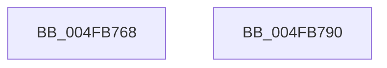

# PopRunNormalIrpWorkers

- RVA: `0x004FB768`–`0x004FB791` (길이 `41` bytes)
- VA: `0x00000001404FB768`
- 실행 섹션: `.text`
- PDB 이름 있음: `예`; PDB Function 태그: `아니요`
- unwind 정보 RVA: `0x0005C788`
- 디코드: `9`개 명령, `41/41` bytes 표시
- 미해석 바이트: `0` (있으면 어셈블리에 `.byte`로 보존)

> 이 문서는 커널 이미지의 기계어와 PDB 기호를 분석해 생성했습니다. 4번과 5번은 함수 원형과 자료형을 바이너리 사용 방식에서 추정한 C 해석이며 원본 소스 복구 결과는 아닙니다.

## 1. Dependencies

- 직접 호출 지점: **2**; 고유 호출 대상: **2**
- 직접 호출자로 확인된 함수: **1**
- RIP 상대 이미지 참조: **2**

### Outgoing calls
- `0x004FB773` → [ExAcquireFastMutex](../20/ExAcquireFastMutex_function_0020E5A0.md) (function, `0x0020E5A0`)
- `0x004FB786` → [ExReleaseFastMutex](../25/ExReleaseFastMutex_function_002519C0.md) (function, `0x002519C0`)

### Direct callers
- [PopUnlockAfterSleepWorker](../../pagelk/B7/PopUnlockAfterSleepWorker_function_00B782A0.md) at `0x00B7832B`

### Static image references
- `0x004FB76C` → RVA `0x00F091A0` (`.data`; read)
- `0x004FB77F` → RVA `0x00F091D8` (`.data`; write)

## 2. Other-region calls and transfers

- 다른 실행 섹션으로 향하는 call: **0**
- 별도 외부 분기/꼬리 이동을 확인하지 못했습니다.

## 3. Assembly (complete function range)

```asm
004FB768  48 83 EC 28                     sub rsp, 0x28
004FB76C  48 8D 0D 2D DA A0 00            lea rcx, [rip + 0xa0da2d]
004FB773  E8 28 2E D1 FF                  call 0x14020e5a0
004FB778  48 8D 0D 21 DA A0 00            lea rcx, [rip + 0xa0da21]
004FB77F  C6 05 52 DA A0 00 01            mov byte ptr [rip + 0xa0da52], 1
004FB786  E8 35 62 D5 FF                  call 0x1402519c0
004FB78B  48 83 C4 28                     add rsp, 0x28
004FB78F  C3                              ret
004FB790  CC                              int3
```

## 4. C-style interpretation (structured pseudocode)

```c
__int64 __fastcall PopRunNormalIrpWorkers(void)
{
    __int64 result;
    __int64 v_rsp;

    v_rsp = (v_rsp) - (40);
    result = ExAcquireFastMutex(v_rip + 10541613, a2, a3, a4);
    *(unsigned __int8 *)(v_rip + 10541650) = 1;
    result = ExReleaseFastMutex(v_rip + 10541601, a2, a3, a4);
    v_rsp = (v_rsp) + (40);
    return result;
}
```

## 5. (Beta) C Style

```c
void PopRunNormalIrpWorkers(void)
{
    int64_t result;
    int64_t local_rsp;

    local_rsp = (local_rsp) - (40);
    result = ExAcquireFastMutex(v_rip + 10541613, a2, a3, a4);
    *(uint8_t *)(v_rip + 0xA0DA52) = 1;
    result = ExReleaseFastMutex(v_rip + 10541601, a2, a3, a4);
    local_rsp = (local_rsp) + (40);
    return result;
}
```

## 6. Execution-region graph

[열기: 2D/3D 그래프와 함수 탐색 컨트롤 패널](../../../control-panel.html?section=text&rva=0x004FB768&view=graph)

- 2D 그래프는 위에서 아래로 흐르고, 3D 그래프는 빈 공간을 드래그해 회전합니다. Shift+드래그는 이동, 휠은 확대·축소, 함수 노드 선택은 대상 보고서 이동입니다.

### Static fallback


