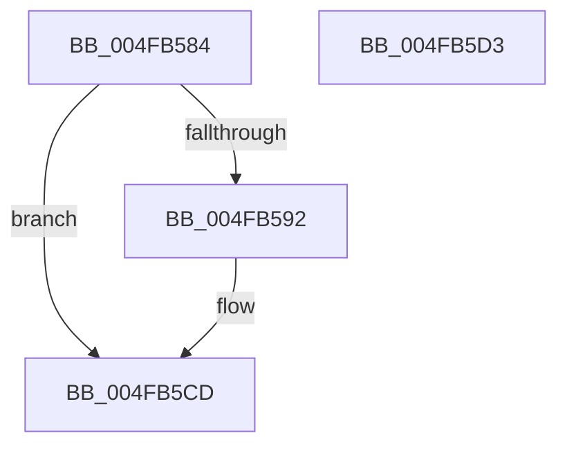

# PopThermalEventTransitionEnableDeepSleep

- RVA: `0x004FB584`–`0x004FB5D4` (길이 `80` bytes)
- VA: `0x00000001404FB584`
- 실행 섹션: `.text`
- PDB 이름 있음: `예`; PDB Function 태그: `아니요`
- unwind 정보 RVA: `0x0005CF00`
- 디코드: `21`개 명령, `80/80` bytes 표시
- 미해석 바이트: `0` (있으면 어셈블리에 `.byte`로 보존)

> 이 문서는 커널 이미지의 기계어와 PDB 기호를 분석해 생성했습니다. 4번과 5번은 함수 원형과 자료형을 바이너리 사용 방식에서 추정한 C 해석이며 원본 소스 복구 결과는 아닙니다.

## 1. Dependencies

- 직접 호출 지점: **4**; 고유 호출 대상: **4**
- 직접 호출자로 확인된 함수: **1**
- RIP 상대 이미지 참조: **3**

### Outgoing calls
- `0x004FB599` → [KeAcquireSpinLockRaiseToDpc](../20/KeAcquireSpinLockRaiseToDpc_function_00208470.md) (function, `0x00208470`)
- `0x004FB5A9` → [KeCancelTimer2](../3A/KeCancelTimer2_function_003A01E0.md) (function, `0x003A01E0`)
- `0x004FB5BA` → [PopDeepSleepClearDisengageReason](../39/PopDeepSleepClearDisengageReason_function_0039010C.md) (function, `0x0039010C`)
- `0x004FB5C8` → [KeReleaseSpinLock](../39/KeReleaseSpinLock_function_00392BA0.md) (function, `0x00392BA0`)

### Direct callers
- [NtInitiatePowerAction](../../page/75/NtInitiatePowerAction_function_0075FCB0.md) at `0x0075FEAB`

### Static image references
- `0x004FB592` → RVA `0x00F0B9A0` (`.data`; read)
- `0x004FB5A0` → RVA `0x00F0B9B0` (`.data`; read)
- `0x004FB5B3` → RVA `0x00F0BA38` (`.data`; write)

## 2. Other-region calls and transfers

- 다른 실행 섹션으로 향하는 call: **0**
- 별도 외부 분기/꼬리 이동을 확인하지 못했습니다.

## 3. Assembly (complete function range)

```asm
004FB584  40 53                           push rbx
004FB586  48 83 EC 20                     sub rsp, 0x20
004FB58A  8D 41 FD                        lea eax, [rcx - 3]
004FB58D  83 F8 03                        cmp eax, 3
004FB590  77 3B                           ja 0x1404fb5cd
004FB592  48 8D 0D 07 04 A1 00            lea rcx, [rip + 0xa10407]
004FB599  E8 D2 CE D0 FF                  call 0x140208470
004FB59E  33 D2                           xor edx, edx
004FB5A0  48 8D 0D 09 04 A1 00            lea rcx, [rip + 0xa10409]
004FB5A7  8A D8                           mov bl, al
004FB5A9  E8 32 4C EA FF                  call 0x1403a01e0
004FB5AE  B9 0A 00 00 00                  mov ecx, 0xa
004FB5B3  C6 05 7E 04 A1 00 00            mov byte ptr [rip + 0xa1047e], 0
004FB5BA  E8 4D 4B E9 FF                  call 0x14039010c
004FB5BF  8A D3                           mov dl, bl
004FB5C1  48 8D 0D D8 03 A1 00            lea rcx, [rip + 0xa103d8]
004FB5C8  E8 D3 75 E9 FF                  call 0x140392ba0
004FB5CD  48 83 C4 20                     add rsp, 0x20
004FB5D1  5B                              pop rbx
004FB5D2  C3                              ret
004FB5D3  CC                              int3
```

## 4. C-style interpretation (structured pseudocode)

```c
__int64 __fastcall PopThermalEventTransitionEnableDeepSleep(__int64 a1, int a2)
{
    __int64 result;
    __int64 v_rbx;
    __int64 v_rsp;

    v_rsp = (v_rsp) - (32);
    result = a1 - 3;
    if (((unsigned int)(a1 - 3)) <= 3) {
        a1 = v_rip + 10552327;
        result = KeAcquireSpinLockRaiseToDpc(a1, a2, a3, a4);
        a2 = 0;
        a1 = v_rip + 10552329;
        v_rbx = (unsigned __int8)(result);
        result = KeCancelTimer2(a1, a2, a3, a4);
        a1 = 10;
        *(unsigned __int8 *)(v_rip + 10552446) = 0;
        result = PopDeepSleepClearDisengageReason(a1, a2, a3, a4);
        a2 = (unsigned __int8)(v_rbx);
        a1 = v_rip + 10552280;
        result = KeReleaseSpinLock(a1, a2, a3, a4);
    }
    v_rsp = (v_rsp) + (32);
    return result;
}
```

## 5. (Beta) C Style

```c
int64_t PopThermalEventTransitionEnableDeepSleep(void *Arg1, int32_t Arg2)
{
    uint8_t *arg1 = (uint8_t *)Arg1;

    int64_t result;
    int64_t local_rbx;
    int64_t local_rsp;

    local_rsp = (local_rsp) - (32);
    result = Arg1 - 3;
    if (((uint32_t)(Arg1 - 3)) <= 3) {
        Arg1 = v_rip + 10552327;
        result = KeAcquireSpinLockRaiseToDpc(Arg1, Arg2, a3, a4);
        Arg2 = 0;
        Arg1 = v_rip + 10552329;
        local_rbx = (uint8_t)(result);
        result = KeCancelTimer2(Arg1, Arg2, a3, a4);
        Arg1 = 10;
        *(uint8_t *)(v_rip + 0xA1047E) = 0;
        result = PopDeepSleepClearDisengageReason(Arg1, Arg2, a3, a4);
        Arg2 = (uint8_t)(local_rbx);
        Arg1 = v_rip + 10552280;
        result = KeReleaseSpinLock(Arg1, Arg2, a3, a4);
    }
    local_rsp = (local_rsp) + (32);
    return result;
}
```

### 관측된 메모리 오프셋

구조체 형식이 확인되지 않은 접근은 인자 기준의 오프셋으로만 기록했습니다.

| 기준 인자 | 오프셋 표현 | 폭 (bit) | 접근 |
|---|---:|---:|---|
| `Arg1` | `- 0x3` | `32` | `R` |

## 6. Execution-region graph

[열기: 2D/3D 그래프와 함수 탐색 컨트롤 패널](../../../control-panel.html?section=text&rva=0x004FB584&view=graph)

- 2D 그래프는 위에서 아래로 흐르고, 3D 그래프는 빈 공간을 드래그해 회전합니다. Shift+드래그는 이동, 휠은 확대·축소, 함수 노드 선택은 대상 보고서 이동입니다.

### Static fallback


