# PpmCheckComputeMultiClassHeteroResponseEx

- RVA: `0x004F14A4`–`0x004F1947` (길이 `1,187` bytes)
- VA: `0x00000001404F14A4`
- 실행 섹션: `.text`
- PDB 이름 있음: `예`; PDB Function 태그: `아니요`
- unwind 정보 RVA: `0x000B76D0`
- 디코드: `280`개 명령, `1,187/1,187` bytes 표시
- 미해석 바이트: `0` (있으면 어셈블리에 `.byte`로 보존)

> 이 문서는 커널 이미지의 기계어와 PDB 기호를 분석해 생성했습니다. 4번과 5번은 함수 원형과 자료형을 바이너리 사용 방식에서 추정한 C 해석이며 원본 소스 복구 결과는 아닙니다.

## 1. Dependencies

- 직접 호출 지점: **7**; 고유 호출 대상: **7**
- 직접 호출자로 확인된 함수: **1**
- RIP 상대 이미지 참조: **11**

### Outgoing calls
- `0x004F15B9` → [PpmHeteroComputeCoreParkingUtilitiesEx](PpmHeteroComputeCoreParkingUtilitiesEx_function_004F1E44.md) (function, `0x004F1E44`)
- `0x004F165D` → [PpmHeteroComputeUnparkCountEx](PpmHeteroComputeUnparkCountEx_function_004F1950.md) (function, `0x004F1950`)
- `0x004F179D` → [PpmEventTraceMultiClassHeteroResponseEx](PpmEventTraceMultiClassHeteroResponseEx_function_004F204C.md) (function, `0x004F204C`)
- `0x004F17D2` → [PpmHeteroComputeMultiClassUnparkCountEx](../5D/PpmHeteroComputeMultiClassUnparkCountEx_function_005DF584.md) (function, `0x005DF584`)
- `0x004F17FE` → [PpmEventTraceHeteroResponseEx](PpmEventTraceHeteroResponseEx_function_004F1B6C.md) (function, `0x004F1B6C`)
- `0x004F181B` → [PpmParkCalculateUnparkCount](../41/PpmParkCalculateUnparkCount_function_00413750.md) (function, `0x00413750`)
- `0x004F1923` → [PpmEventTraceMultiClassHeteroResponseUpdate](../4D/PpmEventTraceMultiClassHeteroResponseUpdate_function_004D0B1C.md) (function, `0x004D0B1C`)

### Direct callers
- [PpmCheckComputeHeteroResponseEx](../5D/PpmCheckComputeHeteroResponseEx_function_005DECA0.md) at `0x005DED28`

### Static image references
- `0x004F14B5` → RVA `0x00E08380` (`.data`; read)
- `0x004F14BE` → RVA `0x00F0CE0C` (`.data`; read)
- `0x004F14C9` → RVA `0x00F070A0` (`.data`; read)
- `0x004F14DA` → RVA `0x00F070A8` (`.data`; read)
- `0x004F14EC` → RVA `0x00F083E0` (`.data`; read)
- `0x004F14F2` → RVA `0x00F070B0` (`.data`; read)
- `0x004F1525` → RVA `0x00F083D8` (`.data`; read)
- `0x004F152C` → RVA `0x00FC6A86` (`ALMOSTRO`; read)
- `0x004F16A8` → RVA `0x00F0B244` (`.data`; read)
- `0x004F1899` → RVA `0x00F083A0` (`.data`; read)
- `0x004F18A5` → RVA `0x00F083A2` (`.data`; read)

## 2. Other-region calls and transfers

- 다른 실행 섹션으로 향하는 call: **0**
- 별도 외부 분기/꼬리 이동을 확인하지 못했습니다.

## 3. Assembly (complete function range)

```asm
004F14A4  40 53                           push rbx
004F14A6  55                              push rbp
004F14A7  56                              push rsi
004F14A8  57                              push rdi
004F14A9  41 54                           push r12
004F14AB  41 55                           push r13
004F14AD  41 56                           push r14
004F14AF  41 57                           push r15
004F14B1  48 83 EC 78                     sub rsp, 0x78
004F14B5  4C 8B 35 C4 6E 91 00            mov r14, qword ptr [rip + 0x916ec4]
004F14BC  33 DB                           xor ebx, ebx
004F14BE  48 63 05 47 B9 A1 00            movsxd rax, dword ptr [rip + 0xa1b947]
004F14C5  49 83 C6 28                     add r14, 0x28
004F14C9  4C 8B 2D D0 5B A1 00            mov r13, qword ptr [rip + 0xa15bd0]
004F14D0  44 8B FB                        mov r15d, ebx
004F14D3  48 69 C8 E8 01 00 00            imul rcx, rax, 0x1e8
004F14DA  48 8B 05 C7 5B A1 00            mov rax, qword ptr [rip + 0xa15bc7]
004F14E1  8D 7B 01                        lea edi, [rbx + 1]
004F14E4  4C 03 F1                        add r14, rcx
004F14E7  48 89 5C 24 50                  mov qword ptr [rsp + 0x50], rbx
004F14EC  39 1D EE 6E A1 00               cmp dword ptr [rip + 0xa16eee], ebx
004F14F2  48 8B 0D B7 5B A1 00            mov rcx, qword ptr [rip + 0xa15bb7]
004F14F9  48 89 8C 24 D8 00 00 00         mov qword ptr [rsp + 0xd8], rcx
004F1501  48 89 5C 24 60                  mov qword ptr [rsp + 0x60], rbx
004F1506  4C 89 B4 24 D0 00 00 00         mov qword ptr [rsp + 0xd0], r14
004F150E  48 89 44 24 58                  mov qword ptr [rsp + 0x58], rax
004F1513  0F 84 02 03 00 00               je 0x1404f181b
004F1519  41 8B C7                        mov eax, r15d
004F151C  8B F3                           mov esi, ebx
004F151E  48 69 F8 10 05 00 00            imul rdi, rax, 0x510
004F1525  48 03 3D AC 6E A1 00            add rdi, qword ptr [rip + 0xa16eac]
004F152C  38 1D 54 55 AD 00               cmp byte ptr [rip + 0xad5554], bl
004F1532  75 0C                           jne 0x1404f1540
004F1534  38 9F A1 04 00 00               cmp byte ptr [rdi + 0x4a1], bl
004F153A  0F 84 C6 02 00 00               je 0x1404f1806
004F1540  0F B6 57 0C                     movzx edx, byte ptr [rdi + 0xc]
004F1544  44 8B E3                        mov r12d, ebx
004F1547  0F B7 EB                        movzx ebp, bx
004F154A  80 FA 01                        cmp dl, 1
004F154D  76 2F                           jbe 0x1404f157e
004F154F  48 8B 8F 08 05 00 00            mov rcx, qword ptr [rdi + 0x508]
004F1556  48 81 C1 80 02 00 00            add rcx, 0x280
004F155D  FF CA                           dec edx
004F155F  0F B7 41 08                     movzx eax, word ptr [rcx + 8]
004F1563  66 03 29                        add bp, word ptr [rcx]
004F1566  44 03 E0                        add r12d, eax
004F1569  48 8D 89 80 02 00 00            lea rcx, [rcx + 0x280]
004F1570  48 83 EA 01                     sub rdx, 1
004F1574  75 E9                           jne 0x1404f155f
004F1576  48 8B 8C 24 D8 00 00 00         mov rcx, qword ptr [rsp + 0xd8]
004F157E  38 1D 02 55 AD 00               cmp byte ptr [rip + 0xad5502], bl
004F1584  74 13                           je 0x1404f1599
004F1586  48 8B 87 08 05 00 00            mov rax, qword ptr [rdi + 0x508]
004F158D  0F B7 6F 0A                     movzx ebp, word ptr [rdi + 0xa]
004F1591  44 0F B7 A0 88 02 00 00         movzx r12d, word ptr [rax + 0x288]
004F1599  48 8D 44 24 50                  lea rax, [rsp + 0x50]
004F159E  4C 8B C9                        mov r9, rcx
004F15A1  48 89 44 24 28                  mov qword ptr [rsp + 0x28], rax
004F15A6  48 8D 57 30                     lea rdx, [rdi + 0x30]
004F15AA  48 8D 44 24 60                  lea rax, [rsp + 0x60]
004F15AF  4D 8B C5                        mov r8, r13
004F15B2  33 C9                           xor ecx, ecx
004F15B4  48 89 44 24 20                  mov qword ptr [rsp + 0x20], rax
004F15B9  E8 86 08 00 00                  call 0x1404f1e44
004F15BE  0F B7 4F 0A                     movzx ecx, word ptr [rdi + 0xa]
004F15C2  4C 8B D3                        mov r10, rbx
004F15C5  48 8B 87 68 04 00 00            mov rax, qword ptr [rdi + 0x468]
004F15CC  4C 8B CB                        mov r9, rbx
004F15CF  4C 8B 5C 24 58                  mov r11, qword ptr [rsp + 0x58]
004F15D4  48 89 5C 24 68                  mov qword ptr [rsp + 0x68], rbx
004F15D9  89 8C 24 C8 00 00 00            mov dword ptr [rsp + 0xc8], ecx
004F15E0  85 C9                           test ecx, ecx
004F15E2  74 39                           je 0x1404f161d
004F15E4  8B D1                           mov edx, ecx
004F15E6  4C 8D 04 C8                     lea r8, [rax + rcx*8]
004F15EA  48 8B 44 24 60                  mov rax, qword ptr [rsp + 0x60]
004F15EF  49 0F AF 00                     imul rax, qword ptr [r8]
004F15F3  4C 03 C8                        add r9, rax
004F15F6  48 8B C2                        mov rax, rdx
004F15F9  FF C9                           dec ecx
004F15FB  48 FF CA                        dec rdx
004F15FE  89 8C 24 C8 00 00 00            mov dword ptr [rsp + 0xc8], ecx
004F1605  4D 89 0C CB                     mov qword ptr [r11 + rcx*8], r9
004F1609  49 0F AF 00                     imul rax, qword ptr [r8]
004F160D  4D 8D 40 F8                     lea r8, [r8 - 8]
004F1611  4C 03 D0                        add r10, rax
004F1614  85 C9                           test ecx, ecx
004F1616  75 D2                           jne 0x1404f15ea
004F1618  4C 89 54 24 68                  mov qword ptr [rsp + 0x68], r10
004F161D  48 8D 8C 24 C8 00 00 00         lea rcx, [rsp + 0xc8]
004F1625  0F B7 C5                        movzx eax, bp
004F1628  48 89 4C 24 48                  mov qword ptr [rsp + 0x48], rcx
004F162D  4D 8B CD                        mov r9, r13
004F1630  89 44 24 40                     mov dword ptr [rsp + 0x40], eax
004F1634  4D 8B C2                        mov r8, r10
004F1637  48 8B 44 24 50                  mov rax, qword ptr [rsp + 0x50]
004F163C  49 8B D6                        mov rdx, r14
004F163F  44 89 64 24 38                  mov dword ptr [rsp + 0x38], r12d
004F1644  33 C9                           xor ecx, ecx
004F1646  48 89 44 24 30                  mov qword ptr [rsp + 0x30], rax
004F164B  48 8B 84 24 D8 00 00 00         mov rax, qword ptr [rsp + 0xd8]
004F1653  48 89 44 24 28                  mov qword ptr [rsp + 0x28], rax
004F1658  4C 89 5C 24 20                  mov qword ptr [rsp + 0x20], r11
004F165D  E8 EE 02 00 00                  call 0x1404f1950
004F1662  44 8B C0                        mov r8d, eax
004F1665  88 9C 24 C0 00 00 00            mov byte ptr [rsp + 0xc0], bl
004F166C  0F BE 87 A4 04 00 00            movsx eax, byte ptr [rdi + 0x4a4]
004F1673  41 3B C0                        cmp eax, r8d
004F1676  75 13                           jne 0x1404f168b
004F1678  8A 87 A2 04 00 00               mov al, byte ptr [rdi + 0x4a2]
004F167E  FE C0                           inc al
004F1680  0F B6 C8                        movzx ecx, al
004F1683  88 8F A2 04 00 00               mov byte ptr [rdi + 0x4a2], cl
004F1689  EB 1D                           jmp 0x1404f16a8
004F168B  B9 01 00 00 00                  mov ecx, 1
004F1690  44 88 87 A4 04 00 00            mov byte ptr [rdi + 0x4a4], r8b
004F1697  C6 87 A2 04 00 00 01            mov byte ptr [rdi + 0x4a2], 1
004F169E  88 8C 24 C0 00 00 00            mov byte ptr [rsp + 0xc0], cl
004F16A5  8D 71 03                        lea esi, [rcx + 3]
004F16A8  83 3D 95 9B A1 00 05            cmp dword ptr [rip + 0xa19b95], 5
004F16AF  44 8A F3                        mov r14b, bl
004F16B2  8B AC 24 C8 00 00 00            mov ebp, dword ptr [rsp + 0xc8]
004F16B9  75 05                           jne 0x1404f16c0
004F16BB  83 CE 10                        or esi, 0x10
004F16BE  EB 3A                           jmp 0x1404f16fa
004F16C0  41 83 F8 02                     cmp r8d, 2
004F16C4  75 18                           jne 0x1404f16de
004F16C6  48 8B 84 24 D0 00 00 00         mov rax, qword ptr [rsp + 0xd0]
004F16CE  0F B6 80 B2 00 00 00            movzx eax, byte ptr [rax + 0xb2]
004F16D5  3B C8                           cmp ecx, eax
004F16D7  72 32                           jb 0x1404f170b
004F16D9  83 CE 20                        or esi, 0x20
004F16DC  EB 1C                           jmp 0x1404f16fa
004F16DE  41 83 F8 01                     cmp r8d, 1
004F16E2  75 27                           jne 0x1404f170b
004F16E4  48 8B 84 24 D0 00 00 00         mov rax, qword ptr [rsp + 0xd0]
004F16EC  0F B6 80 B1 00 00 00            movzx eax, byte ptr [rax + 0xb1]
004F16F3  3B C8                           cmp ecx, eax
004F16F5  72 14                           jb 0x1404f170b
004F16F7  83 CE 40                        or esi, 0x40
004F16FA  48 8B 87 08 05 00 00            mov rax, qword ptr [rdi + 0x508]
004F1701  41 B6 01                        mov r14b, 1
004F1704  66 89 A8 86 02 00 00            mov word ptr [rax + 0x286], bp
004F170B  8A 87 A0 04 00 00               mov al, byte ptr [rdi + 0x4a0]
004F1711  24 FD                           and al, 0xfd
004F1713  0C 04                           or al, 4
004F1715  38 1D 6B 53 AD 00               cmp byte ptr [rip + 0xad536b], bl
004F171B  88 87 A0 04 00 00               mov byte ptr [rdi + 0x4a0], al
004F1721  74 2E                           je 0x1404f1751
004F1723  48 8B 8F 08 05 00 00            mov rcx, qword ptr [rdi + 0x508]
004F172A  0F BA EE 07                     bts esi, 7
004F172E  0F B7 81 86 02 00 00            movzx eax, word ptr [rcx + 0x286]
004F1735  66 89 81 88 02 00 00            mov word ptr [rcx + 0x288], ax
004F173C  48 8B 87 08 05 00 00            mov rax, qword ptr [rdi + 0x508]
004F1743  0F B7 88 86 02 00 00            movzx ecx, word ptr [rax + 0x286]
004F174A  66 89 8F F0 04 00 00            mov word ptr [rdi + 0x4f0], cx
004F1751  0F B7 8F 98 04 00 00            movzx ecx, word ptr [rdi + 0x498]
004F1758  48 8D 57 30                     lea rdx, [rdi + 0x30]
004F175C  48 8B 87 80 04 00 00            mov rax, qword ptr [rdi + 0x480]
004F1763  66 2B CD                        sub cx, bp
004F1766  48 89 44 24 48                  mov qword ptr [rsp + 0x48], rax
004F176B  83 CE 01                        or esi, 1
004F176E  48 8B 44 24 50                  mov rax, qword ptr [rsp + 0x50]
004F1773  66 89 6C 24 40                  mov word ptr [rsp + 0x40], bp
004F1778  66 89 4C 24 38                  mov word ptr [rsp + 0x38], cx
004F177D  33 C9                           xor ecx, ecx
004F177F  66 44 89 44 24 30               mov word ptr [rsp + 0x30], r8w
004F1785  4D 8B C5                        mov r8, r13
004F1788  44 89 64 24 28                  mov dword ptr [rsp + 0x28], r12d
004F178D  4C 8B A4 24 D8 00 00 00         mov r12, qword ptr [rsp + 0xd8]
004F1795  4D 8B CC                        mov r9, r12
004F1798  48 89 44 24 20                  mov qword ptr [rsp + 0x20], rax
004F179D  E8 AA 08 00 00                  call 0x1404f204c
004F17A2  38 1D DE 52 AD 00               cmp byte ptr [rip + 0xad52de], bl
004F17A8  75 33                           jne 0x1404f17dd
004F17AA  8A 84 24 C0 00 00 00            mov al, byte ptr [rsp + 0xc0]
004F17B1  4D 8B CC                        mov r9, r12
004F17B4  88 44 24 30                     mov byte ptr [rsp + 0x30], al
004F17B8  4D 8B C5                        mov r8, r13
004F17BB  44 88 74 24 28                  mov byte ptr [rsp + 0x28], r14b
004F17C0  48 8B CF                        mov rcx, rdi
004F17C3  4C 8B B4 24 D0 00 00 00         mov r14, qword ptr [rsp + 0xd0]
004F17CB  49 8B D6                        mov rdx, r14
004F17CE  89 6C 24 20                     mov dword ptr [rsp + 0x20], ebp
004F17D2  E8 AD DD 0E 00                  call 0x1405df584
004F17D7  0F BA EE 08                     bts esi, 8
004F17DB  EB 08                           jmp 0x1404f17e5
004F17DD  4C 8B B4 24 D0 00 00 00         mov r14, qword ptr [rsp + 0xd0]
004F17E5  4C 8B 4C 24 68                  mov r9, qword ptr [rsp + 0x68]
004F17EA  49 8B D5                        mov rdx, r13
004F17ED  4C 8B 44 24 58                  mov r8, qword ptr [rsp + 0x58]
004F17F2  48 8B CF                        mov rcx, rdi
004F17F5  89 74 24 28                     mov dword ptr [rsp + 0x28], esi
004F17F9  66 89 6C 24 20                  mov word ptr [rsp + 0x20], bp
004F17FE  E8 69 03 00 00                  call 0x1404f1b6c
004F1803  49 8B CC                        mov rcx, r12
004F1806  BF 01 00 00 00                  mov edi, 1
004F180B  44 03 FF                        add r15d, edi
004F180E  44 3B 3D CB 6B A1 00            cmp r15d, dword ptr [rip + 0xa16bcb]
004F1815  0F 82 FE FC FF FF               jb 0x1404f1519
004F181B  E8 30 1F F2 FF                  call 0x140413750
004F1820  8B 0D BA 6B A1 00               mov ecx, dword ptr [rip + 0xa16bba]
004F1826  85 C9                           test ecx, ecx
004F1828  0F 84 CD 00 00 00               je 0x1404f18fb
004F182E  4C 8B 05 A3 6B A1 00            mov r8, qword ptr [rip + 0xa16ba3]
004F1835  44 8B D1                        mov r10d, ecx
004F1838  49 81 C0 9A 04 00 00            add r8, 0x49a
004F183F  41 38 58 07                     cmp byte ptr [r8 + 7], bl
004F1843  0F 84 A2 00 00 00               je 0x1404f18eb
004F1849  41 0F B6 80 72 FB FF FF         movzx eax, byte ptr [r8 - 0x48e]
004F1851  44 8B CB                        mov r9d, ebx
004F1854  3B C7                           cmp eax, edi
004F1856  76 20                           jbe 0x1404f1878
004F1858  49 8B 48 6E                     mov rcx, qword ptr [r8 + 0x6e]
004F185C  8D 50 FF                        lea edx, [rax - 1]
004F185F  48 81 C1 86 02 00 00            add rcx, 0x286
004F1866  0F B7 01                        movzx eax, word ptr [rcx]
004F1869  48 8D 89 80 02 00 00            lea rcx, [rcx + 0x280]
004F1870  44 03 C8                        add r9d, eax
004F1873  48 2B D7                        sub rdx, rdi
004F1876  75 EE                           jne 0x1404f1866
004F1878  41 0F B7 50 FE                  movzx edx, word ptr [r8 - 2]
004F187D  49 8B 48 6E                     mov rcx, qword ptr [r8 + 0x6e]
004F1881  44 3B CA                        cmp r9d, edx
004F1884  0F B7 C2                        movzx eax, dx
004F1887  66 41 0F 42 C1                  cmovb ax, r9w
004F188C  66 2B D0                        sub dx, ax
004F188F  0F B7 01                        movzx eax, word ptr [rcx]
004F1892  66 3B D0                        cmp dx, ax
004F1895  66 0F 43 D0                     cmovae dx, ax
004F1899  38 1D 01 6B A1 00               cmp byte ptr [rip + 0xa16b01], bl
004F189F  66 89 51 06                     mov word ptr [rcx + 6], dx
004F18A3  74 15                           je 0x1404f18ba
004F18A5  66 39 3D F6 6A A1 00            cmp word ptr [rip + 0xa16af6], di
004F18AC  75 3D                           jne 0x1404f18eb
004F18AE  41 8A 86 8E 00 00 00            mov al, byte ptr [r14 + 0x8e]
004F18B5  41 38 00                        cmp byte ptr [r8], al
004F18B8  76 31                           jbe 0x1404f18eb
004F18BA  45 0F B6 88 72 FB FF FF         movzx r9d, byte ptr [r8 - 0x48e]
004F18C2  8B D3                           mov edx, ebx
004F18C4  41 3B D1                        cmp edx, r9d
004F18C7  73 22                           jae 0x1404f18eb
004F18C9  8B C2                           mov eax, edx
004F18CB  48 8D 0C 80                     lea rcx, [rax + rax*4]
004F18CF  48 C1 E1 07                     shl rcx, 7
004F18D3  49 03 48 6E                     add rcx, qword ptr [r8 + 0x6e]
004F18D7  0F B7 41 06                     movzx eax, word ptr [rcx + 6]
004F18DB  66 3B 01                        cmp ax, word ptr [rcx]
004F18DE  72 04                           jb 0x1404f18e4
004F18E0  03 D7                           add edx, edi
004F18E2  EB E0                           jmp 0x1404f18c4
004F18E4  66 03 C7                        add ax, di
004F18E7  66 89 41 06                     mov word ptr [rcx + 6], ax
004F18EB  49 81 C0 10 05 00 00            add r8, 0x510
004F18F2  4C 2B D7                        sub r10, rdi
004F18F5  0F 85 44 FF FF FF               jne 0x1404f183f
004F18FB  39 1D DF 6A A1 00               cmp dword ptr [rip + 0xa16adf], ebx
004F1901  76 2F                           jbe 0x1404f1932
004F1903  8B CB                           mov ecx, ebx
004F1905  48 69 D1 10 05 00 00            imul rdx, rcx, 0x510
004F190C  33 C9                           xor ecx, ecx
004F190E  48 03 15 C3 6A A1 00            add rdx, qword ptr [rip + 0xa16ac3]
004F1915  4C 8B 82 A8 04 00 00            mov r8, qword ptr [rdx + 0x4a8]
004F191C  48 8B 92 08 05 00 00            mov rdx, qword ptr [rdx + 0x508]
004F1923  E8 F4 F1 FD FF                  call 0x1404d0b1c
004F1928  03 DF                           add ebx, edi
004F192A  3B 1D B0 6A A1 00               cmp ebx, dword ptr [rip + 0xa16ab0]
004F1930  72 D1                           jb 0x1404f1903
004F1932  40 8A C7                        mov al, dil
004F1935  48 83 C4 78                     add rsp, 0x78
004F1939  41 5F                           pop r15
004F193B  41 5E                           pop r14
004F193D  41 5D                           pop r13
004F193F  41 5C                           pop r12
004F1941  5F                              pop rdi
004F1942  5E                              pop rsi
004F1943  5D                              pop rbp
004F1944  5B                              pop rbx
004F1945  C3                              ret
004F1946  CC                              int3
```

## 4. C-style interpretation (structured pseudocode)

```c
__int64 __fastcall PpmCheckComputeMultiClassHeteroResponseEx(void)
{
    __int64 result;
    __int64 v_r10;
    __int64 v_r12;
    __int64 v_r14;
    __int64 v_r15;
    __int64 v_rbp;
    __int64 v_rbx;
    __int64 v_rdi;
    __int64 v_rsi;
    __int64 v_rsp;
    unsigned __int64 v_stack_m50;
    unsigned __int64 v_stack_m58;
    unsigned __int64 v_stack_m60;
    unsigned __int64 v_stack_m68;
    unsigned __int64 v_stack_m70;
    unsigned int v_stack_m78;
    unsigned int v_stack_m80;
    unsigned __int64 v_stack_m88;
    unsigned __int64 v_stack_m90;
    unsigned __int64 v_stack_m98;
    unsigned int v_stack_p10;
    unsigned __int64 v_stack_p18;
    unsigned __int64 v_stack_p20;
    unsigned __int8 v_stack_p8;

    v_rsp = (v_rsp) - (120);
    v_rbx = 0;
    v_r14 = (*(unsigned __int64 *)(v_rip + 9531076)) + (40);
    a1 = (a1) * ((int)(*(unsigned int *)(v_rip + 10598727)));
    v_r14 = (v_r14) + (a1);
    v_stack_m68 = 0;
    v_stack_p20 = *(unsigned __int64 *)(v_rip + 10574775);
    v_stack_m58 = 0;
    v_stack_p18 = v_r14;
    v_stack_m60 = *(unsigned __int64 *)(v_rip + 10574791);
    if ((*(unsigned int *)(v_rip + 10579694)) == 0) goto loc_004F181B;
loc_004F1519:
    v_rdi = (v_rbx + 1) * (0);
    v_rdi = (v_rdi) + (*(unsigned __int64 *)(v_rip + 10579628));
    if ((*(unsigned __int8 *)(v_rip + 11359572)) != 0) goto loc_004F1540;
    if ((*(unsigned __int8 *)(v_rdi + 1185)) == 0) goto loc_004F1806;
loc_004F1540:
    if (((unsigned __int8)(*(unsigned __int8 *)(v_rdi + 12))) <= 1) goto loc_004F157E;
    a1 = (*(unsigned __int64 *)(v_rdi + 1288)) + (640);
    a2 = (unsigned int)((*(unsigned __int8 *)(v_rdi + 12)) - 1);
loc_004F155F:
    v_rbp = (unsigned __int16)((0) + (*(unsigned __int16 *)(a1)));
    v_r12 = (unsigned int)((0) + ((unsigned int)(*(unsigned __int16 *)(a1 + 8))));
    a2 = (a2) - (1);
    if (condition_is_not_equal) goto loc_004F155F;
loc_004F157E:
    result = *(unsigned __int16 *)(a1 + 8);
    if ((*(unsigned __int8 *)(v_rip + 11359490)) != 0) {
        result = *(unsigned __int64 *)(v_rdi + 1288);
        v_rbp = *(unsigned __int16 *)(v_rdi + 10);
        v_r12 = *(unsigned __int16 *)(result + 648);
    }
    v_stack_m90 = v_stack_m68;
    a1 = 0;
    v_stack_m98 = v_stack_m58;
    result = PpmHeteroComputeCoreParkingUtilitiesEx(a1, v_rdi + 48, *(unsigned __int64 *)(v_rip + 10574800), v_stack_p20);
    v_stack_m50 = 0;
    v_stack_p10 = (unsigned int)(*(unsigned __int16 *)(v_rdi + 10));
    if ((unsigned int)(*(unsigned __int16 *)(v_rdi + 10)) == 0) goto loc_004F161D;
loc_004F15EA:
    result = (v_stack_m58) * (*(unsigned __int64 *)(*(unsigned __int64 *)(v_rdi + 1128) + *(unsigned __int16 *)(v_rdi + 10) * 8));
    a4 = (0) + (result);
    a1 = (unsigned int)((*(unsigned __int16 *)(v_rdi + 10)) - 1);
    a2 = ((unsigned int)((unsigned int)(*(unsigned __int16 *)(v_rdi + 10)))) - 1;
    v_stack_p10 = (unsigned int)(a1);
    *(unsigned __int64 *)(v_stack_m60 + a1 * 8) = a4;
    result = ((unsigned int)((unsigned int)(*(unsigned __int16 *)(v_rdi + 10)))) * (*(unsigned __int64 *)(*(unsigned __int64 *)(v_rdi + 1128) + *(unsigned __int16 *)(v_rdi + 10) * 8));
    v_r10 = (0) + (result);
    if ((unsigned int)(a1) != 0) goto loc_004F15EA;
    v_stack_m50 = v_r10;
loc_004F161D:
    v_stack_m70 = v_stack_p10;
    v_stack_m78 = (unsigned int)((unsigned __int16)(v_rbp));
    v_stack_m80 = (unsigned int)(v_r12);
    a1 = 0;
    v_stack_m88 = v_stack_m68;
    v_stack_m90 = v_stack_p20;
    v_stack_m98 = v_stack_m60;
    result = PpmHeteroComputeUnparkCountEx(a1, v_r14, v_r10, *(unsigned __int64 *)(v_rip + 10574800));
    v_stack_p8 = 0;
    if (((unsigned int)((__int8)(*(unsigned __int8 *)(v_rdi + 1188)))) != ((unsigned int)((unsigned int)((unsigned int)(result))))) goto loc_004F168B;
    result = (unsigned __int8)((*(unsigned __int8 *)(v_rdi + 1186)) + 1);
    *(unsigned __int8 *)(v_rdi + 1186) = (unsigned __int8)((unsigned __int8)(result));
    goto loc_004F16A8;
loc_004F168B:
    *(unsigned __int8 *)(v_rdi + 1188) = (unsigned __int8)((unsigned int)((unsigned int)(result)));
    *(unsigned __int8 *)(v_rdi + 1186) = 1;
    v_stack_p8 = 1;
loc_004F16A8:
    if ((*(unsigned int *)(v_rip + 10591125)) != 5) goto loc_004F16C0;
    v_rsi = (unsigned int)((1 + 3) | (16));
    goto loc_004F16FA;
loc_004F16C0:
    if (((unsigned int)((unsigned int)((unsigned int)(result)))) != 2) goto loc_004F16DE;
    if (1 < ((unsigned int)(*(unsigned __int8 *)(v_stack_p18 + 178)))) goto loc_004F170B;
    v_rsi = (unsigned int)((v_rsi) | (32));
    goto loc_004F16FA;
loc_004F16DE:
    if (((unsigned int)((unsigned int)((unsigned int)(result)))) != 1) goto loc_004F170B;
    if (1 < ((unsigned int)(*(unsigned __int8 *)(v_stack_p18 + 177)))) goto loc_004F170B;
    v_rsi = (unsigned int)((v_rsi) | (64));
loc_004F16FA:
    *(unsigned __int16 *)(*(unsigned __int64 *)(v_rdi + 1288) + 646) = (unsigned __int16)((unsigned int)(v_stack_p10));
loc_004F170B:
    result = (unsigned __int8)((*(unsigned __int8 *)(v_rdi + 1184)) & (253));
    result = (unsigned __int8)((result) | (4));
    *(unsigned __int8 *)(v_rdi + 1184) = (unsigned __int8)(result);
    if ((*(unsigned __int8 *)(v_rip + 11359083)) != 0) {
        a1 = *(unsigned __int64 *)(v_rdi + 1288);
        result = *(unsigned __int16 *)(a1 + 646);
        *(unsigned __int16 *)(a1 + 648) = (unsigned __int16)(result);
        result = *(unsigned __int64 *)(v_rdi + 1288);
        a1 = *(unsigned __int16 *)(result + 646);
        *(unsigned __int16 *)(v_rdi + 1264) = (unsigned __int16)(a1);
    }
    a1 = (unsigned __int16)((*(unsigned __int16 *)(v_rdi + 1176)) - ((unsigned __int16)((unsigned int)(v_stack_p10))));
    v_stack_m70 = *(unsigned __int64 *)(v_rdi + 1152);
    v_rsi = (unsigned int)((v_rsi) | (1));
    v_stack_m78 = (unsigned __int16)((unsigned int)(v_stack_p10));
    v_stack_m80 = (unsigned __int16)(a1);
    a1 = 0;
    v_stack_m88 = (unsigned __int16)((unsigned int)((unsigned int)(result)));
    v_stack_m90 = (unsigned int)(v_r12);
    v_stack_m98 = v_stack_m68;
    result = PpmEventTraceMultiClassHeteroResponseEx(a1, v_rdi + 48, *(unsigned __int64 *)(v_rip + 10574800), v_stack_p20);
    if ((*(unsigned __int8 *)(v_rip + 11358942)) != 0) goto loc_004F17DD;
    v_stack_m88 = (unsigned __int8)(v_stack_p8);
    v_stack_m90 = 1;
    v_stack_m98 = (unsigned int)((unsigned int)(v_stack_p10));
    result = PpmHeteroComputeMultiClassUnparkCountEx(v_rdi, v_stack_p18, *(unsigned __int64 *)(v_rip + 10574800), v_stack_p20);
    goto loc_004F17E5;
loc_004F17DD:
loc_004F17E5:
    v_stack_m90 = (unsigned int)(v_rsi);
    v_stack_m98 = (unsigned __int16)((unsigned int)(v_stack_p10));
    result = PpmEventTraceHeteroResponseEx(v_rdi, *(unsigned __int64 *)(v_rip + 10574800), v_stack_m60, v_stack_m50);
loc_004F1806:
    v_r15 = (unsigned int)((0) + (1));
    if (((unsigned int)(v_r15)) < (*(unsigned int *)(v_rip + 10578891))) goto loc_004F1519;
loc_004F181B:
    result = PpmParkCalculateUnparkCount(v_stack_p20, *(unsigned __int64 *)(v_rip + 10574800), v_stack_m60, v_stack_m50);
    if ((unsigned int)((unsigned int)(*(unsigned int *)(v_rip + 10578874))) == 0) goto loc_004F18FB;
    a3 = (*(unsigned __int64 *)(v_rip + 10578851)) + (0x49AULL);
loc_004F183F:
    if ((*(unsigned __int8 *)(a3 + 7)) == 0) goto loc_004F18EB;
    if (((unsigned int)(*(unsigned __int8 *)(a3 - 1166))) <= 1) goto loc_004F1878;
    a1 = (*(unsigned __int64 *)(a3 + 110)) + (646);
loc_004F1866:
    a4 = (unsigned int)((0) + ((unsigned int)(*(unsigned __int16 *)(a1))));
    a2 = (*(unsigned __int8 *)(a3 - 1166) - 1) - (1);
    if (condition_is_not_equal) goto loc_004F1866;
loc_004F1878:
    result = (unsigned __int16)(*(unsigned __int16 *)(a3 - 2));
    if (((unsigned int)(a4)) < ((unsigned int)(*(unsigned __int16 *)(a3 - 2)))) { result = (unsigned __int16)(a4); }
    a2 = (unsigned __int16)((*(unsigned __int16 *)(a3 - 2)) - ((unsigned __int16)(result)));
    if (((unsigned __int16)(a2)) >= ((unsigned __int16)(*(unsigned __int16 *)(*(unsigned __int64 *)(a3 + 110))))) { a2 = (unsigned __int16)(*(unsigned __int16 *)(*(unsigned __int64 *)(a3 + 110))); }
    *(unsigned __int16 *)(*(unsigned __int64 *)(a3 + 110) + 6) = (unsigned __int16)(a2);
    if ((*(unsigned __int8 *)(v_rip + 10578689)) == 0) goto loc_004F18BA;
    if ((*(unsigned __int16 *)(v_rip + 10578678)) != 1) goto loc_004F18EB;
    if ((*(unsigned __int8 *)(a3)) <= ((unsigned __int8)(*(unsigned __int8 *)(v_stack_p18 + 142)))) goto loc_004F18EB;
loc_004F18BA:
loc_004F18C4:
    if (0 >= ((unsigned int)(*(unsigned __int8 *)(a3 - 1166)))) goto loc_004F18EB;
    a1 = (0 + 0 * 4) << (7);
    a1 = (a1) + (*(unsigned __int64 *)(a3 + 110));
    if (((unsigned __int16)(*(unsigned __int16 *)(a1 + 6))) < (*(unsigned __int16 *)(a1))) goto loc_004F18E4;
    a2 = (unsigned int)((0) + (1));
    goto loc_004F18C4;
loc_004F18E4:
    result = (unsigned __int16)((*(unsigned __int16 *)(a1 + 6)) + (1));
    *(unsigned __int16 *)(a1 + 6) = (unsigned __int16)(result);
loc_004F18EB:
    a3 = (a3) + (0x510ULL);
    v_r10 = ((unsigned int)((unsigned int)((unsigned int)(*(unsigned int *)(v_rip + 10578874))))) - (1);
    if (condition_is_not_equal) goto loc_004F183F;
loc_004F18FB:
    if ((*(unsigned int *)(v_rip + 10578655)) <= 0) goto loc_004F1932;
loc_004F1903:
    a2 = (a2) * (0);
    a1 = 0;
    a2 = (a2) + (*(unsigned __int64 *)(v_rip + 10578627));
    result = PpmEventTraceMultiClassHeteroResponseUpdate(a1, *(unsigned __int64 *)(a2 + 1288), *(unsigned __int64 *)(a2 + 1192), *(unsigned __int8 *)(a3 - 1166));
    v_rbx = (unsigned int)((v_rbx) + (1));
    if (((unsigned int)(v_rbx)) < (*(unsigned int *)(v_rip + 10578608))) goto loc_004F1903;
loc_004F1932:
    v_rsp = (v_rsp) + (120);
    return 1;
}
```

## 5. (Beta) C Style

```c
void PpmCheckComputeMultiClassHeteroResponseEx(void)
{
    int64_t result;
    int64_t local_r10;
    int64_t local_r12;
    int64_t local_r14;
    int64_t local_r15;
    int64_t local_rbp;
    int64_t local_rbx;
    int64_t local_rdi;
    int64_t local_rsi;
    int64_t local_rsp;
    uint64_t v_stack_m50;
    uint64_t v_stack_m58;
    uint64_t v_stack_m60;
    uint64_t v_stack_m68;
    uint64_t v_stack_m70;
    uint32_t v_stack_m78;
    uint32_t v_stack_m80;
    uint64_t v_stack_m88;
    uint64_t v_stack_m90;
    uint64_t v_stack_m98;
    uint32_t v_stack_p10;
    uint64_t v_stack_p18;
    uint64_t v_stack_p20;
    uint8_t v_stack_p8;

    local_rsp = (local_rsp) - (120);
    local_rbx = 0;
    local_r14 = (*(uint64_t *)(v_rip + 0x916EC4)) + (40);
    a1 = (a1) * ((int32_t)(*(uint32_t *)(v_rip + 0xA1B947)));
    local_r14 = (local_r14) + (a1);
    v_stack_m68 = 0;
    v_stack_p20 = *(uint64_t *)(v_rip + 0xA15BB7);
    v_stack_m58 = 0;
    v_stack_p18 = local_r14;
    v_stack_m60 = *(uint64_t *)(v_rip + 0xA15BC7);
    if ((*(uint32_t *)(v_rip + 0xA16EEE)) == 0) goto loc_004F181B;
loc_004F1519:
    local_rdi = (local_rbx + 1) * (0);
    local_rdi = (local_rdi) + (*(uint64_t *)(v_rip + 0xA16EAC));
    if ((*(uint8_t *)(v_rip + 0xAD5554)) != 0) goto loc_004F1540;
    if ((*(uint8_t *)(local_rdi + 0x4A1)) == 0) goto loc_004F1806;
loc_004F1540:
    if (((uint8_t)(*(uint8_t *)(local_rdi + 0xC))) <= 1) goto loc_004F157E;
    a1 = (*(uint64_t *)(local_rdi + 0x508)) + (640);
    a2 = (uint32_t)((*(uint8_t *)(local_rdi + 0xC)) - 1);
loc_004F155F:
    local_rbp = (uint16_t)((0) + (*(uint16_t *)(a1)));
    local_r12 = (uint32_t)((0) + ((uint32_t)(*(uint16_t *)(a1 + 0x8))));
    a2 = (a2) - (1);
    if (condition_is_not_equal) goto loc_004F155F;
loc_004F157E:
    result = *(uint16_t *)(a1 + 0x8);
    if ((*(uint8_t *)(v_rip + 0xAD5502)) != 0) {
        result = *(uint64_t *)(local_rdi + 0x508);
        local_rbp = *(uint16_t *)(local_rdi + 0xA);
        local_r12 = *(uint16_t *)(result + 0x288);
    }
    v_stack_m90 = v_stack_m68;
    a1 = 0;
    v_stack_m98 = v_stack_m58;
    result = PpmHeteroComputeCoreParkingUtilitiesEx(a1, local_rdi + 48, *(uint64_t *)(v_rip + 0xA15BD0), v_stack_p20);
    v_stack_m50 = 0;
    v_stack_p10 = (uint32_t)(*(uint16_t *)(local_rdi + 0xA));
    if ((uint32_t)(*(uint16_t *)(local_rdi + 0xA)) == 0) goto loc_004F161D;
loc_004F15EA:
    result = (v_stack_m58) * (*(uint64_t *)(*(uint64_t *)(local_rdi + 0x468) + *(uint16_t *)(local_rdi + 0xA) * 8));
    a4 = (0) + (result);
    a1 = (uint32_t)((*(uint16_t *)(local_rdi + 0xA)) - 1);
    a2 = ((uint32_t)((uint32_t)(*(uint16_t *)(local_rdi + 0xA)))) - 1;
    v_stack_p10 = (uint32_t)(a1);
    *(uint64_t *)(v_stack_m60 + a1 * 8) = a4;
    result = ((uint32_t)((uint32_t)(*(uint16_t *)(local_rdi + 0xA)))) * (*(uint64_t *)(*(uint64_t *)(local_rdi + 0x468) + *(uint16_t *)(local_rdi + 0xA) * 8));
    local_r10 = (0) + (result);
    if ((uint32_t)(a1) != 0) goto loc_004F15EA;
    v_stack_m50 = local_r10;
loc_004F161D:
    v_stack_m70 = v_stack_p10;
    v_stack_m78 = (uint32_t)((uint16_t)(local_rbp));
    v_stack_m80 = (uint32_t)(local_r12);
    a1 = 0;
    v_stack_m88 = v_stack_m68;
    v_stack_m90 = v_stack_p20;
    v_stack_m98 = v_stack_m60;
    result = PpmHeteroComputeUnparkCountEx(a1, local_r14, local_r10, *(uint64_t *)(v_rip + 0xA15BD0));
    v_stack_p8 = 0;
    if (((uint32_t)((int8_t)(*(uint8_t *)(local_rdi + 0x4A4)))) != ((uint32_t)((uint32_t)((uint32_t)(result))))) goto loc_004F168B;
    result = (uint8_t)((*(uint8_t *)(local_rdi + 0x4A2)) + 1);
    *(uint8_t *)(local_rdi + 0x4A2) = (uint8_t)((uint8_t)(result));
    goto loc_004F16A8;
loc_004F168B:
    *(uint8_t *)(local_rdi + 0x4A4) = (uint8_t)((uint32_t)((uint32_t)(result)));
    *(uint8_t *)(local_rdi + 0x4A2) = 1;
    v_stack_p8 = 1;
loc_004F16A8:
    if ((*(uint32_t *)(v_rip + 0xA19B95)) != 5) goto loc_004F16C0;
    local_rsi = (uint32_t)((1 + 3) | (16));
    goto loc_004F16FA;
loc_004F16C0:
    if (((uint32_t)((uint32_t)((uint32_t)(result)))) != 2) goto loc_004F16DE;
    if (1 < ((uint32_t)(*(uint8_t *)(v_stack_p18 + 0xB2)))) goto loc_004F170B;
    local_rsi = (uint32_t)((local_rsi) | (32));
    goto loc_004F16FA;
loc_004F16DE:
    if (((uint32_t)((uint32_t)((uint32_t)(result)))) != 1) goto loc_004F170B;
    if (1 < ((uint32_t)(*(uint8_t *)(v_stack_p18 + 0xB1)))) goto loc_004F170B;
    local_rsi = (uint32_t)((local_rsi) | (64));
loc_004F16FA:
    *(uint16_t *)(*(uint64_t *)(local_rdi + 0x508) + 0x286) = (uint16_t)((uint32_t)(v_stack_p10));
loc_004F170B:
    result = (uint8_t)((*(uint8_t *)(local_rdi + 0x4A0)) & (253));
    result = (uint8_t)((result) | (4));
    *(uint8_t *)(local_rdi + 0x4A0) = (uint8_t)(result);
    if ((*(uint8_t *)(v_rip + 0xAD536B)) != 0) {
        a1 = *(uint64_t *)(local_rdi + 0x508);
        result = *(uint16_t *)(a1 + 0x286);
        *(uint16_t *)(a1 + 0x288) = (uint16_t)(result);
        result = *(uint64_t *)(local_rdi + 0x508);
        a1 = *(uint16_t *)(result + 0x286);
        *(uint16_t *)(local_rdi + 0x4F0) = (uint16_t)(a1);
    }
    a1 = (uint16_t)((*(uint16_t *)(local_rdi + 0x498)) - ((uint16_t)((uint32_t)(v_stack_p10))));
    v_stack_m70 = *(uint64_t *)(local_rdi + 0x480);
    local_rsi = (uint32_t)((local_rsi) | (1));
    v_stack_m78 = (uint16_t)((uint32_t)(v_stack_p10));
    v_stack_m80 = (uint16_t)(a1);
    a1 = 0;
    v_stack_m88 = (uint16_t)((uint32_t)((uint32_t)(result)));
    v_stack_m90 = (uint32_t)(local_r12);
    v_stack_m98 = v_stack_m68;
    result = PpmEventTraceMultiClassHeteroResponseEx(a1, local_rdi + 48, *(uint64_t *)(v_rip + 0xA15BD0), v_stack_p20);
    if ((*(uint8_t *)(v_rip + 0xAD52DE)) != 0) goto loc_004F17DD;
    v_stack_m88 = (uint8_t)(v_stack_p8);
    v_stack_m90 = 1;
    v_stack_m98 = (uint32_t)((uint32_t)(v_stack_p10));
    result = PpmHeteroComputeMultiClassUnparkCountEx(local_rdi, v_stack_p18, *(uint64_t *)(v_rip + 0xA15BD0), v_stack_p20);
    goto loc_004F17E5;
loc_004F17DD:
loc_004F17E5:
    v_stack_m90 = (uint32_t)(local_rsi);
    v_stack_m98 = (uint16_t)((uint32_t)(v_stack_p10));
    result = PpmEventTraceHeteroResponseEx(local_rdi, *(uint64_t *)(v_rip + 0xA15BD0), v_stack_m60, v_stack_m50);
loc_004F1806:
    local_r15 = (uint32_t)((0) + (1));
    if (((uint32_t)(local_r15)) < (*(uint32_t *)(v_rip + 0xA16BCB))) goto loc_004F1519;
loc_004F181B:
    result = PpmParkCalculateUnparkCount(v_stack_p20, *(uint64_t *)(v_rip + 0xA15BD0), v_stack_m60, v_stack_m50);
    if ((uint32_t)((uint32_t)(*(uint32_t *)(v_rip + 0xA16BBA))) == 0) goto loc_004F18FB;
    a3 = (*(uint64_t *)(v_rip + 0xA16BA3)) + (0x49AULL);
loc_004F183F:
    if ((*(uint8_t *)(a3 + 0x7)) == 0) goto loc_004F18EB;
    if (((uint32_t)(*(uint8_t *)(a3 - 0x48E))) <= 1) goto loc_004F1878;
    a1 = (*(uint64_t *)(a3 + 0x6E)) + (646);
loc_004F1866:
    a4 = (uint32_t)((0) + ((uint32_t)(*(uint16_t *)(a1))));
    a2 = (*(uint8_t *)(a3 - 0x48E) - 1) - (1);
    if (condition_is_not_equal) goto loc_004F1866;
loc_004F1878:
    result = (uint16_t)(*(uint16_t *)(a3 - 0x2));
    if (((uint32_t)(a4)) < ((uint32_t)(*(uint16_t *)(a3 - 0x2)))) { result = (uint16_t)(a4); }
    a2 = (uint16_t)((*(uint16_t *)(a3 - 0x2)) - ((uint16_t)(result)));
    if (((uint16_t)(a2)) >= ((uint16_t)(*(uint16_t *)(*(uint64_t *)(a3 + 0x6E))))) { a2 = (uint16_t)(*(uint16_t *)(*(uint64_t *)(a3 + 0x6E))); }
    *(uint16_t *)(*(uint64_t *)(a3 + 0x6E) + 0x6) = (uint16_t)(a2);
    if ((*(uint8_t *)(v_rip + 0xA16B01)) == 0) goto loc_004F18BA;
    if ((*(uint16_t *)(v_rip + 0xA16AF6)) != 1) goto loc_004F18EB;
    if ((*(uint8_t *)(a3)) <= ((uint8_t)(*(uint8_t *)(v_stack_p18 + 0x8E)))) goto loc_004F18EB;
loc_004F18BA:
loc_004F18C4:
    if (0 >= ((uint32_t)(*(uint8_t *)(a3 - 0x48E)))) goto loc_004F18EB;
    a1 = (0 + 0 * 4) << (7);
    a1 = (a1) + (*(uint64_t *)(a3 + 0x6E));
    if (((uint16_t)(*(uint16_t *)(a1 + 0x6))) < (*(uint16_t *)(a1))) goto loc_004F18E4;
    a2 = (uint32_t)((0) + (1));
    goto loc_004F18C4;
loc_004F18E4:
    result = (uint16_t)((*(uint16_t *)(a1 + 0x6)) + (1));
    *(uint16_t *)(a1 + 0x6) = (uint16_t)(result);
loc_004F18EB:
    a3 = (a3) + (0x510ULL);
    local_r10 = ((uint32_t)((uint32_t)((uint32_t)(*(uint32_t *)(v_rip + 0xA16BBA))))) - (1);
    if (condition_is_not_equal) goto loc_004F183F;
loc_004F18FB:
    if ((*(uint32_t *)(v_rip + 0xA16ADF)) <= 0) goto loc_004F1932;
loc_004F1903:
    a2 = (a2) * (0);
    a1 = 0;
    a2 = (a2) + (*(uint64_t *)(v_rip + 0xA16AC3));
    result = PpmEventTraceMultiClassHeteroResponseUpdate(a1, *(uint64_t *)(a2 + 0x508), *(uint64_t *)(a2 + 0x4A8), *(uint8_t *)(a3 - 0x48E));
    local_rbx = (uint32_t)((local_rbx) + (1));
    if (((uint32_t)(local_rbx)) < (*(uint32_t *)(v_rip + 0xA16AB0))) goto loc_004F1903;
loc_004F1932:
    local_rsp = (local_rsp) + (120);
    return 1;
}
```

## 6. Execution-region graph

[열기: 2D/3D 그래프와 함수 탐색 컨트롤 패널](../../../control-panel.html?section=text&rva=0x004F14A4&view=graph)

- 2D 그래프는 위에서 아래로 흐르고, 3D 그래프는 빈 공간을 드래그해 회전합니다. Shift+드래그는 이동, 휠은 확대·축소, 함수 노드 선택은 대상 보고서 이동입니다.

### Static fallback

```mermaid
flowchart TD
  bb_004F14A4[BB_004F14A4]
  bb_004F1519[BB_004F1519]
  bb_004F1534[BB_004F1534]
  bb_004F1540[BB_004F1540]
  bb_004F154F[BB_004F154F]
  bb_004F155F[BB_004F155F]
  bb_004F1576[BB_004F1576]
  bb_004F157E[BB_004F157E]
  bb_004F1586[BB_004F1586]
  bb_004F1599[BB_004F1599]
  bb_004F15E4[BB_004F15E4]
  bb_004F15EA[BB_004F15EA]
  bb_004F1618[BB_004F1618]
  bb_004F161D[BB_004F161D]
  bb_004F1678[BB_004F1678]
  bb_004F168B[BB_004F168B]
  bb_004F16A8[BB_004F16A8]
  bb_004F16BB[BB_004F16BB]
  bb_004F16C0[BB_004F16C0]
  bb_004F16C6[BB_004F16C6]
  bb_004F16D9[BB_004F16D9]
  bb_004F16DE[BB_004F16DE]
  bb_004F16E4[BB_004F16E4]
  bb_004F16F7[BB_004F16F7]
  bb_004F16FA[BB_004F16FA]
  bb_004F170B[BB_004F170B]
  bb_004F1723[BB_004F1723]
  bb_004F1751[BB_004F1751]
  bb_004F17AA[BB_004F17AA]
  bb_004F17DD[BB_004F17DD]
  bb_004F17E5[BB_004F17E5]
  bb_004F1806[BB_004F1806]
  bb_004F181B[BB_004F181B]
  bb_004F182E[BB_004F182E]
  bb_004F183F[BB_004F183F]
  bb_004F1849[BB_004F1849]
  bb_004F1858[BB_004F1858]
  bb_004F1866[BB_004F1866]
  bb_004F1878[BB_004F1878]
  bb_004F18A5[BB_004F18A5]
  bb_004F18AE[BB_004F18AE]
  bb_004F18BA[BB_004F18BA]
  bb_004F18C4[BB_004F18C4]
  bb_004F18C9[BB_004F18C9]
  bb_004F18E0[BB_004F18E0]
  bb_004F18E4[BB_004F18E4]
  bb_004F18EB[BB_004F18EB]
  bb_004F18FB[BB_004F18FB]
  bb_004F1903[BB_004F1903]
  bb_004F1932[BB_004F1932]
  bb_004F1946[BB_004F1946]
  bb_004F14A4 -->|branch| bb_004F181B
  bb_004F14A4 -->|fallthrough| bb_004F1519
  bb_004F1519 -->|branch| bb_004F1540
  bb_004F1519 -->|fallthrough| bb_004F1534
  bb_004F1534 -->|branch| bb_004F1806
  bb_004F1534 -->|fallthrough| bb_004F1540
  bb_004F1540 -->|branch| bb_004F157E
  bb_004F1540 -->|fallthrough| bb_004F154F
  bb_004F154F -->|flow| bb_004F155F
  bb_004F155F -->|branch| bb_004F155F
  bb_004F155F -->|fallthrough| bb_004F1576
  bb_004F1576 -->|flow| bb_004F157E
  bb_004F157E -->|branch| bb_004F1599
  bb_004F157E -->|fallthrough| bb_004F1586
  bb_004F1586 -->|flow| bb_004F1599
  bb_004F1599 -->|branch| bb_004F161D
  bb_004F1599 -->|fallthrough| bb_004F15E4
  bb_004F15E4 -->|flow| bb_004F15EA
  bb_004F15EA -->|branch| bb_004F15EA
  bb_004F15EA -->|fallthrough| bb_004F1618
  bb_004F1618 -->|flow| bb_004F161D
  bb_004F161D -->|branch| bb_004F168B
  bb_004F161D -->|fallthrough| bb_004F1678
  bb_004F1678 -->|branch| bb_004F16A8
  bb_004F168B -->|flow| bb_004F16A8
  bb_004F16A8 -->|branch| bb_004F16C0
  bb_004F16A8 -->|fallthrough| bb_004F16BB
  bb_004F16BB -->|branch| bb_004F16FA
  bb_004F16C0 -->|branch| bb_004F16DE
  bb_004F16C0 -->|fallthrough| bb_004F16C6
  bb_004F16C6 -->|branch| bb_004F170B
  bb_004F16C6 -->|fallthrough| bb_004F16D9
  bb_004F16D9 -->|branch| bb_004F16FA
  bb_004F16DE -->|branch| bb_004F170B
  bb_004F16DE -->|fallthrough| bb_004F16E4
  bb_004F16E4 -->|branch| bb_004F170B
  bb_004F16E4 -->|fallthrough| bb_004F16F7
  bb_004F16F7 -->|flow| bb_004F16FA
  bb_004F16FA -->|flow| bb_004F170B
  bb_004F170B -->|branch| bb_004F1751
  bb_004F170B -->|fallthrough| bb_004F1723
  bb_004F1723 -->|flow| bb_004F1751
  bb_004F1751 -->|branch| bb_004F17DD
  bb_004F1751 -->|fallthrough| bb_004F17AA
  bb_004F17AA -->|branch| bb_004F17E5
  bb_004F17DD -->|flow| bb_004F17E5
  bb_004F17E5 -->|flow| bb_004F1806
  bb_004F1806 -->|branch| bb_004F1519
  bb_004F1806 -->|fallthrough| bb_004F181B
  bb_004F181B -->|branch| bb_004F18FB
  bb_004F181B -->|fallthrough| bb_004F182E
  bb_004F182E -->|flow| bb_004F183F
  bb_004F183F -->|branch| bb_004F18EB
  bb_004F183F -->|fallthrough| bb_004F1849
  bb_004F1849 -->|branch| bb_004F1878
  bb_004F1849 -->|fallthrough| bb_004F1858
  bb_004F1858 -->|flow| bb_004F1866
  bb_004F1866 -->|branch| bb_004F1866
  bb_004F1866 -->|fallthrough| bb_004F1878
  bb_004F1878 -->|branch| bb_004F18BA
  bb_004F1878 -->|fallthrough| bb_004F18A5
  bb_004F18A5 -->|branch| bb_004F18EB
  bb_004F18A5 -->|fallthrough| bb_004F18AE
  bb_004F18AE -->|branch| bb_004F18EB
  bb_004F18AE -->|fallthrough| bb_004F18BA
  bb_004F18BA -->|flow| bb_004F18C4
  bb_004F18C4 -->|branch| bb_004F18EB
  bb_004F18C4 -->|fallthrough| bb_004F18C9
  bb_004F18C9 -->|branch| bb_004F18E4
  bb_004F18C9 -->|fallthrough| bb_004F18E0
  bb_004F18E0 -->|branch| bb_004F18C4
  bb_004F18E4 -->|flow| bb_004F18EB
  bb_004F18EB -->|branch| bb_004F183F
  bb_004F18EB -->|fallthrough| bb_004F18FB
  bb_004F18FB -->|branch| bb_004F1932
  bb_004F18FB -->|fallthrough| bb_004F1903
  bb_004F1903 -->|branch| bb_004F1903
  bb_004F1903 -->|fallthrough| bb_004F1932
```


