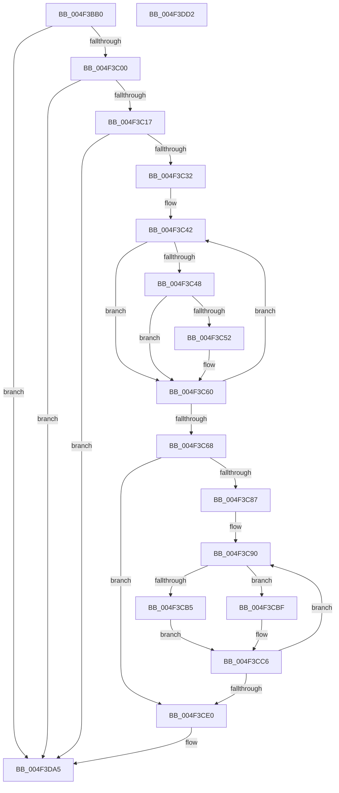

# PpmEventHgsActiveWorkloadClassEx

- RVA: `0x004F3BB0`–`0x004F3DD3` (길이 `547` bytes)
- VA: `0x00000001404F3BB0`
- 실행 섹션: `.text`
- PDB 이름 있음: `예`; PDB Function 태그: `아니요`
- unwind 정보 RVA: `0x000B9A70`
- 디코드: `128`개 명령, `547/547` bytes 표시
- 미해석 바이트: `0` (있으면 어셈블리에 `.byte`로 보존)

> 이 문서는 커널 이미지의 기계어와 PDB 기호를 분석해 생성했습니다. 4번과 5번은 함수 원형과 자료형을 바이너리 사용 방식에서 추정한 C 해석이며 원본 소스 복구 결과는 아닙니다.

## 1. Dependencies

- 직접 호출 지점: **3**; 고유 호출 대상: **3**
- 직접 호출자로 확인된 함수: **1**
- RIP 상대 이미지 참조: **7**

### Outgoing calls
- `0x004F3C25` → [EtwEventEnabled](../39/EtwEventEnabled_function_00392450.md) (function, `0x00392450`)
- `0x004F3DA0` → [EtwWriteEx](../25/EtwWriteEx_function_0025F0D0.md) (function, `0x0025F0D0`)
- `0x004F3DB0` → [_security_check_cookie](../6A/_security_check_cookie_function_006AC640.md) (function, `0x006AC640`)

### Direct callers
- [PpmPerfRecordMostActiveWorkloadClass](../40/PpmPerfRecordMostActiveWorkloadClass_function_0040B1A4.md) at `0x0040B436`

### Static image references
- `0x004F3BCF` → RVA `0x00E0A740` (`.data`; read)
- `0x004F3BE1` → RVA `0x00E67A70` (`.data`; read)
- `0x004F3C00` → RVA `0x00E67A39` (`.data`; read)
- `0x004F3C07` → RVA `0x00E0B804` (`.data`; read)
- `0x004F3C17` → RVA `0x00F083E8` (`.data`; read)
- `0x004F3C1E` → RVA `0x0001C398` (`.rdata`; read)
- `0x004F3CBF` → RVA `0x00E67A78` (`.data`; read)

## 2. Other-region calls and transfers

- 다른 실행 섹션으로 향하는 call: **0**
- 별도 외부 분기/꼬리 이동을 확인하지 못했습니다.

## 3. Assembly (complete function range)

```asm
004F3BB0  48 8B C4                        mov rax, rsp
004F3BB3  48 89 58 08                     mov qword ptr [rax + 8], rbx
004F3BB7  48 89 68 10                     mov qword ptr [rax + 0x10], rbp
004F3BBB  48 89 70 18                     mov qword ptr [rax + 0x18], rsi
004F3BBF  44 89 48 20                     mov dword ptr [rax + 0x20], r9d
004F3BC3  57                              push rdi
004F3BC4  41 56                           push r14
004F3BC6  41 57                           push r15
004F3BC8  48 81 EC A0 00 00 00            sub rsp, 0xa0
004F3BCF  48 8B 05 6A 6B 91 00            mov rax, qword ptr [rip + 0x916b6a]
004F3BD6  48 33 C4                        xor rax, rsp
004F3BD9  48 89 84 24 90 00 00 00         mov qword ptr [rsp + 0x90], rax
004F3BE1  48 8B 1D 88 3E 97 00            mov rbx, qword ptr [rip + 0x973e88]
004F3BE8  45 33 FF                        xor r15d, r15d
004F3BEB  49 8B E8                        mov rbp, r8
004F3BEE  4C 8B F2                        mov r14, rdx
004F3BF1  48 8B F9                        mov rdi, rcx
004F3BF4  41 8B F7                        mov esi, r15d
004F3BF7  48 85 DB                        test rbx, rbx
004F3BFA  0F 84 A5 01 00 00               je 0x1404f3da5
004F3C00  44 38 3D 32 3E 97 00            cmp byte ptr [rip + 0x973e32], r15b
004F3C07  8B 05 F7 7B 91 00               mov eax, dword ptr [rip + 0x917bf7]
004F3C0D  89 44 24 44                     mov dword ptr [rsp + 0x44], eax
004F3C11  0F 84 8E 01 00 00               je 0x1404f3da5
004F3C17  48 8B 0D CA 47 A1 00            mov rcx, qword ptr [rip + 0xa147ca]
004F3C1E  48 8D 15 73 87 B2 FF            lea rdx, [rip - 0x4d788d]
004F3C25  E8 26 E8 E9 FF                  call 0x140392450
004F3C2A  84 C0                           test al, al
004F3C2C  0F 84 73 01 00 00               je 0x1404f3da5
004F3C32  44 0F B7 4F 30                  movzx r9d, word ptr [rdi + 0x30]
004F3C37  45 8D 5F 01                     lea r11d, [r15 + 1]
004F3C3B  45 0F B7 C7                     movzx r8d, r15w
004F3C3F  41 8B D7                        mov edx, r15d
004F3C42  66 41 3B D1                     cmp dx, r9w
004F3C46  73 18                           jae 0x1404f3c60
004F3C48  0F B7 C2                        movzx eax, dx
004F3C4B  4C 39 7C C7 38                  cmp qword ptr [rdi + rax*8 + 0x38], r15
004F3C50  74 0E                           je 0x1404f3c60
004F3C52  8B C6                           mov eax, esi
004F3C54  41 03 F3                        add esi, r11d
004F3C57  66 45 03 C3                     add r8w, r11w
004F3C5B  66 89 54 44 50                  mov word ptr [rsp + rax*2 + 0x50], dx
004F3C60  41 03 D3                        add edx, r11d
004F3C63  83 FA 20                        cmp edx, 0x20
004F3C66  72 DA                           jb 0x1404f3c42
004F3C68  66 44 89 44 24 40               mov word ptr [rsp + 0x40], r8w
004F3C6E  48 8D 44 24 40                  lea rax, [rsp + 0x40]
004F3C73  48 89 03                        mov qword ptr [rbx], rax
004F3C76  45 8B CB                        mov r9d, r11d
004F3C79  48 C7 43 08 02 00 00 00         mov qword ptr [rbx + 8], 2
004F3C81  66 45 3B F8                     cmp r15w, r8w
004F3C85  73 59                           jae 0x1404f3ce0
004F3C87  48 8D 54 24 50                  lea rdx, [rsp + 0x50]
004F3C8C  45 0F B7 D0                     movzx r10d, r8w
004F3C90  44 0F B7 02                     movzx r8d, word ptr [rdx]
004F3C94  41 8D 49 01                     lea ecx, [r9 + 1]
004F3C98  41 8B C1                        mov eax, r9d
004F3C9B  48 03 C9                        add rcx, rcx
004F3C9E  48 03 C0                        add rax, rax
004F3CA1  48 89 14 C3                     mov qword ptr [rbx + rax*8], rdx
004F3CA5  48 C7 44 C3 08 02 00 00 00      mov qword ptr [rbx + rax*8 + 8], 2
004F3CAE  66 44 3B 47 30                  cmp r8w, word ptr [rdi + 0x30]
004F3CB3  73 0A                           jae 0x1404f3cbf
004F3CB5  49 83 C0 07                     add r8, 7
004F3CB9  4E 8D 04 C7                     lea r8, [rdi + r8*8]
004F3CBD  EB 07                           jmp 0x1404f3cc6
004F3CBF  4C 8D 05 B2 3D 97 00            lea r8, [rip + 0x973db2]
004F3CC6  41 83 C1 02                     add r9d, 2
004F3CCA  4C 89 04 CB                     mov qword ptr [rbx + rcx*8], r8
004F3CCE  48 83 C2 02                     add rdx, 2
004F3CD2  48 C7 44 CB 08 08 00 00 00      mov qword ptr [rbx + rcx*8 + 8], 8
004F3CDB  4D 2B D3                        sub r10, r11
004F3CDE  75 B0                           jne 0x1404f3c90
004F3CE0  41 8B C9                        mov ecx, r9d
004F3CE3  48 8D 87 F6 04 00 00            lea rax, [rdi + 0x4f6]
004F3CEA  48 03 C9                        add rcx, rcx
004F3CED  48 89 5C 24 38                  mov qword ptr [rsp + 0x38], rbx
004F3CF2  45 33 C0                        xor r8d, r8d
004F3CF5  48 89 04 CB                     mov qword ptr [rbx + rcx*8], rax
004F3CF9  48 8D 87 F7 04 00 00            lea rax, [rdi + 0x4f7]
004F3D00  4C 89 5C CB 08                  mov qword ptr [rbx + rcx*8 + 8], r11
004F3D05  41 8D 49 01                     lea ecx, [r9 + 1]
004F3D09  48 03 C9                        add rcx, rcx
004F3D0C  48 89 04 CB                     mov qword ptr [rbx + rcx*8], rax
004F3D10  48 8D 44 24 44                  lea rax, [rsp + 0x44]
004F3D15  4C 89 5C CB 08                  mov qword ptr [rbx + rcx*8 + 8], r11
004F3D1A  41 8D 49 02                     lea ecx, [r9 + 2]
004F3D1E  48 03 C9                        add rcx, rcx
004F3D21  48 89 04 CB                     mov qword ptr [rbx + rcx*8], rax
004F3D25  8B 44 24 44                     mov eax, dword ptr [rsp + 0x44]
004F3D29  48 C7 44 CB 08 04 00 00 00      mov qword ptr [rbx + rcx*8 + 8], 4
004F3D32  41 8D 49 03                     lea ecx, [r9 + 3]
004F3D36  48 03 C9                        add rcx, rcx
004F3D39  8D 14 C5 00 00 00 00            lea edx, [rax*8]
004F3D40  48 8D 84 24 D8 00 00 00         lea rax, [rsp + 0xd8]
004F3D48  89 54 CB 08                     mov dword ptr [rbx + rcx*8 + 8], edx
004F3D4C  4C 89 34 CB                     mov qword ptr [rbx + rcx*8], r14
004F3D50  44 89 7C CB 0C                  mov dword ptr [rbx + rcx*8 + 0xc], r15d
004F3D55  41 8D 49 04                     lea ecx, [r9 + 4]
004F3D59  48 03 C9                        add rcx, rcx
004F3D5C  89 54 CB 08                     mov dword ptr [rbx + rcx*8 + 8], edx
004F3D60  48 8D 15 31 86 B2 FF            lea rdx, [rip - 0x4d79cf]
004F3D67  48 89 2C CB                     mov qword ptr [rbx + rcx*8], rbp
004F3D6B  44 89 7C CB 0C                  mov dword ptr [rbx + rcx*8 + 0xc], r15d
004F3D70  41 8D 49 05                     lea ecx, [r9 + 5]
004F3D74  48 03 C9                        add rcx, rcx
004F3D77  48 89 04 CB                     mov qword ptr [rbx + rcx*8], rax
004F3D7B  41 8D 41 06                     lea eax, [r9 + 6]
004F3D7F  89 44 24 30                     mov dword ptr [rsp + 0x30], eax
004F3D83  45 33 C9                        xor r9d, r9d
004F3D86  48 C7 44 CB 08 04 00 00 00      mov qword ptr [rbx + rcx*8 + 8], 4
004F3D8F  48 8B 0D 52 46 A1 00            mov rcx, qword ptr [rip + 0xa14652]
004F3D96  4C 89 7C 24 28                  mov qword ptr [rsp + 0x28], r15
004F3D9B  4C 89 7C 24 20                  mov qword ptr [rsp + 0x20], r15
004F3DA0  E8 2B B3 D6 FF                  call 0x14025f0d0
004F3DA5  48 8B 8C 24 90 00 00 00         mov rcx, qword ptr [rsp + 0x90]
004F3DAD  48 33 CC                        xor rcx, rsp
004F3DB0  E8 8B 88 1B 00                  call 0x1406ac640
004F3DB5  4C 8D 9C 24 A0 00 00 00         lea r11, [rsp + 0xa0]
004F3DBD  49 8B 5B 20                     mov rbx, qword ptr [r11 + 0x20]
004F3DC1  49 8B 6B 28                     mov rbp, qword ptr [r11 + 0x28]
004F3DC5  49 8B 73 30                     mov rsi, qword ptr [r11 + 0x30]
004F3DC9  49 8B E3                        mov rsp, r11
004F3DCC  41 5F                           pop r15
004F3DCE  41 5E                           pop r14
004F3DD0  5F                              pop rdi
004F3DD1  C3                              ret
004F3DD2  CC                              int3
```

## 4. C-style interpretation (structured pseudocode)

```c
__int64 __fastcall PpmEventHgsActiveWorkloadClassEx(__int64 a1, __int64 a2, __int64 a3, int a4)
{
    __int64 result;
    __int64 v_r10;
    __int64 v_r15;
    __int64 v_rsi;
    __int64 v_rsp;
    unsigned __int64 v_stack_m18;
    unsigned __int64 v_stack_m28;
    unsigned __int64 v_stack_m68;
    unsigned int v_stack_m74;
    unsigned __int16 v_stack_m78;
    unsigned __int64 v_stack_m80;
    unsigned int v_stack_m88;
    unsigned __int64 v_stack_m90;
    unsigned __int64 v_stack_m98;
    unsigned __int64 v_stack_p20;

    *(unsigned __int64 *)(v_rsp + 8) = v_rbx;
    *(unsigned __int64 *)(v_rsp + 16) = v_rbp;
    *(unsigned __int64 *)(v_rsp + 24) = v_rsi;
    *(unsigned int *)(v_rsp + 32) = a4;
    v_rsp = (v_rsp) - (160);
    result = (*(unsigned __int64 *)(v_rip + 9530218)) ^ (v_rsp);
    v_stack_m28 = result;
    v_r15 = 0;
    if (*(unsigned __int64 *)(v_rip + 9911944) == 0) goto loc_004F3DA5;
    v_stack_m74 = (unsigned int)((unsigned int)(*(unsigned int *)(v_rip + 9534455)));
    if ((*(unsigned __int8 *)(v_rip + 9911858)) == 0) goto loc_004F3DA5;
    result = EtwEventEnabled(*(unsigned __int64 *)(v_rip + 10569674), v_rip - 5077133, a3, a4);
    if ((unsigned __int8)(result) == 0) goto loc_004F3DA5;
loc_004F3C42:
    if (0 >= ((unsigned __int16)(*(unsigned __int16 *)(a1 + 48)))) goto loc_004F3C60;
    result = 0;
    v_rsi = 0;
    if ((*(unsigned __int64 *)(a1 + 0 * 8 + 56)) != 0) {
        result = 0;
        v_rsi = (unsigned int)((0) + ((unsigned int)(v_r15 + 1)));
        a3 = (unsigned __int16)((0) + ((unsigned __int16)(v_r15 + 1)));
        *(unsigned __int16 *)(v_rsp + result * 2 + 80) = 0;
    }
    a2 = (unsigned int)((0) + ((unsigned int)(v_r15 + 1)));
    if (((unsigned int)(a2)) < 32) goto loc_004F3C42;
    v_stack_m78 = (unsigned __int16)(a3);
    *(unsigned __int64 *)(*(unsigned __int64 *)(v_rip + 9911944)) = v_stack_m78;
    *(unsigned __int64 *)(*(unsigned __int64 *)(v_rip + 9911944) + 8) = 2;
    if (0 >= ((unsigned __int16)(a3))) goto loc_004F3CE0;
loc_004F3C90:
    a1 = ((unsigned int)((unsigned int)(v_r15 + 1)) + 1) + ((unsigned int)((unsigned int)(v_r15 + 1)) + 1);
    result = ((unsigned int)((unsigned int)((unsigned int)((unsigned int)(v_r15 + 1))))) + ((unsigned int)((unsigned int)((unsigned int)((unsigned int)(v_r15 + 1)))));
    *(unsigned __int64 *)(*(unsigned __int64 *)(v_rip + 9911944) + result * 8) = v_stack_m68;
    *(unsigned __int64 *)(*(unsigned __int64 *)(v_rip + 9911944) + result * 8 + 8) = 2;
    if (((unsigned __int16)(*(unsigned __int16 *)(v_stack_m68))) >= (*(unsigned __int16 *)(a1 + 48))) goto loc_004F3CBF;
    a3 = (*(unsigned __int16 *)(v_stack_m68)) + (7);
    goto loc_004F3CC6;
loc_004F3CBF:
loc_004F3CC6:
    a4 = (unsigned int)(((unsigned int)((unsigned int)(v_r15 + 1))) + (2));
    *(unsigned __int64 *)(*(unsigned __int64 *)(v_rip + 9911944) + a1 * 8) = v_rip + 9911730;
    a2 = (v_stack_m68) + (2);
    *(unsigned __int64 *)(*(unsigned __int64 *)(v_rip + 9911944) + a1 * 8 + 8) = 8;
    v_r10 = ((unsigned __int16)(a3)) - (v_r15 + 1);
    if (condition_is_not_equal) goto loc_004F3C90;
loc_004F3CE0:
    a1 = ((unsigned int)(a4)) + ((unsigned int)(a4));
    v_stack_m80 = *(unsigned __int64 *)(v_rip + 9911944);
    a3 = 0;
    *(unsigned __int64 *)(*(unsigned __int64 *)(v_rip + 9911944) + a1 * 8) = a1 + 1270;
    *(unsigned __int64 *)(*(unsigned __int64 *)(v_rip + 9911944) + a1 * 8 + 8) = v_r15 + 1;
    a1 = (a4 + 1) + (a4 + 1);
    *(unsigned __int64 *)(*(unsigned __int64 *)(v_rip + 9911944) + a1 * 8) = a1 + 1271;
    *(unsigned __int64 *)(*(unsigned __int64 *)(v_rip + 9911944) + a1 * 8 + 8) = v_r15 + 1;
    a1 = (a4 + 2) + (a4 + 2);
    *(unsigned __int64 *)(*(unsigned __int64 *)(v_rip + 9911944) + a1 * 8) = v_stack_m74;
    *(unsigned __int64 *)(*(unsigned __int64 *)(v_rip + 9911944) + a1 * 8 + 8) = 4;
    a1 = (a4 + 3) + (a4 + 3);
    *(unsigned int *)(*(unsigned __int64 *)(v_rip + 9911944) + a1 * 8 + 8) = (unsigned int)((unsigned int)(v_stack_m74) * 8);
    *(unsigned __int64 *)(*(unsigned __int64 *)(v_rip + 9911944) + a1 * 8) = a2;
    *(unsigned int *)(*(unsigned __int64 *)(v_rip + 9911944) + a1 * 8 + 12) = 0;
    a1 = (a4 + 4) + (a4 + 4);
    *(unsigned int *)(*(unsigned __int64 *)(v_rip + 9911944) + a1 * 8 + 8) = (unsigned int)((unsigned int)(v_stack_m74) * 8);
    *(unsigned __int64 *)(*(unsigned __int64 *)(v_rip + 9911944) + a1 * 8) = 0;
    *(unsigned int *)(*(unsigned __int64 *)(v_rip + 9911944) + a1 * 8 + 12) = 0;
    a1 = (a4 + 5) + (a4 + 5);
    *(unsigned __int64 *)(*(unsigned __int64 *)(v_rip + 9911944) + a1 * 8) = v_stack_p20;
    v_stack_m88 = (unsigned int)(a4 + 6);
    a4 = 0;
    *(unsigned __int64 *)(*(unsigned __int64 *)(v_rip + 9911944) + a1 * 8 + 8) = 4;
    v_stack_m90 = 0;
    v_stack_m98 = 0;
    result = EtwWriteEx(*(unsigned __int64 *)(v_rip + 10569298), v_rip - 5077455, a3, a4);
loc_004F3DA5:
    a1 = (v_stack_m28) ^ (v_rsp);
    result = _security_check_cookie(a1, v_rip - 5077455, a3, a4);
    return result;
}
```

## 5. (Beta) C Style

```c
int64_t PpmEventHgsActiveWorkloadClassEx(void *Arg1, int64_t Arg2, int64_t Arg3, int32_t Arg4)
{
    uint8_t *arg1 = (uint8_t *)Arg1;

    int64_t result;
    int64_t local_r10;
    int64_t local_r15;
    int64_t local_rsi;
    int64_t local_rsp;
    uint64_t v_stack_m18;
    uint64_t v_stack_m28;
    uint64_t v_stack_m68;
    uint32_t v_stack_m74;
    uint16_t v_stack_m78;
    uint64_t v_stack_m80;
    uint32_t v_stack_m88;
    uint64_t v_stack_m90;
    uint64_t v_stack_m98;
    uint64_t v_stack_p20;

    *(uint64_t *)(local_rsp + 0x8) = local_rbx;
    *(uint64_t *)(local_rsp + 0x10) = local_rbp;
    *(uint64_t *)(local_rsp + 0x18) = local_rsi;
    *(uint32_t *)(local_rsp + 0x20) = Arg4;
    local_rsp = (local_rsp) - (160);
    result = (*(uint64_t *)(v_rip + 0x916B6A)) ^ (local_rsp);
    v_stack_m28 = result;
    local_r15 = 0;
    if (*(uint64_t *)(v_rip + 0x973E88) == 0) goto loc_004F3DA5;
    v_stack_m74 = (uint32_t)((uint32_t)(*(uint32_t *)(v_rip + 0x917BF7)));
    if ((*(uint8_t *)(v_rip + 0x973E32)) == 0) goto loc_004F3DA5;
    result = EtwEventEnabled(*(uint64_t *)(v_rip + 0xA147CA), v_rip - 5077133, Arg3, Arg4);
    if ((uint8_t)(result) == 0) goto loc_004F3DA5;
loc_004F3C42:
    if (0 >= ((uint16_t)(*(uint16_t *)(arg1 + 0x30)))) goto loc_004F3C60;
    result = 0;
    local_rsi = 0;
    if ((*(uint64_t *)(arg1 + 0x0 * 8 + 0x38)) != 0) {
        result = 0;
        local_rsi = (uint32_t)((0) + ((uint32_t)(local_r15 + 1)));
        Arg3 = (uint16_t)((0) + ((uint16_t)(local_r15 + 1)));
        *(uint16_t *)(local_rsp + result * 2 + 0x50) = 0;
    }
    Arg2 = (uint32_t)((0) + ((uint32_t)(local_r15 + 1)));
    if (((uint32_t)(Arg2)) < 32) goto loc_004F3C42;
    v_stack_m78 = (uint16_t)(Arg3);
    *(uint64_t *)(*(uint64_t *)(v_rip + 0x973E88)) = v_stack_m78;
    *(uint64_t *)(*(uint64_t *)(v_rip + 0x973E88) + 0x8) = 2;
    if (0 >= ((uint16_t)(Arg3))) goto loc_004F3CE0;
loc_004F3C90:
    Arg1 = ((uint32_t)((uint32_t)(local_r15 + 1)) + 1) + ((uint32_t)((uint32_t)(local_r15 + 1)) + 1);
    result = ((uint32_t)((uint32_t)((uint32_t)((uint32_t)(local_r15 + 1))))) + ((uint32_t)((uint32_t)((uint32_t)((uint32_t)(local_r15 + 1)))));
    *(uint64_t *)(*(uint64_t *)(v_rip + 0x973E88) + result * 8) = v_stack_m68;
    *(uint64_t *)(*(uint64_t *)(v_rip + 0x973E88) + result * 8 + 0x8) = 2;
    if (((uint16_t)(*(uint16_t *)(v_stack_m68))) >= (*(uint16_t *)(arg1 + 0x30))) goto loc_004F3CBF;
    Arg3 = (*(uint16_t *)(v_stack_m68)) + (7);
    goto loc_004F3CC6;
loc_004F3CBF:
loc_004F3CC6:
    Arg4 = (uint32_t)(((uint32_t)((uint32_t)(local_r15 + 1))) + (2));
    *(uint64_t *)(*(uint64_t *)(v_rip + 0x973E88) + arg1 * 8) = v_rip + 9911730;
    Arg2 = (v_stack_m68) + (2);
    *(uint64_t *)(*(uint64_t *)(v_rip + 0x973E88) + arg1 * 8 + 0x8) = 8;
    local_r10 = ((uint16_t)(Arg3)) - (local_r15 + 1);
    if (condition_is_not_equal) goto loc_004F3C90;
loc_004F3CE0:
    Arg1 = ((uint32_t)(Arg4)) + ((uint32_t)(Arg4));
    v_stack_m80 = *(uint64_t *)(v_rip + 0x973E88);
    Arg3 = 0;
    *(void **)(*(uint64_t *)(v_rip + 0x973E88) + arg1 * 8) = Arg1 + 1270;
    *(uint64_t *)(*(uint64_t *)(v_rip + 0x973E88) + arg1 * 8 + 0x8) = local_r15 + 1;
    Arg1 = (Arg4 + 1) + (Arg4 + 1);
    *(void **)(*(uint64_t *)(v_rip + 0x973E88) + arg1 * 8) = Arg1 + 1271;
    *(uint64_t *)(*(uint64_t *)(v_rip + 0x973E88) + arg1 * 8 + 0x8) = local_r15 + 1;
    Arg1 = (Arg4 + 2) + (Arg4 + 2);
    *(uint64_t *)(*(uint64_t *)(v_rip + 0x973E88) + arg1 * 8) = v_stack_m74;
    *(uint64_t *)(*(uint64_t *)(v_rip + 0x973E88) + arg1 * 8 + 0x8) = 4;
    Arg1 = (Arg4 + 3) + (Arg4 + 3);
    *(uint32_t *)(*(uint64_t *)(v_rip + 0x973E88) + arg1 * 8 + 0x8) = (uint32_t)((uint32_t)(v_stack_m74) * 8);
    *(uint64_t *)(*(uint64_t *)(v_rip + 0x973E88) + arg1 * 8) = Arg2;
    *(uint32_t *)(*(uint64_t *)(v_rip + 0x973E88) + arg1 * 8 + 0xC) = 0;
    Arg1 = (Arg4 + 4) + (Arg4 + 4);
    *(uint32_t *)(*(uint64_t *)(v_rip + 0x973E88) + arg1 * 8 + 0x8) = (uint32_t)((uint32_t)(v_stack_m74) * 8);
    *(uint64_t *)(*(uint64_t *)(v_rip + 0x973E88) + arg1 * 8) = 0;
    *(uint32_t *)(*(uint64_t *)(v_rip + 0x973E88) + arg1 * 8 + 0xC) = 0;
    Arg1 = (Arg4 + 5) + (Arg4 + 5);
    *(uint64_t *)(*(uint64_t *)(v_rip + 0x973E88) + arg1 * 8) = v_stack_p20;
    v_stack_m88 = (uint32_t)(Arg4 + 6);
    Arg4 = 0;
    *(uint64_t *)(*(uint64_t *)(v_rip + 0x973E88) + arg1 * 8 + 0x8) = 4;
    v_stack_m90 = 0;
    v_stack_m98 = 0;
    result = EtwWriteEx(*(uint64_t *)(v_rip + 0xA14652), v_rip - 5077455, Arg3, Arg4);
loc_004F3DA5:
    Arg1 = (v_stack_m28) ^ (local_rsp);
    result = _security_check_cookie(Arg1, v_rip - 5077455, Arg3, Arg4);
    return result;
}
```

### 관측된 메모리 오프셋

구조체 형식이 확인되지 않은 접근은 인자 기준의 오프셋으로만 기록했습니다.

| 기준 인자 | 오프셋 표현 | 폭 (bit) | 접근 |
|---|---:|---:|---|
| `Arg1` | `+ 0x0 + r8*8` | `64` | `R` |
| `Arg1` | `+ 0x30` | `16` | `R` |
| `Arg1` | `+ 0x38 + rax*8` | `64` | `R` |
| `Arg1` | `+ 0x4F6` | `64` | `R` |
| `Arg1` | `+ 0x4F7` | `64` | `R` |

## 6. Execution-region graph

[열기: 2D/3D 그래프와 함수 탐색 컨트롤 패널](../../../control-panel.html?section=text&rva=0x004F3BB0&view=graph)

- 2D 그래프는 위에서 아래로 흐르고, 3D 그래프는 빈 공간을 드래그해 회전합니다. Shift+드래그는 이동, 휠은 확대·축소, 함수 노드 선택은 대상 보고서 이동입니다.

### Static fallback


