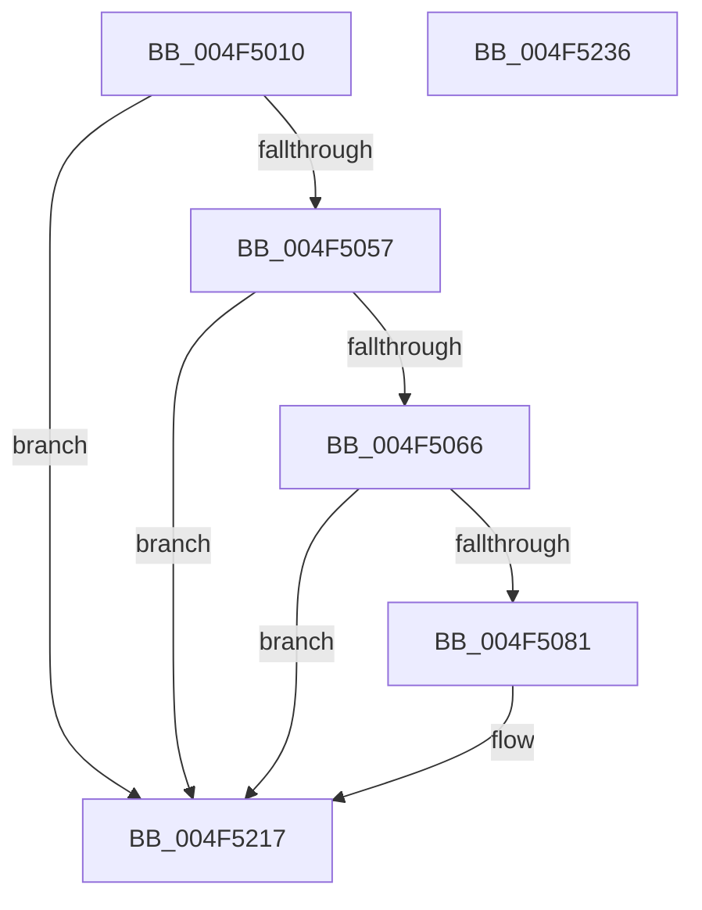

# PpmEventHgsContainmentUnparkedCountEx

- RVA: `0x004F5010`–`0x004F5237` (길이 `551` bytes)
- VA: `0x00000001404F5010`
- 실행 섹션: `.text`
- PDB 이름 있음: `예`; PDB Function 태그: `아니요`
- unwind 정보 RVA: `0x000BD6F4`
- 디코드: `119`개 명령, `551/551` bytes 표시
- 미해석 바이트: `0` (있으면 어셈블리에 `.byte`로 보존)

> 이 문서는 커널 이미지의 기계어와 PDB 기호를 분석해 생성했습니다. 4번과 5번은 함수 원형과 자료형을 바이너리 사용 방식에서 추정한 C 해석이며 원본 소스 복구 결과는 아닙니다.

## 1. Dependencies

- 직접 호출 지점: **3**; 고유 호출 대상: **3**
- 직접 호출자로 확인된 함수: **1**
- RIP 상대 이미지 참조: **5**

### Outgoing calls
- `0x004F5074` → [EtwEventEnabled](../39/EtwEventEnabled_function_00392450.md) (function, `0x00392450`)
- `0x004F5212` → [EtwWriteEx](../25/EtwWriteEx_function_0025F0D0.md) (function, `0x0025F0D0`)
- `0x004F521E` → [_security_check_cookie](../6A/_security_check_cookie_function_006AC640.md) (function, `0x006AC640`)

### Direct callers
- [PpmHeteroHgsCalculateContainmentCount](../41/PpmHeteroHgsCalculateContainmentCount_function_004144E4.md) at `0x00414662`

### Static image references
- `0x004F5032` → RVA `0x00E0A740` (`.data`; read)
- `0x004F5040` → RVA `0x00FC501C` (`ALMOSTRO`; read)
- `0x004F5059` → RVA `0x00E67A39` (`.data`; read)
- `0x004F5066` → RVA `0x00F083E8` (`.data`; read)
- `0x004F506D` → RVA `0x0001E540` (`.rdata`; read)

## 2. Other-region calls and transfers

- 다른 실행 섹션으로 향하는 call: **0**
- 별도 외부 분기/꼬리 이동을 확인하지 못했습니다.

## 3. Assembly (complete function range)

```asm
004F5010  48 8B C4                        mov rax, rsp
004F5013  48 89 58 20                     mov qword ptr [rax + 0x20], rbx
004F5017  66 44 89 40 18                  mov word ptr [rax + 0x18], r8w
004F501C  66 89 50 10                     mov word ptr [rax + 0x10], dx
004F5020  66 89 48 08                     mov word ptr [rax + 8], cx
004F5024  55                              push rbp
004F5025  56                              push rsi
004F5026  57                              push rdi
004F5027  48 8D 68 88                     lea rbp, [rax - 0x78]
004F502B  48 81 EC 60 01 00 00            sub rsp, 0x160
004F5032  48 8B 05 07 57 91 00            mov rax, qword ptr [rip + 0x915707]
004F5039  48 33 C4                        xor rax, rsp
004F503C  48 89 45 50                     mov qword ptr [rbp + 0x50], rax
004F5040  8B 05 D6 FF AC 00               mov eax, dword ptr [rip + 0xacffd6]
004F5046  BE 04 00 00 00                  mov esi, 4
004F504B  49 8B D9                        mov rbx, r9
004F504E  40 84 C6                        test sil, al
004F5051  0F 84 C0 01 00 00               je 0x1404f5217
004F5057  33 FF                           xor edi, edi
004F5059  40 38 3D D9 29 97 00            cmp byte ptr [rip + 0x9729d9], dil
004F5060  0F 84 B1 01 00 00               je 0x1404f5217
004F5066  48 8B 0D 7B 33 A1 00            mov rcx, qword ptr [rip + 0xa1337b]
004F506D  48 8D 15 CC 94 B2 FF            lea rdx, [rip - 0x4d6b34]
004F5074  E8 D7 D3 E9 FF                  call 0x140392450
004F5079  84 C0                           test al, al
004F507B  0F 84 96 01 00 00               je 0x1404f5217
004F5081  48 8B 8B 00 05 00 00            mov rcx, qword ptr [rbx + 0x500]
004F5088  8D 56 FD                        lea edx, [rsi - 3]
004F508B  8B 05 8B FF AC 00               mov eax, dword ptr [rip + 0xacff8b]
004F5091  C1 E8 03                        shr eax, 3
004F5094  23 C2                           and eax, edx
004F5096  40 38 BD B0 00 00 00            cmp byte ptr [rbp + 0xb0], dil
004F509D  89 44 24 50                     mov dword ptr [rsp + 0x50], eax
004F50A1  0F B7 83 F0 04 00 00            movzx eax, word ptr [rbx + 0x4f0]
004F50A8  66 89 44 24 40                  mov word ptr [rsp + 0x40], ax
004F50AD  0F B7 83 F2 04 00 00            movzx eax, word ptr [rbx + 0x4f2]
004F50B4  66 89 44 24 44                  mov word ptr [rsp + 0x44], ax
004F50B9  8B 41 04                        mov eax, dword ptr [rcx + 4]
004F50BC  89 44 24 4C                     mov dword ptr [rsp + 0x4c], eax
004F50C0  8B C7                           mov eax, edi
004F50C2  0F 95 C0                        setne al
004F50C5  89 44 24 48                     mov dword ptr [rsp + 0x48], eax
004F50C9  8B C7                           mov eax, edi
004F50CB  40 38 B9 38 03 00 00            cmp byte ptr [rcx + 0x338], dil
004F50D2  0F 95 C0                        setne al
004F50D5  89 44 24 54                     mov dword ptr [rsp + 0x54], eax
004F50D9  8B C7                           mov eax, edi
004F50DB  40 38 B9 39 03 00 00            cmp byte ptr [rcx + 0x339], dil
004F50E2  0F 95 C0                        setne al
004F50E5  89 44 24 58                     mov dword ptr [rsp + 0x58], eax
004F50E9  8B C7                           mov eax, edi
004F50EB  40 38 B9 3A 03 00 00            cmp byte ptr [rcx + 0x33a], dil
004F50F2  48 89 55 88                     mov qword ptr [rbp - 0x78], rdx
004F50F6  0F 95 C0                        setne al
004F50F9  48 89 55 98                     mov qword ptr [rbp - 0x68], rdx
004F50FD  89 44 24 5C                     mov dword ptr [rsp + 0x5c], eax
004F5101  45 33 C9                        xor r9d, r9d
004F5104  48 8D 81 34 03 00 00            lea rax, [rcx + 0x334]
004F510B  48 89 55 A8                     mov qword ptr [rbp - 0x58], rdx
004F510F  48 89 44 24 60                  mov qword ptr [rsp + 0x60], rax
004F5114  48 8D 15 25 94 B2 FF            lea rdx, [rip - 0x4d6bdb]
004F511B  48 8D 44 24 48                  lea rax, [rsp + 0x48]
004F5120  48 89 74 24 68                  mov qword ptr [rsp + 0x68], rsi
004F5125  48 89 44 24 70                  mov qword ptr [rsp + 0x70], rax
004F512A  45 33 C0                        xor r8d, r8d
004F512D  48 8D 85 A0 00 00 00            lea rax, [rbp + 0xa0]
004F5134  48 89 74 24 78                  mov qword ptr [rsp + 0x78], rsi
004F5139  48 89 45 80                     mov qword ptr [rbp - 0x80], rax
004F513D  48 8D 85 A8 00 00 00            lea rax, [rbp + 0xa8]
004F5144  48 89 45 90                     mov qword ptr [rbp - 0x70], rax
004F5148  48 8D 44 24 4C                  lea rax, [rsp + 0x4c]
004F514D  48 89 45 A0                     mov qword ptr [rbp - 0x60], rax
004F5151  48 8D 85 80 00 00 00            lea rax, [rbp + 0x80]
004F5158  48 89 45 B0                     mov qword ptr [rbp - 0x50], rax
004F515C  48 8D 85 88 00 00 00            lea rax, [rbp + 0x88]
004F5163  48 89 45 C0                     mov qword ptr [rbp - 0x40], rax
004F5167  48 8D 85 90 00 00 00            lea rax, [rbp + 0x90]
004F516E  48 89 45 D0                     mov qword ptr [rbp - 0x30], rax
004F5172  48 8D 44 24 40                  lea rax, [rsp + 0x40]
004F5177  48 89 45 E0                     mov qword ptr [rbp - 0x20], rax
004F517B  48 8D 44 24 44                  lea rax, [rsp + 0x44]
004F5180  48 89 45 F0                     mov qword ptr [rbp - 0x10], rax
004F5184  48 8B 85 B8 00 00 00            mov rax, qword ptr [rbp + 0xb8]
004F518B  48 89 45 00                     mov qword ptr [rbp], rax
004F518F  48 8D 44 24 50                  lea rax, [rsp + 0x50]
004F5194  48 89 45 10                     mov qword ptr [rbp + 0x10], rax
004F5198  48 8D 44 24 54                  lea rax, [rsp + 0x54]
004F519D  48 89 45 20                     mov qword ptr [rbp + 0x20], rax
004F51A1  48 8D 44 24 58                  lea rax, [rsp + 0x58]
004F51A6  48 89 45 30                     mov qword ptr [rbp + 0x30], rax
004F51AA  48 8D 44 24 5C                  lea rax, [rsp + 0x5c]
004F51AF  48 89 45 40                     mov qword ptr [rbp + 0x40], rax
004F51B3  48 8D 44 24 60                  lea rax, [rsp + 0x60]
004F51B8  48 89 44 24 38                  mov qword ptr [rsp + 0x38], rax
004F51BD  C7 44 24 30 0F 00 00 00         mov dword ptr [rsp + 0x30], 0xf
004F51C5  48 89 7C 24 28                  mov qword ptr [rsp + 0x28], rdi
004F51CA  48 89 7C 24 20                  mov qword ptr [rsp + 0x20], rdi
004F51CF  48 C7 45 B8 02 00 00 00         mov qword ptr [rbp - 0x48], 2
004F51D7  48 C7 45 C8 02 00 00 00         mov qword ptr [rbp - 0x38], 2
004F51DF  48 C7 45 D8 02 00 00 00         mov qword ptr [rbp - 0x28], 2
004F51E7  48 C7 45 E8 02 00 00 00         mov qword ptr [rbp - 0x18], 2
004F51EF  48 C7 45 F8 02 00 00 00         mov qword ptr [rbp - 8], 2
004F51F7  48 89 75 08                     mov qword ptr [rbp + 8], rsi
004F51FB  48 89 75 18                     mov qword ptr [rbp + 0x18], rsi
004F51FF  48 89 75 28                     mov qword ptr [rbp + 0x28], rsi
004F5203  48 89 75 38                     mov qword ptr [rbp + 0x38], rsi
004F5207  48 89 75 48                     mov qword ptr [rbp + 0x48], rsi
004F520B  48 8B 0D D6 31 A1 00            mov rcx, qword ptr [rip + 0xa131d6]
004F5212  E8 B9 9E D6 FF                  call 0x14025f0d0
004F5217  48 8B 4D 50                     mov rcx, qword ptr [rbp + 0x50]
004F521B  48 33 CC                        xor rcx, rsp
004F521E  E8 1D 74 1B 00                  call 0x1406ac640
004F5223  48 8B 9C 24 98 01 00 00         mov rbx, qword ptr [rsp + 0x198]
004F522B  48 81 C4 60 01 00 00            add rsp, 0x160
004F5232  5F                              pop rdi
004F5233  5E                              pop rsi
004F5234  5D                              pop rbp
004F5235  C3                              ret
004F5236  CC                              int3
```

## 4. C-style interpretation (structured pseudocode)

```c
__int64 __fastcall PpmEventHgsContainmentUnparkedCountEx(unsigned __int16 a1, unsigned __int16 a2, int a3, __int64 a4)
{
    __int64 result;
    __int64 v_rdi;
    __int64 v_rsp;
    unsigned __int64 v_stack_m100;
    unsigned __int64 v_stack_m108;
    unsigned __int64 v_stack_m110;
    unsigned __int64 v_stack_m118;
    unsigned int v_stack_m11C;
    unsigned int v_stack_m120;
    unsigned int v_stack_m124;
    unsigned int v_stack_m128;
    unsigned int v_stack_m12C;
    unsigned int v_stack_m130;
    unsigned __int16 v_stack_m134;
    unsigned __int16 v_stack_m138;
    unsigned __int64 v_stack_m140;
    unsigned int v_stack_m148;
    unsigned __int64 v_stack_m150;
    unsigned __int64 v_stack_m158;
    unsigned __int64 v_stack_p20;

    *(unsigned __int64 *)(v_rsp + 32) = v_rbx;
    *(unsigned __int16 *)(v_rsp + 24) = (unsigned __int16)(a3);
    *(unsigned __int16 *)(v_rsp + 16) = a2;
    *(unsigned __int16 *)(v_rsp + 8) = a1;
    v_rsp = (v_rsp) - (352);
    result = (*(unsigned __int64 *)(v_rip + 9524999)) ^ (v_rsp);
    *(unsigned __int64 *)(v_rsp - 120 + 80) = result;
    if (((4) & ((unsigned __int8)((unsigned int)(*(unsigned int *)(v_rip + 11337686))))) == 0) goto loc_004F5217;
    v_rdi = 0;
    if ((*(unsigned __int8 *)(v_rip + 9906649)) == 0) goto loc_004F5217;
    result = EtwEventEnabled(*(unsigned __int64 *)(v_rip + 10564475), v_rip - 5073716, a3, a4);
    if ((unsigned __int8)(result) != 0) {
        a1 = *(unsigned __int64 *)(a4 + 1280);
        a2 = 4 - 3;
        result = *(unsigned int *)(v_rip + 11337611);
        result = (unsigned int)((result) >> (3));
        result = (unsigned int)((result) & (a2));
        v_stack_m128 = (unsigned int)(result);
        result = *(unsigned __int16 *)(a4 + 1264);
        v_stack_m138 = (unsigned __int16)(result);
        result = *(unsigned __int16 *)(a4 + 1266);
        v_stack_m134 = (unsigned __int16)(result);
        result = *(unsigned int *)(a1 + 4);
        v_stack_m12C = (unsigned int)(result);
        result = 0;
        result = ((*(unsigned __int8 *)(v_rsp - 120 + 176)) != 0) ? 1 : 0;
        v_stack_m130 = (unsigned int)(result);
        result = 0;
        result = ((*(unsigned __int8 *)(a1 + 824)) != 0) ? 1 : 0;
        v_stack_m124 = (unsigned int)(result);
        result = 0;
        result = ((*(unsigned __int8 *)(a1 + 825)) != 0) ? 1 : 0;
        v_stack_m120 = (unsigned int)(result);
        result = 0;
        *(unsigned __int64 *)(v_rsp - 120 - 120) = a2;
        result = ((*(unsigned __int8 *)(a1 + 826)) != 0) ? 1 : 0;
        *(unsigned __int64 *)(v_rsp - 120 - 104) = a2;
        v_stack_m11C = (unsigned int)(result);
        a4 = 0;
        result = a1 + 820;
        *(unsigned __int64 *)(v_rsp - 120 - 88) = a2;
        v_stack_m118 = result;
        a2 = v_rip - 5073883;
        result = v_stack_m130;
        v_stack_m110 = 4;
        v_stack_m108 = result;
        a3 = 0;
        result = v_rsp - 120 + 160;
        v_stack_m100 = 4;
        *(unsigned __int64 *)(v_rsp - 120 - 128) = result;
        result = v_rsp - 120 + 168;
        *(unsigned __int64 *)(v_rsp - 120 - 112) = result;
        result = v_stack_m12C;
        *(unsigned __int64 *)(v_rsp - 120 - 96) = result;
        result = v_rsp - 120 + 128;
        *(unsigned __int64 *)(v_rsp - 120 - 80) = result;
        result = v_rsp - 120 + 136;
        *(unsigned __int64 *)(v_rsp - 120 - 64) = result;
        result = v_rsp - 120 + 144;
        *(unsigned __int64 *)(v_rsp - 120 - 48) = result;
        result = v_stack_m138;
        *(unsigned __int64 *)(v_rsp - 120 - 32) = result;
        result = v_stack_m134;
        *(unsigned __int64 *)(v_rsp - 120 - 16) = result;
        result = *(unsigned __int64 *)(v_rsp - 120 + 184);
        *(unsigned __int64 *)(v_rsp - 120) = result;
        result = v_stack_m128;
        *(unsigned __int64 *)(v_rsp - 120 + 16) = result;
        result = v_stack_m124;
        *(unsigned __int64 *)(v_rsp - 120 + 32) = result;
        result = v_stack_m120;
        *(unsigned __int64 *)(v_rsp - 120 + 48) = result;
        result = v_stack_m11C;
        *(unsigned __int64 *)(v_rsp - 120 + 64) = result;
        result = v_stack_m118;
        v_stack_m140 = result;
        v_stack_m148 = 15;
        v_stack_m150 = 0;
        v_stack_m158 = 0;
        *(unsigned __int64 *)(v_rsp - 120 - 72) = 2;
        *(unsigned __int64 *)(v_rsp - 120 - 56) = 2;
        *(unsigned __int64 *)(v_rsp - 120 - 40) = 2;
        *(unsigned __int64 *)(v_rsp - 120 - 24) = 2;
        *(unsigned __int64 *)(v_rsp - 120 - 8) = 2;
        *(unsigned __int64 *)(v_rsp - 120 + 8) = 4;
        *(unsigned __int64 *)(v_rsp - 120 + 24) = 4;
        *(unsigned __int64 *)(v_rsp - 120 + 40) = 4;
        *(unsigned __int64 *)(v_rsp - 120 + 56) = 4;
        *(unsigned __int64 *)(v_rsp - 120 + 72) = 4;
        a1 = *(unsigned __int64 *)(v_rip + 10564054);
        result = EtwWriteEx(a1, a2, a3, a4);
    }
    a1 = (*(unsigned __int64 *)(v_rsp - 120 + 80)) ^ (v_rsp);
    result = _security_check_cookie(a1, a2, a3, a4);
    v_rsp = (v_rsp) + (352);
    return result;
}
```

## 5. (Beta) C Style

```c
int64_t PpmEventHgsContainmentUnparkedCountEx(uint16_t Arg1, uint16_t Arg2, int32_t Arg3, void *Arg4)
{
    uint8_t *arg4 = (uint8_t *)Arg4;

    int64_t result;
    int64_t local_rdi;
    int64_t local_rsp;
    uint64_t v_stack_m100;
    uint64_t v_stack_m108;
    uint64_t v_stack_m110;
    uint64_t v_stack_m118;
    uint32_t v_stack_m11C;
    uint32_t v_stack_m120;
    uint32_t v_stack_m124;
    uint32_t v_stack_m128;
    uint32_t v_stack_m12C;
    uint32_t v_stack_m130;
    uint16_t v_stack_m134;
    uint16_t v_stack_m138;
    uint64_t v_stack_m140;
    uint32_t v_stack_m148;
    uint64_t v_stack_m150;
    uint64_t v_stack_m158;
    uint64_t v_stack_p20;

    *(uint64_t *)(local_rsp + 0x20) = local_rbx;
    *(uint16_t *)(local_rsp + 0x18) = (uint16_t)(Arg3);
    *(uint16_t *)(local_rsp + 0x10) = Arg2;
    *(uint16_t *)(local_rsp + 0x8) = Arg1;
    local_rsp = (local_rsp) - (352);
    result = (*(uint64_t *)(v_rip + 0x915707)) ^ (local_rsp);
    *(uint64_t *)(local_rsp - 0x78 + 0x50) = result;
    if (((4) & ((uint8_t)((uint32_t)(*(uint32_t *)(v_rip + 0xACFFD6))))) == 0) goto loc_004F5217;
    local_rdi = 0;
    if ((*(uint8_t *)(v_rip + 0x9729D9)) == 0) goto loc_004F5217;
    result = EtwEventEnabled(*(uint64_t *)(v_rip + 0xA1337B), v_rip - 5073716, Arg3, Arg4);
    if ((uint8_t)(result) != 0) {
        Arg1 = *(uint64_t *)(arg4 + 0x500);
        Arg2 = 4 - 3;
        result = *(uint32_t *)(v_rip + 0xACFF8B);
        result = (uint32_t)((result) >> (3));
        result = (uint32_t)((result) & (Arg2));
        v_stack_m128 = (uint32_t)(result);
        result = *(uint16_t *)(arg4 + 0x4F0);
        v_stack_m138 = (uint16_t)(result);
        result = *(uint16_t *)(arg4 + 0x4F2);
        v_stack_m134 = (uint16_t)(result);
        result = *(uint32_t *)(Arg1 + 0x4);
        v_stack_m12C = (uint32_t)(result);
        result = 0;
        result = ((*(uint8_t *)(local_rsp - 0x78 + 0xB0)) != 0) ? 1 : 0;
        v_stack_m130 = (uint32_t)(result);
        result = 0;
        result = ((*(uint8_t *)(Arg1 + 0x338)) != 0) ? 1 : 0;
        v_stack_m124 = (uint32_t)(result);
        result = 0;
        result = ((*(uint8_t *)(Arg1 + 0x339)) != 0) ? 1 : 0;
        v_stack_m120 = (uint32_t)(result);
        result = 0;
        *(uint64_t *)(local_rsp - 0x78 - 0x78) = Arg2;
        result = ((*(uint8_t *)(Arg1 + 0x33A)) != 0) ? 1 : 0;
        *(uint64_t *)(local_rsp - 0x78 - 0x68) = Arg2;
        v_stack_m11C = (uint32_t)(result);
        Arg4 = 0;
        result = Arg1 + 820;
        *(uint64_t *)(local_rsp - 0x78 - 0x58) = Arg2;
        v_stack_m118 = result;
        Arg2 = v_rip - 5073883;
        result = v_stack_m130;
        v_stack_m110 = 4;
        v_stack_m108 = result;
        Arg3 = 0;
        result = local_rsp - 120 + 160;
        v_stack_m100 = 4;
        *(uint64_t *)(local_rsp - 0x78 - 0x80) = result;
        result = local_rsp - 120 + 168;
        *(uint64_t *)(local_rsp - 0x78 - 0x70) = result;
        result = v_stack_m12C;
        *(uint64_t *)(local_rsp - 0x78 - 0x60) = result;
        result = local_rsp - 120 + 128;
        *(uint64_t *)(local_rsp - 0x78 - 0x50) = result;
        result = local_rsp - 120 + 136;
        *(uint64_t *)(local_rsp - 0x78 - 0x40) = result;
        result = local_rsp - 120 + 144;
        *(uint64_t *)(local_rsp - 0x78 - 0x30) = result;
        result = v_stack_m138;
        *(uint64_t *)(local_rsp - 0x78 - 0x20) = result;
        result = v_stack_m134;
        *(uint64_t *)(local_rsp - 0x78 - 0x10) = result;
        result = *(uint64_t *)(local_rsp - 0x78 + 0xB8);
        *(uint64_t *)(local_rsp - 0x78) = result;
        result = v_stack_m128;
        *(uint64_t *)(local_rsp - 0x78 + 0x10) = result;
        result = v_stack_m124;
        *(uint64_t *)(local_rsp - 0x78 + 0x20) = result;
        result = v_stack_m120;
        *(uint64_t *)(local_rsp - 0x78 + 0x30) = result;
        result = v_stack_m11C;
        *(uint64_t *)(local_rsp - 0x78 + 0x40) = result;
        result = v_stack_m118;
        v_stack_m140 = result;
        v_stack_m148 = 15;
        v_stack_m150 = 0;
        v_stack_m158 = 0;
        *(uint64_t *)(local_rsp - 0x78 - 0x48) = 2;
        *(uint64_t *)(local_rsp - 0x78 - 0x38) = 2;
        *(uint64_t *)(local_rsp - 0x78 - 0x28) = 2;
        *(uint64_t *)(local_rsp - 0x78 - 0x18) = 2;
        *(uint64_t *)(local_rsp - 0x78 - 0x8) = 2;
        *(uint64_t *)(local_rsp - 0x78 + 0x8) = 4;
        *(uint64_t *)(local_rsp - 0x78 + 0x18) = 4;
        *(uint64_t *)(local_rsp - 0x78 + 0x28) = 4;
        *(uint64_t *)(local_rsp - 0x78 + 0x38) = 4;
        *(uint64_t *)(local_rsp - 0x78 + 0x48) = 4;
        Arg1 = *(uint64_t *)(v_rip + 0xA131D6);
        result = EtwWriteEx(Arg1, Arg2, Arg3, Arg4);
    }
    Arg1 = (*(uint64_t *)(local_rsp - 0x78 + 0x50)) ^ (local_rsp);
    result = _security_check_cookie(Arg1, Arg2, Arg3, Arg4);
    local_rsp = (local_rsp) + (352);
    return result;
}
```

### 관측된 메모리 오프셋

구조체 형식이 확인되지 않은 접근은 인자 기준의 오프셋으로만 기록했습니다.

| 기준 인자 | 오프셋 표현 | 폭 (bit) | 접근 |
|---|---:|---:|---|
| `Arg4` | `+ 0x4F0` | `16` | `R` |
| `Arg4` | `+ 0x4F2` | `16` | `R` |
| `Arg4` | `+ 0x500` | `64` | `R` |

## 6. Execution-region graph

[열기: 2D/3D 그래프와 함수 탐색 컨트롤 패널](../../../control-panel.html?section=text&rva=0x004F5010&view=graph)

- 2D 그래프는 위에서 아래로 흐르고, 3D 그래프는 빈 공간을 드래그해 회전합니다. Shift+드래그는 이동, 휠은 확대·축소, 함수 노드 선택은 대상 보고서 이동입니다.

### Static fallback


