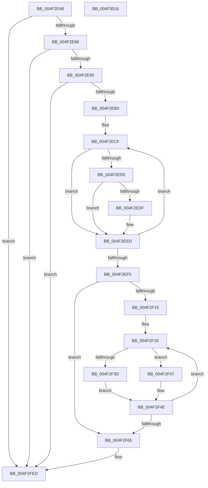

# PpmEventHgsCoresUnparkedCountEx

- RVA: `0x004F2E48`–`0x004F3017` (길이 `463` bytes)
- VA: `0x00000001404F2E48`
- 실행 섹션: `.text`
- PDB 이름 있음: `예`; PDB Function 태그: `아니요`
- unwind 정보 RVA: `0x00068468`
- 디코드: `111`개 명령, `463/463` bytes 표시
- 미해석 바이트: `0` (있으면 어셈블리에 `.byte`로 보존)

> 이 문서는 커널 이미지의 기계어와 PDB 기호를 분석해 생성했습니다. 4번과 5번은 함수 원형과 자료형을 바이너리 사용 방식에서 추정한 C 해석이며 원본 소스 복구 결과는 아닙니다.

## 1. Dependencies

- 직접 호출 지점: **3**; 고유 호출 대상: **3**
- 직접 호출자로 확인된 함수: **1**
- RIP 상대 이미지 참조: **7**

### Outgoing calls
- `0x004F2EA3` → [EtwEventEnabled](../39/EtwEventEnabled_function_00392450.md) (function, `0x00392450`)
- `0x004F2FE8` → [EtwWriteEx](../25/EtwWriteEx_function_0025F0D0.md) (function, `0x0025F0D0`)
- `0x004F2FF8` → [_security_check_cookie](../6A/_security_check_cookie_function_006AC640.md) (function, `0x006AC640`)

### Direct callers
- [PpmEventHgsCoresUnparkedCount](../41/PpmEventHgsCoresUnparkedCount_function_0041432C.md) at `0x0041435F`

### Static image references
- `0x004F2E5F` → RVA `0x00E0A740` (`.data`; read)
- `0x004F2E71` → RVA `0x00E67A70` (`.data`; read)
- `0x004F2E88` → RVA `0x00E67A39` (`.data`; read)
- `0x004F2E95` → RVA `0x00F083E8` (`.data`; read)
- `0x004F2E9C` → RVA `0x0001C040` (`.rdata`; read)
- `0x004F2EB0` → RVA `0x00FC501C` (`ALMOSTRO`; read)
- `0x004F2F47` → RVA `0x00E67A78` (`.data`; read)

## 2. Other-region calls and transfers

- 다른 실행 섹션으로 향하는 call: **0**
- 별도 외부 분기/꼬리 이동을 확인하지 못했습니다.

## 3. Assembly (complete function range)

```asm
004F2E48  48 89 5C 24 08                  mov qword ptr [rsp + 8], rbx
004F2E4D  48 89 6C 24 10                  mov qword ptr [rsp + 0x10], rbp
004F2E52  48 89 74 24 18                  mov qword ptr [rsp + 0x18], rsi
004F2E57  57                              push rdi
004F2E58  48 81 EC A0 00 00 00            sub rsp, 0xa0
004F2E5F  48 8B 05 DA 78 91 00            mov rax, qword ptr [rip + 0x9178da]
004F2E66  48 33 C4                        xor rax, rsp
004F2E69  48 89 84 24 90 00 00 00         mov qword ptr [rsp + 0x90], rax
004F2E71  48 8B 1D F8 4B 97 00            mov rbx, qword ptr [rip + 0x974bf8]
004F2E78  33 ED                           xor ebp, ebp
004F2E7A  48 8B F9                        mov rdi, rcx
004F2E7D  8B F5                           mov esi, ebp
004F2E7F  48 85 DB                        test rbx, rbx
004F2E82  0F 84 65 01 00 00               je 0x1404f2fed
004F2E88  40 38 2D AA 4B 97 00            cmp byte ptr [rip + 0x974baa], bpl
004F2E8F  0F 84 58 01 00 00               je 0x1404f2fed
004F2E95  48 8B 0D 4C 55 A1 00            mov rcx, qword ptr [rip + 0xa1554c]
004F2E9C  48 8D 15 9D 91 B2 FF            lea rdx, [rip - 0x4d6e63]
004F2EA3  E8 A8 F5 E9 FF                  call 0x140392450
004F2EA8  84 C0                           test al, al
004F2EAA  0F 84 3D 01 00 00               je 0x1404f2fed
004F2EB0  8B 05 66 21 AD 00               mov eax, dword ptr [rip + 0xad2166]
004F2EB6  44 8D 5D 01                     lea r11d, [rbp + 1]
004F2EBA  44 0F B7 4F 30                  movzx r9d, word ptr [rdi + 0x30]
004F2EBF  44 0F B7 C5                     movzx r8d, bp
004F2EC3  C1 E8 03                        shr eax, 3
004F2EC6  8B D5                           mov edx, ebp
004F2EC8  41 23 C3                        and eax, r11d
004F2ECB  89 44 24 44                     mov dword ptr [rsp + 0x44], eax
004F2ECF  66 41 3B D1                     cmp dx, r9w
004F2ED3  73 18                           jae 0x1404f2eed
004F2ED5  0F B7 C2                        movzx eax, dx
004F2ED8  48 39 6C C7 38                  cmp qword ptr [rdi + rax*8 + 0x38], rbp
004F2EDD  74 0E                           je 0x1404f2eed
004F2EDF  8B C6                           mov eax, esi
004F2EE1  41 03 F3                        add esi, r11d
004F2EE4  66 45 03 C3                     add r8w, r11w
004F2EE8  66 89 54 44 50                  mov word ptr [rsp + rax*2 + 0x50], dx
004F2EED  41 03 D3                        add edx, r11d
004F2EF0  83 FA 20                        cmp edx, 0x20
004F2EF3  72 DA                           jb 0x1404f2ecf
004F2EF5  66 44 89 44 24 40               mov word ptr [rsp + 0x40], r8w
004F2EFB  48 8D 44 24 40                  lea rax, [rsp + 0x40]
004F2F00  48 89 03                        mov qword ptr [rbx], rax
004F2F03  BE 02 00 00 00                  mov esi, 2
004F2F08  48 89 73 08                     mov qword ptr [rbx + 8], rsi
004F2F0C  41 8B D3                        mov edx, r11d
004F2F0F  66 41 3B E8                     cmp bp, r8w
004F2F13  73 50                           jae 0x1404f2f65
004F2F15  4C 8D 4C 24 50                  lea r9, [rsp + 0x50]
004F2F1A  45 0F B7 D0                     movzx r10d, r8w
004F2F1E  45 0F B7 01                     movzx r8d, word ptr [r9]
004F2F22  8D 4A 01                        lea ecx, [rdx + 1]
004F2F25  8B C2                           mov eax, edx
004F2F27  48 03 C9                        add rcx, rcx
004F2F2A  48 03 C0                        add rax, rax
004F2F2D  4C 89 0C C3                     mov qword ptr [rbx + rax*8], r9
004F2F31  48 89 74 C3 08                  mov qword ptr [rbx + rax*8 + 8], rsi
004F2F36  66 44 3B 47 30                  cmp r8w, word ptr [rdi + 0x30]
004F2F3B  73 0A                           jae 0x1404f2f47
004F2F3D  49 83 C0 07                     add r8, 7
004F2F41  4E 8D 04 C7                     lea r8, [rdi + r8*8]
004F2F45  EB 07                           jmp 0x1404f2f4e
004F2F47  4C 8D 05 2A 4B 97 00            lea r8, [rip + 0x974b2a]
004F2F4E  03 D6                           add edx, esi
004F2F50  4C 89 04 CB                     mov qword ptr [rbx + rcx*8], r8
004F2F54  4C 03 CE                        add r9, rsi
004F2F57  48 C7 44 CB 08 08 00 00 00      mov qword ptr [rbx + rcx*8 + 8], 8
004F2F60  4D 2B D3                        sub r10, r11
004F2F63  75 B9                           jne 0x1404f2f1e
004F2F65  8B CA                           mov ecx, edx
004F2F67  48 8D 87 F4 04 00 00            lea rax, [rdi + 0x4f4]
004F2F6E  48 03 C9                        add rcx, rcx
004F2F71  48 89 5C 24 38                  mov qword ptr [rsp + 0x38], rbx
004F2F76  45 33 C9                        xor r9d, r9d
004F2F79  45 33 C0                        xor r8d, r8d
004F2F7C  48 89 04 CB                     mov qword ptr [rbx + rcx*8], rax
004F2F80  48 8D 87 F0 04 00 00            lea rax, [rdi + 0x4f0]
004F2F87  48 89 74 CB 08                  mov qword ptr [rbx + rcx*8 + 8], rsi
004F2F8C  8D 4A 01                        lea ecx, [rdx + 1]
004F2F8F  48 03 C9                        add rcx, rcx
004F2F92  48 89 04 CB                     mov qword ptr [rbx + rcx*8], rax
004F2F96  48 8D 87 F2 04 00 00            lea rax, [rdi + 0x4f2]
004F2F9D  48 89 74 CB 08                  mov qword ptr [rbx + rcx*8 + 8], rsi
004F2FA2  8D 4A 02                        lea ecx, [rdx + 2]
004F2FA5  48 03 C9                        add rcx, rcx
004F2FA8  48 89 04 CB                     mov qword ptr [rbx + rcx*8], rax
004F2FAC  48 8D 44 24 44                  lea rax, [rsp + 0x44]
004F2FB1  48 89 74 CB 08                  mov qword ptr [rbx + rcx*8 + 8], rsi
004F2FB6  8D 4A 03                        lea ecx, [rdx + 3]
004F2FB9  48 03 C9                        add rcx, rcx
004F2FBC  48 89 04 CB                     mov qword ptr [rbx + rcx*8], rax
004F2FC0  8D 42 04                        lea eax, [rdx + 4]
004F2FC3  89 44 24 30                     mov dword ptr [rsp + 0x30], eax
004F2FC7  48 8D 15 72 90 B2 FF            lea rdx, [rip - 0x4d6f8e]
004F2FCE  48 C7 44 CB 08 04 00 00 00      mov qword ptr [rbx + rcx*8 + 8], 4
004F2FD7  48 8B 0D 0A 54 A1 00            mov rcx, qword ptr [rip + 0xa1540a]
004F2FDE  48 89 6C 24 28                  mov qword ptr [rsp + 0x28], rbp
004F2FE3  48 89 6C 24 20                  mov qword ptr [rsp + 0x20], rbp
004F2FE8  E8 E3 C0 D6 FF                  call 0x14025f0d0
004F2FED  48 8B 8C 24 90 00 00 00         mov rcx, qword ptr [rsp + 0x90]
004F2FF5  48 33 CC                        xor rcx, rsp
004F2FF8  E8 43 96 1B 00                  call 0x1406ac640
004F2FFD  4C 8D 9C 24 A0 00 00 00         lea r11, [rsp + 0xa0]
004F3005  49 8B 5B 10                     mov rbx, qword ptr [r11 + 0x10]
004F3009  49 8B 6B 18                     mov rbp, qword ptr [r11 + 0x18]
004F300D  49 8B 73 20                     mov rsi, qword ptr [r11 + 0x20]
004F3011  49 8B E3                        mov rsp, r11
004F3014  5F                              pop rdi
004F3015  C3                              ret
004F3016  CC                              int3
```

## 4. C-style interpretation (structured pseudocode)

```c
__int64 __fastcall PpmEventHgsCoresUnparkedCountEx(__int64 a1)
{
    __int64 result;
    __int64 v_r10;
    __int64 v_rbp;
    __int64 v_rsi;
    __int64 v_rsp;
    unsigned __int64 v_stack_m18;
    unsigned __int64 v_stack_m58;
    unsigned int v_stack_m64;
    unsigned __int16 v_stack_m68;
    unsigned __int64 v_stack_m70;
    unsigned int v_stack_m78;
    unsigned __int64 v_stack_m8;
    unsigned __int64 v_stack_m80;
    unsigned __int64 v_stack_m88;
    unsigned __int64 v_stack_p10;
    unsigned __int64 v_stack_p18;
    unsigned __int64 v_stack_p8;

    v_stack_p8 = v_rbx;
    v_stack_p10 = v_rbp;
    v_stack_p18 = v_rsi;
    v_rsp = (v_rsp) - (160);
    result = (*(unsigned __int64 *)(v_rip + 9533658)) ^ (v_rsp);
    v_stack_m18 = result;
    v_rbp = 0;
    if (*(unsigned __int64 *)(v_rip + 9915384) == 0) goto loc_004F2FED;
    if ((*(unsigned __int8 *)(v_rip + 9915306)) == 0) goto loc_004F2FED;
    result = EtwEventEnabled(*(unsigned __int64 *)(v_rip + 10573132), v_rip - 5074531, a3, a4);
    if ((unsigned __int8)(result) == 0) goto loc_004F2FED;
    result = (unsigned int)(((unsigned int)(*(unsigned int *)(v_rip + 11346278))) >> (3));
    result = (unsigned int)((result) & ((unsigned int)(v_rbp + 1)));
    v_stack_m64 = (unsigned int)(result);
loc_004F2ECF:
    if (0 >= ((unsigned __int16)(*(unsigned __int16 *)(a1 + 48)))) goto loc_004F2EED;
    result = 0;
    v_rsi = 0;
    if ((*(unsigned __int64 *)(a1 + 0 * 8 + 56)) != 0) {
        result = 0;
        v_rsi = (unsigned int)((0) + ((unsigned int)(v_rbp + 1)));
        a3 = (unsigned __int16)((0) + ((unsigned __int16)(v_rbp + 1)));
        *(unsigned __int16 *)(v_rsp + result * 2 + 80) = 0;
    }
    a2 = (unsigned int)((0) + ((unsigned int)(v_rbp + 1)));
    if (((unsigned int)(a2)) < 32) goto loc_004F2ECF;
    v_stack_m68 = (unsigned __int16)(a3);
    *(unsigned __int64 *)(*(unsigned __int64 *)(v_rip + 9915384)) = v_stack_m68;
    *(unsigned __int64 *)(*(unsigned __int64 *)(v_rip + 9915384) + 8) = 2;
    if (0 >= ((unsigned __int16)(a3))) goto loc_004F2F65;
loc_004F2F1E:
    a1 = ((unsigned int)((unsigned int)(v_rbp + 1)) + 1) + ((unsigned int)((unsigned int)(v_rbp + 1)) + 1);
    result = ((unsigned int)((unsigned int)((unsigned int)((unsigned int)(v_rbp + 1))))) + ((unsigned int)((unsigned int)((unsigned int)((unsigned int)(v_rbp + 1)))));
    *(unsigned __int64 *)(*(unsigned __int64 *)(v_rip + 9915384) + result * 8) = v_stack_m58;
    *(unsigned __int64 *)(*(unsigned __int64 *)(v_rip + 9915384) + result * 8 + 8) = 2;
    if (((unsigned __int16)(*(unsigned __int16 *)(v_stack_m58))) >= (*(unsigned __int16 *)(a1 + 48))) goto loc_004F2F47;
    a3 = (*(unsigned __int16 *)(v_stack_m58)) + (7);
    goto loc_004F2F4E;
loc_004F2F47:
loc_004F2F4E:
    a2 = (unsigned int)(((unsigned int)((unsigned int)(v_rbp + 1))) + (2));
    *(unsigned __int64 *)(*(unsigned __int64 *)(v_rip + 9915384) + a1 * 8) = v_rip + 9915178;
    a4 = (v_stack_m58) + (2);
    *(unsigned __int64 *)(*(unsigned __int64 *)(v_rip + 9915384) + a1 * 8 + 8) = 8;
    v_r10 = ((unsigned __int16)(a3)) - (v_rbp + 1);
    if (condition_is_not_equal) goto loc_004F2F1E;
loc_004F2F65:
    a1 = ((unsigned int)((unsigned int)(a2))) + ((unsigned int)((unsigned int)(a2)));
    v_stack_m70 = *(unsigned __int64 *)(v_rip + 9915384);
    a4 = 0;
    a3 = 0;
    *(unsigned __int64 *)(*(unsigned __int64 *)(v_rip + 9915384) + a1 * 8) = a1 + 1268;
    *(unsigned __int64 *)(*(unsigned __int64 *)(v_rip + 9915384) + a1 * 8 + 8) = 2;
    a1 = (a2 + 1) + (a2 + 1);
    *(unsigned __int64 *)(*(unsigned __int64 *)(v_rip + 9915384) + a1 * 8) = a1 + 1264;
    *(unsigned __int64 *)(*(unsigned __int64 *)(v_rip + 9915384) + a1 * 8 + 8) = 2;
    a1 = (a2 + 2) + (a2 + 2);
    *(unsigned __int64 *)(*(unsigned __int64 *)(v_rip + 9915384) + a1 * 8) = a1 + 1266;
    *(unsigned __int64 *)(*(unsigned __int64 *)(v_rip + 9915384) + a1 * 8 + 8) = 2;
    a1 = (a2 + 3) + (a2 + 3);
    *(unsigned __int64 *)(*(unsigned __int64 *)(v_rip + 9915384) + a1 * 8) = v_stack_m64;
    v_stack_m78 = (unsigned int)(a2 + 4);
    *(unsigned __int64 *)(*(unsigned __int64 *)(v_rip + 9915384) + a1 * 8 + 8) = 4;
    v_stack_m80 = 0;
    v_stack_m88 = 0;
    result = EtwWriteEx(*(unsigned __int64 *)(v_rip + 10572810), v_rip - 5074830, a3, a4);
loc_004F2FED:
    a1 = (v_stack_m18) ^ (v_rsp);
    result = _security_check_cookie(a1, v_rip - 5074830, a3, a4);
    return result;
}
```

## 5. (Beta) C Style

```c
int64_t PpmEventHgsCoresUnparkedCountEx(void *Arg1)
{
    uint8_t *arg1 = (uint8_t *)Arg1;

    int64_t result;
    int64_t local_r10;
    int64_t local_rbp;
    int64_t local_rsi;
    int64_t local_rsp;
    uint64_t v_stack_m18;
    uint64_t v_stack_m58;
    uint32_t v_stack_m64;
    uint16_t v_stack_m68;
    uint64_t v_stack_m70;
    uint32_t v_stack_m78;
    uint64_t v_stack_m8;
    uint64_t v_stack_m80;
    uint64_t v_stack_m88;
    uint64_t v_stack_p10;
    uint64_t v_stack_p18;
    uint64_t v_stack_p8;

    v_stack_p8 = local_rbx;
    v_stack_p10 = local_rbp;
    v_stack_p18 = local_rsi;
    local_rsp = (local_rsp) - (160);
    result = (*(uint64_t *)(v_rip + 0x9178DA)) ^ (local_rsp);
    v_stack_m18 = result;
    local_rbp = 0;
    if (*(uint64_t *)(v_rip + 0x974BF8) == 0) goto loc_004F2FED;
    if ((*(uint8_t *)(v_rip + 0x974BAA)) == 0) goto loc_004F2FED;
    result = EtwEventEnabled(*(uint64_t *)(v_rip + 0xA1554C), v_rip - 5074531, a3, a4);
    if ((uint8_t)(result) == 0) goto loc_004F2FED;
    result = (uint32_t)(((uint32_t)(*(uint32_t *)(v_rip + 0xAD2166))) >> (3));
    result = (uint32_t)((result) & ((uint32_t)(local_rbp + 1)));
    v_stack_m64 = (uint32_t)(result);
loc_004F2ECF:
    if (0 >= ((uint16_t)(*(uint16_t *)(arg1 + 0x30)))) goto loc_004F2EED;
    result = 0;
    local_rsi = 0;
    if ((*(uint64_t *)(arg1 + 0x0 * 8 + 0x38)) != 0) {
        result = 0;
        local_rsi = (uint32_t)((0) + ((uint32_t)(local_rbp + 1)));
        a3 = (uint16_t)((0) + ((uint16_t)(local_rbp + 1)));
        *(uint16_t *)(local_rsp + result * 2 + 0x50) = 0;
    }
    a2 = (uint32_t)((0) + ((uint32_t)(local_rbp + 1)));
    if (((uint32_t)(a2)) < 32) goto loc_004F2ECF;
    v_stack_m68 = (uint16_t)(a3);
    *(uint64_t *)(*(uint64_t *)(v_rip + 0x974BF8)) = v_stack_m68;
    *(uint64_t *)(*(uint64_t *)(v_rip + 0x974BF8) + 0x8) = 2;
    if (0 >= ((uint16_t)(a3))) goto loc_004F2F65;
loc_004F2F1E:
    Arg1 = ((uint32_t)((uint32_t)(local_rbp + 1)) + 1) + ((uint32_t)((uint32_t)(local_rbp + 1)) + 1);
    result = ((uint32_t)((uint32_t)((uint32_t)((uint32_t)(local_rbp + 1))))) + ((uint32_t)((uint32_t)((uint32_t)((uint32_t)(local_rbp + 1)))));
    *(uint64_t *)(*(uint64_t *)(v_rip + 0x974BF8) + result * 8) = v_stack_m58;
    *(uint64_t *)(*(uint64_t *)(v_rip + 0x974BF8) + result * 8 + 0x8) = 2;
    if (((uint16_t)(*(uint16_t *)(v_stack_m58))) >= (*(uint16_t *)(arg1 + 0x30))) goto loc_004F2F47;
    a3 = (*(uint16_t *)(v_stack_m58)) + (7);
    goto loc_004F2F4E;
loc_004F2F47:
loc_004F2F4E:
    a2 = (uint32_t)(((uint32_t)((uint32_t)(local_rbp + 1))) + (2));
    *(uint64_t *)(*(uint64_t *)(v_rip + 0x974BF8) + arg1 * 8) = v_rip + 9915178;
    a4 = (v_stack_m58) + (2);
    *(uint64_t *)(*(uint64_t *)(v_rip + 0x974BF8) + arg1 * 8 + 0x8) = 8;
    local_r10 = ((uint16_t)(a3)) - (local_rbp + 1);
    if (condition_is_not_equal) goto loc_004F2F1E;
loc_004F2F65:
    Arg1 = ((uint32_t)((uint32_t)(a2))) + ((uint32_t)((uint32_t)(a2)));
    v_stack_m70 = *(uint64_t *)(v_rip + 0x974BF8);
    a4 = 0;
    a3 = 0;
    *(void **)(*(uint64_t *)(v_rip + 0x974BF8) + arg1 * 8) = Arg1 + 1268;
    *(uint64_t *)(*(uint64_t *)(v_rip + 0x974BF8) + arg1 * 8 + 0x8) = 2;
    Arg1 = (a2 + 1) + (a2 + 1);
    *(void **)(*(uint64_t *)(v_rip + 0x974BF8) + arg1 * 8) = Arg1 + 1264;
    *(uint64_t *)(*(uint64_t *)(v_rip + 0x974BF8) + arg1 * 8 + 0x8) = 2;
    Arg1 = (a2 + 2) + (a2 + 2);
    *(void **)(*(uint64_t *)(v_rip + 0x974BF8) + arg1 * 8) = Arg1 + 1266;
    *(uint64_t *)(*(uint64_t *)(v_rip + 0x974BF8) + arg1 * 8 + 0x8) = 2;
    Arg1 = (a2 + 3) + (a2 + 3);
    *(uint64_t *)(*(uint64_t *)(v_rip + 0x974BF8) + arg1 * 8) = v_stack_m64;
    v_stack_m78 = (uint32_t)(a2 + 4);
    *(uint64_t *)(*(uint64_t *)(v_rip + 0x974BF8) + arg1 * 8 + 0x8) = 4;
    v_stack_m80 = 0;
    v_stack_m88 = 0;
    result = EtwWriteEx(*(uint64_t *)(v_rip + 0xA1540A), v_rip - 5074830, a3, a4);
loc_004F2FED:
    Arg1 = (v_stack_m18) ^ (local_rsp);
    result = _security_check_cookie(Arg1, v_rip - 5074830, a3, a4);
    return result;
}
```

### 관측된 메모리 오프셋

구조체 형식이 확인되지 않은 접근은 인자 기준의 오프셋으로만 기록했습니다.

| 기준 인자 | 오프셋 표현 | 폭 (bit) | 접근 |
|---|---:|---:|---|
| `Arg1` | `+ 0x0 + r8*8` | `64` | `R` |
| `Arg1` | `+ 0x30` | `16` | `R` |
| `Arg1` | `+ 0x38 + rax*8` | `64` | `R` |
| `Arg1` | `+ 0x4F0` | `64` | `R` |
| `Arg1` | `+ 0x4F2` | `64` | `R` |
| `Arg1` | `+ 0x4F4` | `64` | `R` |

## 6. Execution-region graph

[열기: 2D/3D 그래프와 함수 탐색 컨트롤 패널](../../../control-panel.html?section=text&rva=0x004F2E48&view=graph)

- 2D 그래프는 위에서 아래로 흐르고, 3D 그래프는 빈 공간을 드래그해 회전합니다. Shift+드래그는 이동, 휠은 확대·축소, 함수 노드 선택은 대상 보고서 이동입니다.

### Static fallback


