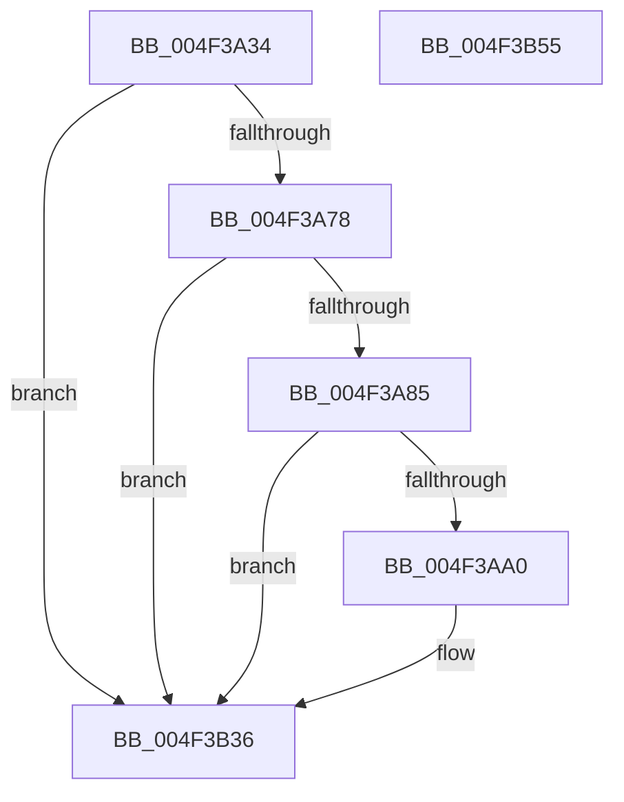

# PpmEventParkNodeParkHintChangedEx

- RVA: `0x004F3A34`–`0x004F3B56` (길이 `290` bytes)
- VA: `0x00000001404F3A34`
- 실행 섹션: `.text`
- PDB 이름 있음: `예`; PDB Function 태그: `아니요`
- unwind 정보 RVA: `0x000B958C`
- 디코드: `68`개 명령, `290/290` bytes 표시
- 미해석 바이트: `0` (있으면 어셈블리에 `.byte`로 보존)

> 이 문서는 커널 이미지의 기계어와 PDB 기호를 분석해 생성했습니다. 4번과 5번은 함수 원형과 자료형을 바이너리 사용 방식에서 추정한 C 해석이며 원본 소스 복구 결과는 아닙니다.

## 1. Dependencies

- 직접 호출 지점: **5**; 고유 호출 대상: **4**
- 직접 호출자로 확인된 함수: **1**
- RIP 상대 이미지 참조: **5**

### Outgoing calls
- `0x004F3A93` → [EtwEventEnabled](../39/EtwEventEnabled_function_00392450.md) (function, `0x00392450`)
- `0x004F3ACD` → [PpmEventAddAffinityMaskAsSubset](../4E/PpmEventAddAffinityMaskAsSubset_function_004EF628.md) (function, `0x004EF628`)
- `0x004F3B00` → [PpmEventAddAffinityMaskAsSubset](../4E/PpmEventAddAffinityMaskAsSubset_function_004EF628.md) (function, `0x004EF628`)
- `0x004F3B31` → [EtwWriteEx](../25/EtwWriteEx_function_0025F0D0.md) (function, `0x0025F0D0`)
- `0x004F3B3D` → [_security_check_cookie](../6A/_security_check_cookie_function_006AC640.md) (function, `0x006AC640`)

### Direct callers
- [PpmParkApplyPolicyEx](PpmParkApplyPolicyEx_function_004F3090.md) at `0x004F3595`

### Static image references
- `0x004F3A48` → RVA `0x00E0A740` (`.data`; read)
- `0x004F3A68` → RVA `0x00E67A70` (`.data`; read)
- `0x004F3A78` → RVA `0x00E67A39` (`.data`; read)
- `0x004F3A85` → RVA `0x00F083E8` (`.data`; read)
- `0x004F3A8C` → RVA `0x00021F80` (`.rdata`; read)

## 2. Other-region calls and transfers

- 다른 실행 섹션으로 향하는 call: **0**
- 별도 외부 분기/꼬리 이동을 확인하지 못했습니다.

## 3. Assembly (complete function range)

```asm
004F3A34  48 89 5C 24 18                  mov qword ptr [rsp + 0x18], rbx
004F3A39  55                              push rbp
004F3A3A  56                              push rsi
004F3A3B  57                              push rdi
004F3A3C  48 8D 6C 24 B9                  lea rbp, [rsp - 0x47]
004F3A41  48 81 EC E0 00 00 00            sub rsp, 0xe0
004F3A48  48 8B 05 F1 6C 91 00            mov rax, qword ptr [rip + 0x916cf1]
004F3A4F  48 33 C4                        xor rax, rsp
004F3A52  48 89 45 37                     mov qword ptr [rbp + 0x37], rax
004F3A56  83 65 AF 00                     and dword ptr [rbp - 0x51], 0
004F3A5A  48 8B F2                        mov rsi, rdx
004F3A5D  83 65 AB 00                     and dword ptr [rbp - 0x55], 0
004F3A61  48 8B F9                        mov rdi, rcx
004F3A64  83 65 A7 00                     and dword ptr [rbp - 0x59], 0
004F3A68  48 8B 1D 01 40 97 00            mov rbx, qword ptr [rip + 0x974001]
004F3A6F  48 85 DB                        test rbx, rbx
004F3A72  0F 84 BE 00 00 00               je 0x1404f3b36
004F3A78  80 3D BA 3F 97 00 00            cmp byte ptr [rip + 0x973fba], 0
004F3A7F  0F 84 B1 00 00 00               je 0x1404f3b36
004F3A85  48 8B 0D 5C 49 A1 00            mov rcx, qword ptr [rip + 0xa1495c]
004F3A8C  48 8D 15 ED E4 B2 FF            lea rdx, [rip - 0x4d1b13]
004F3A93  E8 B8 E9 E9 FF                  call 0x140392450
004F3A98  84 C0                           test al, al
004F3A9A  0F 84 96 00 00 00               je 0x1404f3b36
004F3AA0  48 8D 45 A7                     lea rax, [rbp - 0x59]
004F3AA4  48 8B D7                        mov rdx, rdi
004F3AA7  48 89 44 24 38                  mov qword ptr [rsp + 0x38], rax
004F3AAC  4C 8D 4D B7                     lea r9, [rbp - 0x49]
004F3AB0  48 8D 45 AB                     lea rax, [rbp - 0x55]
004F3AB4  33 C9                           xor ecx, ecx
004F3AB6  48 89 44 24 30                  mov qword ptr [rsp + 0x30], rax
004F3ABB  4C 8D 45 B3                     lea r8, [rbp - 0x4d]
004F3ABF  48 8D 45 AF                     lea rax, [rbp - 0x51]
004F3AC3  48 89 44 24 28                  mov qword ptr [rsp + 0x28], rax
004F3AC8  48 89 5C 24 20                  mov qword ptr [rsp + 0x20], rbx
004F3ACD  E8 56 BB FF FF                  call 0x1404ef628
004F3AD2  48 8D 45 A7                     lea rax, [rbp - 0x59]
004F3AD6  48 8B D6                        mov rdx, rsi
004F3AD9  48 89 44 24 38                  mov qword ptr [rsp + 0x38], rax
004F3ADE  4C 8D 4D B7                     lea r9, [rbp - 0x49]
004F3AE2  48 8D 45 AB                     lea rax, [rbp - 0x55]
004F3AE6  48 8B CF                        mov rcx, rdi
004F3AE9  48 89 44 24 30                  mov qword ptr [rsp + 0x30], rax
004F3AEE  4C 8D 45 B3                     lea r8, [rbp - 0x4d]
004F3AF2  48 8D 45 AF                     lea rax, [rbp - 0x51]
004F3AF6  48 89 44 24 28                  mov qword ptr [rsp + 0x28], rax
004F3AFB  48 89 5C 24 20                  mov qword ptr [rsp + 0x20], rbx
004F3B00  E8 23 BB FF FF                  call 0x1404ef628
004F3B05  8B 45 A7                        mov eax, dword ptr [rbp - 0x59]
004F3B08  48 8D 15 71 E4 B2 FF            lea rdx, [rip - 0x4d1b8f]
004F3B0F  48 8B 0D D2 48 A1 00            mov rcx, qword ptr [rip + 0xa148d2]
004F3B16  45 33 C9                        xor r9d, r9d
004F3B19  48 89 5C 24 38                  mov qword ptr [rsp + 0x38], rbx
004F3B1E  45 33 C0                        xor r8d, r8d
004F3B21  89 44 24 30                     mov dword ptr [rsp + 0x30], eax
004F3B25  48 83 64 24 28 00               and qword ptr [rsp + 0x28], 0
004F3B2B  48 83 64 24 20 00               and qword ptr [rsp + 0x20], 0
004F3B31  E8 9A B5 D6 FF                  call 0x14025f0d0
004F3B36  48 8B 4D 37                     mov rcx, qword ptr [rbp + 0x37]
004F3B3A  48 33 CC                        xor rcx, rsp
004F3B3D  E8 FE 8A 1B 00                  call 0x1406ac640
004F3B42  48 8B 9C 24 10 01 00 00         mov rbx, qword ptr [rsp + 0x110]
004F3B4A  48 81 C4 E0 00 00 00            add rsp, 0xe0
004F3B51  5F                              pop rdi
004F3B52  5E                              pop rsi
004F3B53  5D                              pop rbp
004F3B54  C3                              ret
004F3B55  CC                              int3
```

## 4. C-style interpretation (structured pseudocode)

```c
__int64 __fastcall PpmEventParkNodeParkHintChangedEx(__int64 a1, __int64 a2)
{
    __int64 result;
    __int64 v_rsp;
    unsigned __int64 v_stack_m28;
    unsigned __int64 v_stack_m5F;
    unsigned __int64 v_stack_mA8;
    unsigned __int64 v_stack_mAC;
    unsigned int v_stack_mB0;
    unsigned int v_stack_mB4;
    unsigned int v_stack_mB8;
    unsigned __int64 v_stack_mC0;
    unsigned __int64 v_stack_mC8;
    unsigned __int64 v_stack_mD0;
    unsigned __int64 v_stack_mD8;
    unsigned __int64 v_stack_p18;

    v_stack_p18 = v_rbx;
    v_rsp = (v_rsp) - (224);
    result = (*(unsigned __int64 *)(v_rip + 9530609)) ^ (v_rsp);
    v_stack_m28 = result;
    if (*(unsigned __int64 *)(v_rip + 9912321) == 0) goto loc_004F3B36;
    if ((*(unsigned __int8 *)(v_rip + 9912250)) == 0) goto loc_004F3B36;
    result = EtwEventEnabled(*(unsigned __int64 *)(v_rip + 10570076), v_rip - 5053203, a3, a4);
    if ((unsigned __int8)(result) != 0) {
        result = v_stack_mB8;
        a2 = a1;
        v_stack_mC0 = result;
        a4 = v_stack_mA8;
        result = v_stack_mB4;
        a1 = 0;
        v_stack_mC8 = result;
        a3 = v_stack_mAC;
        result = v_stack_mB0;
        v_stack_mD0 = result;
        v_stack_mD8 = *(unsigned __int64 *)(v_rip + 9912321);
        result = PpmEventAddAffinityMaskAsSubset(a1, a2, a3, a4);
        result = v_stack_mB8;
        a2 = a2;
        v_stack_mC0 = result;
        a4 = v_stack_mA8;
        result = v_stack_mB4;
        a1 = 0;
        v_stack_mC8 = result;
        a3 = v_stack_mAC;
        result = v_stack_mB0;
        v_stack_mD0 = result;
        v_stack_mD8 = *(unsigned __int64 *)(v_rip + 9912321);
        result = PpmEventAddAffinityMaskAsSubset(a1, a2, a3, a4);
        result = v_stack_mB8;
        a2 = v_rip - 5053327;
        a1 = *(unsigned __int64 *)(v_rip + 10569938);
        a4 = 0;
        v_stack_mC0 = *(unsigned __int64 *)(v_rip + 9912321);
        a3 = 0;
        v_stack_mC8 = (unsigned int)(result);
        result = EtwWriteEx(a1, a2, a3, a4);
    }
    a1 = (v_stack_m28) ^ (v_rsp);
    result = _security_check_cookie(a1, a2, a3, a4);
    v_rsp = (v_rsp) + (224);
    return result;
}
```

## 5. (Beta) C Style

```c
int64_t PpmEventParkNodeParkHintChangedEx(int64_t Arg1, int64_t Arg2)
{
    int64_t result;
    int64_t local_rsp;
    uint64_t v_stack_m28;
    uint64_t v_stack_m5F;
    uint64_t v_stack_mA8;
    uint64_t v_stack_mAC;
    uint32_t v_stack_mB0;
    uint32_t v_stack_mB4;
    uint32_t v_stack_mB8;
    uint64_t v_stack_mC0;
    uint64_t v_stack_mC8;
    uint64_t v_stack_mD0;
    uint64_t v_stack_mD8;
    uint64_t v_stack_p18;

    v_stack_p18 = local_rbx;
    local_rsp = (local_rsp) - (224);
    result = (*(uint64_t *)(v_rip + 0x916CF1)) ^ (local_rsp);
    v_stack_m28 = result;
    if (*(uint64_t *)(v_rip + 0x974001) == 0) goto loc_004F3B36;
    if ((*(uint8_t *)(v_rip + 0x973FBA)) == 0) goto loc_004F3B36;
    result = EtwEventEnabled(*(uint64_t *)(v_rip + 0xA1495C), v_rip - 5053203, a3, a4);
    if ((uint8_t)(result) != 0) {
        result = v_stack_mB8;
        Arg2 = Arg1;
        v_stack_mC0 = result;
        a4 = v_stack_mA8;
        result = v_stack_mB4;
        Arg1 = 0;
        v_stack_mC8 = result;
        a3 = v_stack_mAC;
        result = v_stack_mB0;
        v_stack_mD0 = result;
        v_stack_mD8 = *(uint64_t *)(v_rip + 0x974001);
        result = PpmEventAddAffinityMaskAsSubset(Arg1, Arg2, a3, a4);
        result = v_stack_mB8;
        Arg2 = Arg2;
        v_stack_mC0 = result;
        a4 = v_stack_mA8;
        result = v_stack_mB4;
        Arg1 = 0;
        v_stack_mC8 = result;
        a3 = v_stack_mAC;
        result = v_stack_mB0;
        v_stack_mD0 = result;
        v_stack_mD8 = *(uint64_t *)(v_rip + 0x974001);
        result = PpmEventAddAffinityMaskAsSubset(Arg1, Arg2, a3, a4);
        result = v_stack_mB8;
        Arg2 = v_rip - 5053327;
        Arg1 = *(uint64_t *)(v_rip + 0xA148D2);
        a4 = 0;
        v_stack_mC0 = *(uint64_t *)(v_rip + 0x974001);
        a3 = 0;
        v_stack_mC8 = (uint32_t)(result);
        result = EtwWriteEx(Arg1, Arg2, a3, a4);
    }
    Arg1 = (v_stack_m28) ^ (local_rsp);
    result = _security_check_cookie(Arg1, Arg2, a3, a4);
    local_rsp = (local_rsp) + (224);
    return result;
}
```

## 6. Execution-region graph

[열기: 2D/3D 그래프와 함수 탐색 컨트롤 패널](../../../control-panel.html?section=text&rva=0x004F3A34&view=graph)

- 2D 그래프는 위에서 아래로 흐르고, 3D 그래프는 빈 공간을 드래그해 회전합니다. Shift+드래그는 이동, 휠은 확대·축소, 함수 노드 선택은 대상 보고서 이동입니다.

### Static fallback


