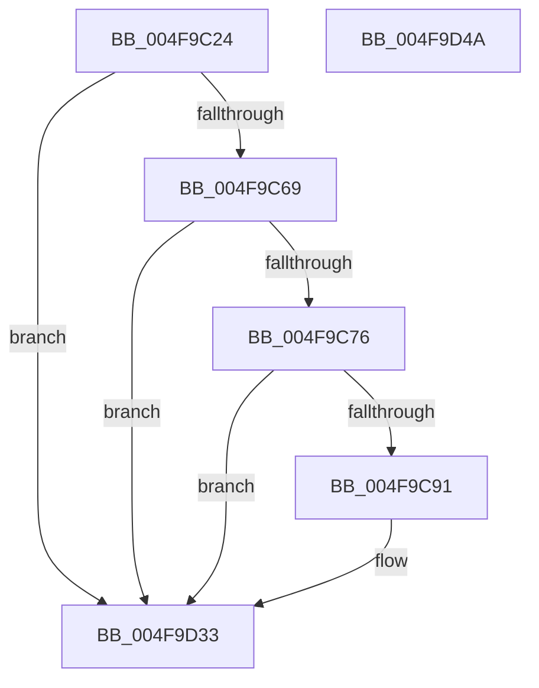

# PpmEventTraceHeteroDistributeUtilityEx

- RVA: `0x004F9C24`–`0x004F9D4B` (길이 `295` bytes)
- VA: `0x00000001404F9C24`
- 실행 섹션: `.text`
- PDB 이름 있음: `예`; PDB Function 태그: `아니요`
- unwind 정보 RVA: `0x000BF8D4`
- 디코드: `71`개 명령, `295/295` bytes 표시
- 미해석 바이트: `0` (있으면 어셈블리에 `.byte`로 보존)

> 이 문서는 커널 이미지의 기계어와 PDB 기호를 분석해 생성했습니다. 4번과 5번은 함수 원형과 자료형을 바이너리 사용 방식에서 추정한 C 해석이며 원본 소스 복구 결과는 아닙니다.

## 1. Dependencies

- 직접 호출 지점: **4**; 고유 호출 대상: **4**
- 직접 호출자로 확인된 함수: **1**
- RIP 상대 이미지 참조: **5**

### Outgoing calls
- `0x004F9C84` → [EtwEventEnabled](../39/EtwEventEnabled_function_00392450.md) (function, `0x00392450`)
- `0x004F9CBF` → [PpmEventAddAffinityMaskAsSubset](../4E/PpmEventAddAffinityMaskAsSubset_function_004EF628.md) (function, `0x004EF628`)
- `0x004F9D2E` → [EtwWriteEx](../25/EtwWriteEx_function_0025F0D0.md) (function, `0x0025F0D0`)
- `0x004F9D3A` → [_security_check_cookie](../6A/_security_check_cookie_function_006AC640.md) (function, `0x006AC640`)

### Direct callers
- [PpmEventTraceHeteroDistributeUtility](../4D/PpmEventTraceHeteroDistributeUtility_function_004DF094.md) at `0x004DF0D2`

### Static image references
- `0x004F9C3C` → RVA `0x00E0A740` (`.data`; read)
- `0x004F9C59` → RVA `0x00E67A70` (`.data`; read)
- `0x004F9C69` → RVA `0x00E67A39` (`.data`; read)
- `0x004F9C76` → RVA `0x00F083E8` (`.data`; read)
- `0x004F9C7D` → RVA `0x00021B98` (`.rdata`; read)

## 2. Other-region calls and transfers

- 다른 실행 섹션으로 향하는 call: **0**
- 별도 외부 분기/꼬리 이동을 확인하지 못했습니다.

## 3. Assembly (complete function range)

```asm
004F9C24  44 88 44 24 18                  mov byte ptr [rsp + 0x18], r8b
004F9C29  88 54 24 10                     mov byte ptr [rsp + 0x10], dl
004F9C2D  55                              push rbp
004F9C2E  53                              push rbx
004F9C2F  57                              push rdi
004F9C30  48 8D 6C 24 B9                  lea rbp, [rsp - 0x47]
004F9C35  48 81 EC A0 00 00 00            sub rsp, 0xa0
004F9C3C  48 8B 05 FD 0A 91 00            mov rax, qword ptr [rip + 0x910afd]
004F9C43  48 33 C4                        xor rax, rsp
004F9C46  48 89 45 37                     mov qword ptr [rbp + 0x37], rax
004F9C4A  83 65 F3 00                     and dword ptr [rbp - 0xd], 0
004F9C4E  48 8B F9                        mov rdi, rcx
004F9C51  83 65 EF 00                     and dword ptr [rbp - 0x11], 0
004F9C55  83 65 E7 00                     and dword ptr [rbp - 0x19], 0
004F9C59  48 8B 1D 10 DE 96 00            mov rbx, qword ptr [rip + 0x96de10]
004F9C60  48 85 DB                        test rbx, rbx
004F9C63  0F 84 CA 00 00 00               je 0x1404f9d33
004F9C69  80 3D C9 DD 96 00 00            cmp byte ptr [rip + 0x96ddc9], 0
004F9C70  0F 84 BD 00 00 00               je 0x1404f9d33
004F9C76  48 8B 0D 6B E7 A0 00            mov rcx, qword ptr [rip + 0xa0e76b]
004F9C7D  48 8D 15 14 7F B2 FF            lea rdx, [rip - 0x4d80ec]
004F9C84  E8 C7 87 E9 FF                  call 0x140392450
004F9C89  84 C0                           test al, al
004F9C8B  0F 84 A2 00 00 00               je 0x1404f9d33
004F9C91  48 8D 45 E7                     lea rax, [rbp - 0x19]
004F9C95  33 C9                           xor ecx, ecx
004F9C97  48 89 44 24 38                  mov qword ptr [rsp + 0x38], rax
004F9C9C  48 8D 57 30                     lea rdx, [rdi + 0x30]
004F9CA0  48 8D 45 EF                     lea rax, [rbp - 0x11]
004F9CA4  48 89 44 24 30                  mov qword ptr [rsp + 0x30], rax
004F9CA9  4C 8D 4D F7                     lea r9, [rbp - 9]
004F9CAD  48 8D 45 F3                     lea rax, [rbp - 0xd]
004F9CB1  48 89 44 24 28                  mov qword ptr [rsp + 0x28], rax
004F9CB6  4C 8D 45 EB                     lea r8, [rbp - 0x15]
004F9CBA  48 89 5C 24 20                  mov qword ptr [rsp + 0x20], rbx
004F9CBF  E8 64 59 FF FF                  call 0x1404ef628
004F9CC4  44 8B 45 E7                     mov r8d, dword ptr [rbp - 0x19]
004F9CC8  48 8D 4D 6F                     lea rcx, [rbp + 0x6f]
004F9CCC  41 B9 01 00 00 00               mov r9d, 1
004F9CD2  48 89 5C 24 38                  mov qword ptr [rsp + 0x38], rbx
004F9CD7  41 8B C0                        mov eax, r8d
004F9CDA  48 8D 15 B7 7E B2 FF            lea rdx, [rip - 0x4d8149]
004F9CE1  48 C1 E0 04                     shl rax, 4
004F9CE5  48 03 C3                        add rax, rbx
004F9CE8  83 60 0C 00                     and dword ptr [rax + 0xc], 0
004F9CEC  48 89 08                        mov qword ptr [rax], rcx
004F9CEF  41 8D 48 01                     lea ecx, [r8 + 1]
004F9CF3  44 89 48 08                     mov dword ptr [rax + 8], r9d
004F9CF7  48 8D 45 77                     lea rax, [rbp + 0x77]
004F9CFB  48 C1 E1 04                     shl rcx, 4
004F9CFF  48 03 CB                        add rcx, rbx
004F9D02  83 61 0C 00                     and dword ptr [rcx + 0xc], 0
004F9D06  48 89 01                        mov qword ptr [rcx], rax
004F9D09  41 8D 40 02                     lea eax, [r8 + 2]
004F9D0D  89 44 24 30                     mov dword ptr [rsp + 0x30], eax
004F9D11  45 33 C0                        xor r8d, r8d
004F9D14  48 83 64 24 28 00               and qword ptr [rsp + 0x28], 0
004F9D1A  48 83 64 24 20 00               and qword ptr [rsp + 0x20], 0
004F9D20  44 89 49 08                     mov dword ptr [rcx + 8], r9d
004F9D24  45 33 C9                        xor r9d, r9d
004F9D27  48 8B 0D BA E6 A0 00            mov rcx, qword ptr [rip + 0xa0e6ba]
004F9D2E  E8 9D 53 D6 FF                  call 0x14025f0d0
004F9D33  48 8B 4D 37                     mov rcx, qword ptr [rbp + 0x37]
004F9D37  48 33 CC                        xor rcx, rsp
004F9D3A  E8 01 29 1B 00                  call 0x1406ac640
004F9D3F  48 81 C4 A0 00 00 00            add rsp, 0xa0
004F9D46  5F                              pop rdi
004F9D47  5B                              pop rbx
004F9D48  5D                              pop rbp
004F9D49  C3                              ret
004F9D4A  CC                              int3
```

## 4. C-style interpretation (structured pseudocode)

```c
__int64 __fastcall PpmEventTraceHeteroDistributeUtilityEx(__int64 a1, unsigned __int8 a2, unsigned __int8 a3)
{
    __int64 result;
    __int64 v_rsp;
    unsigned __int64 v_stack_m28;
    unsigned __int64 v_stack_m5F;
    unsigned __int64 v_stack_m68;
    unsigned int v_stack_m6C;
    unsigned int v_stack_m70;
    unsigned __int64 v_stack_m74;
    unsigned int v_stack_m78;
    unsigned __int64 v_stack_m80;
    unsigned __int64 v_stack_m88;
    unsigned __int64 v_stack_m90;
    unsigned __int64 v_stack_m98;
    unsigned __int8 v_stack_p10;
    unsigned __int8 v_stack_p18;

    v_stack_p18 = a3;
    v_stack_p10 = a2;
    v_rsp = (v_rsp) - (160);
    result = (*(unsigned __int64 *)(v_rip + 9505533)) ^ (v_rsp);
    v_stack_m28 = result;
    if (*(unsigned __int64 *)(v_rip + 9887248) == 0) goto loc_004F9D33;
    if ((*(unsigned __int8 *)(v_rip + 9887177)) == 0) goto loc_004F9D33;
    result = EtwEventEnabled(*(unsigned __int64 *)(v_rip + 10545003), v_rip - 5079276, a3, a4);
    if ((unsigned __int8)(result) != 0) {
        result = v_stack_m78;
        a1 = 0;
        v_stack_m80 = result;
        a2 = a1 + 48;
        result = v_stack_m70;
        v_stack_m88 = result;
        a4 = v_stack_m68;
        result = v_stack_m6C;
        v_stack_m90 = result;
        a3 = v_stack_m74;
        v_stack_m98 = *(unsigned __int64 *)(v_rip + 9887248);
        result = PpmEventAddAffinityMaskAsSubset(a1, a2, a3, a4);
        a3 = v_stack_m78;
        a1 = v_stack_p10;
        a4 = 1;
        v_stack_m80 = *(unsigned __int64 *)(v_rip + 9887248);
        result = a3;
        a2 = v_rip - 5079369;
        result = (result) << (4);
        result = (result) + (*(unsigned __int64 *)(v_rip + 9887248));
        *(unsigned __int64 *)(result) = a1;
        a1 = a3 + 1;
        *(unsigned int *)(result + 8) = (unsigned int)(a4);
        result = v_stack_p18;
        a1 = (a1) << (4);
        a1 = (a1) + (*(unsigned __int64 *)(v_rip + 9887248));
        *(unsigned __int64 *)(a1) = result;
        result = a3 + 2;
        v_stack_m88 = (unsigned int)(result);
        a3 = 0;
        *(unsigned int *)(a1 + 8) = (unsigned int)(a4);
        a4 = 0;
        a1 = *(unsigned __int64 *)(v_rip + 10544826);
        result = EtwWriteEx(a1, a2, a3, a4);
    }
    a1 = (v_stack_m28) ^ (v_rsp);
    result = _security_check_cookie(a1, a2, a3, a4);
    v_rsp = (v_rsp) + (160);
    return result;
}
```

## 5. (Beta) C Style

```c
int64_t PpmEventTraceHeteroDistributeUtilityEx(void *Arg1, uint8_t Arg2, uint8_t Arg3)
{
    uint8_t *arg1 = (uint8_t *)Arg1;

    int64_t result;
    int64_t local_rsp;
    uint64_t v_stack_m28;
    uint64_t v_stack_m5F;
    uint64_t v_stack_m68;
    uint32_t v_stack_m6C;
    uint32_t v_stack_m70;
    uint64_t v_stack_m74;
    uint32_t v_stack_m78;
    uint64_t v_stack_m80;
    uint64_t v_stack_m88;
    uint64_t v_stack_m90;
    uint64_t v_stack_m98;
    uint8_t v_stack_p10;
    uint8_t v_stack_p18;

    v_stack_p18 = Arg3;
    v_stack_p10 = Arg2;
    local_rsp = (local_rsp) - (160);
    result = (*(uint64_t *)(v_rip + 0x910AFD)) ^ (local_rsp);
    v_stack_m28 = result;
    if (*(uint64_t *)(v_rip + 0x96DE10) == 0) goto loc_004F9D33;
    if ((*(uint8_t *)(v_rip + 0x96DDC9)) == 0) goto loc_004F9D33;
    result = EtwEventEnabled(*(uint64_t *)(v_rip + 0xA0E76B), v_rip - 5079276, Arg3, a4);
    if ((uint8_t)(result) != 0) {
        result = v_stack_m78;
        Arg1 = 0;
        v_stack_m80 = result;
        Arg2 = Arg1 + 48;
        result = v_stack_m70;
        v_stack_m88 = result;
        a4 = v_stack_m68;
        result = v_stack_m6C;
        v_stack_m90 = result;
        Arg3 = v_stack_m74;
        v_stack_m98 = *(uint64_t *)(v_rip + 0x96DE10);
        result = PpmEventAddAffinityMaskAsSubset(Arg1, Arg2, Arg3, a4);
        Arg3 = v_stack_m78;
        Arg1 = v_stack_p10;
        a4 = 1;
        v_stack_m80 = *(uint64_t *)(v_rip + 0x96DE10);
        result = Arg3;
        Arg2 = v_rip - 5079369;
        result = (result) << (4);
        result = (result) + (*(uint64_t *)(v_rip + 0x96DE10));
        *(void **)(result) = Arg1;
        Arg1 = Arg3 + 1;
        *(uint32_t *)(result + 0x8) = (uint32_t)(a4);
        result = v_stack_p18;
        Arg1 = (Arg1) << (4);
        Arg1 = (Arg1) + (*(uint64_t *)(v_rip + 0x96DE10));
        *(uint64_t *)(arg1) = result;
        result = Arg3 + 2;
        v_stack_m88 = (uint32_t)(result);
        Arg3 = 0;
        *(uint32_t *)(arg1 + 0x8) = (uint32_t)(a4);
        a4 = 0;
        Arg1 = *(uint64_t *)(v_rip + 0xA0E6BA);
        result = EtwWriteEx(Arg1, Arg2, Arg3, a4);
    }
    Arg1 = (v_stack_m28) ^ (local_rsp);
    result = _security_check_cookie(Arg1, Arg2, Arg3, a4);
    local_rsp = (local_rsp) + (160);
    return result;
}
```

### 관측된 메모리 오프셋

구조체 형식이 확인되지 않은 접근은 인자 기준의 오프셋으로만 기록했습니다.

| 기준 인자 | 오프셋 표현 | 폭 (bit) | 접근 |
|---|---:|---:|---|
| `Arg1` | `+ 0x30` | `64` | `R` |

## 6. Execution-region graph

[열기: 2D/3D 그래프와 함수 탐색 컨트롤 패널](../../../control-panel.html?section=text&rva=0x004F9C24&view=graph)

- 2D 그래프는 위에서 아래로 흐르고, 3D 그래프는 빈 공간을 드래그해 회전합니다. Shift+드래그는 이동, 휠은 확대·축소, 함수 노드 선택은 대상 보고서 이동입니다.

### Static fallback


