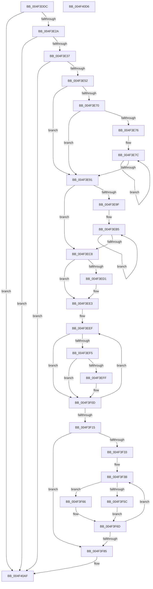

# PpmEventTraceHeteroResponseExV1

- RVA: `0x004F3DDC`–`0x004F40D7` (길이 `763` bytes)
- VA: `0x00000001404F3DDC`
- 실행 섹션: `.text`
- PDB 이름 있음: `예`; PDB Function 태그: `아니요`
- unwind 정보 RVA: `0x000B76EC`
- 디코드: `190`개 명령, `763/763` bytes 표시
- 미해석 바이트: `0` (있으면 어셈블리에 `.byte`로 보존)

> 이 문서는 커널 이미지의 기계어와 PDB 기호를 분석해 생성했습니다. 4번과 5번은 함수 원형과 자료형을 바이너리 사용 방식에서 추정한 C 해석이며 원본 소스 복구 결과는 아닙니다.

## 1. Dependencies

- 직접 호출 지점: **3**; 고유 호출 대상: **3**
- 직접 호출자로 확인된 함수: **1**
- RIP 상대 이미지 참조: **7**

### Outgoing calls
- `0x004F3E45` → [EtwEventEnabled](../39/EtwEventEnabled_function_00392450.md) (function, `0x00392450`)
- `0x004F40AA` → [EtwWriteEx](../25/EtwWriteEx_function_0025F0D0.md) (function, `0x0025F0D0`)
- `0x004F40B6` → [_security_check_cookie](../6A/_security_check_cookie_function_006AC640.md) (function, `0x006AC640`)

### Direct callers
- [PpmCheckComputeHeteroResponseEx](../5D/PpmCheckComputeHeteroResponseEx_function_005DECA0.md) at `0x005DF545`

### Static image references
- `0x004F3DFD` → RVA `0x00E0A740` (`.data`; read)
- `0x004F3E0B` → RVA `0x00E67A70` (`.data`; read)
- `0x004F3E2A` → RVA `0x00E67A39` (`.data`; read)
- `0x004F3E37` → RVA `0x00F083E8` (`.data`; read)
- `0x004F3E3E` → RVA `0x0001C630` (`.rdata`; read)
- `0x004F3EC8` → RVA `0x00FC6A86` (`ALMOSTRO`; read)
- `0x004F3F66` → RVA `0x00E67A78` (`.data`; read)

## 2. Other-region calls and transfers

- 다른 실행 섹션으로 향하는 call: **0**
- 별도 외부 분기/꼬리 이동을 확인하지 못했습니다.

## 3. Assembly (complete function range)

```asm
004F3DDC  48 89 5C 24 08                  mov qword ptr [rsp + 8], rbx
004F3DE1  4C 89 4C 24 20                  mov qword ptr [rsp + 0x20], r9
004F3DE6  55                              push rbp
004F3DE7  56                              push rsi
004F3DE8  57                              push rdi
004F3DE9  41 54                           push r12
004F3DEB  41 55                           push r13
004F3DED  41 56                           push r14
004F3DEF  41 57                           push r15
004F3DF1  48 8D 6C 24 F9                  lea rbp, [rsp - 7]
004F3DF6  48 81 EC A0 00 00 00            sub rsp, 0xa0
004F3DFD  48 8B 05 3C 69 91 00            mov rax, qword ptr [rip + 0x91693c]
004F3E04  48 33 C4                        xor rax, rsp
004F3E07  48 89 45 F7                     mov qword ptr [rbp - 9], rax
004F3E0B  48 8B 3D 5E 3C 97 00            mov rdi, qword ptr [rip + 0x973c5e]
004F3E12  45 33 E4                        xor r12d, r12d
004F3E15  4D 8B F0                        mov r14, r8
004F3E18  4C 8B FA                        mov r15, rdx
004F3E1B  48 8B D9                        mov rbx, rcx
004F3E1E  41 8B F4                        mov esi, r12d
004F3E21  48 85 FF                        test rdi, rdi
004F3E24  0F 84 85 02 00 00               je 0x1404f40af
004F3E2A  44 38 25 08 3C 97 00            cmp byte ptr [rip + 0x973c08], r12b
004F3E31  0F 84 78 02 00 00               je 0x1404f40af
004F3E37  48 8B 0D AA 45 A1 00            mov rcx, qword ptr [rip + 0xa145aa]
004F3E3E  48 8D 15 EB 87 B2 FF            lea rdx, [rip - 0x4d7815]
004F3E45  E8 06 E6 E9 FF                  call 0x140392450
004F3E4A  84 C0                           test al, al
004F3E4C  0F 84 5D 02 00 00               je 0x1404f40af
004F3E52  44 0F B7 53 0A                  movzx r10d, word ptr [rbx + 0xa]
004F3E57  45 8D 6C 24 01                  lea r13d, [r12 + 1]
004F3E5C  8A 83 A4 04 00 00               mov al, byte ptr [rbx + 0x4a4]
004F3E62  66 44 89 55 B3                  mov word ptr [rbp - 0x4d], r10w
004F3E67  88 45 A7                        mov byte ptr [rbp - 0x59], al
004F3E6A  4C 39 6D 5F                     cmp qword ptr [rbp + 0x5f], r13
004F3E6E  76 21                           jbe 0x1404f3e91
004F3E70  66 45 3B E2                     cmp r12w, r10w
004F3E74  73 1B                           jae 0x1404f3e91
004F3E76  49 8B CE                        mov rcx, r14
004F3E79  45 8B C2                        mov r8d, r10d
004F3E7C  48 8B 01                        mov rax, qword ptr [rcx]
004F3E7F  33 D2                           xor edx, edx
004F3E81  48 F7 75 5F                     div qword ptr [rbp + 0x5f]
004F3E85  48 89 01                        mov qword ptr [rcx], rax
004F3E88  48 8D 49 08                     lea rcx, [rcx + 8]
004F3E8C  4D 2B C5                        sub r8, r13
004F3E8F  75 EB                           jne 0x1404f3e7c
004F3E91  0F B6 43 0C                     movzx eax, byte ptr [rbx + 0xc]
004F3E95  66 44 89 65 AB                  mov word ptr [rbp - 0x55], r12w
004F3E9A  41 3B C5                        cmp eax, r13d
004F3E9D  76 29                           jbe 0x1404f3ec8
004F3E9F  48 8B 93 08 05 00 00            mov rdx, qword ptr [rbx + 0x508]
004F3EA6  44 8D 40 FF                     lea r8d, [rax - 1]
004F3EAA  48 81 C2 86 02 00 00            add rdx, 0x286
004F3EB1  41 0F B7 CC                     movzx ecx, r12w
004F3EB5  66 03 0A                        add cx, word ptr [rdx]
004F3EB8  48 8D 92 80 02 00 00            lea rdx, [rdx + 0x280]
004F3EBF  66 89 4D AB                     mov word ptr [rbp - 0x55], cx
004F3EC3  4D 2B C5                        sub r8, r13
004F3EC6  75 ED                           jne 0x1404f3eb5
004F3EC8  44 38 25 B7 2B AD 00            cmp byte ptr [rip + 0xad2bb7], r12b
004F3ECF  74 12                           je 0x1404f3ee3
004F3ED1  48 8B 83 08 05 00 00            mov rax, qword ptr [rbx + 0x508]
004F3ED8  0F B7 88 86 02 00 00            movzx ecx, word ptr [rax + 0x286]
004F3EDF  66 89 4D AB                     mov word ptr [rbp - 0x55], cx
004F3EE3  44 0F B7 4B 30                  movzx r9d, word ptr [rbx + 0x30]
004F3EE8  45 0F B7 C4                     movzx r8d, r12w
004F3EEC  41 8B D4                        mov edx, r12d
004F3EEF  66 41 3B D1                     cmp dx, r9w
004F3EF3  73 18                           jae 0x1404f3f0d
004F3EF5  0F B7 C2                        movzx eax, dx
004F3EF8  4C 39 64 C3 38                  cmp qword ptr [rbx + rax*8 + 0x38], r12
004F3EFD  74 0E                           je 0x1404f3f0d
004F3EFF  8B C6                           mov eax, esi
004F3F01  41 03 F5                        add esi, r13d
004F3F04  66 45 03 C5                     add r8w, r13w
004F3F08  66 89 54 45 B7                  mov word ptr [rbp + rax*2 - 0x49], dx
004F3F0D  41 03 D5                        add edx, r13d
004F3F10  83 FA 20                        cmp edx, 0x20
004F3F13  72 DA                           jb 0x1404f3eef
004F3F15  66 44 89 45 AF                  mov word ptr [rbp - 0x51], r8w
004F3F1A  48 8D 45 AF                     lea rax, [rbp - 0x51]
004F3F1E  48 89 07                        mov qword ptr [rdi], rax
004F3F21  BE 02 00 00 00                  mov esi, 2
004F3F26  48 89 77 08                     mov qword ptr [rdi + 8], rsi
004F3F2A  45 8B CD                        mov r9d, r13d
004F3F2D  66 45 3B E0                     cmp r12w, r8w
004F3F31  73 52                           jae 0x1404f3f85
004F3F33  48 8D 55 B7                     lea rdx, [rbp - 0x49]
004F3F37  45 0F B7 D8                     movzx r11d, r8w
004F3F3B  44 0F B7 02                     movzx r8d, word ptr [rdx]
004F3F3F  41 8D 49 01                     lea ecx, [r9 + 1]
004F3F43  41 8B C1                        mov eax, r9d
004F3F46  48 03 C9                        add rcx, rcx
004F3F49  48 03 C0                        add rax, rax
004F3F4C  48 89 14 C7                     mov qword ptr [rdi + rax*8], rdx
004F3F50  48 89 74 C7 08                  mov qword ptr [rdi + rax*8 + 8], rsi
004F3F55  66 44 3B 43 30                  cmp r8w, word ptr [rbx + 0x30]
004F3F5A  73 0A                           jae 0x1404f3f66
004F3F5C  49 83 C0 07                     add r8, 7
004F3F60  4E 8D 04 C3                     lea r8, [rbx + r8*8]
004F3F64  EB 07                           jmp 0x1404f3f6d
004F3F66  4C 8D 05 0B 3B 97 00            lea r8, [rip + 0x973b0b]
004F3F6D  44 03 CE                        add r9d, esi
004F3F70  4C 89 04 CF                     mov qword ptr [rdi + rcx*8], r8
004F3F74  48 03 D6                        add rdx, rsi
004F3F77  48 C7 44 CF 08 08 00 00 00      mov qword ptr [rdi + rcx*8 + 8], 8
004F3F80  4D 2B DD                        sub r11, r13
004F3F83  75 B6                           jne 0x1404f3f3b
004F3F85  41 8B C1                        mov eax, r9d
004F3F88  48 8D 4D B3                     lea rcx, [rbp - 0x4d]
004F3F8C  48 03 C0                        add rax, rax
004F3F8F  48 89 7C 24 38                  mov qword ptr [rsp + 0x38], rdi
004F3F94  45 33 C0                        xor r8d, r8d
004F3F97  48 8D 15 92 86 B2 FF            lea rdx, [rip - 0x4d796e]
004F3F9E  48 89 0C C7                     mov qword ptr [rdi + rax*8], rcx
004F3FA2  41 8D 49 01                     lea ecx, [r9 + 1]
004F3FA6  48 89 74 C7 08                  mov qword ptr [rdi + rax*8 + 8], rsi
004F3FAB  48 03 C9                        add rcx, rcx
004F3FAE  42 8D 04 95 00 00 00 00         lea eax, [r10*4]
004F3FB6  89 44 CF 08                     mov dword ptr [rdi + rcx*8 + 8], eax
004F3FBA  42 8D 04 D5 00 00 00 00         lea eax, [r10*8]
004F3FC2  4C 89 3C CF                     mov qword ptr [rdi + rcx*8], r15
004F3FC6  44 89 64 CF 0C                  mov dword ptr [rdi + rcx*8 + 0xc], r12d
004F3FCB  41 8D 49 02                     lea ecx, [r9 + 2]
004F3FCF  48 03 C9                        add rcx, rcx
004F3FD2  89 44 CF 08                     mov dword ptr [rdi + rcx*8 + 8], eax
004F3FD6  48 8D 45 5F                     lea rax, [rbp + 0x5f]
004F3FDA  4C 89 34 CF                     mov qword ptr [rdi + rcx*8], r14
004F3FDE  44 89 64 CF 0C                  mov dword ptr [rdi + rcx*8 + 0xc], r12d
004F3FE3  41 8D 49 03                     lea ecx, [r9 + 3]
004F3FE7  48 03 C9                        add rcx, rcx
004F3FEA  48 89 04 CF                     mov qword ptr [rdi + rcx*8], rax
004F3FEE  48 8D 83 A2 04 00 00            lea rax, [rbx + 0x4a2]
004F3FF5  48 C7 44 CF 08 08 00 00 00      mov qword ptr [rdi + rcx*8 + 8], 8
004F3FFE  41 8D 49 04                     lea ecx, [r9 + 4]
004F4002  48 03 C9                        add rcx, rcx
004F4005  48 89 04 CF                     mov qword ptr [rdi + rcx*8], rax
004F4009  48 8D 45 A7                     lea rax, [rbp - 0x59]
004F400D  4C 89 6C CF 08                  mov qword ptr [rdi + rcx*8 + 8], r13
004F4012  41 8D 49 05                     lea ecx, [r9 + 5]
004F4016  48 03 C9                        add rcx, rcx
004F4019  48 89 04 CF                     mov qword ptr [rdi + rcx*8], rax
004F401D  48 8D 45 67                     lea rax, [rbp + 0x67]
004F4021  4C 89 6C CF 08                  mov qword ptr [rdi + rcx*8 + 8], r13
004F4026  41 8D 49 06                     lea ecx, [r9 + 6]
004F402A  48 03 C9                        add rcx, rcx
004F402D  48 89 04 CF                     mov qword ptr [rdi + rcx*8], rax
004F4031  48 8D 45 AB                     lea rax, [rbp - 0x55]
004F4035  48 89 74 CF 08                  mov qword ptr [rdi + rcx*8 + 8], rsi
004F403A  41 8D 49 07                     lea ecx, [r9 + 7]
004F403E  48 03 C9                        add rcx, rcx
004F4041  48 89 04 CF                     mov qword ptr [rdi + rcx*8], rax
004F4045  48 8D 45 6F                     lea rax, [rbp + 0x6f]
004F4049  48 89 74 CF 08                  mov qword ptr [rdi + rcx*8 + 8], rsi
004F404E  41 8D 49 08                     lea ecx, [r9 + 8]
004F4052  48 03 C9                        add rcx, rcx
004F4055  48 89 04 CF                     mov qword ptr [rdi + rcx*8], rax
004F4059  48 8D 45 77                     lea rax, [rbp + 0x77]
004F405D  48 C7 44 CF 08 04 00 00 00      mov qword ptr [rdi + rcx*8 + 8], 4
004F4066  41 8D 49 09                     lea ecx, [r9 + 9]
004F406A  48 03 C9                        add rcx, rcx
004F406D  48 89 04 CF                     mov qword ptr [rdi + rcx*8], rax
004F4071  48 8D 45 7F                     lea rax, [rbp + 0x7f]
004F4075  48 C7 44 CF 08 04 00 00 00      mov qword ptr [rdi + rcx*8 + 8], 4
004F407E  41 8D 49 0A                     lea ecx, [r9 + 0xa]
004F4082  48 03 C9                        add rcx, rcx
004F4085  48 89 04 CF                     mov qword ptr [rdi + rcx*8], rax
004F4089  41 8D 41 0B                     lea eax, [r9 + 0xb]
004F408D  89 44 24 30                     mov dword ptr [rsp + 0x30], eax
004F4091  45 33 C9                        xor r9d, r9d
004F4094  48 89 74 CF 08                  mov qword ptr [rdi + rcx*8 + 8], rsi
004F4099  48 8B 0D 48 43 A1 00            mov rcx, qword ptr [rip + 0xa14348]
004F40A0  4C 89 64 24 28                  mov qword ptr [rsp + 0x28], r12
004F40A5  4C 89 64 24 20                  mov qword ptr [rsp + 0x20], r12
004F40AA  E8 21 B0 D6 FF                  call 0x14025f0d0
004F40AF  48 8B 4D F7                     mov rcx, qword ptr [rbp - 9]
004F40B3  48 33 CC                        xor rcx, rsp
004F40B6  E8 85 85 1B 00                  call 0x1406ac640
004F40BB  48 8B 9C 24 E0 00 00 00         mov rbx, qword ptr [rsp + 0xe0]
004F40C3  48 81 C4 A0 00 00 00            add rsp, 0xa0
004F40CA  41 5F                           pop r15
004F40CC  41 5E                           pop r14
004F40CE  41 5D                           pop r13
004F40D0  41 5C                           pop r12
004F40D2  5F                              pop rdi
004F40D3  5E                              pop rsi
004F40D4  5D                              pop rbp
004F40D5  C3                              ret
004F40D6  CC                              int3
```

## 4. C-style interpretation (structured pseudocode)

```c
__int64 __fastcall PpmEventTraceHeteroResponseExV1(__int64 a1, __int64 a2, __int64 a3, __int64 a4, __int64 a5, __int64 a6, __int64 a7, __int64 a8)
{
    __int64 result;
    __int64 v_r11;
    __int64 v_r12;
    __int64 v_rsi;
    __int64 v_rsp;
    unsigned __int64 v_stack_m3F;
    unsigned __int64 v_stack_m48;
    unsigned __int64 v_stack_m88;
    unsigned __int16 v_stack_m8C;
    unsigned __int16 v_stack_m90;
    unsigned __int16 v_stack_m94;
    unsigned __int8 v_stack_m98;
    unsigned __int64 v_stack_mA0;
    unsigned int v_stack_mA8;
    unsigned __int64 v_stack_mB0;
    unsigned __int64 v_stack_mB8;
    unsigned __int64 v_stack_p20;
    unsigned __int64 v_stack_p8;

    v_stack_p8 = v_rbx;
    v_stack_p20 = a4;
    v_rsp = (v_rsp) - (160);
    result = (*(unsigned __int64 *)(v_rip + 9529660)) ^ (v_rsp);
    v_stack_m48 = result;
    v_r12 = 0;
    if (*(unsigned __int64 *)(v_rip + 9911390) == 0) goto loc_004F40AF;
    if ((*(unsigned __int8 *)(v_rip + 9911304)) == 0) goto loc_004F40AF;
    result = EtwEventEnabled(*(unsigned __int64 *)(v_rip + 10569130), v_rip - 5077013, a3, a4);
    if ((unsigned __int8)(result) == 0) goto loc_004F40AF;
    v_stack_m8C = (unsigned __int16)(*(unsigned __int16 *)(a1 + 10));
    v_stack_m98 = (unsigned __int8)(*(unsigned __int8 *)(a1 + 1188));
    if (v_stack_p20 <= (v_r12 + 1)) goto loc_004F3E91;
    if (0 >= ((unsigned __int16)(*(unsigned __int16 *)(a1 + 10)))) goto loc_004F3E91;
loc_004F3E7C:
    a2 = 0;
    *(unsigned __int64 *)(a3) = *(unsigned __int64 *)(a3);
    a3 = ((unsigned int)((unsigned int)(*(unsigned __int16 *)(a1 + 10)))) - (v_r12 + 1);
    if (condition_is_not_equal) goto loc_004F3E7C;
loc_004F3E91:
    v_stack_m94 = 0;
    if (((unsigned int)(*(unsigned __int8 *)(a1 + 12))) <= ((unsigned int)(v_r12 + 1))) goto loc_004F3EC8;
    a2 = (*(unsigned __int64 *)(a1 + 1288)) + (646);
loc_004F3EB5:
    a1 = (unsigned __int16)((0) + (*(unsigned __int16 *)(a2)));
    v_stack_m94 = (unsigned __int16)(a1);
    a3 = (*(unsigned __int8 *)(a1 + 12) - 1) - (v_r12 + 1);
    if (condition_is_not_equal) goto loc_004F3EB5;
loc_004F3EC8:
    result = *(unsigned __int8 *)(a1 + 12);
    if ((*(unsigned __int8 *)(v_rip + 11348919)) != 0) {
        result = *(unsigned __int64 *)(a1 + 1288);
        a1 = *(unsigned __int16 *)(result + 646);
        v_stack_m94 = (unsigned __int16)(a1);
    }
loc_004F3EEF:
    if (0 >= ((unsigned __int16)(*(unsigned __int16 *)(a1 + 48)))) goto loc_004F3F0D;
    result = 0;
    v_rsi = 0;
    if ((*(unsigned __int64 *)(a1 + 0 * 8 + 56)) != 0) {
        result = 0;
        v_rsi = (unsigned int)((0) + ((unsigned int)(v_r12 + 1)));
        a3 = (unsigned __int16)((0) + ((unsigned __int16)(v_r12 + 1)));
        *(unsigned __int16 *)(v_stack_m3F + result * 2 - 73) = 0;
    }
    a2 = (unsigned int)((0) + ((unsigned int)(v_r12 + 1)));
    if (((unsigned int)(a2)) < 32) goto loc_004F3EEF;
    v_stack_m90 = (unsigned __int16)(a3);
    *(unsigned __int64 *)(*(unsigned __int64 *)(v_rip + 9911390)) = v_stack_m90;
    *(unsigned __int64 *)(*(unsigned __int64 *)(v_rip + 9911390) + 8) = 2;
    if (0 >= ((unsigned __int16)(a3))) goto loc_004F3F85;
loc_004F3F3B:
    a1 = ((unsigned int)((unsigned int)(v_r12 + 1)) + 1) + ((unsigned int)((unsigned int)(v_r12 + 1)) + 1);
    result = ((unsigned int)((unsigned int)((unsigned int)((unsigned int)(v_r12 + 1))))) + ((unsigned int)((unsigned int)((unsigned int)((unsigned int)(v_r12 + 1)))));
    *(unsigned __int64 *)(*(unsigned __int64 *)(v_rip + 9911390) + result * 8) = v_stack_m88;
    *(unsigned __int64 *)(*(unsigned __int64 *)(v_rip + 9911390) + result * 8 + 8) = 2;
    if (((unsigned __int16)(*(unsigned __int16 *)(v_stack_m88))) >= (*(unsigned __int16 *)(a1 + 48))) goto loc_004F3F66;
    a3 = (*(unsigned __int16 *)(v_stack_m88)) + (7);
    goto loc_004F3F6D;
loc_004F3F66:
loc_004F3F6D:
    a4 = (unsigned int)(((unsigned int)((unsigned int)(v_r12 + 1))) + (2));
    *(unsigned __int64 *)(*(unsigned __int64 *)(v_rip + 9911390) + a1 * 8) = v_rip + 9911051;
    a2 = (v_stack_m88) + (2);
    *(unsigned __int64 *)(*(unsigned __int64 *)(v_rip + 9911390) + a1 * 8 + 8) = 8;
    v_r11 = ((unsigned __int16)(a3)) - (v_r12 + 1);
    if (condition_is_not_equal) goto loc_004F3F3B;
loc_004F3F85:
    result = ((unsigned int)((unsigned int)(a4))) + ((unsigned int)((unsigned int)(a4)));
    v_stack_mA0 = *(unsigned __int64 *)(v_rip + 9911390);
    a3 = 0;
    *(unsigned __int64 *)(*(unsigned __int64 *)(v_rip + 9911390) + result * 8) = v_stack_m8C;
    *(unsigned __int64 *)(*(unsigned __int64 *)(v_rip + 9911390) + result * 8 + 8) = 2;
    a1 = (a4 + 1) + (a4 + 1);
    *(unsigned int *)(*(unsigned __int64 *)(v_rip + 9911390) + a1 * 8 + 8) = (unsigned int)(*(unsigned __int16 *)(a1 + 10) * 4);
    *(unsigned __int64 *)(*(unsigned __int64 *)(v_rip + 9911390) + a1 * 8) = a2;
    *(unsigned int *)(*(unsigned __int64 *)(v_rip + 9911390) + a1 * 8 + 12) = 0;
    a1 = (a4 + 2) + (a4 + 2);
    *(unsigned int *)(*(unsigned __int64 *)(v_rip + 9911390) + a1 * 8 + 8) = (unsigned int)(*(unsigned __int16 *)(a1 + 10) * 8);
    *(unsigned __int64 *)(*(unsigned __int64 *)(v_rip + 9911390) + a1 * 8) = 0;
    *(unsigned int *)(*(unsigned __int64 *)(v_rip + 9911390) + a1 * 8 + 12) = 0;
    a1 = (a4 + 3) + (a4 + 3);
    *(unsigned __int64 *)(*(unsigned __int64 *)(v_rip + 9911390) + a1 * 8) = v_stack_p20;
    *(unsigned __int64 *)(*(unsigned __int64 *)(v_rip + 9911390) + a1 * 8 + 8) = 8;
    a1 = (a4 + 4) + (a4 + 4);
    *(unsigned __int64 *)(*(unsigned __int64 *)(v_rip + 9911390) + a1 * 8) = a1 + 1186;
    *(unsigned __int64 *)(*(unsigned __int64 *)(v_rip + 9911390) + a1 * 8 + 8) = v_r12 + 1;
    a1 = (a4 + 5) + (a4 + 5);
    *(unsigned __int64 *)(*(unsigned __int64 *)(v_rip + 9911390) + a1 * 8) = v_stack_m98;
    *(unsigned __int64 *)(*(unsigned __int64 *)(v_rip + 9911390) + a1 * 8 + 8) = v_r12 + 1;
    a1 = (a4 + 6) + (a4 + 6);
    *(unsigned __int64 *)(*(unsigned __int64 *)(v_rip + 9911390) + a1 * 8) = a5;
    *(unsigned __int64 *)(*(unsigned __int64 *)(v_rip + 9911390) + a1 * 8 + 8) = 2;
    a1 = (a4 + 7) + (a4 + 7);
    *(unsigned __int64 *)(*(unsigned __int64 *)(v_rip + 9911390) + a1 * 8) = v_stack_m94;
    *(unsigned __int64 *)(*(unsigned __int64 *)(v_rip + 9911390) + a1 * 8 + 8) = 2;
    a1 = (a4 + 8) + (a4 + 8);
    *(unsigned __int64 *)(*(unsigned __int64 *)(v_rip + 9911390) + a1 * 8) = a6;
    *(unsigned __int64 *)(*(unsigned __int64 *)(v_rip + 9911390) + a1 * 8 + 8) = 4;
    a1 = (a4 + 9) + (a4 + 9);
    *(unsigned __int64 *)(*(unsigned __int64 *)(v_rip + 9911390) + a1 * 8) = a7;
    *(unsigned __int64 *)(*(unsigned __int64 *)(v_rip + 9911390) + a1 * 8 + 8) = 4;
    a1 = (a4 + 10) + (a4 + 10);
    *(unsigned __int64 *)(*(unsigned __int64 *)(v_rip + 9911390) + a1 * 8) = a8;
    v_stack_mA8 = (unsigned int)(a4 + 11);
    a4 = 0;
    *(unsigned __int64 *)(*(unsigned __int64 *)(v_rip + 9911390) + a1 * 8 + 8) = 2;
    v_stack_mB0 = 0;
    v_stack_mB8 = 0;
    result = EtwWriteEx(*(unsigned __int64 *)(v_rip + 10568520), v_rip - 5077358, a3, a4);
loc_004F40AF:
    a1 = (v_stack_m48) ^ (v_rsp);
    result = _security_check_cookie(a1, v_rip - 5077358, a3, a4);
    v_rsp = (v_rsp) + (160);
    return result;
}
```

## 5. (Beta) C Style

```c
int64_t PpmEventTraceHeteroResponseExV1(void *Arg1, int64_t Arg2, void *Arg3, int64_t Arg4, int64_t Arg5, int64_t Arg6, int64_t Arg7, int64_t Arg8)
{
    uint8_t *arg1 = (uint8_t *)Arg1;
    uint8_t *arg3 = (uint8_t *)Arg3;

    int64_t result;
    int64_t local_r11;
    int64_t local_r12;
    int64_t local_rsi;
    int64_t local_rsp;
    uint64_t v_stack_m3F;
    uint64_t v_stack_m48;
    uint64_t v_stack_m88;
    uint16_t v_stack_m8C;
    uint16_t v_stack_m90;
    uint16_t v_stack_m94;
    uint8_t v_stack_m98;
    uint64_t v_stack_mA0;
    uint32_t v_stack_mA8;
    uint64_t v_stack_mB0;
    uint64_t v_stack_mB8;
    uint64_t v_stack_p20;
    uint64_t v_stack_p8;

    v_stack_p8 = local_rbx;
    v_stack_p20 = Arg4;
    local_rsp = (local_rsp) - (160);
    result = (*(uint64_t *)(v_rip + 0x91693C)) ^ (local_rsp);
    v_stack_m48 = result;
    local_r12 = 0;
    if (*(uint64_t *)(v_rip + 0x973C5E) == 0) goto loc_004F40AF;
    if ((*(uint8_t *)(v_rip + 0x973C08)) == 0) goto loc_004F40AF;
    result = EtwEventEnabled(*(uint64_t *)(v_rip + 0xA145AA), v_rip - 5077013, Arg3, Arg4);
    if ((uint8_t)(result) == 0) goto loc_004F40AF;
    v_stack_m8C = (uint16_t)(*(uint16_t *)(arg1 + 0xA));
    v_stack_m98 = (uint8_t)(*(uint8_t *)(arg1 + 0x4A4));
    if (v_stack_p20 <= (local_r12 + 1)) goto loc_004F3E91;
    if (0 >= ((uint16_t)(*(uint16_t *)(arg1 + 0xA)))) goto loc_004F3E91;
loc_004F3E7C:
    Arg2 = 0;
    *(uint64_t *)(arg3) = *(uint64_t *)(arg3);
    Arg3 = ((uint32_t)((uint32_t)(*(uint16_t *)(arg1 + 0xA)))) - (local_r12 + 1);
    if (condition_is_not_equal) goto loc_004F3E7C;
loc_004F3E91:
    v_stack_m94 = 0;
    if (((uint32_t)(*(uint8_t *)(arg1 + 0xC))) <= ((uint32_t)(local_r12 + 1))) goto loc_004F3EC8;
    Arg2 = (*(uint64_t *)(arg1 + 0x508)) + (646);
loc_004F3EB5:
    Arg1 = (uint16_t)((0) + (*(uint16_t *)(Arg2)));
    v_stack_m94 = (uint16_t)(Arg1);
    Arg3 = (*(uint8_t *)(arg1 + 0xC) - 1) - (local_r12 + 1);
    if (condition_is_not_equal) goto loc_004F3EB5;
loc_004F3EC8:
    result = *(uint8_t *)(arg1 + 0xC);
    if ((*(uint8_t *)(v_rip + 0xAD2BB7)) != 0) {
        result = *(uint64_t *)(arg1 + 0x508);
        Arg1 = *(uint16_t *)(result + 0x286);
        v_stack_m94 = (uint16_t)(Arg1);
    }
loc_004F3EEF:
    if (0 >= ((uint16_t)(*(uint16_t *)(arg1 + 0x30)))) goto loc_004F3F0D;
    result = 0;
    local_rsi = 0;
    if ((*(uint64_t *)(arg1 + 0x0 * 8 + 0x38)) != 0) {
        result = 0;
        local_rsi = (uint32_t)((0) + ((uint32_t)(local_r12 + 1)));
        Arg3 = (uint16_t)((0) + ((uint16_t)(local_r12 + 1)));
        *(uint16_t *)(v_stack_m3F + result * 2 - 0x49) = 0;
    }
    Arg2 = (uint32_t)((0) + ((uint32_t)(local_r12 + 1)));
    if (((uint32_t)(Arg2)) < 32) goto loc_004F3EEF;
    v_stack_m90 = (uint16_t)(Arg3);
    *(uint64_t *)(*(uint64_t *)(v_rip + 0x973C5E)) = v_stack_m90;
    *(uint64_t *)(*(uint64_t *)(v_rip + 0x973C5E) + 0x8) = 2;
    if (0 >= ((uint16_t)(Arg3))) goto loc_004F3F85;
loc_004F3F3B:
    Arg1 = ((uint32_t)((uint32_t)(local_r12 + 1)) + 1) + ((uint32_t)((uint32_t)(local_r12 + 1)) + 1);
    result = ((uint32_t)((uint32_t)((uint32_t)((uint32_t)(local_r12 + 1))))) + ((uint32_t)((uint32_t)((uint32_t)((uint32_t)(local_r12 + 1)))));
    *(uint64_t *)(*(uint64_t *)(v_rip + 0x973C5E) + result * 8) = v_stack_m88;
    *(uint64_t *)(*(uint64_t *)(v_rip + 0x973C5E) + result * 8 + 0x8) = 2;
    if (((uint16_t)(*(uint16_t *)(v_stack_m88))) >= (*(uint16_t *)(arg1 + 0x30))) goto loc_004F3F66;
    Arg3 = (*(uint16_t *)(v_stack_m88)) + (7);
    goto loc_004F3F6D;
loc_004F3F66:
loc_004F3F6D:
    Arg4 = (uint32_t)(((uint32_t)((uint32_t)(local_r12 + 1))) + (2));
    *(uint64_t *)(*(uint64_t *)(v_rip + 0x973C5E) + arg1 * 8) = v_rip + 9911051;
    Arg2 = (v_stack_m88) + (2);
    *(uint64_t *)(*(uint64_t *)(v_rip + 0x973C5E) + arg1 * 8 + 0x8) = 8;
    local_r11 = ((uint16_t)(Arg3)) - (local_r12 + 1);
    if (condition_is_not_equal) goto loc_004F3F3B;
loc_004F3F85:
    result = ((uint32_t)((uint32_t)(Arg4))) + ((uint32_t)((uint32_t)(Arg4)));
    v_stack_mA0 = *(uint64_t *)(v_rip + 0x973C5E);
    Arg3 = 0;
    *(uint64_t *)(*(uint64_t *)(v_rip + 0x973C5E) + result * 8) = v_stack_m8C;
    *(uint64_t *)(*(uint64_t *)(v_rip + 0x973C5E) + result * 8 + 0x8) = 2;
    Arg1 = (Arg4 + 1) + (Arg4 + 1);
    *(uint32_t *)(*(uint64_t *)(v_rip + 0x973C5E) + arg1 * 8 + 0x8) = (uint32_t)(*(uint16_t *)(arg1 + 0xA) * 4);
    *(uint64_t *)(*(uint64_t *)(v_rip + 0x973C5E) + arg1 * 8) = Arg2;
    *(uint32_t *)(*(uint64_t *)(v_rip + 0x973C5E) + arg1 * 8 + 0xC) = 0;
    Arg1 = (Arg4 + 2) + (Arg4 + 2);
    *(uint32_t *)(*(uint64_t *)(v_rip + 0x973C5E) + arg1 * 8 + 0x8) = (uint32_t)(*(uint16_t *)(arg1 + 0xA) * 8);
    *(uint64_t *)(*(uint64_t *)(v_rip + 0x973C5E) + arg1 * 8) = 0;
    *(uint32_t *)(*(uint64_t *)(v_rip + 0x973C5E) + arg1 * 8 + 0xC) = 0;
    Arg1 = (Arg4 + 3) + (Arg4 + 3);
    *(uint64_t *)(*(uint64_t *)(v_rip + 0x973C5E) + arg1 * 8) = v_stack_p20;
    *(uint64_t *)(*(uint64_t *)(v_rip + 0x973C5E) + arg1 * 8 + 0x8) = 8;
    Arg1 = (Arg4 + 4) + (Arg4 + 4);
    *(void **)(*(uint64_t *)(v_rip + 0x973C5E) + arg1 * 8) = Arg1 + 1186;
    *(uint64_t *)(*(uint64_t *)(v_rip + 0x973C5E) + arg1 * 8 + 0x8) = local_r12 + 1;
    Arg1 = (Arg4 + 5) + (Arg4 + 5);
    *(uint64_t *)(*(uint64_t *)(v_rip + 0x973C5E) + arg1 * 8) = v_stack_m98;
    *(uint64_t *)(*(uint64_t *)(v_rip + 0x973C5E) + arg1 * 8 + 0x8) = local_r12 + 1;
    Arg1 = (Arg4 + 6) + (Arg4 + 6);
    *(uint64_t *)(*(uint64_t *)(v_rip + 0x973C5E) + arg1 * 8) = Arg5;
    *(uint64_t *)(*(uint64_t *)(v_rip + 0x973C5E) + arg1 * 8 + 0x8) = 2;
    Arg1 = (Arg4 + 7) + (Arg4 + 7);
    *(uint64_t *)(*(uint64_t *)(v_rip + 0x973C5E) + arg1 * 8) = v_stack_m94;
    *(uint64_t *)(*(uint64_t *)(v_rip + 0x973C5E) + arg1 * 8 + 0x8) = 2;
    Arg1 = (Arg4 + 8) + (Arg4 + 8);
    *(uint64_t *)(*(uint64_t *)(v_rip + 0x973C5E) + arg1 * 8) = Arg6;
    *(uint64_t *)(*(uint64_t *)(v_rip + 0x973C5E) + arg1 * 8 + 0x8) = 4;
    Arg1 = (Arg4 + 9) + (Arg4 + 9);
    *(uint64_t *)(*(uint64_t *)(v_rip + 0x973C5E) + arg1 * 8) = Arg7;
    *(uint64_t *)(*(uint64_t *)(v_rip + 0x973C5E) + arg1 * 8 + 0x8) = 4;
    Arg1 = (Arg4 + 10) + (Arg4 + 10);
    *(uint64_t *)(*(uint64_t *)(v_rip + 0x973C5E) + arg1 * 8) = Arg8;
    v_stack_mA8 = (uint32_t)(Arg4 + 11);
    Arg4 = 0;
    *(uint64_t *)(*(uint64_t *)(v_rip + 0x973C5E) + arg1 * 8 + 0x8) = 2;
    v_stack_mB0 = 0;
    v_stack_mB8 = 0;
    result = EtwWriteEx(*(uint64_t *)(v_rip + 0xA14348), v_rip - 5077358, Arg3, Arg4);
loc_004F40AF:
    Arg1 = (v_stack_m48) ^ (local_rsp);
    result = _security_check_cookie(Arg1, v_rip - 5077358, Arg3, Arg4);
    local_rsp = (local_rsp) + (160);
    return result;
}
```

### 관측된 메모리 오프셋

구조체 형식이 확인되지 않은 접근은 인자 기준의 오프셋으로만 기록했습니다.

| 기준 인자 | 오프셋 표현 | 폭 (bit) | 접근 |
|---|---:|---:|---|
| `Arg1` | `+ 0x0 + r8*8` | `64` | `R` |
| `Arg1` | `+ 0xA` | `16` | `R` |
| `Arg1` | `+ 0xC` | `8` | `R` |
| `Arg1` | `+ 0x30` | `16` | `R` |
| `Arg1` | `+ 0x38 + rax*8` | `64` | `R` |
| `Arg1` | `+ 0x4A2` | `64` | `R` |
| `Arg1` | `+ 0x4A4` | `8` | `R` |
| `Arg1` | `+ 0x508` | `64` | `R` |
| `Arg3` | `+ 0x0` | `64` | `R` |
| `Arg3` | `+ 0x0` | `64` | `W` |
| `Arg3` | `+ 0x8` | `64` | `R` |

## 6. Execution-region graph

[열기: 2D/3D 그래프와 함수 탐색 컨트롤 패널](../../../control-panel.html?section=text&rva=0x004F3DDC&view=graph)

- 2D 그래프는 위에서 아래로 흐르고, 3D 그래프는 빈 공간을 드래그해 회전합니다. Shift+드래그는 이동, 휠은 확대·축소, 함수 노드 선택은 대상 보고서 이동입니다.

### Static fallback


