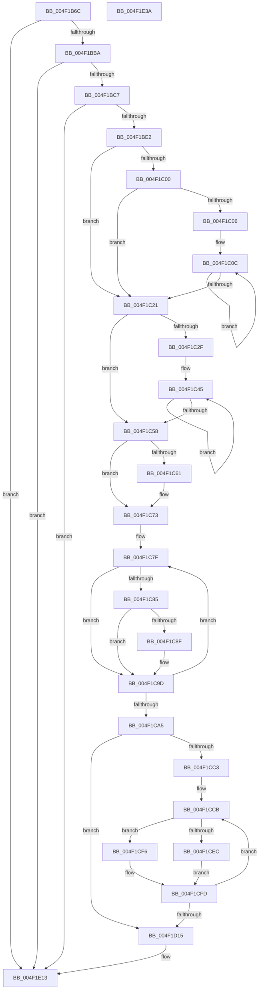

# PpmEventTraceHeteroResponseEx

- RVA: `0x004F1B6C`–`0x004F1E3B` (길이 `719` bytes)
- VA: `0x00000001404F1B6C`
- 실행 섹션: `.text`
- PDB 이름 있음: `예`; PDB Function 태그: `아니요`
- unwind 정보 RVA: `0x000B76EC`
- 디코드: `180`개 명령, `719/719` bytes 표시
- 미해석 바이트: `0` (있으면 어셈블리에 `.byte`로 보존)

> 이 문서는 커널 이미지의 기계어와 PDB 기호를 분석해 생성했습니다. 4번과 5번은 함수 원형과 자료형을 바이너리 사용 방식에서 추정한 C 해석이며 원본 소스 복구 결과는 아닙니다.

## 1. Dependencies

- 직접 호출 지점: **3**; 고유 호출 대상: **3**
- 직접 호출자로 확인된 함수: **2**
- RIP 상대 이미지 참조: **7**

### Outgoing calls
- `0x004F1BD5` → [EtwEventEnabled](../39/EtwEventEnabled_function_00392450.md) (function, `0x00392450`)
- `0x004F1E0E` → [EtwWriteEx](../25/EtwWriteEx_function_0025F0D0.md) (function, `0x0025F0D0`)
- `0x004F1E1A` → [_security_check_cookie](../6A/_security_check_cookie_function_006AC640.md) (function, `0x006AC640`)

### Direct callers
- [PpmCheckComputeMultiClassHeteroResponseEx](PpmCheckComputeMultiClassHeteroResponseEx_function_004F14A4.md) at `0x004F17FE`
- [PpmCheckComputeHeteroResponseEx](../5D/PpmCheckComputeHeteroResponseEx_function_005DECA0.md) at `0x005DF445`

### Static image references
- `0x004F1B8D` → RVA `0x00E0A740` (`.data`; read)
- `0x004F1B9B` → RVA `0x00E67A70` (`.data`; read)
- `0x004F1BBA` → RVA `0x00E67A39` (`.data`; read)
- `0x004F1BC7` → RVA `0x00F083E8` (`.data`; read)
- `0x004F1BCE` → RVA `0x0001BD08` (`.rdata`; read)
- `0x004F1C58` → RVA `0x00FC6A86` (`ALMOSTRO`; read)
- `0x004F1CF6` → RVA `0x00E67A78` (`.data`; read)

## 2. Other-region calls and transfers

- 다른 실행 섹션으로 향하는 call: **0**
- 별도 외부 분기/꼬리 이동을 확인하지 못했습니다.

## 3. Assembly (complete function range)

```asm
004F1B6C  48 89 5C 24 08                  mov qword ptr [rsp + 8], rbx
004F1B71  4C 89 4C 24 20                  mov qword ptr [rsp + 0x20], r9
004F1B76  55                              push rbp
004F1B77  56                              push rsi
004F1B78  57                              push rdi
004F1B79  41 54                           push r12
004F1B7B  41 55                           push r13
004F1B7D  41 56                           push r14
004F1B7F  41 57                           push r15
004F1B81  48 8D 6C 24 E9                  lea rbp, [rsp - 0x17]
004F1B86  48 81 EC A0 00 00 00            sub rsp, 0xa0
004F1B8D  48 8B 05 AC 8B 91 00            mov rax, qword ptr [rip + 0x918bac]
004F1B94  48 33 C4                        xor rax, rsp
004F1B97  48 89 45 07                     mov qword ptr [rbp + 7], rax
004F1B9B  48 8B 3D CE 5E 97 00            mov rdi, qword ptr [rip + 0x975ece]
004F1BA2  45 33 E4                        xor r12d, r12d
004F1BA5  4D 8B F0                        mov r14, r8
004F1BA8  4C 8B FA                        mov r15, rdx
004F1BAB  48 8B D9                        mov rbx, rcx
004F1BAE  41 8B F4                        mov esi, r12d
004F1BB1  48 85 FF                        test rdi, rdi
004F1BB4  0F 84 59 02 00 00               je 0x1404f1e13
004F1BBA  44 38 25 78 5E 97 00            cmp byte ptr [rip + 0x975e78], r12b
004F1BC1  0F 84 4C 02 00 00               je 0x1404f1e13
004F1BC7  48 8B 0D 1A 68 A1 00            mov rcx, qword ptr [rip + 0xa1681a]
004F1BCE  48 8D 15 33 A1 B2 FF            lea rdx, [rip - 0x4d5ecd]
004F1BD5  E8 76 08 EA FF                  call 0x140392450
004F1BDA  84 C0                           test al, al
004F1BDC  0F 84 31 02 00 00               je 0x1404f1e13
004F1BE2  44 0F B7 53 0A                  movzx r10d, word ptr [rbx + 0xa]
004F1BE7  45 8D 6C 24 01                  lea r13d, [r12 + 1]
004F1BEC  8A 83 A4 04 00 00               mov al, byte ptr [rbx + 0x4a4]
004F1BF2  66 44 89 55 C3                  mov word ptr [rbp - 0x3d], r10w
004F1BF7  88 45 B7                        mov byte ptr [rbp - 0x49], al
004F1BFA  4C 39 6D 6F                     cmp qword ptr [rbp + 0x6f], r13
004F1BFE  76 21                           jbe 0x1404f1c21
004F1C00  66 45 3B E2                     cmp r12w, r10w
004F1C04  73 1B                           jae 0x1404f1c21
004F1C06  49 8B CE                        mov rcx, r14
004F1C09  45 8B C2                        mov r8d, r10d
004F1C0C  48 8B 01                        mov rax, qword ptr [rcx]
004F1C0F  33 D2                           xor edx, edx
004F1C11  48 F7 75 6F                     div qword ptr [rbp + 0x6f]
004F1C15  48 89 01                        mov qword ptr [rcx], rax
004F1C18  48 8D 49 08                     lea rcx, [rcx + 8]
004F1C1C  4D 2B C5                        sub r8, r13
004F1C1F  75 EB                           jne 0x1404f1c0c
004F1C21  0F B6 43 0C                     movzx eax, byte ptr [rbx + 0xc]
004F1C25  66 44 89 65 BB                  mov word ptr [rbp - 0x45], r12w
004F1C2A  41 3B C5                        cmp eax, r13d
004F1C2D  76 29                           jbe 0x1404f1c58
004F1C2F  48 8B 93 08 05 00 00            mov rdx, qword ptr [rbx + 0x508]
004F1C36  44 8D 40 FF                     lea r8d, [rax - 1]
004F1C3A  48 81 C2 86 02 00 00            add rdx, 0x286
004F1C41  41 0F B7 CC                     movzx ecx, r12w
004F1C45  66 03 0A                        add cx, word ptr [rdx]
004F1C48  48 8D 92 80 02 00 00            lea rdx, [rdx + 0x280]
004F1C4F  66 89 4D BB                     mov word ptr [rbp - 0x45], cx
004F1C53  4D 2B C5                        sub r8, r13
004F1C56  75 ED                           jne 0x1404f1c45
004F1C58  44 38 25 27 4E AD 00            cmp byte ptr [rip + 0xad4e27], r12b
004F1C5F  74 12                           je 0x1404f1c73
004F1C61  48 8B 83 08 05 00 00            mov rax, qword ptr [rbx + 0x508]
004F1C68  0F B7 88 86 02 00 00            movzx ecx, word ptr [rax + 0x286]
004F1C6F  66 89 4D BB                     mov word ptr [rbp - 0x45], cx
004F1C73  44 0F B7 4B 30                  movzx r9d, word ptr [rbx + 0x30]
004F1C78  45 0F B7 C4                     movzx r8d, r12w
004F1C7C  41 8B D4                        mov edx, r12d
004F1C7F  66 41 3B D1                     cmp dx, r9w
004F1C83  73 18                           jae 0x1404f1c9d
004F1C85  0F B7 C2                        movzx eax, dx
004F1C88  4C 39 64 C3 38                  cmp qword ptr [rbx + rax*8 + 0x38], r12
004F1C8D  74 0E                           je 0x1404f1c9d
004F1C8F  8B C6                           mov eax, esi
004F1C91  41 03 F5                        add esi, r13d
004F1C94  66 45 03 C5                     add r8w, r13w
004F1C98  66 89 54 45 C7                  mov word ptr [rbp + rax*2 - 0x39], dx
004F1C9D  41 03 D5                        add edx, r13d
004F1CA0  83 FA 20                        cmp edx, 0x20
004F1CA3  72 DA                           jb 0x1404f1c7f
004F1CA5  66 44 89 45 BF                  mov word ptr [rbp - 0x41], r8w
004F1CAA  48 8D 45 BF                     lea rax, [rbp - 0x41]
004F1CAE  48 89 07                        mov qword ptr [rdi], rax
004F1CB1  BE 02 00 00 00                  mov esi, 2
004F1CB6  48 89 77 08                     mov qword ptr [rdi + 8], rsi
004F1CBA  45 8B CD                        mov r9d, r13d
004F1CBD  66 45 3B E0                     cmp r12w, r8w
004F1CC1  73 52                           jae 0x1404f1d15
004F1CC3  48 8D 55 C7                     lea rdx, [rbp - 0x39]
004F1CC7  45 0F B7 D8                     movzx r11d, r8w
004F1CCB  44 0F B7 02                     movzx r8d, word ptr [rdx]
004F1CCF  41 8D 49 01                     lea ecx, [r9 + 1]
004F1CD3  41 8B C1                        mov eax, r9d
004F1CD6  48 03 C9                        add rcx, rcx
004F1CD9  48 03 C0                        add rax, rax
004F1CDC  48 89 14 C7                     mov qword ptr [rdi + rax*8], rdx
004F1CE0  48 89 74 C7 08                  mov qword ptr [rdi + rax*8 + 8], rsi
004F1CE5  66 44 3B 43 30                  cmp r8w, word ptr [rbx + 0x30]
004F1CEA  73 0A                           jae 0x1404f1cf6
004F1CEC  49 83 C0 07                     add r8, 7
004F1CF0  4E 8D 04 C3                     lea r8, [rbx + r8*8]
004F1CF4  EB 07                           jmp 0x1404f1cfd
004F1CF6  4C 8D 05 7B 5D 97 00            lea r8, [rip + 0x975d7b]
004F1CFD  44 03 CE                        add r9d, esi
004F1D00  4C 89 04 CF                     mov qword ptr [rdi + rcx*8], r8
004F1D04  48 03 D6                        add rdx, rsi
004F1D07  48 C7 44 CF 08 08 00 00 00      mov qword ptr [rdi + rcx*8 + 8], 8
004F1D10  4D 2B DD                        sub r11, r13
004F1D13  75 B6                           jne 0x1404f1ccb
004F1D15  41 8B C1                        mov eax, r9d
004F1D18  48 8D 4D C3                     lea rcx, [rbp - 0x3d]
004F1D1C  48 03 C0                        add rax, rax
004F1D1F  48 89 7C 24 38                  mov qword ptr [rsp + 0x38], rdi
004F1D24  45 33 C0                        xor r8d, r8d
004F1D27  48 8D 15 DA 9F B2 FF            lea rdx, [rip - 0x4d6026]
004F1D2E  48 89 0C C7                     mov qword ptr [rdi + rax*8], rcx
004F1D32  41 8D 49 01                     lea ecx, [r9 + 1]
004F1D36  48 89 74 C7 08                  mov qword ptr [rdi + rax*8 + 8], rsi
004F1D3B  48 03 C9                        add rcx, rcx
004F1D3E  42 8D 04 95 00 00 00 00         lea eax, [r10*4]
004F1D46  89 44 CF 08                     mov dword ptr [rdi + rcx*8 + 8], eax
004F1D4A  42 8D 04 D5 00 00 00 00         lea eax, [r10*8]
004F1D52  4C 89 3C CF                     mov qword ptr [rdi + rcx*8], r15
004F1D56  44 89 64 CF 0C                  mov dword ptr [rdi + rcx*8 + 0xc], r12d
004F1D5B  41 8D 49 02                     lea ecx, [r9 + 2]
004F1D5F  48 03 C9                        add rcx, rcx
004F1D62  89 44 CF 08                     mov dword ptr [rdi + rcx*8 + 8], eax
004F1D66  48 8D 45 6F                     lea rax, [rbp + 0x6f]
004F1D6A  4C 89 34 CF                     mov qword ptr [rdi + rcx*8], r14
004F1D6E  44 89 64 CF 0C                  mov dword ptr [rdi + rcx*8 + 0xc], r12d
004F1D73  41 8D 49 03                     lea ecx, [r9 + 3]
004F1D77  48 03 C9                        add rcx, rcx
004F1D7A  48 89 04 CF                     mov qword ptr [rdi + rcx*8], rax
004F1D7E  48 8D 83 A2 04 00 00            lea rax, [rbx + 0x4a2]
004F1D85  48 C7 44 CF 08 08 00 00 00      mov qword ptr [rdi + rcx*8 + 8], 8
004F1D8E  41 8D 49 04                     lea ecx, [r9 + 4]
004F1D92  48 03 C9                        add rcx, rcx
004F1D95  48 89 04 CF                     mov qword ptr [rdi + rcx*8], rax
004F1D99  48 8D 45 B7                     lea rax, [rbp - 0x49]
004F1D9D  4C 89 6C CF 08                  mov qword ptr [rdi + rcx*8 + 8], r13
004F1DA2  41 8D 49 05                     lea ecx, [r9 + 5]
004F1DA6  48 03 C9                        add rcx, rcx
004F1DA9  48 89 04 CF                     mov qword ptr [rdi + rcx*8], rax
004F1DAD  48 8D 45 77                     lea rax, [rbp + 0x77]
004F1DB1  4C 89 6C CF 08                  mov qword ptr [rdi + rcx*8 + 8], r13
004F1DB6  41 8D 49 06                     lea ecx, [r9 + 6]
004F1DBA  48 03 C9                        add rcx, rcx
004F1DBD  48 89 04 CF                     mov qword ptr [rdi + rcx*8], rax
004F1DC1  48 8D 45 BB                     lea rax, [rbp - 0x45]
004F1DC5  48 89 74 CF 08                  mov qword ptr [rdi + rcx*8 + 8], rsi
004F1DCA  41 8D 49 07                     lea ecx, [r9 + 7]
004F1DCE  48 03 C9                        add rcx, rcx
004F1DD1  48 89 04 CF                     mov qword ptr [rdi + rcx*8], rax
004F1DD5  48 8D 45 7F                     lea rax, [rbp + 0x7f]
004F1DD9  48 89 74 CF 08                  mov qword ptr [rdi + rcx*8 + 8], rsi
004F1DDE  41 8D 49 08                     lea ecx, [r9 + 8]
004F1DE2  48 03 C9                        add rcx, rcx
004F1DE5  48 89 04 CF                     mov qword ptr [rdi + rcx*8], rax
004F1DE9  41 8D 41 09                     lea eax, [r9 + 9]
004F1DED  89 44 24 30                     mov dword ptr [rsp + 0x30], eax
004F1DF1  45 33 C9                        xor r9d, r9d
004F1DF4  48 C7 44 CF 08 04 00 00 00      mov qword ptr [rdi + rcx*8 + 8], 4
004F1DFD  48 8B 0D E4 65 A1 00            mov rcx, qword ptr [rip + 0xa165e4]
004F1E04  4C 89 64 24 28                  mov qword ptr [rsp + 0x28], r12
004F1E09  4C 89 64 24 20                  mov qword ptr [rsp + 0x20], r12
004F1E0E  E8 BD D2 D6 FF                  call 0x14025f0d0
004F1E13  48 8B 4D 07                     mov rcx, qword ptr [rbp + 7]
004F1E17  48 33 CC                        xor rcx, rsp
004F1E1A  E8 21 A8 1B 00                  call 0x1406ac640
004F1E1F  48 8B 9C 24 E0 00 00 00         mov rbx, qword ptr [rsp + 0xe0]
004F1E27  48 81 C4 A0 00 00 00            add rsp, 0xa0
004F1E2E  41 5F                           pop r15
004F1E30  41 5E                           pop r14
004F1E32  41 5D                           pop r13
004F1E34  41 5C                           pop r12
004F1E36  5F                              pop rdi
004F1E37  5E                              pop rsi
004F1E38  5D                              pop rbp
004F1E39  C3                              ret
004F1E3A  CC                              int3
```

## 4. C-style interpretation (structured pseudocode)

```c
__int64 __fastcall PpmEventTraceHeteroResponseEx(__int64 a1, __int64 a2, __int64 a3, __int64 a4, __int64 a5, __int64 a6)
{
    __int64 result;
    __int64 v_r11;
    __int64 v_r12;
    __int64 v_rsi;
    __int64 v_rsp;
    unsigned __int64 v_stack_m48;
    unsigned __int64 v_stack_m4F;
    unsigned __int64 v_stack_m88;
    unsigned __int16 v_stack_m8C;
    unsigned __int16 v_stack_m90;
    unsigned __int16 v_stack_m94;
    unsigned __int8 v_stack_m98;
    unsigned __int64 v_stack_mA0;
    unsigned int v_stack_mA8;
    unsigned __int64 v_stack_mB0;
    unsigned __int64 v_stack_mB8;
    unsigned __int64 v_stack_p20;
    unsigned __int64 v_stack_p8;

    v_stack_p8 = v_rbx;
    v_stack_p20 = a4;
    v_rsp = (v_rsp) - (160);
    result = (*(unsigned __int64 *)(v_rip + 9538476)) ^ (v_rsp);
    v_stack_m48 = result;
    v_r12 = 0;
    if (*(unsigned __int64 *)(v_rip + 9920206) == 0) goto loc_004F1E13;
    if ((*(unsigned __int8 *)(v_rip + 9920120)) == 0) goto loc_004F1E13;
    result = EtwEventEnabled(*(unsigned __int64 *)(v_rip + 10577946), v_rip - 5070541, a3, a4);
    if ((unsigned __int8)(result) == 0) goto loc_004F1E13;
    v_stack_m8C = (unsigned __int16)(*(unsigned __int16 *)(a1 + 10));
    v_stack_m98 = (unsigned __int8)(*(unsigned __int8 *)(a1 + 1188));
    if (v_stack_p20 <= (v_r12 + 1)) goto loc_004F1C21;
    if (0 >= ((unsigned __int16)(*(unsigned __int16 *)(a1 + 10)))) goto loc_004F1C21;
loc_004F1C0C:
    a2 = 0;
    *(unsigned __int64 *)(a3) = *(unsigned __int64 *)(a3);
    a3 = ((unsigned int)((unsigned int)(*(unsigned __int16 *)(a1 + 10)))) - (v_r12 + 1);
    if (condition_is_not_equal) goto loc_004F1C0C;
loc_004F1C21:
    v_stack_m94 = 0;
    if (((unsigned int)(*(unsigned __int8 *)(a1 + 12))) <= ((unsigned int)(v_r12 + 1))) goto loc_004F1C58;
    a2 = (*(unsigned __int64 *)(a1 + 1288)) + (646);
loc_004F1C45:
    a1 = (unsigned __int16)((0) + (*(unsigned __int16 *)(a2)));
    v_stack_m94 = (unsigned __int16)(a1);
    a3 = (*(unsigned __int8 *)(a1 + 12) - 1) - (v_r12 + 1);
    if (condition_is_not_equal) goto loc_004F1C45;
loc_004F1C58:
    result = *(unsigned __int8 *)(a1 + 12);
    if ((*(unsigned __int8 *)(v_rip + 11357735)) != 0) {
        result = *(unsigned __int64 *)(a1 + 1288);
        a1 = *(unsigned __int16 *)(result + 646);
        v_stack_m94 = (unsigned __int16)(a1);
    }
loc_004F1C7F:
    if (0 >= ((unsigned __int16)(*(unsigned __int16 *)(a1 + 48)))) goto loc_004F1C9D;
    result = 0;
    v_rsi = 0;
    if ((*(unsigned __int64 *)(a1 + 0 * 8 + 56)) != 0) {
        result = 0;
        v_rsi = (unsigned int)((0) + ((unsigned int)(v_r12 + 1)));
        a3 = (unsigned __int16)((0) + ((unsigned __int16)(v_r12 + 1)));
        *(unsigned __int16 *)(v_stack_m4F + result * 2 - 57) = 0;
    }
    a2 = (unsigned int)((0) + ((unsigned int)(v_r12 + 1)));
    if (((unsigned int)(a2)) < 32) goto loc_004F1C7F;
    v_stack_m90 = (unsigned __int16)(a3);
    *(unsigned __int64 *)(*(unsigned __int64 *)(v_rip + 9920206)) = v_stack_m90;
    *(unsigned __int64 *)(*(unsigned __int64 *)(v_rip + 9920206) + 8) = 2;
    if (0 >= ((unsigned __int16)(a3))) goto loc_004F1D15;
loc_004F1CCB:
    a1 = ((unsigned int)((unsigned int)(v_r12 + 1)) + 1) + ((unsigned int)((unsigned int)(v_r12 + 1)) + 1);
    result = ((unsigned int)((unsigned int)((unsigned int)((unsigned int)(v_r12 + 1))))) + ((unsigned int)((unsigned int)((unsigned int)((unsigned int)(v_r12 + 1)))));
    *(unsigned __int64 *)(*(unsigned __int64 *)(v_rip + 9920206) + result * 8) = v_stack_m88;
    *(unsigned __int64 *)(*(unsigned __int64 *)(v_rip + 9920206) + result * 8 + 8) = 2;
    if (((unsigned __int16)(*(unsigned __int16 *)(v_stack_m88))) >= (*(unsigned __int16 *)(a1 + 48))) goto loc_004F1CF6;
    a3 = (*(unsigned __int16 *)(v_stack_m88)) + (7);
    goto loc_004F1CFD;
loc_004F1CF6:
loc_004F1CFD:
    a4 = (unsigned int)(((unsigned int)((unsigned int)(v_r12 + 1))) + (2));
    *(unsigned __int64 *)(*(unsigned __int64 *)(v_rip + 9920206) + a1 * 8) = v_rip + 9919867;
    a2 = (v_stack_m88) + (2);
    *(unsigned __int64 *)(*(unsigned __int64 *)(v_rip + 9920206) + a1 * 8 + 8) = 8;
    v_r11 = ((unsigned __int16)(a3)) - (v_r12 + 1);
    if (condition_is_not_equal) goto loc_004F1CCB;
loc_004F1D15:
    result = ((unsigned int)((unsigned int)(a4))) + ((unsigned int)((unsigned int)(a4)));
    v_stack_mA0 = *(unsigned __int64 *)(v_rip + 9920206);
    a3 = 0;
    *(unsigned __int64 *)(*(unsigned __int64 *)(v_rip + 9920206) + result * 8) = v_stack_m8C;
    *(unsigned __int64 *)(*(unsigned __int64 *)(v_rip + 9920206) + result * 8 + 8) = 2;
    a1 = (a4 + 1) + (a4 + 1);
    *(unsigned int *)(*(unsigned __int64 *)(v_rip + 9920206) + a1 * 8 + 8) = (unsigned int)(*(unsigned __int16 *)(a1 + 10) * 4);
    *(unsigned __int64 *)(*(unsigned __int64 *)(v_rip + 9920206) + a1 * 8) = a2;
    *(unsigned int *)(*(unsigned __int64 *)(v_rip + 9920206) + a1 * 8 + 12) = 0;
    a1 = (a4 + 2) + (a4 + 2);
    *(unsigned int *)(*(unsigned __int64 *)(v_rip + 9920206) + a1 * 8 + 8) = (unsigned int)(*(unsigned __int16 *)(a1 + 10) * 8);
    *(unsigned __int64 *)(*(unsigned __int64 *)(v_rip + 9920206) + a1 * 8) = 0;
    *(unsigned int *)(*(unsigned __int64 *)(v_rip + 9920206) + a1 * 8 + 12) = 0;
    a1 = (a4 + 3) + (a4 + 3);
    *(unsigned __int64 *)(*(unsigned __int64 *)(v_rip + 9920206) + a1 * 8) = v_stack_p20;
    *(unsigned __int64 *)(*(unsigned __int64 *)(v_rip + 9920206) + a1 * 8 + 8) = 8;
    a1 = (a4 + 4) + (a4 + 4);
    *(unsigned __int64 *)(*(unsigned __int64 *)(v_rip + 9920206) + a1 * 8) = a1 + 1186;
    *(unsigned __int64 *)(*(unsigned __int64 *)(v_rip + 9920206) + a1 * 8 + 8) = v_r12 + 1;
    a1 = (a4 + 5) + (a4 + 5);
    *(unsigned __int64 *)(*(unsigned __int64 *)(v_rip + 9920206) + a1 * 8) = v_stack_m98;
    *(unsigned __int64 *)(*(unsigned __int64 *)(v_rip + 9920206) + a1 * 8 + 8) = v_r12 + 1;
    a1 = (a4 + 6) + (a4 + 6);
    *(unsigned __int64 *)(*(unsigned __int64 *)(v_rip + 9920206) + a1 * 8) = a5;
    *(unsigned __int64 *)(*(unsigned __int64 *)(v_rip + 9920206) + a1 * 8 + 8) = 2;
    a1 = (a4 + 7) + (a4 + 7);
    *(unsigned __int64 *)(*(unsigned __int64 *)(v_rip + 9920206) + a1 * 8) = v_stack_m94;
    *(unsigned __int64 *)(*(unsigned __int64 *)(v_rip + 9920206) + a1 * 8 + 8) = 2;
    a1 = (a4 + 8) + (a4 + 8);
    *(unsigned __int64 *)(*(unsigned __int64 *)(v_rip + 9920206) + a1 * 8) = a6;
    v_stack_mA8 = (unsigned int)(a4 + 9);
    a4 = 0;
    *(unsigned __int64 *)(*(unsigned __int64 *)(v_rip + 9920206) + a1 * 8 + 8) = 4;
    v_stack_mB0 = 0;
    v_stack_mB8 = 0;
    result = EtwWriteEx(*(unsigned __int64 *)(v_rip + 10577380), v_rip - 5070886, a3, a4);
loc_004F1E13:
    a1 = (v_stack_m48) ^ (v_rsp);
    result = _security_check_cookie(a1, v_rip - 5070886, a3, a4);
    v_rsp = (v_rsp) + (160);
    return result;
}
```

## 5. (Beta) C Style

```c
int64_t PpmEventTraceHeteroResponseEx(void *Arg1, int64_t Arg2, void *Arg3, int64_t Arg4, int64_t Arg5, int64_t Arg6)
{
    uint8_t *arg1 = (uint8_t *)Arg1;
    uint8_t *arg3 = (uint8_t *)Arg3;

    int64_t result;
    int64_t local_r11;
    int64_t local_r12;
    int64_t local_rsi;
    int64_t local_rsp;
    uint64_t v_stack_m48;
    uint64_t v_stack_m4F;
    uint64_t v_stack_m88;
    uint16_t v_stack_m8C;
    uint16_t v_stack_m90;
    uint16_t v_stack_m94;
    uint8_t v_stack_m98;
    uint64_t v_stack_mA0;
    uint32_t v_stack_mA8;
    uint64_t v_stack_mB0;
    uint64_t v_stack_mB8;
    uint64_t v_stack_p20;
    uint64_t v_stack_p8;

    v_stack_p8 = local_rbx;
    v_stack_p20 = Arg4;
    local_rsp = (local_rsp) - (160);
    result = (*(uint64_t *)(v_rip + 0x918BAC)) ^ (local_rsp);
    v_stack_m48 = result;
    local_r12 = 0;
    if (*(uint64_t *)(v_rip + 0x975ECE) == 0) goto loc_004F1E13;
    if ((*(uint8_t *)(v_rip + 0x975E78)) == 0) goto loc_004F1E13;
    result = EtwEventEnabled(*(uint64_t *)(v_rip + 0xA1681A), v_rip - 5070541, Arg3, Arg4);
    if ((uint8_t)(result) == 0) goto loc_004F1E13;
    v_stack_m8C = (uint16_t)(*(uint16_t *)(arg1 + 0xA));
    v_stack_m98 = (uint8_t)(*(uint8_t *)(arg1 + 0x4A4));
    if (v_stack_p20 <= (local_r12 + 1)) goto loc_004F1C21;
    if (0 >= ((uint16_t)(*(uint16_t *)(arg1 + 0xA)))) goto loc_004F1C21;
loc_004F1C0C:
    Arg2 = 0;
    *(uint64_t *)(arg3) = *(uint64_t *)(arg3);
    Arg3 = ((uint32_t)((uint32_t)(*(uint16_t *)(arg1 + 0xA)))) - (local_r12 + 1);
    if (condition_is_not_equal) goto loc_004F1C0C;
loc_004F1C21:
    v_stack_m94 = 0;
    if (((uint32_t)(*(uint8_t *)(arg1 + 0xC))) <= ((uint32_t)(local_r12 + 1))) goto loc_004F1C58;
    Arg2 = (*(uint64_t *)(arg1 + 0x508)) + (646);
loc_004F1C45:
    Arg1 = (uint16_t)((0) + (*(uint16_t *)(Arg2)));
    v_stack_m94 = (uint16_t)(Arg1);
    Arg3 = (*(uint8_t *)(arg1 + 0xC) - 1) - (local_r12 + 1);
    if (condition_is_not_equal) goto loc_004F1C45;
loc_004F1C58:
    result = *(uint8_t *)(arg1 + 0xC);
    if ((*(uint8_t *)(v_rip + 0xAD4E27)) != 0) {
        result = *(uint64_t *)(arg1 + 0x508);
        Arg1 = *(uint16_t *)(result + 0x286);
        v_stack_m94 = (uint16_t)(Arg1);
    }
loc_004F1C7F:
    if (0 >= ((uint16_t)(*(uint16_t *)(arg1 + 0x30)))) goto loc_004F1C9D;
    result = 0;
    local_rsi = 0;
    if ((*(uint64_t *)(arg1 + 0x0 * 8 + 0x38)) != 0) {
        result = 0;
        local_rsi = (uint32_t)((0) + ((uint32_t)(local_r12 + 1)));
        Arg3 = (uint16_t)((0) + ((uint16_t)(local_r12 + 1)));
        *(uint16_t *)(v_stack_m4F + result * 2 - 0x39) = 0;
    }
    Arg2 = (uint32_t)((0) + ((uint32_t)(local_r12 + 1)));
    if (((uint32_t)(Arg2)) < 32) goto loc_004F1C7F;
    v_stack_m90 = (uint16_t)(Arg3);
    *(uint64_t *)(*(uint64_t *)(v_rip + 0x975ECE)) = v_stack_m90;
    *(uint64_t *)(*(uint64_t *)(v_rip + 0x975ECE) + 0x8) = 2;
    if (0 >= ((uint16_t)(Arg3))) goto loc_004F1D15;
loc_004F1CCB:
    Arg1 = ((uint32_t)((uint32_t)(local_r12 + 1)) + 1) + ((uint32_t)((uint32_t)(local_r12 + 1)) + 1);
    result = ((uint32_t)((uint32_t)((uint32_t)((uint32_t)(local_r12 + 1))))) + ((uint32_t)((uint32_t)((uint32_t)((uint32_t)(local_r12 + 1)))));
    *(uint64_t *)(*(uint64_t *)(v_rip + 0x975ECE) + result * 8) = v_stack_m88;
    *(uint64_t *)(*(uint64_t *)(v_rip + 0x975ECE) + result * 8 + 0x8) = 2;
    if (((uint16_t)(*(uint16_t *)(v_stack_m88))) >= (*(uint16_t *)(arg1 + 0x30))) goto loc_004F1CF6;
    Arg3 = (*(uint16_t *)(v_stack_m88)) + (7);
    goto loc_004F1CFD;
loc_004F1CF6:
loc_004F1CFD:
    Arg4 = (uint32_t)(((uint32_t)((uint32_t)(local_r12 + 1))) + (2));
    *(uint64_t *)(*(uint64_t *)(v_rip + 0x975ECE) + arg1 * 8) = v_rip + 9919867;
    Arg2 = (v_stack_m88) + (2);
    *(uint64_t *)(*(uint64_t *)(v_rip + 0x975ECE) + arg1 * 8 + 0x8) = 8;
    local_r11 = ((uint16_t)(Arg3)) - (local_r12 + 1);
    if (condition_is_not_equal) goto loc_004F1CCB;
loc_004F1D15:
    result = ((uint32_t)((uint32_t)(Arg4))) + ((uint32_t)((uint32_t)(Arg4)));
    v_stack_mA0 = *(uint64_t *)(v_rip + 0x975ECE);
    Arg3 = 0;
    *(uint64_t *)(*(uint64_t *)(v_rip + 0x975ECE) + result * 8) = v_stack_m8C;
    *(uint64_t *)(*(uint64_t *)(v_rip + 0x975ECE) + result * 8 + 0x8) = 2;
    Arg1 = (Arg4 + 1) + (Arg4 + 1);
    *(uint32_t *)(*(uint64_t *)(v_rip + 0x975ECE) + arg1 * 8 + 0x8) = (uint32_t)(*(uint16_t *)(arg1 + 0xA) * 4);
    *(uint64_t *)(*(uint64_t *)(v_rip + 0x975ECE) + arg1 * 8) = Arg2;
    *(uint32_t *)(*(uint64_t *)(v_rip + 0x975ECE) + arg1 * 8 + 0xC) = 0;
    Arg1 = (Arg4 + 2) + (Arg4 + 2);
    *(uint32_t *)(*(uint64_t *)(v_rip + 0x975ECE) + arg1 * 8 + 0x8) = (uint32_t)(*(uint16_t *)(arg1 + 0xA) * 8);
    *(uint64_t *)(*(uint64_t *)(v_rip + 0x975ECE) + arg1 * 8) = 0;
    *(uint32_t *)(*(uint64_t *)(v_rip + 0x975ECE) + arg1 * 8 + 0xC) = 0;
    Arg1 = (Arg4 + 3) + (Arg4 + 3);
    *(uint64_t *)(*(uint64_t *)(v_rip + 0x975ECE) + arg1 * 8) = v_stack_p20;
    *(uint64_t *)(*(uint64_t *)(v_rip + 0x975ECE) + arg1 * 8 + 0x8) = 8;
    Arg1 = (Arg4 + 4) + (Arg4 + 4);
    *(void **)(*(uint64_t *)(v_rip + 0x975ECE) + arg1 * 8) = Arg1 + 1186;
    *(uint64_t *)(*(uint64_t *)(v_rip + 0x975ECE) + arg1 * 8 + 0x8) = local_r12 + 1;
    Arg1 = (Arg4 + 5) + (Arg4 + 5);
    *(uint64_t *)(*(uint64_t *)(v_rip + 0x975ECE) + arg1 * 8) = v_stack_m98;
    *(uint64_t *)(*(uint64_t *)(v_rip + 0x975ECE) + arg1 * 8 + 0x8) = local_r12 + 1;
    Arg1 = (Arg4 + 6) + (Arg4 + 6);
    *(uint64_t *)(*(uint64_t *)(v_rip + 0x975ECE) + arg1 * 8) = Arg5;
    *(uint64_t *)(*(uint64_t *)(v_rip + 0x975ECE) + arg1 * 8 + 0x8) = 2;
    Arg1 = (Arg4 + 7) + (Arg4 + 7);
    *(uint64_t *)(*(uint64_t *)(v_rip + 0x975ECE) + arg1 * 8) = v_stack_m94;
    *(uint64_t *)(*(uint64_t *)(v_rip + 0x975ECE) + arg1 * 8 + 0x8) = 2;
    Arg1 = (Arg4 + 8) + (Arg4 + 8);
    *(uint64_t *)(*(uint64_t *)(v_rip + 0x975ECE) + arg1 * 8) = Arg6;
    v_stack_mA8 = (uint32_t)(Arg4 + 9);
    Arg4 = 0;
    *(uint64_t *)(*(uint64_t *)(v_rip + 0x975ECE) + arg1 * 8 + 0x8) = 4;
    v_stack_mB0 = 0;
    v_stack_mB8 = 0;
    result = EtwWriteEx(*(uint64_t *)(v_rip + 0xA165E4), v_rip - 5070886, Arg3, Arg4);
loc_004F1E13:
    Arg1 = (v_stack_m48) ^ (local_rsp);
    result = _security_check_cookie(Arg1, v_rip - 5070886, Arg3, Arg4);
    local_rsp = (local_rsp) + (160);
    return result;
}
```

### 관측된 메모리 오프셋

구조체 형식이 확인되지 않은 접근은 인자 기준의 오프셋으로만 기록했습니다.

| 기준 인자 | 오프셋 표현 | 폭 (bit) | 접근 |
|---|---:|---:|---|
| `Arg1` | `+ 0x0 + r8*8` | `64` | `R` |
| `Arg1` | `+ 0xA` | `16` | `R` |
| `Arg1` | `+ 0xC` | `8` | `R` |
| `Arg1` | `+ 0x30` | `16` | `R` |
| `Arg1` | `+ 0x38 + rax*8` | `64` | `R` |
| `Arg1` | `+ 0x4A2` | `64` | `R` |
| `Arg1` | `+ 0x4A4` | `8` | `R` |
| `Arg1` | `+ 0x508` | `64` | `R` |
| `Arg3` | `+ 0x0` | `64` | `R` |
| `Arg3` | `+ 0x0` | `64` | `W` |
| `Arg3` | `+ 0x8` | `64` | `R` |

## 6. Execution-region graph

[열기: 2D/3D 그래프와 함수 탐색 컨트롤 패널](../../../control-panel.html?section=text&rva=0x004F1B6C&view=graph)

- 2D 그래프는 위에서 아래로 흐르고, 3D 그래프는 빈 공간을 드래그해 회전합니다. Shift+드래그는 이동, 휠은 확대·축소, 함수 노드 선택은 대상 보고서 이동입니다.

### Static fallback


