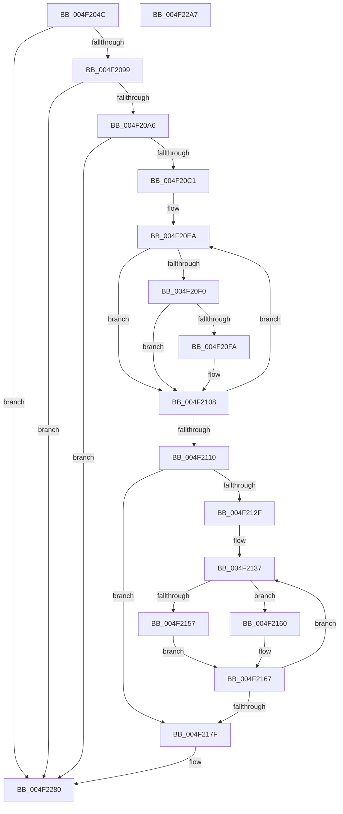

# PpmEventTraceMultiClassHeteroResponseEx

- RVA: `0x004F204C`–`0x004F22A8` (길이 `604` bytes)
- VA: `0x00000001404F204C`
- 실행 섹션: `.text`
- PDB 이름 있음: `예`; PDB Function 태그: `아니요`
- unwind 정보 RVA: `0x000B7730`
- 디코드: `151`개 명령, `604/604` bytes 표시
- 미해석 바이트: `0` (있으면 어셈블리에 `.byte`로 보존)

> 이 문서는 커널 이미지의 기계어와 PDB 기호를 분석해 생성했습니다. 4번과 5번은 함수 원형과 자료형을 바이너리 사용 방식에서 추정한 C 해석이며 원본 소스 복구 결과는 아닙니다.

## 1. Dependencies

- 직접 호출 지점: **4**; 고유 호출 대상: **4**
- 직접 호출자로 확인된 함수: **2**
- RIP 상대 이미지 참조: **6**

### Outgoing calls
- `0x004F20B4` → [EtwEventEnabled](../39/EtwEventEnabled_function_00392450.md) (function, `0x00392450`)
- `0x004F20C4` → [KeCountSetBitsAffinityEx](../2C/KeCountSetBitsAffinityEx_function_002CE6E0.md) (function, `0x002CE6E0`)
- `0x004F227B` → [EtwWriteEx](../25/EtwWriteEx_function_0025F0D0.md) (function, `0x0025F0D0`)
- `0x004F2287` → [_security_check_cookie](../6A/_security_check_cookie_function_006AC640.md) (function, `0x006AC640`)

### Direct callers
- [PpmCheckComputeMultiClassHeteroResponseEx](PpmCheckComputeMultiClassHeteroResponseEx_function_004F14A4.md) at `0x004F179D`
- [PpmHeteroComputeMultiClassUnparkCountEx](../5D/PpmHeteroComputeMultiClassUnparkCountEx_function_005DF584.md) at `0x005DF7CF`

### Static image references
- `0x004F206C` → RVA `0x00E0A740` (`.data`; read)
- `0x004F207A` → RVA `0x00E67A70` (`.data`; read)
- `0x004F2099` → RVA `0x00E67A39` (`.data`; read)
- `0x004F20A6` → RVA `0x00F083E8` (`.data`; read)
- `0x004F20AD` → RVA `0x0001BD18` (`.rdata`; read)
- `0x004F2160` → RVA `0x00E67A78` (`.data`; read)

## 2. Other-region calls and transfers

- 다른 실행 섹션으로 향하는 call: **0**
- 별도 외부 분기/꼬리 이동을 확인하지 못했습니다.

## 3. Assembly (complete function range)

```asm
004F204C  48 89 5C 24 18                  mov qword ptr [rsp + 0x18], rbx
004F2051  88 4C 24 08                     mov byte ptr [rsp + 8], cl
004F2055  55                              push rbp
004F2056  56                              push rsi
004F2057  57                              push rdi
004F2058  41 54                           push r12
004F205A  41 55                           push r13
004F205C  41 56                           push r14
004F205E  41 57                           push r15
004F2060  48 8D 6C 24 F9                  lea rbp, [rsp - 7]
004F2065  48 81 EC A0 00 00 00            sub rsp, 0xa0
004F206C  48 8B 05 CD 86 91 00            mov rax, qword ptr [rip + 0x9186cd]
004F2073  48 33 C4                        xor rax, rsp
004F2076  48 89 45 F7                     mov qword ptr [rbp - 9], rax
004F207A  48 8B 1D EF 59 97 00            mov rbx, qword ptr [rip + 0x9759ef]
004F2081  45 33 E4                        xor r12d, r12d
004F2084  4D 8B F1                        mov r14, r9
004F2087  4D 8B F8                        mov r15, r8
004F208A  48 8B FA                        mov rdi, rdx
004F208D  41 8B F4                        mov esi, r12d
004F2090  48 85 DB                        test rbx, rbx
004F2093  0F 84 E7 01 00 00               je 0x1404f2280
004F2099  44 38 25 99 59 97 00            cmp byte ptr [rip + 0x975999], r12b
004F20A0  0F 84 DA 01 00 00               je 0x1404f2280
004F20A6  48 8B 0D 3B 63 A1 00            mov rcx, qword ptr [rip + 0xa1633b]
004F20AD  48 8D 15 64 9C B2 FF            lea rdx, [rip - 0x4d639c]
004F20B4  E8 97 03 EA FF                  call 0x140392450
004F20B9  84 C0                           test al, al
004F20BB  0F 84 BF 01 00 00               je 0x1404f2280
004F20C1  48 8B CF                        mov rcx, rdi
004F20C4  E8 17 C6 DD FF                  call 0x1402ce6e0
004F20C9  44 8B D8                        mov r11d, eax
004F20CC  89 45 AB                        mov dword ptr [rbp - 0x55], eax
004F20CF  48 8D 45 47                     lea rax, [rbp + 0x47]
004F20D3  45 0F B7 C4                     movzx r8d, r12w
004F20D7  45 8D 6C 24 01                  lea r13d, [r12 + 1]
004F20DC  48 89 03                        mov qword ptr [rbx], rax
004F20DF  4C 89 6B 08                     mov qword ptr [rbx + 8], r13
004F20E3  41 8B D4                        mov edx, r12d
004F20E6  44 0F B7 0F                     movzx r9d, word ptr [rdi]
004F20EA  66 41 3B D1                     cmp dx, r9w
004F20EE  73 18                           jae 0x1404f2108
004F20F0  0F B7 C2                        movzx eax, dx
004F20F3  4C 39 64 C7 08                  cmp qword ptr [rdi + rax*8 + 8], r12
004F20F8  74 0E                           je 0x1404f2108
004F20FA  8B C6                           mov eax, esi
004F20FC  41 03 F5                        add esi, r13d
004F20FF  66 45 03 C5                     add r8w, r13w
004F2103  66 89 54 45 B7                  mov word ptr [rbp + rax*2 - 0x49], dx
004F2108  41 03 D5                        add edx, r13d
004F210B  83 FA 20                        cmp edx, 0x20
004F210E  72 DA                           jb 0x1404f20ea
004F2110  66 44 89 45 A7                  mov word ptr [rbp - 0x59], r8w
004F2115  BE 02 00 00 00                  mov esi, 2
004F211A  48 89 73 18                     mov qword ptr [rbx + 0x18], rsi
004F211E  48 8D 45 A7                     lea rax, [rbp - 0x59]
004F2122  48 89 43 10                     mov qword ptr [rbx + 0x10], rax
004F2126  44 8B CE                        mov r9d, esi
004F2129  66 45 3B E0                     cmp r12w, r8w
004F212D  73 50                           jae 0x1404f217f
004F212F  48 8D 55 B7                     lea rdx, [rbp - 0x49]
004F2133  45 0F B7 D0                     movzx r10d, r8w
004F2137  44 0F B7 02                     movzx r8d, word ptr [rdx]
004F213B  41 8D 49 01                     lea ecx, [r9 + 1]
004F213F  41 8B C1                        mov eax, r9d
004F2142  48 03 C9                        add rcx, rcx
004F2145  48 03 C0                        add rax, rax
004F2148  48 89 14 C3                     mov qword ptr [rbx + rax*8], rdx
004F214C  48 89 74 C3 08                  mov qword ptr [rbx + rax*8 + 8], rsi
004F2151  66 44 3B 07                     cmp r8w, word ptr [rdi]
004F2155  73 09                           jae 0x1404f2160
004F2157  49 FF C0                        inc r8
004F215A  4E 8D 04 C7                     lea r8, [rdi + r8*8]
004F215E  EB 07                           jmp 0x1404f2167
004F2160  4C 8D 05 11 59 97 00            lea r8, [rip + 0x975911]
004F2167  44 03 CE                        add r9d, esi
004F216A  4C 89 04 CB                     mov qword ptr [rbx + rcx*8], r8
004F216E  48 03 D6                        add rdx, rsi
004F2171  48 C7 44 CB 08 08 00 00 00      mov qword ptr [rbx + rcx*8 + 8], 8
004F217A  4D 2B D5                        sub r10, r13
004F217D  75 B8                           jne 0x1404f2137
004F217F  42 8D 14 9D 00 00 00 00         lea edx, [r11*4]
004F2187  41 8B C1                        mov eax, r9d
004F218A  48 03 C0                        add rax, rax
004F218D  48 89 5C 24 38                  mov qword ptr [rsp + 0x38], rbx
004F2192  48 8D 4D AB                     lea rcx, [rbp - 0x55]
004F2196  45 33 C0                        xor r8d, r8d
004F2199  48 89 0C C3                     mov qword ptr [rbx + rax*8], rcx
004F219D  41 8D 49 01                     lea ecx, [r9 + 1]
004F21A1  48 C7 44 C3 08 04 00 00 00      mov qword ptr [rbx + rax*8 + 8], 4
004F21AA  48 03 C9                        add rcx, rcx
004F21AD  48 8D 45 67                     lea rax, [rbp + 0x67]
004F21B1  89 54 CB 08                     mov dword ptr [rbx + rcx*8 + 8], edx
004F21B5  4C 89 3C CB                     mov qword ptr [rbx + rcx*8], r15
004F21B9  44 89 64 CB 0C                  mov dword ptr [rbx + rcx*8 + 0xc], r12d
004F21BE  41 8D 49 02                     lea ecx, [r9 + 2]
004F21C2  48 03 C9                        add rcx, rcx
004F21C5  89 54 CB 08                     mov dword ptr [rbx + rcx*8 + 8], edx
004F21C9  48 8D 15 48 9B B2 FF            lea rdx, [rip - 0x4d64b8]
004F21D0  4C 89 34 CB                     mov qword ptr [rbx + rcx*8], r14
004F21D4  44 89 64 CB 0C                  mov dword ptr [rbx + rcx*8 + 0xc], r12d
004F21D9  41 8D 49 03                     lea ecx, [r9 + 3]
004F21DD  48 03 C9                        add rcx, rcx
004F21E0  48 89 04 CB                     mov qword ptr [rbx + rcx*8], rax
004F21E4  48 8D 45 6F                     lea rax, [rbp + 0x6f]
004F21E8  48 C7 44 CB 08 08 00 00 00      mov qword ptr [rbx + rcx*8 + 8], 8
004F21F1  41 8D 49 04                     lea ecx, [r9 + 4]
004F21F5  48 03 C9                        add rcx, rcx
004F21F8  48 89 04 CB                     mov qword ptr [rbx + rcx*8], rax
004F21FC  48 8D 45 77                     lea rax, [rbp + 0x77]
004F2200  48 C7 44 CB 08 04 00 00 00      mov qword ptr [rbx + rcx*8 + 8], 4
004F2209  41 8D 49 05                     lea ecx, [r9 + 5]
004F220D  48 03 C9                        add rcx, rcx
004F2210  48 89 04 CB                     mov qword ptr [rbx + rcx*8], rax
004F2214  48 8D 45 7F                     lea rax, [rbp + 0x7f]
004F2218  48 89 74 CB 08                  mov qword ptr [rbx + rcx*8 + 8], rsi
004F221D  41 8D 49 06                     lea ecx, [r9 + 6]
004F2221  48 03 C9                        add rcx, rcx
004F2224  48 89 04 CB                     mov qword ptr [rbx + rcx*8], rax
004F2228  48 8D 85 87 00 00 00            lea rax, [rbp + 0x87]
004F222F  48 89 74 CB 08                  mov qword ptr [rbx + rcx*8 + 8], rsi
004F2234  41 8D 49 07                     lea ecx, [r9 + 7]
004F2238  48 03 C9                        add rcx, rcx
004F223B  48 89 04 CB                     mov qword ptr [rbx + rcx*8], rax
004F223F  48 8D 85 8F 00 00 00            lea rax, [rbp + 0x8f]
004F2246  48 89 74 CB 08                  mov qword ptr [rbx + rcx*8 + 8], rsi
004F224B  41 8D 49 08                     lea ecx, [r9 + 8]
004F224F  48 03 C9                        add rcx, rcx
004F2252  48 89 04 CB                     mov qword ptr [rbx + rcx*8], rax
004F2256  41 8D 41 09                     lea eax, [r9 + 9]
004F225A  89 44 24 30                     mov dword ptr [rsp + 0x30], eax
004F225E  45 33 C9                        xor r9d, r9d
004F2261  48 C7 44 CB 08 08 00 00 00      mov qword ptr [rbx + rcx*8 + 8], 8
004F226A  48 8B 0D 77 61 A1 00            mov rcx, qword ptr [rip + 0xa16177]
004F2271  4C 89 64 24 28                  mov qword ptr [rsp + 0x28], r12
004F2276  4C 89 64 24 20                  mov qword ptr [rsp + 0x20], r12
004F227B  E8 50 CE D6 FF                  call 0x14025f0d0
004F2280  48 8B 4D F7                     mov rcx, qword ptr [rbp - 9]
004F2284  48 33 CC                        xor rcx, rsp
004F2287  E8 B4 A3 1B 00                  call 0x1406ac640
004F228C  48 8B 9C 24 F0 00 00 00         mov rbx, qword ptr [rsp + 0xf0]
004F2294  48 81 C4 A0 00 00 00            add rsp, 0xa0
004F229B  41 5F                           pop r15
004F229D  41 5E                           pop r14
004F229F  41 5D                           pop r13
004F22A1  41 5C                           pop r12
004F22A3  5F                              pop rdi
004F22A4  5E                              pop rsi
004F22A5  5D                              pop rbp
004F22A6  C3                              ret
004F22A7  CC                              int3
```

## 4. C-style interpretation (structured pseudocode)

```c
__int64 __fastcall PpmEventTraceMultiClassHeteroResponseEx(unsigned __int8 a1, __int64 a2, __int64 a3, __int64 a4, __int64 a5, __int64 a6, __int64 a7, __int64 a8, __int64 a9, __int64 a10)
{
    __int64 result;
    __int64 v_r10;
    __int64 v_r12;
    __int64 v_rsi;
    __int64 v_rsp;
    unsigned __int64 v_stack_m3F;
    unsigned __int64 v_stack_m48;
    unsigned __int64 v_stack_m88;
    unsigned int v_stack_m94;
    unsigned __int16 v_stack_m98;
    unsigned __int64 v_stack_mA0;
    unsigned int v_stack_mA8;
    unsigned __int64 v_stack_mB0;
    unsigned __int64 v_stack_mB8;
    unsigned __int64 v_stack_p18;
    unsigned __int8 v_stack_p8;

    v_stack_p18 = v_rbx;
    v_stack_p8 = a1;
    v_rsp = (v_rsp) - (160);
    result = (*(unsigned __int64 *)(v_rip + 9537229)) ^ (v_rsp);
    v_stack_m48 = result;
    v_r12 = 0;
    if (*(unsigned __int64 *)(v_rip + 9918959) == 0) goto loc_004F2280;
    if ((*(unsigned __int8 *)(v_rip + 9918873)) == 0) goto loc_004F2280;
    result = EtwEventEnabled(*(unsigned __int64 *)(v_rip + 10576699), v_rip - 5071772, a3, a4);
    if ((unsigned __int8)(result) == 0) goto loc_004F2280;
    result = KeCountSetBitsAffinityEx(a2, v_rip - 5071772, a3, a4);
    v_stack_m94 = (unsigned int)(result);
    *(unsigned __int64 *)(*(unsigned __int64 *)(v_rip + 9918959)) = v_stack_p8;
    *(unsigned __int64 *)(*(unsigned __int64 *)(v_rip + 9918959) + 8) = v_r12 + 1;
loc_004F20EA:
    if (0 >= ((unsigned __int16)(*(unsigned __int16 *)(a2)))) goto loc_004F2108;
    result = 0;
    v_rsi = 0;
    if ((*(unsigned __int64 *)(a2 + 0 * 8 + 8)) != 0) {
        result = 0;
        v_rsi = (unsigned int)((0) + ((unsigned int)(v_r12 + 1)));
        a3 = (unsigned __int16)((0) + ((unsigned __int16)(v_r12 + 1)));
        *(unsigned __int16 *)(v_stack_m3F + result * 2 - 73) = 0;
    }
    a2 = (unsigned int)((0) + ((unsigned int)(v_r12 + 1)));
    if (((unsigned int)(a2)) < 32) goto loc_004F20EA;
    v_stack_m98 = (unsigned __int16)(a3);
    *(unsigned __int64 *)(*(unsigned __int64 *)(v_rip + 9918959) + 24) = 2;
    *(unsigned __int64 *)(*(unsigned __int64 *)(v_rip + 9918959) + 16) = v_stack_m98;
    if (0 >= ((unsigned __int16)(a3))) goto loc_004F217F;
loc_004F2137:
    a1 = (2 + 1) + (2 + 1);
    result = (2) + (2);
    *(unsigned __int64 *)(*(unsigned __int64 *)(v_rip + 9918959) + result * 8) = v_stack_m88;
    *(unsigned __int64 *)(*(unsigned __int64 *)(v_rip + 9918959) + result * 8 + 8) = 2;
    if (((unsigned __int16)(*(unsigned __int16 *)(v_stack_m88))) >= (*(unsigned __int16 *)(a2))) goto loc_004F2160;
    a3 = (*(unsigned __int16 *)(v_stack_m88)) + 1;
    goto loc_004F2167;
loc_004F2160:
loc_004F2167:
    a4 = (unsigned int)((2) + (2));
    *(unsigned __int64 *)(*(unsigned __int64 *)(v_rip + 9918959) + a1 * 8) = v_rip + 9918737;
    a2 = (v_stack_m88) + (2);
    *(unsigned __int64 *)(*(unsigned __int64 *)(v_rip + 9918959) + a1 * 8 + 8) = 8;
    v_r10 = ((unsigned __int16)(a3)) - (v_r12 + 1);
    if (condition_is_not_equal) goto loc_004F2137;
loc_004F217F:
    result = ((unsigned int)((unsigned int)(a4))) + ((unsigned int)((unsigned int)(a4)));
    v_stack_mA0 = *(unsigned __int64 *)(v_rip + 9918959);
    a3 = 0;
    *(unsigned __int64 *)(*(unsigned __int64 *)(v_rip + 9918959) + result * 8) = v_stack_m94;
    *(unsigned __int64 *)(*(unsigned __int64 *)(v_rip + 9918959) + result * 8 + 8) = 4;
    a1 = (a4 + 1) + (a4 + 1);
    *(unsigned int *)(*(unsigned __int64 *)(v_rip + 9918959) + a1 * 8 + 8) = (unsigned int)((unsigned int)((unsigned int)(result)) * 4);
    *(unsigned __int64 *)(*(unsigned __int64 *)(v_rip + 9918959) + a1 * 8) = 0;
    *(unsigned int *)(*(unsigned __int64 *)(v_rip + 9918959) + a1 * 8 + 12) = 0;
    a1 = (a4 + 2) + (a4 + 2);
    *(unsigned int *)(*(unsigned __int64 *)(v_rip + 9918959) + a1 * 8 + 8) = (unsigned int)((unsigned int)((unsigned int)(result)) * 4);
    *(unsigned __int64 *)(*(unsigned __int64 *)(v_rip + 9918959) + a1 * 8) = a4;
    *(unsigned int *)(*(unsigned __int64 *)(v_rip + 9918959) + a1 * 8 + 12) = 0;
    a1 = (a4 + 3) + (a4 + 3);
    *(unsigned __int64 *)(*(unsigned __int64 *)(v_rip + 9918959) + a1 * 8) = a5;
    *(unsigned __int64 *)(*(unsigned __int64 *)(v_rip + 9918959) + a1 * 8 + 8) = 8;
    a1 = (a4 + 4) + (a4 + 4);
    *(unsigned __int64 *)(*(unsigned __int64 *)(v_rip + 9918959) + a1 * 8) = a6;
    *(unsigned __int64 *)(*(unsigned __int64 *)(v_rip + 9918959) + a1 * 8 + 8) = 4;
    a1 = (a4 + 5) + (a4 + 5);
    *(unsigned __int64 *)(*(unsigned __int64 *)(v_rip + 9918959) + a1 * 8) = a7;
    *(unsigned __int64 *)(*(unsigned __int64 *)(v_rip + 9918959) + a1 * 8 + 8) = 2;
    a1 = (a4 + 6) + (a4 + 6);
    *(unsigned __int64 *)(*(unsigned __int64 *)(v_rip + 9918959) + a1 * 8) = a8;
    *(unsigned __int64 *)(*(unsigned __int64 *)(v_rip + 9918959) + a1 * 8 + 8) = 2;
    a1 = (a4 + 7) + (a4 + 7);
    *(unsigned __int64 *)(*(unsigned __int64 *)(v_rip + 9918959) + a1 * 8) = a9;
    *(unsigned __int64 *)(*(unsigned __int64 *)(v_rip + 9918959) + a1 * 8 + 8) = 2;
    a1 = (a4 + 8) + (a4 + 8);
    *(unsigned __int64 *)(*(unsigned __int64 *)(v_rip + 9918959) + a1 * 8) = a10;
    v_stack_mA8 = (unsigned int)(a4 + 9);
    a4 = 0;
    *(unsigned __int64 *)(*(unsigned __int64 *)(v_rip + 9918959) + a1 * 8 + 8) = 8;
    v_stack_mB0 = 0;
    v_stack_mB8 = 0;
    result = EtwWriteEx(*(unsigned __int64 *)(v_rip + 10576247), v_rip - 5072056, a3, a4);
loc_004F2280:
    a1 = (v_stack_m48) ^ (v_rsp);
    result = _security_check_cookie(a1, v_rip - 5072056, a3, a4);
    v_rsp = (v_rsp) + (160);
    return result;
}
```

## 5. (Beta) C Style

```c
int64_t PpmEventTraceMultiClassHeteroResponseEx(uint8_t Arg1, void *Arg2, int64_t Arg3, int64_t Arg4, int64_t Arg5, int64_t Arg6, int64_t Arg7, int64_t Arg8, int64_t Arg9, int64_t Arg10)
{
    uint8_t *arg2 = (uint8_t *)Arg2;

    int64_t result;
    int64_t local_r10;
    int64_t local_r12;
    int64_t local_rsi;
    int64_t local_rsp;
    uint64_t v_stack_m3F;
    uint64_t v_stack_m48;
    uint64_t v_stack_m88;
    uint32_t v_stack_m94;
    uint16_t v_stack_m98;
    uint64_t v_stack_mA0;
    uint32_t v_stack_mA8;
    uint64_t v_stack_mB0;
    uint64_t v_stack_mB8;
    uint64_t v_stack_p18;
    uint8_t v_stack_p8;

    v_stack_p18 = local_rbx;
    v_stack_p8 = Arg1;
    local_rsp = (local_rsp) - (160);
    result = (*(uint64_t *)(v_rip + 0x9186CD)) ^ (local_rsp);
    v_stack_m48 = result;
    local_r12 = 0;
    if (*(uint64_t *)(v_rip + 0x9759EF) == 0) goto loc_004F2280;
    if ((*(uint8_t *)(v_rip + 0x975999)) == 0) goto loc_004F2280;
    result = EtwEventEnabled(*(uint64_t *)(v_rip + 0xA1633B), v_rip - 5071772, Arg3, Arg4);
    if ((uint8_t)(result) == 0) goto loc_004F2280;
    result = KeCountSetBitsAffinityEx(Arg2, v_rip - 5071772, Arg3, Arg4);
    v_stack_m94 = (uint32_t)(result);
    *(uint64_t *)(*(uint64_t *)(v_rip + 0x9759EF)) = v_stack_p8;
    *(uint64_t *)(*(uint64_t *)(v_rip + 0x9759EF) + 0x8) = local_r12 + 1;
loc_004F20EA:
    if (0 >= ((uint16_t)(*(uint16_t *)(arg2)))) goto loc_004F2108;
    result = 0;
    local_rsi = 0;
    if ((*(uint64_t *)(arg2 + 0x0 * 8 + 0x8)) != 0) {
        result = 0;
        local_rsi = (uint32_t)((0) + ((uint32_t)(local_r12 + 1)));
        Arg3 = (uint16_t)((0) + ((uint16_t)(local_r12 + 1)));
        *(uint16_t *)(v_stack_m3F + result * 2 - 0x49) = 0;
    }
    Arg2 = (uint32_t)((0) + ((uint32_t)(local_r12 + 1)));
    if (((uint32_t)(Arg2)) < 32) goto loc_004F20EA;
    v_stack_m98 = (uint16_t)(Arg3);
    *(uint64_t *)(*(uint64_t *)(v_rip + 0x9759EF) + 0x18) = 2;
    *(uint64_t *)(*(uint64_t *)(v_rip + 0x9759EF) + 0x10) = v_stack_m98;
    if (0 >= ((uint16_t)(Arg3))) goto loc_004F217F;
loc_004F2137:
    Arg1 = (2 + 1) + (2 + 1);
    result = (2) + (2);
    *(uint64_t *)(*(uint64_t *)(v_rip + 0x9759EF) + result * 8) = v_stack_m88;
    *(uint64_t *)(*(uint64_t *)(v_rip + 0x9759EF) + result * 8 + 0x8) = 2;
    if (((uint16_t)(*(uint16_t *)(v_stack_m88))) >= (*(uint16_t *)(arg2))) goto loc_004F2160;
    Arg3 = (*(uint16_t *)(v_stack_m88)) + 1;
    goto loc_004F2167;
loc_004F2160:
loc_004F2167:
    Arg4 = (uint32_t)((2) + (2));
    *(uint64_t *)(*(uint64_t *)(v_rip + 0x9759EF) + Arg1 * 8) = v_rip + 9918737;
    Arg2 = (v_stack_m88) + (2);
    *(uint64_t *)(*(uint64_t *)(v_rip + 0x9759EF) + Arg1 * 8 + 0x8) = 8;
    local_r10 = ((uint16_t)(Arg3)) - (local_r12 + 1);
    if (condition_is_not_equal) goto loc_004F2137;
loc_004F217F:
    result = ((uint32_t)((uint32_t)(Arg4))) + ((uint32_t)((uint32_t)(Arg4)));
    v_stack_mA0 = *(uint64_t *)(v_rip + 0x9759EF);
    Arg3 = 0;
    *(uint64_t *)(*(uint64_t *)(v_rip + 0x9759EF) + result * 8) = v_stack_m94;
    *(uint64_t *)(*(uint64_t *)(v_rip + 0x9759EF) + result * 8 + 0x8) = 4;
    Arg1 = (Arg4 + 1) + (Arg4 + 1);
    *(uint32_t *)(*(uint64_t *)(v_rip + 0x9759EF) + Arg1 * 8 + 0x8) = (uint32_t)((uint32_t)((uint32_t)(result)) * 4);
    *(uint64_t *)(*(uint64_t *)(v_rip + 0x9759EF) + Arg1 * 8) = 0;
    *(uint32_t *)(*(uint64_t *)(v_rip + 0x9759EF) + Arg1 * 8 + 0xC) = 0;
    Arg1 = (Arg4 + 2) + (Arg4 + 2);
    *(uint32_t *)(*(uint64_t *)(v_rip + 0x9759EF) + Arg1 * 8 + 0x8) = (uint32_t)((uint32_t)((uint32_t)(result)) * 4);
    *(uint64_t *)(*(uint64_t *)(v_rip + 0x9759EF) + Arg1 * 8) = Arg4;
    *(uint32_t *)(*(uint64_t *)(v_rip + 0x9759EF) + Arg1 * 8 + 0xC) = 0;
    Arg1 = (Arg4 + 3) + (Arg4 + 3);
    *(uint64_t *)(*(uint64_t *)(v_rip + 0x9759EF) + Arg1 * 8) = Arg5;
    *(uint64_t *)(*(uint64_t *)(v_rip + 0x9759EF) + Arg1 * 8 + 0x8) = 8;
    Arg1 = (Arg4 + 4) + (Arg4 + 4);
    *(uint64_t *)(*(uint64_t *)(v_rip + 0x9759EF) + Arg1 * 8) = Arg6;
    *(uint64_t *)(*(uint64_t *)(v_rip + 0x9759EF) + Arg1 * 8 + 0x8) = 4;
    Arg1 = (Arg4 + 5) + (Arg4 + 5);
    *(uint64_t *)(*(uint64_t *)(v_rip + 0x9759EF) + Arg1 * 8) = Arg7;
    *(uint64_t *)(*(uint64_t *)(v_rip + 0x9759EF) + Arg1 * 8 + 0x8) = 2;
    Arg1 = (Arg4 + 6) + (Arg4 + 6);
    *(uint64_t *)(*(uint64_t *)(v_rip + 0x9759EF) + Arg1 * 8) = Arg8;
    *(uint64_t *)(*(uint64_t *)(v_rip + 0x9759EF) + Arg1 * 8 + 0x8) = 2;
    Arg1 = (Arg4 + 7) + (Arg4 + 7);
    *(uint64_t *)(*(uint64_t *)(v_rip + 0x9759EF) + Arg1 * 8) = Arg9;
    *(uint64_t *)(*(uint64_t *)(v_rip + 0x9759EF) + Arg1 * 8 + 0x8) = 2;
    Arg1 = (Arg4 + 8) + (Arg4 + 8);
    *(uint64_t *)(*(uint64_t *)(v_rip + 0x9759EF) + Arg1 * 8) = Arg10;
    v_stack_mA8 = (uint32_t)(Arg4 + 9);
    Arg4 = 0;
    *(uint64_t *)(*(uint64_t *)(v_rip + 0x9759EF) + Arg1 * 8 + 0x8) = 8;
    v_stack_mB0 = 0;
    v_stack_mB8 = 0;
    result = EtwWriteEx(*(uint64_t *)(v_rip + 0xA16177), v_rip - 5072056, Arg3, Arg4);
loc_004F2280:
    Arg1 = (v_stack_m48) ^ (local_rsp);
    result = _security_check_cookie(Arg1, v_rip - 5072056, Arg3, Arg4);
    local_rsp = (local_rsp) + (160);
    return result;
}
```

### 관측된 메모리 오프셋

구조체 형식이 확인되지 않은 접근은 인자 기준의 오프셋으로만 기록했습니다.

| 기준 인자 | 오프셋 표현 | 폭 (bit) | 접근 |
|---|---:|---:|---|
| `Arg2` | `+ 0x0` | `16` | `R` |
| `Arg2` | `+ 0x0 + r8*8` | `64` | `R` |
| `Arg2` | `+ 0x8 + rax*8` | `64` | `R` |

## 6. Execution-region graph

[열기: 2D/3D 그래프와 함수 탐색 컨트롤 패널](../../../control-panel.html?section=text&rva=0x004F204C&view=graph)

- 2D 그래프는 위에서 아래로 흐르고, 3D 그래프는 빈 공간을 드래그해 회전합니다. Shift+드래그는 이동, 휠은 확대·축소, 함수 노드 선택은 대상 보고서 이동입니다.

### Static fallback


