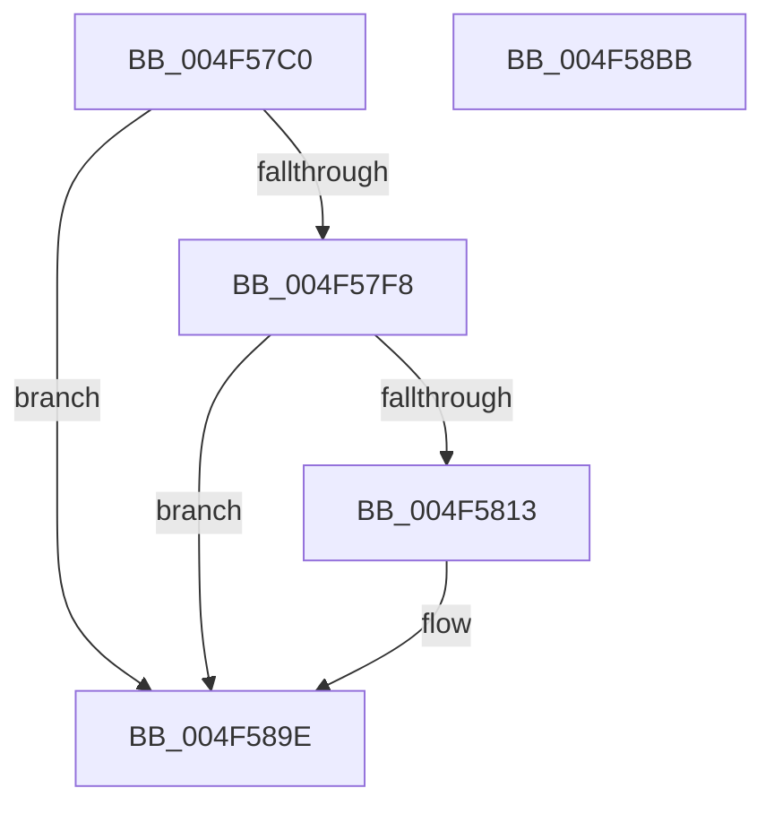

# PpmEventTraceMultiClassHeteroResponseUpdateEx

- RVA: `0x004F57C0`–`0x004F58BC` (길이 `252` bytes)
- VA: `0x00000001404F57C0`
- 실행 섹션: `.text`
- PDB 이름 있음: `예`; PDB Function 태그: `아니요`
- unwind 정보 RVA: `0x000BD988`
- 디코드: `57`개 명령, `252/252` bytes 표시
- 미해석 바이트: `0` (있으면 어셈블리에 `.byte`로 보존)

> 이 문서는 커널 이미지의 기계어와 PDB 기호를 분석해 생성했습니다. 4번과 5번은 함수 원형과 자료형을 바이너리 사용 방식에서 추정한 C 해석이며 원본 소스 복구 결과는 아닙니다.

## 1. Dependencies

- 직접 호출 지점: **3**; 고유 호출 대상: **3**
- 직접 호출자로 확인된 함수: **1**
- RIP 상대 이미지 참조: **4**

### Outgoing calls
- `0x004F5806` → [EtwEventEnabled](../39/EtwEventEnabled_function_00392450.md) (function, `0x00392450`)
- `0x004F5899` → [EtwWriteEx](../25/EtwWriteEx_function_0025F0D0.md) (function, `0x0025F0D0`)
- `0x004F58A5` → [_security_check_cookie](../6A/_security_check_cookie_function_006AC640.md) (function, `0x006AC640`)

### Direct callers
- [PpmEventTraceMultiClassHeteroResponseUpdate](../4D/PpmEventTraceMultiClassHeteroResponseUpdate_function_004D0B1C.md) at `0x004D0B59`

### Static image references
- `0x004F57DA` → RVA `0x00E0A740` (`.data`; read)
- `0x004F57E8` → RVA `0x00E67A39` (`.data`; read)
- `0x004F57F8` → RVA `0x00F083E8` (`.data`; read)
- `0x004F57FF` → RVA `0x0001E870` (`.rdata`; read)

## 2. Other-region calls and transfers

- 다른 실행 섹션으로 향하는 call: **0**
- 별도 외부 분기/꼬리 이동을 확인하지 못했습니다.

## 3. Assembly (complete function range)

```asm
004F57C0  48 8B C4                        mov rax, rsp
004F57C3  48 89 58 10                     mov qword ptr [rax + 0x10], rbx
004F57C7  4C 89 40 18                     mov qword ptr [rax + 0x18], r8
004F57CB  88 48 08                        mov byte ptr [rax + 8], cl
004F57CE  55                              push rbp
004F57CF  48 8D 68 A1                     lea rbp, [rax - 0x5f]
004F57D3  48 81 EC A0 00 00 00            sub rsp, 0xa0
004F57DA  48 8B 05 5F 4F 91 00            mov rax, qword ptr [rip + 0x914f5f]
004F57E1  48 33 C4                        xor rax, rsp
004F57E4  48 89 45 47                     mov qword ptr [rbp + 0x47], rax
004F57E8  80 3D 4A 22 97 00 00            cmp byte ptr [rip + 0x97224a], 0
004F57EF  48 8B DA                        mov rbx, rdx
004F57F2  0F 84 A6 00 00 00               je 0x1404f589e
004F57F8  48 8B 0D E9 2B A1 00            mov rcx, qword ptr [rip + 0xa12be9]
004F57FF  48 8D 15 6A 90 B2 FF            lea rdx, [rip - 0x4d6f96]
004F5806  E8 45 CC E9 FF                  call 0x140392450
004F580B  84 C0                           test al, al
004F580D  0F 84 8B 00 00 00               je 0x1404f589e
004F5813  83 65 03 00                     and dword ptr [rbp + 3], 0
004F5817  48 8D 45 67                     lea rax, [rbp + 0x67]
004F581B  83 65 13 00                     and dword ptr [rbp + 0x13], 0
004F581F  48 8D 15 4A 90 B2 FF            lea rdx, [rip - 0x4d6fb6]
004F5826  83 65 23 00                     and dword ptr [rbp + 0x23], 0
004F582A  B9 02 00 00 00                  mov ecx, 2
004F582F  83 65 33 00                     and dword ptr [rbp + 0x33], 0
004F5833  45 33 C9                        xor r9d, r9d
004F5836  83 65 43 00                     and dword ptr [rbp + 0x43], 0
004F583A  45 33 C0                        xor r8d, r8d
004F583D  48 89 45 F7                     mov qword ptr [rbp - 9], rax
004F5841  48 8D 43 06                     lea rax, [rbx + 6]
004F5845  48 89 45 17                     mov qword ptr [rbp + 0x17], rax
004F5849  48 8D 43 10                     lea rax, [rbx + 0x10]
004F584D  48 89 45 27                     mov qword ptr [rbp + 0x27], rax
004F5851  48 8D 45 77                     lea rax, [rbp + 0x77]
004F5855  89 4D 0F                        mov dword ptr [rbp + 0xf], ecx
004F5858  89 4D 1F                        mov dword ptr [rbp + 0x1f], ecx
004F585B  B9 08 00 00 00                  mov ecx, 8
004F5860  48 89 45 37                     mov qword ptr [rbp + 0x37], rax
004F5864  48 8D 45 F7                     lea rax, [rbp - 9]
004F5868  48 89 44 24 38                  mov qword ptr [rsp + 0x38], rax
004F586D  C7 44 24 30 05 00 00 00         mov dword ptr [rsp + 0x30], 5
004F5875  48 83 64 24 28 00               and qword ptr [rsp + 0x28], 0
004F587B  48 83 64 24 20 00               and qword ptr [rsp + 0x20], 0
004F5881  89 4D 2F                        mov dword ptr [rbp + 0x2f], ecx
004F5884  89 4D 3F                        mov dword ptr [rbp + 0x3f], ecx
004F5887  48 8B 0D 5A 2B A1 00            mov rcx, qword ptr [rip + 0xa12b5a]
004F588E  C7 45 FF 01 00 00 00            mov dword ptr [rbp - 1], 1
004F5895  48 89 5D 07                     mov qword ptr [rbp + 7], rbx
004F5899  E8 32 98 D6 FF                  call 0x14025f0d0
004F589E  48 8B 4D 47                     mov rcx, qword ptr [rbp + 0x47]
004F58A2  48 33 CC                        xor rcx, rsp
004F58A5  E8 96 6D 1B 00                  call 0x1406ac640
004F58AA  48 8B 9C 24 B8 00 00 00         mov rbx, qword ptr [rsp + 0xb8]
004F58B2  48 81 C4 A0 00 00 00            add rsp, 0xa0
004F58B9  5D                              pop rbp
004F58BA  C3                              ret
004F58BB  CC                              int3
```

## 4. C-style interpretation (structured pseudocode)

```c
__int64 __fastcall PpmEventTraceMultiClassHeteroResponseUpdateEx(unsigned __int8 a1, __int64 a2, __int64 a3, int a4)
{
    __int64 result;
    __int64 v_rsp;
    unsigned __int64 v_stack_m70;
    unsigned int v_stack_m78;
    unsigned __int64 v_stack_m80;
    unsigned __int64 v_stack_m88;
    unsigned __int64 v_stack_p10;

    *(unsigned __int64 *)(v_rsp + 16) = v_rbx;
    *(unsigned __int64 *)(v_rsp + 24) = a3;
    *(unsigned __int8 *)(v_rsp + 8) = a1;
    v_rsp = (v_rsp) - (160);
    result = (*(unsigned __int64 *)(v_rip + 9523039)) ^ (v_rsp);
    *(unsigned __int64 *)(v_rsp - 95 + 71) = result;
    if ((*(unsigned __int8 *)(v_rip + 9904714)) == 0) goto loc_004F589E;
    result = EtwEventEnabled(*(unsigned __int64 *)(v_rip + 10562537), v_rip - 5074838, a3, a4);
    if ((unsigned __int8)(result) != 0) {
        result = v_rsp - 95 + 103;
        a2 = v_rip - 5074870;
        a1 = 2;
        a4 = 0;
        a3 = 0;
        *(unsigned __int64 *)(v_rsp - 95 - 9) = result;
        result = a2 + 6;
        *(unsigned __int64 *)(v_rsp - 95 + 23) = result;
        result = a2 + 16;
        *(unsigned __int64 *)(v_rsp - 95 + 39) = result;
        result = v_rsp - 95 + 119;
        *(unsigned int *)(v_rsp - 95 + 15) = a1;
        *(unsigned int *)(v_rsp - 95 + 31) = a1;
        a1 = 8;
        *(unsigned __int64 *)(v_rsp - 95 + 55) = result;
        result = v_rsp - 95 - 9;
        v_stack_m70 = result;
        v_stack_m78 = 5;
        *(unsigned int *)(v_rsp - 95 + 47) = a1;
        *(unsigned int *)(v_rsp - 95 + 63) = a1;
        a1 = *(unsigned __int64 *)(v_rip + 10562394);
        *(unsigned int *)(v_rsp - 95 - 1) = 1;
        *(unsigned __int64 *)(v_rsp - 95 + 7) = a2;
        result = EtwWriteEx(a1, a2, a3, a4);
    }
    a1 = (*(unsigned __int64 *)(v_rsp - 95 + 71)) ^ (v_rsp);
    result = _security_check_cookie(a1, a2, a3, a4);
    v_rsp = (v_rsp) + (160);
    return result;
}
```

## 5. (Beta) C Style

```c
int64_t PpmEventTraceMultiClassHeteroResponseUpdateEx(uint8_t Arg1, void *Arg2, int64_t Arg3, int32_t Arg4)
{
    uint8_t *arg2 = (uint8_t *)Arg2;

    int64_t result;
    int64_t local_rsp;
    uint64_t v_stack_m70;
    uint32_t v_stack_m78;
    uint64_t v_stack_m80;
    uint64_t v_stack_m88;
    uint64_t v_stack_p10;

    *(uint64_t *)(local_rsp + 0x10) = local_rbx;
    *(uint64_t *)(local_rsp + 0x18) = Arg3;
    *(uint8_t *)(local_rsp + 0x8) = Arg1;
    local_rsp = (local_rsp) - (160);
    result = (*(uint64_t *)(v_rip + 0x914F5F)) ^ (local_rsp);
    *(uint64_t *)(local_rsp - 0x5F + 0x47) = result;
    if ((*(uint8_t *)(v_rip + 0x97224A)) == 0) goto loc_004F589E;
    result = EtwEventEnabled(*(uint64_t *)(v_rip + 0xA12BE9), v_rip - 5074838, Arg3, Arg4);
    if ((uint8_t)(result) != 0) {
        result = local_rsp - 95 + 103;
        Arg2 = v_rip - 5074870;
        Arg1 = 2;
        Arg4 = 0;
        Arg3 = 0;
        *(uint64_t *)(local_rsp - 0x5F - 0x9) = result;
        result = Arg2 + 6;
        *(uint64_t *)(local_rsp - 0x5F + 0x17) = result;
        result = Arg2 + 16;
        *(uint64_t *)(local_rsp - 0x5F + 0x27) = result;
        result = local_rsp - 95 + 119;
        *(uint32_t *)(local_rsp - 0x5F + 0xF) = Arg1;
        *(uint32_t *)(local_rsp - 0x5F + 0x1F) = Arg1;
        Arg1 = 8;
        *(uint64_t *)(local_rsp - 0x5F + 0x37) = result;
        result = local_rsp - 95 - 9;
        v_stack_m70 = result;
        v_stack_m78 = 5;
        *(uint32_t *)(local_rsp - 0x5F + 0x2F) = Arg1;
        *(uint32_t *)(local_rsp - 0x5F + 0x3F) = Arg1;
        Arg1 = *(uint64_t *)(v_rip + 0xA12B5A);
        *(uint32_t *)(local_rsp - 0x5F - 0x1) = 1;
        *(void **)(local_rsp - 0x5F + 0x7) = Arg2;
        result = EtwWriteEx(Arg1, Arg2, Arg3, Arg4);
    }
    Arg1 = (*(uint64_t *)(local_rsp - 0x5F + 0x47)) ^ (local_rsp);
    result = _security_check_cookie(Arg1, Arg2, Arg3, Arg4);
    local_rsp = (local_rsp) + (160);
    return result;
}
```

### 관측된 메모리 오프셋

구조체 형식이 확인되지 않은 접근은 인자 기준의 오프셋으로만 기록했습니다.

| 기준 인자 | 오프셋 표현 | 폭 (bit) | 접근 |
|---|---:|---:|---|
| `Arg2` | `+ 0x6` | `64` | `R` |
| `Arg2` | `+ 0x10` | `64` | `R` |

## 6. Execution-region graph

[열기: 2D/3D 그래프와 함수 탐색 컨트롤 패널](../../../control-panel.html?section=text&rva=0x004F57C0&view=graph)

- 2D 그래프는 위에서 아래로 흐르고, 3D 그래프는 빈 공간을 드래그해 회전합니다. Shift+드래그는 이동, 휠은 확대·축소, 함수 노드 선택은 대상 보고서 이동입니다.

### Static fallback


