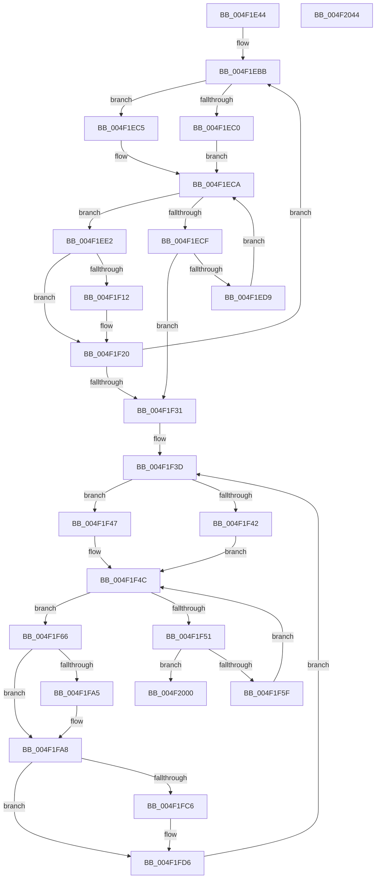

# PpmHeteroComputeCoreParkingUtilitiesEx

- RVA: `0x004F1E44`–`0x004F2045` (길이 `513` bytes)
- VA: `0x00000001404F1E44`
- 실행 섹션: `.text`
- PDB 이름 있음: `예`; PDB Function 태그: `아니요`
- unwind 정보 RVA: `0x000B7714`
- 디코드: `146`개 명령, `513/513` bytes 표시
- 미해석 바이트: `0` (있으면 어셈블리에 `.byte`로 보존)

> 이 문서는 커널 이미지의 기계어와 PDB 기호를 분석해 생성했습니다. 4번과 5번은 함수 원형과 자료형을 바이너리 사용 방식에서 추정한 C 해석이며 원본 소스 복구 결과는 아닙니다.

## 1. Dependencies

- 직접 호출 지점: **10**; 고유 호출 대상: **4**
- 직접 호출자로 확인된 함수: **2**
- RIP 상대 이미지 참조: **4**

### Outgoing calls
- `0x004F1E92` → [memset](../6C/memset_function_006C6C40.md) (function, `0x006C6C40`)
- `0x004F1EA7` → [memset](../6C/memset_function_006C6C40.md) (function, `0x006C6C40`)
- `0x004F1F04` → [KeGetPrcb](../2D/KeGetPrcb_function_002D85D0.md) (function, `0x002D85D0`)
- `0x004F1F14` → [KeGetPrcb](../2D/KeGetPrcb_function_002D85D0.md) (function, `0x002D85D0`)
- `0x004F1F86` → [KeGetPrcb](../2D/KeGetPrcb_function_002D85D0.md) (function, `0x002D85D0`)
- `0x004F1FA8` → [PpmHeteroUtilityToNormalizedUtility](../41/PpmHeteroUtilityToNormalizedUtility_function_00413394.md) (function, `0x00413394`)
- `0x004F1FB4` → [PpmHeteroUtilityToNormalizedUtility](../41/PpmHeteroUtilityToNormalizedUtility_function_00413394.md) (function, `0x00413394`)
- `0x004F1FC9` → [PpmHeteroUtilityToNormalizedUtility](../41/PpmHeteroUtilityToNormalizedUtility_function_00413394.md) (function, `0x00413394`)
- `0x004F2015` → [qsort](../50/qsort_function_005009F0.md) (function, `0x005009F0`)
- `0x004F202A` → [qsort](../50/qsort_function_005009F0.md) (function, `0x005009F0`)

### Direct callers
- [PpmCheckComputeMultiClassHeteroResponseEx](PpmCheckComputeMultiClassHeteroResponseEx_function_004F14A4.md) at `0x004F15B9`
- [PpmHeteroComputeMultiClassUnparkCountEx](../5D/PpmHeteroComputeMultiClassUnparkCountEx_function_005DF584.md) at `0x005DF71B`

### Static image references
- `0x004F1E68` → RVA `0x00FC6AE8` (`ALMOSTRO`; read)
- `0x004F1EF8` → RVA `0x00F231B8` (`.data`; read)
- `0x004F1F8B` → RVA `0x00F0B244` (`.data`; read)
- `0x004F200B` → RVA `0x0047F870` (`PpmUtilityComparer`; read)

## 2. Other-region calls and transfers

- 다른 실행 섹션으로 향하는 call: **0**
- 별도 외부 분기/꼬리 이동을 확인하지 못했습니다.

## 3. Assembly (complete function range)

```asm
004F1E44  48 89 5C 24 08                  mov qword ptr [rsp + 8], rbx
004F1E49  4C 89 4C 24 20                  mov qword ptr [rsp + 0x20], r9
004F1E4E  55                              push rbp
004F1E4F  56                              push rsi
004F1E50  57                              push rdi
004F1E51  41 54                           push r12
004F1E53  41 55                           push r13
004F1E55  41 56                           push r14
004F1E57  41 57                           push r15
004F1E59  48 83 EC 20                     sub rsp, 0x20
004F1E5D  48 8B 84 24 88 00 00 00         mov rax, qword ptr [rsp + 0x88]
004F1E65  4D 8B E0                        mov r12, r8
004F1E68  44 8B 05 79 4C AD 00            mov r8d, dword ptr [rip + 0xad4c79]
004F1E6F  45 33 F6                        xor r14d, r14d
004F1E72  48 8B FA                        mov rdi, rdx
004F1E75  49 C1 E0 02                     shl r8, 2
004F1E79  44 8B E9                        mov r13d, ecx
004F1E7C  33 D2                           xor edx, edx
004F1E7E  4C 21 30                        and qword ptr [rax], r14
004F1E81  49 8B CC                        mov rcx, r12
004F1E84  48 8B 84 24 80 00 00 00         mov rax, qword ptr [rsp + 0x80]
004F1E8C  49 8B E9                        mov rbp, r9
004F1E8F  4C 21 30                        and qword ptr [rax], r14
004F1E92  E8 A9 4D 1D 00                  call 0x1406c6c40
004F1E97  44 8B 05 4A 4C AD 00            mov r8d, dword ptr [rip + 0xad4c4a]
004F1E9E  33 D2                           xor edx, edx
004F1EA0  49 C1 E0 02                     shl r8, 2
004F1EA4  48 8B CD                        mov rcx, rbp
004F1EA7  E8 94 4D 1D 00                  call 0x1406c6c40
004F1EAC  48 8B 77 08                     mov rsi, qword ptr [rdi + 8]
004F1EB0  33 C0                           xor eax, eax
004F1EB2  41 B7 FF                        mov r15b, 0xff
004F1EB5  0F B7 D8                        movzx ebx, ax
004F1EB8  8D 50 01                        lea edx, [rax + 1]
004F1EBB  48 85 FF                        test rdi, rdi
004F1EBE  74 05                           je 0x1404f1ec5
004F1EC0  0F B7 0F                        movzx ecx, word ptr [rdi]
004F1EC3  EB 05                           jmp 0x1404f1eca
004F1EC5  0F B7 CB                        movzx ecx, bx
004F1EC8  03 CA                           add ecx, edx
004F1ECA  48 85 F6                        test rsi, rsi
004F1ECD  75 13                           jne 0x1404f1ee2
004F1ECF  66 03 DA                        add bx, dx
004F1ED2  0F B7 DB                        movzx ebx, bx
004F1ED5  3B D9                           cmp ebx, ecx
004F1ED7  73 58                           jae 0x1404f1f31
004F1ED9  48 8B 74 DF 08                  mov rsi, qword ptr [rdi + rbx*8 + 8]
004F1EDE  33 C0                           xor eax, eax
004F1EE0  EB E8                           jmp 0x1404f1eca
004F1EE2  48 0F BC D6                     bsf rdx, rsi
004F1EE6  0F B7 CB                        movzx ecx, bx
004F1EE9  0F B6 C2                        movzx eax, dl
004F1EEC  C1 E1 06                        shl ecx, 6
004F1EEF  48 0F B3 C6                     btr rsi, rax
004F1EF3  0F B6 C2                        movzx eax, dl
004F1EF6  03 C8                           add ecx, eax
004F1EF8  48 8B 05 B9 12 A3 00            mov rax, qword ptr [rip + 0xa312b9]
004F1EFF  8B 2C 88                        mov ebp, dword ptr [rax + rcx*4]
004F1F02  8B CD                           mov ecx, ebp
004F1F04  E8 C7 66 DE FF                  call 0x1402d85d0
004F1F09  44 3A B8 08 8A 00 00            cmp r15b, byte ptr [rax + 0x8a08]
004F1F10  72 0E                           jb 0x1404f1f20
004F1F12  8B CD                           mov ecx, ebp
004F1F14  E8 B7 66 DE FF                  call 0x1402d85d0
004F1F19  44 8A B8 08 8A 00 00            mov r15b, byte ptr [rax + 0x8a08]
004F1F20  41 0F B6 C7                     movzx eax, r15b
004F1F24  BA 01 00 00 00                  mov edx, 1
004F1F29  41 3B C5                        cmp eax, r13d
004F1F2C  49 8B C6                        mov rax, r14
004F1F2F  75 8A                           jne 0x1404f1ebb
004F1F31  48 8B 77 08                     mov rsi, qword ptr [rdi + 8]
004F1F35  0F B7 D8                        movzx ebx, ax
004F1F38  48 8B 6C 24 78                  mov rbp, qword ptr [rsp + 0x78]
004F1F3D  48 85 FF                        test rdi, rdi
004F1F40  74 05                           je 0x1404f1f47
004F1F42  0F B7 0F                        movzx ecx, word ptr [rdi]
004F1F45  EB 05                           jmp 0x1404f1f4c
004F1F47  0F B7 CB                        movzx ecx, bx
004F1F4A  03 CA                           add ecx, edx
004F1F4C  48 85 F6                        test rsi, rsi
004F1F4F  75 15                           jne 0x1404f1f66
004F1F51  66 03 DA                        add bx, dx
004F1F54  0F B7 DB                        movzx ebx, bx
004F1F57  3B D9                           cmp ebx, ecx
004F1F59  0F 83 A1 00 00 00               jae 0x1404f2000
004F1F5F  48 8B 74 DF 08                  mov rsi, qword ptr [rdi + rbx*8 + 8]
004F1F64  EB E6                           jmp 0x1404f1f4c
004F1F66  48 0F BC D6                     bsf rdx, rsi
004F1F6A  0F B7 CB                        movzx ecx, bx
004F1F6D  0F B6 C2                        movzx eax, dl
004F1F70  48 0F B3 C6                     btr rsi, rax
004F1F74  C1 E1 06                        shl ecx, 6
004F1F77  0F B6 C2                        movzx eax, dl
004F1F7A  03 C8                           add ecx, eax
004F1F7C  48 8B 05 35 12 A3 00            mov rax, qword ptr [rip + 0xa31235]
004F1F83  8B 0C 88                        mov ecx, dword ptr [rax + rcx*4]
004F1F86  E8 45 66 DE FF                  call 0x1402d85d0
004F1F8B  83 3D B2 92 A1 00 05            cmp dword ptr [rip + 0xa192b2], 5
004F1F92  44 8A 90 08 8A 00 00            mov r10b, byte ptr [rax + 0x8a08]
004F1F99  48 8D 88 B0 89 00 00            lea rcx, [rax + 0x89b0]
004F1FA0  8B 51 28                        mov edx, dword ptr [rcx + 0x28]
004F1FA3  74 03                           je 0x1404f1fa8
004F1FA5  2B 51 30                        sub edx, dword ptr [rcx + 0x30]
004F1FA8  E8 E7 13 F2 FF                  call 0x140413394
004F1FAD  43 89 04 B4                     mov dword ptr [r12 + r14*4], eax
004F1FB1  8B 51 34                        mov edx, dword ptr [rcx + 0x34]
004F1FB4  E8 DB 13 F2 FF                  call 0x140413394
004F1FB9  42 89 44 B5 00                  mov dword ptr [rbp + r14*4], eax
004F1FBE  44 8B C0                        mov r8d, eax
004F1FC1  45 3A D7                        cmp r10b, r15b
004F1FC4  76 10                           jbe 0x1404f1fd6
004F1FC6  8B 51 38                        mov edx, dword ptr [rcx + 0x38]
004F1FC9  E8 C6 13 F2 FF                  call 0x140413394
004F1FCE  44 03 C0                        add r8d, eax
004F1FD1  46 89 44 B5 00                  mov dword ptr [rbp + r14*4], r8d
004F1FD6  48 8B 8C 24 88 00 00 00         mov rcx, qword ptr [rsp + 0x88]
004F1FDE  BA 01 00 00 00                  mov edx, 1
004F1FE3  41 8B C0                        mov eax, r8d
004F1FE6  48 01 01                        add qword ptr [rcx], rax
004F1FE9  43 8B 04 B4                     mov eax, dword ptr [r12 + r14*4]
004F1FED  48 8B 8C 24 80 00 00 00         mov rcx, qword ptr [rsp + 0x80]
004F1FF5  48 01 01                        add qword ptr [rcx], rax
004F1FF8  44 03 F2                        add r14d, edx
004F1FFB  E9 3D FF FF FF                  jmp 0x1404f1f3d
004F2000  BF 04 00 00 00                  mov edi, 4
004F2005  41 8B D6                        mov edx, r14d
004F2008  44 8B C7                        mov r8d, edi
004F200B  4C 8D 0D 5E D8 F8 FF            lea r9, [rip - 0x727a2]
004F2012  49 8B CC                        mov rcx, r12
004F2015  E8 D6 E9 00 00                  call 0x1405009f0
004F201A  4C 8D 0D 4F D8 F8 FF            lea r9, [rip - 0x727b1]
004F2021  41 8B D6                        mov edx, r14d
004F2024  44 8B C7                        mov r8d, edi
004F2027  48 8B CD                        mov rcx, rbp
004F202A  E8 C1 E9 00 00                  call 0x1405009f0
004F202F  48 8B 5C 24 60                  mov rbx, qword ptr [rsp + 0x60]
004F2034  48 83 C4 20                     add rsp, 0x20
004F2038  41 5F                           pop r15
004F203A  41 5E                           pop r14
004F203C  41 5D                           pop r13
004F203E  41 5C                           pop r12
004F2040  5F                              pop rdi
004F2041  5E                              pop rsi
004F2042  5D                              pop rbp
004F2043  C3                              ret
004F2044  CC                              int3
```

## 4. C-style interpretation (structured pseudocode)

```c
__int64 __fastcall PpmHeteroComputeCoreParkingUtilitiesEx(int a1, __int64 a2, __int64 a3, __int64 a4, __int64 a5, __int64 a6)
{
    __int64 result;
    __int64 v_r14;
    __int64 v_r15;
    __int64 v_rbx;
    __int64 v_rsp;
    unsigned __int64 v_stack_p20;
    unsigned __int64 v_stack_p8;

    v_stack_p8 = v_rbx;
    v_stack_p20 = a4;
    v_rsp = (v_rsp) - (32);
    v_r14 = 0;
    a3 = ((unsigned int)(*(unsigned int *)(v_rip + 11357305))) << (2);
    a2 = 0;
    result = memset(a3, a2, a3, a4);
    a2 = 0;
    a3 = ((unsigned int)(*(unsigned int *)(v_rip + 11357258))) << (2);
    result = memset(a4, a2, a3, a4);
    result = 0;
loc_004F1EBB:
    if (0 == 0) goto loc_004F1EC5;
    goto loc_004F1ECA;
loc_004F1EC5:
    a1 = (unsigned int)((0) + ((unsigned int)(result + 1)));
loc_004F1ECA:
    if (*(unsigned __int64 *)(a2 + 8) != 0) goto loc_004F1EE2;
    v_rbx = (unsigned __int16)((0) + ((unsigned __int16)(result + 1)));
    if (((unsigned int)((unsigned __int16)(v_rbx))) >= a1) goto loc_004F1F31;
    result = 0;
    goto loc_004F1ECA;
loc_004F1EE2:
    a1 = (unsigned int)(((unsigned __int16)((unsigned __int16)(v_rbx))) << (6));
    a1 = (unsigned int)((a1) + ((unsigned int)((unsigned __int8)(result + 1))));
    result = KeGetPrcb((unsigned int)((unsigned int)((unsigned int)(*(unsigned int *)(*(unsigned __int64 *)(v_rip + 10687161) + a1 * 4)))), result + 1, a3, a4);
    v_r15 = 255;
    if (255 >= (*(unsigned __int8 *)(result + 35336))) {
        a1 = (unsigned int)((unsigned int)(*(unsigned int *)(*(unsigned __int64 *)(v_rip + 10687161) + a1 * 4)));
        result = KeGetPrcb(a1, result + 1, a3, a4);
        v_r15 = *(unsigned __int8 *)(result + 35336);
    }
    if (((unsigned int)((unsigned __int8)(v_r15))) != ((unsigned int)((unsigned int)(a1)))) goto loc_004F1EBB;
loc_004F1F31:
loc_004F1F3D:
    if (0 == 0) goto loc_004F1F47;
    goto loc_004F1F4C;
loc_004F1F47:
    a1 = (unsigned int)((0) + (1));
loc_004F1F4C:
    if (*(unsigned __int64 *)(a2 + 8) != 0) goto loc_004F1F66;
    v_rbx = (unsigned __int16)((0) + (1));
    if (((unsigned int)((unsigned __int16)(v_rbx))) >= a1) goto loc_004F2000;
    goto loc_004F1F4C;
loc_004F1F66:
    a1 = (unsigned int)(((unsigned __int16)((unsigned __int16)(v_rbx))) << (6));
    a1 = (unsigned int)((a1) + (1));
    result = KeGetPrcb((unsigned int)(*(unsigned int *)(*(unsigned __int64 *)(v_rip + 10687029) + a1 * 4)), 1, a3, a4);
    if ((*(unsigned int *)(v_rip + 10588850)) != 5) {
        a2 = (unsigned int)(((unsigned int)(*(unsigned int *)(result + 35248 + 40))) - (*(unsigned int *)(result + 35248 + 48)));
    }
    result = PpmHeteroUtilityToNormalizedUtility(result + 35248, a2, a3, a4);
    *(unsigned int *)(a3 + v_r14 * 4) = (unsigned int)(result);
    result = PpmHeteroUtilityToNormalizedUtility(result + 35248, (unsigned int)(*(unsigned int *)(result + 35248 + 52)), a3, a4);
    *(unsigned int *)(v_stack_p20 + v_r14 * 4) = (unsigned int)(result);
    if (((unsigned __int8)(*(unsigned __int8 *)(result + 35336))) >= = ((unsigned __int8)(v_r15))) {
        a2 = *(unsigned int *)(result + 35248 + 56);
        result = PpmHeteroUtilityToNormalizedUtility(result + 35248, a2, (unsigned int)((unsigned int)(result)), a4);
        a3 = (unsigned int)(((unsigned int)((unsigned int)(result))) + ((unsigned int)(result)));
        *(unsigned int *)(v_stack_p20 + v_r14 * 4) = (unsigned int)(a3);
    }
    v_r14 = (unsigned int)((v_r14) + (1));
    goto loc_004F1F3D;
loc_004F2000:
    result = qsort(a3, (unsigned int)((unsigned int)(v_r14)), 4, v_rip - 468898);
    result = qsort(v_stack_p20, (unsigned int)((unsigned int)(v_r14)), 4, v_rip - 468913);
    v_rsp = (v_rsp) + (32);
    return result;
}
```

## 5. (Beta) C Style

```c
int64_t PpmHeteroComputeCoreParkingUtilitiesEx(int32_t Arg1, void *Arg2, void *Arg3, int64_t Arg4, void *Arg5, void *Arg6)
{
    uint8_t *arg2 = (uint8_t *)Arg2;
    uint8_t *arg3 = (uint8_t *)Arg3;
    uint8_t *arg5 = (uint8_t *)Arg5;
    uint8_t *arg6 = (uint8_t *)Arg6;

    int64_t result;
    int64_t local_r14;
    int64_t local_r15;
    int64_t local_rbx;
    int64_t local_rsp;
    uint64_t v_stack_p20;
    uint64_t v_stack_p8;

    v_stack_p8 = local_rbx;
    v_stack_p20 = Arg4;
    local_rsp = (local_rsp) - (32);
    local_r14 = 0;
    Arg3 = ((uint32_t)(*(uint32_t *)(v_rip + 0xAD4C79))) << (2);
    Arg2 = 0;
    result = memset(Arg3, Arg2, Arg3, Arg4);
    Arg2 = 0;
    Arg3 = ((uint32_t)(*(uint32_t *)(v_rip + 0xAD4C4A))) << (2);
    result = memset(Arg4, Arg2, Arg3, Arg4);
    result = 0;
loc_004F1EBB:
    if (0 == 0) goto loc_004F1EC5;
    goto loc_004F1ECA;
loc_004F1EC5:
    Arg1 = (uint32_t)((0) + ((uint32_t)(result + 1)));
loc_004F1ECA:
    if (*(uint64_t *)(arg2 + 0x8) != 0) goto loc_004F1EE2;
    local_rbx = (uint16_t)((0) + ((uint16_t)(result + 1)));
    if (((uint32_t)((uint16_t)(local_rbx))) >= Arg1) goto loc_004F1F31;
    result = 0;
    goto loc_004F1ECA;
loc_004F1EE2:
    Arg1 = (uint32_t)(((uint16_t)((uint16_t)(local_rbx))) << (6));
    Arg1 = (uint32_t)((Arg1) + ((uint32_t)((uint8_t)(result + 1))));
    result = KeGetPrcb((uint32_t)((uint32_t)((uint32_t)(*(uint32_t *)(*(uint64_t *)(v_rip + 0xA312B9) + Arg1 * 4)))), result + 1, Arg3, Arg4);
    local_r15 = 255;
    if (255 >= (*(uint8_t *)(result + 0x8A08))) {
        Arg1 = (uint32_t)((uint32_t)(*(uint32_t *)(*(uint64_t *)(v_rip + 0xA312B9) + Arg1 * 4)));
        result = KeGetPrcb(Arg1, result + 1, Arg3, Arg4);
        local_r15 = *(uint8_t *)(result + 0x8A08);
    }
    if (((uint32_t)((uint8_t)(local_r15))) != ((uint32_t)((uint32_t)(Arg1)))) goto loc_004F1EBB;
loc_004F1F31:
loc_004F1F3D:
    if (0 == 0) goto loc_004F1F47;
    goto loc_004F1F4C;
loc_004F1F47:
    Arg1 = (uint32_t)((0) + (1));
loc_004F1F4C:
    if (*(uint64_t *)(arg2 + 0x8) != 0) goto loc_004F1F66;
    local_rbx = (uint16_t)((0) + (1));
    if (((uint32_t)((uint16_t)(local_rbx))) >= Arg1) goto loc_004F2000;
    goto loc_004F1F4C;
loc_004F1F66:
    Arg1 = (uint32_t)(((uint16_t)((uint16_t)(local_rbx))) << (6));
    Arg1 = (uint32_t)((Arg1) + (1));
    result = KeGetPrcb((uint32_t)(*(uint32_t *)(*(uint64_t *)(v_rip + 0xA31235) + Arg1 * 4)), 1, Arg3, Arg4);
    if ((*(uint32_t *)(v_rip + 0xA192B2)) != 5) {
        Arg2 = (uint32_t)(((uint32_t)(*(uint32_t *)(result + 0x89B0 + 0x28))) - (*(uint32_t *)(result + 0x89B0 + 0x30)));
    }
    result = PpmHeteroUtilityToNormalizedUtility(result + 35248, Arg2, Arg3, Arg4);
    *(uint32_t *)(arg3 + local_r14 * 4) = (uint32_t)(result);
    result = PpmHeteroUtilityToNormalizedUtility(result + 35248, (uint32_t)(*(uint32_t *)(result + 0x89B0 + 0x34)), Arg3, Arg4);
    *(uint32_t *)(v_stack_p20 + local_r14 * 4) = (uint32_t)(result);
    if (((uint8_t)(*(uint8_t *)(result + 0x8A08))) >= = ((uint8_t)(local_r15))) {
        Arg2 = *(uint32_t *)(result + 0x89B0 + 0x38);
        result = PpmHeteroUtilityToNormalizedUtility(result + 35248, Arg2, (uint32_t)((uint32_t)(result)), Arg4);
        Arg3 = (uint32_t)(((uint32_t)((uint32_t)(result))) + ((uint32_t)(result)));
        *(uint32_t *)(v_stack_p20 + local_r14 * 4) = (uint32_t)(Arg3);
    }
    local_r14 = (uint32_t)((local_r14) + (1));
    goto loc_004F1F3D;
loc_004F2000:
    result = qsort(Arg3, (uint32_t)((uint32_t)(local_r14)), 4, v_rip - 468898);
    result = qsort(v_stack_p20, (uint32_t)((uint32_t)(local_r14)), 4, v_rip - 468913);
    local_rsp = (local_rsp) + (32);
    return result;
}
```

### 관측된 메모리 오프셋

구조체 형식이 확인되지 않은 접근은 인자 기준의 오프셋으로만 기록했습니다.

| 기준 인자 | 오프셋 표현 | 폭 (bit) | 접근 |
|---|---:|---:|---|
| `Arg2` | `+ 0x8` | `64` | `R` |
| `Arg3` | `+ 0x0 + r14*4` | `32` | `R` |
| `Arg3` | `+ 0x0 + r14*4` | `32` | `W` |
| `Arg5` | `+ 0x0` | `64` | `R/W` |
| `Arg6` | `+ 0x0` | `64` | `R/W` |

## 6. Execution-region graph

[열기: 2D/3D 그래프와 함수 탐색 컨트롤 패널](../../../control-panel.html?section=text&rva=0x004F1E44&view=graph)

- 2D 그래프는 위에서 아래로 흐르고, 3D 그래프는 빈 공간을 드래그해 회전합니다. Shift+드래그는 이동, 휠은 확대·축소, 함수 노드 선택은 대상 보고서 이동입니다.

### Static fallback


