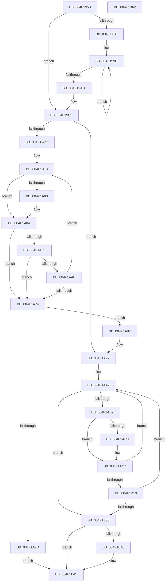

# PpmHeteroComputeUnparkCountEx

- RVA: `0x004F1950`–`0x004F1B63` (길이 `531` bytes)
- VA: `0x00000001404F1950`
- 실행 섹션: `.text`
- PDB 이름 있음: `예`; PDB Function 태그: `아니요`
- unwind 정보 RVA: `0x00094E74`
- 디코드: `140`개 명령, `531/531` bytes 표시
- 미해석 바이트: `0` (있으면 어셈블리에 `.byte`로 보존)

> 이 문서는 커널 이미지의 기계어와 PDB 기호를 분석해 생성했습니다. 4번과 5번은 함수 원형과 자료형을 바이너리 사용 방식에서 추정한 C 해석이며 원본 소스 복구 결과는 아닙니다.

## 1. Dependencies

- 직접 호출 지점: **4**; 고유 호출 대상: **1**
- 직접 호출자로 확인된 함수: **2**
- RIP 상대 이미지 참조: **0**

### Outgoing calls
- `0x004F1A29` → [PpmHeteroUtilityGreaterThanOrEqualThreshold](../41/PpmHeteroUtilityGreaterThanOrEqualThreshold_function_004124A0.md) (function, `0x004124A0`)
- `0x004F1A44` → [PpmHeteroUtilityGreaterThanOrEqualThreshold](../41/PpmHeteroUtilityGreaterThanOrEqualThreshold_function_004124A0.md) (function, `0x004124A0`)
- `0x004F1AFF` → [PpmHeteroUtilityGreaterThanOrEqualThreshold](../41/PpmHeteroUtilityGreaterThanOrEqualThreshold_function_004124A0.md) (function, `0x004124A0`)
- `0x004F1B1E` → [PpmHeteroUtilityGreaterThanOrEqualThreshold](../41/PpmHeteroUtilityGreaterThanOrEqualThreshold_function_004124A0.md) (function, `0x004124A0`)

### Direct callers
- [PpmCheckComputeMultiClassHeteroResponseEx](PpmCheckComputeMultiClassHeteroResponseEx_function_004F14A4.md) at `0x004F165D`
- [PpmHeteroComputeMultiClassUnparkCountEx](../5D/PpmHeteroComputeMultiClassUnparkCountEx_function_005DF584.md) at `0x005DF761`

### Static image references
- 디코드된 RIP-relative 메모리 참조가 없습니다.

## 2. Other-region calls and transfers

- 다른 실행 섹션으로 향하는 call: **0**
- 별도 외부 분기/꼬리 이동을 확인하지 못했습니다.

## 3. Assembly (complete function range)

```asm
004F1950  48 8B C4                        mov rax, rsp
004F1953  4C 89 48 20                     mov qword ptr [rax + 0x20], r9
004F1957  4C 89 40 18                     mov qword ptr [rax + 0x18], r8
004F195B  48 89 50 10                     mov qword ptr [rax + 0x10], rdx
004F195F  89 48 08                        mov dword ptr [rax + 8], ecx
004F1962  53                              push rbx
004F1963  55                              push rbp
004F1964  56                              push rsi
004F1965  57                              push rdi
004F1966  41 54                           push r12
004F1968  41 55                           push r13
004F196A  41 56                           push r14
004F196C  41 57                           push r15
004F196E  48 83 EC 48                     sub rsp, 0x48
004F1972  8B AC 24 C8 00 00 00            mov ebp, dword ptr [rsp + 0xc8]
004F1979  33 FF                           xor edi, edi
004F197B  48 8B B4 24 C0 00 00 00         mov rsi, qword ptr [rsp + 0xc0]
004F1983  44 8B E9                        mov r13d, ecx
004F1986  48 8B 8C 24 B8 00 00 00         mov rcx, qword ptr [rsp + 0xb8]
004F198E  4D 8B D8                        mov r11, r8
004F1991  44 8B D5                        mov r10d, ebp
004F1994  85 ED                           test ebp, ebp
004F1996  74 1D                           je 0x1404f19b5
004F1998  4C 8B C9                        mov r9, rcx
004F199B  8B D5                           mov edx, ebp
004F199D  41 8B 01                        mov eax, dword ptr [r9]
004F19A0  4D 8D 49 04                     lea r9, [r9 + 4]
004F19A4  48 2B F0                        sub rsi, rax
004F19A7  48 83 EA 01                     sub rdx, 1
004F19AB  75 F0                           jne 0x1404f199d
004F19AD  4C 8B 8C 24 A8 00 00 00         mov r9, qword ptr [rsp + 0xa8]
004F19B5  8B DD                           mov ebx, ebp
004F19B7  4C 8B BC 24 B0 00 00 00         mov r15, qword ptr [rsp + 0xb0]
004F19BF  3B AC 24 D0 00 00 00            cmp ebp, dword ptr [rsp + 0xd0]
004F19C6  0F 83 CB 00 00 00               jae 0x1404f1a97
004F19CC  8B AC 24 90 00 00 00            mov ebp, dword ptr [rsp + 0x90]
004F19D3  4E 8D 24 91                     lea r12, [rcx + r10*4]
004F19D7  8B C5                           mov eax, ebp
004F19D9  4F 8D 2C D7                     lea r13, [r15 + r10*8]
004F19DD  F7 D8                           neg eax
004F19DF  49 8B D1                        mov rdx, r9
004F19E2  4D 1B F6                        sbb r14, r14
004F19E5  41 83 E6 40                     and r14d, 0x40
004F19E9  49 81 C6 33 01 00 00            add r14, 0x133
004F19F0  48 2B D1                        sub rdx, rcx
004F19F3  48 89 54 24 30                  mov qword ptr [rsp + 0x30], rdx
004F19F8  4C 8B C7                        mov r8, rdi
004F19FB  4D 85 FF                        test r15, r15
004F19FE  74 04                           je 0x1404f1a04
004F1A00  4D 8B 45 00                     mov r8, qword ptr [r13]
004F1A04  48 8B 8C 24 98 00 00 00         mov rcx, qword ptr [rsp + 0x98]
004F1A0C  B8 3F 00 00 00                  mov eax, 0x3f
004F1A11  42 8B 14 22                     mov edx, dword ptr [rdx + r12]
004F1A15  3B D8                           cmp ebx, eax
004F1A17  89 6C 24 20                     mov dword ptr [rsp + 0x20], ebp
004F1A1B  0F 42 C3                        cmovb eax, ebx
004F1A1E  49 03 C6                        add rax, r14
004F1A21  44 0F B6 0C 08                  movzx r9d, byte ptr [rax + rcx]
004F1A26  49 8B CB                        mov rcx, r11
004F1A29  E8 72 0A F2 FF                  call 0x1404124a0
004F1A2E  85 C0                           test eax, eax
004F1A30  74 42                           je 0x1404f1a74
004F1A32  48 8B 8C 24 A0 00 00 00         mov rcx, qword ptr [rsp + 0xa0]
004F1A3A  45 33 C0                        xor r8d, r8d
004F1A3D  48 8B D6                        mov rdx, rsi
004F1A40  89 6C 24 20                     mov dword ptr [rsp + 0x20], ebp
004F1A44  E8 57 0A F2 FF                  call 0x1404124a0
004F1A49  85 C0                           test eax, eax
004F1A4B  74 27                           je 0x1404f1a74
004F1A4D  41 8B 04 24                     mov eax, dword ptr [r12]
004F1A51  FF C3                           inc ebx
004F1A53  48 8B 54 24 30                  mov rdx, qword ptr [rsp + 0x30]
004F1A58  48 2B F0                        sub rsi, rax
004F1A5B  4C 8B 9C 24 A0 00 00 00         mov r11, qword ptr [rsp + 0xa0]
004F1A63  49 83 C5 08                     add r13, 8
004F1A67  49 83 C4 04                     add r12, 4
004F1A6B  3B 9C 24 D0 00 00 00            cmp ebx, dword ptr [rsp + 0xd0]
004F1A72  72 84                           jb 0x1404f19f8
004F1A74  3B 9C 24 C8 00 00 00            cmp ebx, dword ptr [rsp + 0xc8]
004F1A7B  76 0A                           jbe 0x1404f1a87
004F1A7D  BF 02 00 00 00                  mov edi, 2
004F1A82  E9 BE 00 00 00                  jmp 0x1404f1b45
004F1A87  44 8B AC 24 90 00 00 00         mov r13d, dword ptr [rsp + 0x90]
004F1A8F  4C 8B 9C 24 A0 00 00 00         mov r11, qword ptr [rsp + 0xa0]
004F1A97  4C 8B A4 24 B8 00 00 00         mov r12, qword ptr [rsp + 0xb8]
004F1A9F  48 8B AC 24 A8 00 00 00         mov rbp, qword ptr [rsp + 0xa8]
004F1AA7  44 8B F3                        mov r14d, ebx
004F1AAA  85 DB                           test ebx, ebx
004F1AAC  0F 84 81 00 00 00               je 0x1404f1b33
004F1AB2  FF CB                           dec ebx
004F1AB4  4C 8B C7                        mov r8, rdi
004F1AB7  41 8B 04 9C                     mov eax, dword ptr [r12 + rbx*4]
004F1ABB  48 03 F0                        add rsi, rax
004F1ABE  4D 85 FF                        test r15, r15
004F1AC1  74 04                           je 0x1404f1ac7
004F1AC3  4D 8B 04 DF                     mov r8, qword ptr [r15 + rbx*8]
004F1AC7  B9 3F 00 00 00                  mov ecx, 0x3f
004F1ACC  44 89 6C 24 20                  mov dword ptr [rsp + 0x20], r13d
004F1AD1  3B D9                           cmp ebx, ecx
004F1AD3  41 8B C5                        mov eax, r13d
004F1AD6  0F 42 CB                        cmovb ecx, ebx
004F1AD9  F7 D8                           neg eax
004F1ADB  48 8B 84 24 98 00 00 00         mov rax, qword ptr [rsp + 0x98]
004F1AE3  48 1B D2                        sbb rdx, rdx
004F1AE6  83 E2 40                        and edx, 0x40
004F1AE9  48 81 C2 B3 00 00 00            add rdx, 0xb3
004F1AF0  48 03 C2                        add rax, rdx
004F1AF3  8B 54 9D 00                     mov edx, dword ptr [rbp + rbx*4]
004F1AF7  44 0F B6 0C 01                  movzx r9d, byte ptr [rcx + rax]
004F1AFC  49 8B CB                        mov rcx, r11
004F1AFF  E8 9C 09 F2 FF                  call 0x1404124a0
004F1B04  4C 8B 9C 24 A0 00 00 00         mov r11, qword ptr [rsp + 0xa0]
004F1B0C  85 C0                           test eax, eax
004F1B0E  74 97                           je 0x1404f1aa7
004F1B10  45 33 C0                        xor r8d, r8d
004F1B13  44 89 6C 24 20                  mov dword ptr [rsp + 0x20], r13d
004F1B18  48 8B D6                        mov rdx, rsi
004F1B1B  49 8B CB                        mov rcx, r11
004F1B1E  E8 7D 09 F2 FF                  call 0x1404124a0
004F1B23  4C 8B 9C 24 A0 00 00 00         mov r11, qword ptr [rsp + 0xa0]
004F1B2B  85 C0                           test eax, eax
004F1B2D  0F 84 74 FF FF FF               je 0x1404f1aa7
004F1B33  41 8B DE                        mov ebx, r14d
004F1B36  44 3B B4 24 C8 00 00 00         cmp r14d, dword ptr [rsp + 0xc8]
004F1B3E  73 05                           jae 0x1404f1b45
004F1B40  BF 01 00 00 00                  mov edi, 1
004F1B45  48 8B 8C 24 D8 00 00 00         mov rcx, qword ptr [rsp + 0xd8]
004F1B4D  8B C7                           mov eax, edi
004F1B4F  89 19                           mov dword ptr [rcx], ebx
004F1B51  48 83 C4 48                     add rsp, 0x48
004F1B55  41 5F                           pop r15
004F1B57  41 5E                           pop r14
004F1B59  41 5D                           pop r13
004F1B5B  41 5C                           pop r12
004F1B5D  5F                              pop rdi
004F1B5E  5E                              pop rsi
004F1B5F  5D                              pop rbp
004F1B60  5B                              pop rbx
004F1B61  C3                              ret
004F1B62  CC                              int3
```

## 4. C-style interpretation (structured pseudocode)

```c
__int64 __fastcall PpmHeteroComputeUnparkCountEx(int a1, __int64 a2, __int64 a3, __int64 a4, __int64 a5, __int64 a6, __int64 a7, unsigned int a8, unsigned int a9, __int64 a10)
{
    __int64 result;
    __int64 v_r12;
    __int64 v_r13;
    __int64 v_r14;
    __int64 v_rbx;
    __int64 v_rdi;
    __int64 v_rsi;
    __int64 v_rsp;
    unsigned __int64 v_stack_m58;
    unsigned int v_stack_m68;
    unsigned __int64 v_stack_p10;
    unsigned __int64 v_stack_p18;
    unsigned __int64 v_stack_p20;
    unsigned int v_stack_p8;

    *(unsigned __int64 *)(v_rsp + 32) = a4;
    *(unsigned __int64 *)(v_rsp + 24) = a3;
    *(unsigned __int64 *)(v_rsp + 16) = a2;
    *(unsigned int *)(v_rsp + 8) = a1;
    v_rsp = (v_rsp) - (72);
    v_rdi = 0;
    if ((unsigned int)((unsigned int)(a8)) == 0) goto loc_004F19B5;
loc_004F199D:
    v_rsi = (a7) - ((unsigned int)(*(unsigned int *)(a6)));
    a2 = ((unsigned int)((unsigned int)((unsigned int)(a8)))) - (1);
    if (condition_is_not_equal) goto loc_004F199D;
loc_004F19B5:
    if (((unsigned int)((unsigned int)(a8))) >= a9) goto loc_004F1A97;
    result = (unsigned int)(-((unsigned int)((unsigned int)((unsigned int)(v_stack_p8)))));
    v_r14 = (unsigned int)((v_r14) & (64));
    v_r14 = (v_r14) + (307);
    a2 = (v_stack_p20) - (a6);
    v_stack_m58 = a2;
loc_004F19F8:
    if (a5 != 0) {
        a3 = *(unsigned __int64 *)(a5 + (unsigned int)((unsigned int)((unsigned int)(a8))) * 8);
    }
    v_stack_m68 = (unsigned int)((unsigned int)(v_stack_p8));
    result = 63;
    if (((unsigned int)((unsigned int)((unsigned int)((unsigned int)(a8))))) < 63) { result = (unsigned int)((unsigned int)((unsigned int)((unsigned int)(a8)))); }
    result = (result) + (v_r14);
    result = PpmHeteroUtilityGreaterThanOrEqualThreshold(a3, (unsigned int)(*(unsigned int *)(a2 + a6 + (unsigned int)((unsigned int)((unsigned int)(a8))) * 4 * 1)), a3, *(unsigned __int8 *)(result + v_stack_p10 * 1));
    if ((unsigned int)(result) == 0) goto loc_004F1A74;
    a3 = 0;
    v_stack_m68 = (unsigned int)((unsigned int)(v_stack_p8));
    result = PpmHeteroUtilityGreaterThanOrEqualThreshold(v_stack_p18, v_rsi, a3, *(unsigned __int8 *)(result + v_stack_p10 * 1));
    if ((unsigned int)(result) == 0) goto loc_004F1A74;
    v_rbx = (unsigned int)(((unsigned int)((unsigned int)((unsigned int)(a8)))) + 1);
    v_rsi = (v_rsi) - ((unsigned int)(*(unsigned int *)(a6 + (unsigned int)((unsigned int)((unsigned int)(a8))) * 4)));
    v_r13 = (a5 + (unsigned int)((unsigned int)((unsigned int)(a8))) * 8) + (8);
    v_r12 = (a6 + (unsigned int)((unsigned int)((unsigned int)(a8))) * 4) + (4);
    if (((unsigned int)(v_rbx)) < a9) goto loc_004F19F8;
loc_004F1A74:
    if (((unsigned int)(v_rbx)) <= a8) goto loc_004F1A87;
    goto loc_004F1B45;
loc_004F1A87:
loc_004F1A97:
loc_004F1AA7:
    if ((unsigned int)(v_rbx) == 0) goto loc_004F1B33;
    v_rbx = (unsigned int)((v_rbx) - 1);
    v_rsi = (v_rsi) + ((unsigned int)(*(unsigned int *)(a6 + v_rbx * 4)));
    if (a5 != 0) {
        a3 = *(unsigned __int64 *)(a5 + v_rbx * 8);
    }
    v_stack_m68 = (unsigned int)((unsigned int)(v_stack_p8));
    a1 = 63;
    if (((unsigned int)(v_rbx)) < 63) { a1 = (unsigned int)(v_rbx); }
    result = (unsigned int)(-((unsigned int)((unsigned int)((unsigned int)(v_stack_p8)))));
    a2 = (unsigned int)((v_stack_m58) & (64));
    a2 = (a2) + (179);
    result = (v_stack_p10) + (a2);
    result = PpmHeteroUtilityGreaterThanOrEqualThreshold(v_stack_p18, (unsigned int)(*(unsigned int *)(v_stack_p20 + v_rbx * 4)), a3, *(unsigned __int8 *)(a1 + result * 1));
    if ((unsigned int)(result) == 0) goto loc_004F1AA7;
    a3 = 0;
    v_stack_m68 = (unsigned int)((unsigned int)(v_stack_p8));
    result = PpmHeteroUtilityGreaterThanOrEqualThreshold(v_stack_p18, v_rsi, a3, *(unsigned __int8 *)(a1 + result * 1));
    if ((unsigned int)(result) == 0) goto loc_004F1AA7;
loc_004F1B33:
    v_rdi = 2;
    if (((unsigned int)((unsigned int)((unsigned int)(v_rbx)))) < a8) {
        v_rdi = 1;
    }
    *(unsigned int *)(a10) = (unsigned int)((unsigned int)((unsigned int)((unsigned int)((unsigned int)(v_rbx)))));
    v_rsp = (v_rsp) + (72);
    return (unsigned int)((unsigned int)(v_rdi));
}
```

## 5. (Beta) C Style

```c
int64_t PpmHeteroComputeUnparkCountEx(int32_t Arg1, int64_t Arg2, int64_t Arg3, int64_t Arg4, void *Arg5, void *Arg6, int64_t Arg7, uint32_t Arg8, uint32_t Arg9, void *Arg10)
{
    uint8_t *arg5 = (uint8_t *)Arg5;
    uint8_t *arg6 = (uint8_t *)Arg6;
    uint8_t *arg10 = (uint8_t *)Arg10;

    int64_t result;
    int64_t local_r12;
    int64_t local_r13;
    int64_t local_r14;
    int64_t local_rbx;
    int64_t local_rdi;
    int64_t local_rsi;
    int64_t local_rsp;
    uint64_t v_stack_m58;
    uint32_t v_stack_m68;
    uint64_t v_stack_p10;
    uint64_t v_stack_p18;
    uint64_t v_stack_p20;
    uint32_t v_stack_p8;

    *(uint64_t *)(local_rsp + 0x20) = Arg4;
    *(uint64_t *)(local_rsp + 0x18) = Arg3;
    *(uint64_t *)(local_rsp + 0x10) = Arg2;
    *(uint32_t *)(local_rsp + 0x8) = Arg1;
    local_rsp = (local_rsp) - (72);
    local_rdi = 0;
    if ((uint32_t)((uint32_t)(Arg8)) == 0) goto loc_004F19B5;
loc_004F199D:
    local_rsi = (Arg7) - ((uint32_t)(*(uint32_t *)(arg6)));
    Arg2 = ((uint32_t)((uint32_t)((uint32_t)(Arg8)))) - (1);
    if (condition_is_not_equal) goto loc_004F199D;
loc_004F19B5:
    if (((uint32_t)((uint32_t)(Arg8))) >= Arg9) goto loc_004F1A97;
    result = (uint32_t)(-((uint32_t)((uint32_t)((uint32_t)(v_stack_p8)))));
    local_r14 = (uint32_t)((local_r14) & (64));
    local_r14 = (local_r14) + (307);
    Arg2 = (v_stack_p20) - (Arg6);
    v_stack_m58 = Arg2;
loc_004F19F8:
    if (Arg5 != NULL) {
        Arg3 = *(uint64_t *)(arg5 + (uint32_t)((uint32_t)((uint32_t)(Arg8))) * 8);
    }
    v_stack_m68 = (uint32_t)((uint32_t)(v_stack_p8));
    result = 63;
    if (((uint32_t)((uint32_t)((uint32_t)((uint32_t)(Arg8))))) < 63) { result = (uint32_t)((uint32_t)((uint32_t)((uint32_t)(Arg8)))); }
    result = (result) + (local_r14);
    result = PpmHeteroUtilityGreaterThanOrEqualThreshold(Arg3, (uint32_t)(*(uint32_t *)(Arg2 + arg6 + (uint32_t)((uint32_t)((uint32_t)(Arg8))) * 4 * 1)), Arg3, *(uint8_t *)(result + v_stack_p10 * 1));
    if ((uint32_t)(result) == 0) goto loc_004F1A74;
    Arg3 = 0;
    v_stack_m68 = (uint32_t)((uint32_t)(v_stack_p8));
    result = PpmHeteroUtilityGreaterThanOrEqualThreshold(v_stack_p18, local_rsi, Arg3, *(uint8_t *)(result + v_stack_p10 * 1));
    if ((uint32_t)(result) == 0) goto loc_004F1A74;
    local_rbx = (uint32_t)(((uint32_t)((uint32_t)((uint32_t)(Arg8)))) + 1);
    local_rsi = (local_rsi) - ((uint32_t)(*(uint32_t *)(arg6 + (uint32_t)((uint32_t)((uint32_t)(Arg8))) * 4)));
    local_r13 = (Arg5 + (uint32_t)((uint32_t)((uint32_t)(Arg8))) * 8) + (8);
    local_r12 = (Arg6 + (uint32_t)((uint32_t)((uint32_t)(Arg8))) * 4) + (4);
    if (((uint32_t)(local_rbx)) < Arg9) goto loc_004F19F8;
loc_004F1A74:
    if (((uint32_t)(local_rbx)) <= Arg8) goto loc_004F1A87;
    goto loc_004F1B45;
loc_004F1A87:
loc_004F1A97:
loc_004F1AA7:
    if ((uint32_t)(local_rbx) == 0) goto loc_004F1B33;
    local_rbx = (uint32_t)((local_rbx) - 1);
    local_rsi = (local_rsi) + ((uint32_t)(*(uint32_t *)(arg6 + local_rbx * 4)));
    if (Arg5 != NULL) {
        Arg3 = *(uint64_t *)(arg5 + local_rbx * 8);
    }
    v_stack_m68 = (uint32_t)((uint32_t)(v_stack_p8));
    Arg1 = 63;
    if (((uint32_t)(local_rbx)) < 63) { Arg1 = (uint32_t)(local_rbx); }
    result = (uint32_t)(-((uint32_t)((uint32_t)((uint32_t)(v_stack_p8)))));
    Arg2 = (uint32_t)((v_stack_m58) & (64));
    Arg2 = (Arg2) + (179);
    result = (v_stack_p10) + (Arg2);
    result = PpmHeteroUtilityGreaterThanOrEqualThreshold(v_stack_p18, (uint32_t)(*(uint32_t *)(v_stack_p20 + local_rbx * 4)), Arg3, *(uint8_t *)(Arg1 + result * 1));
    if ((uint32_t)(result) == 0) goto loc_004F1AA7;
    Arg3 = 0;
    v_stack_m68 = (uint32_t)((uint32_t)(v_stack_p8));
    result = PpmHeteroUtilityGreaterThanOrEqualThreshold(v_stack_p18, local_rsi, Arg3, *(uint8_t *)(Arg1 + result * 1));
    if ((uint32_t)(result) == 0) goto loc_004F1AA7;
loc_004F1B33:
    local_rdi = 2;
    if (((uint32_t)((uint32_t)((uint32_t)(local_rbx)))) < Arg8) {
        local_rdi = 1;
    }
    *(uint32_t *)(arg10) = (uint32_t)((uint32_t)((uint32_t)((uint32_t)((uint32_t)(local_rbx)))));
    local_rsp = (local_rsp) + (72);
    return (uint32_t)((uint32_t)(local_rdi));
}
```

### 관측된 메모리 오프셋

구조체 형식이 확인되지 않은 접근은 인자 기준의 오프셋으로만 기록했습니다.

| 기준 인자 | 오프셋 표현 | 폭 (bit) | 접근 |
|---|---:|---:|---|
| `Arg5` | `+ 0x0` | `64` | `R` |
| `Arg5` | `+ 0x0 + r10*8` | `64` | `R` |
| `Arg6` | `+ 0x0` | `32` | `R` |
| `Arg6` | `+ 0x0 + r10*4` | `64` | `R` |
| `Arg6` | `+ 0x0 + rbx*4` | `32` | `R` |
| `Arg6` | `+ 0x4` | `64` | `R` |
| `Arg10` | `+ 0x0` | `32` | `W` |

## 6. Execution-region graph

[열기: 2D/3D 그래프와 함수 탐색 컨트롤 패널](../../../control-panel.html?section=text&rva=0x004F1950&view=graph)

- 2D 그래프는 위에서 아래로 흐르고, 3D 그래프는 빈 공간을 드래그해 회전합니다. Shift+드래그는 이동, 휠은 확대·축소, 함수 노드 선택은 대상 보고서 이동입니다.

### Static fallback


