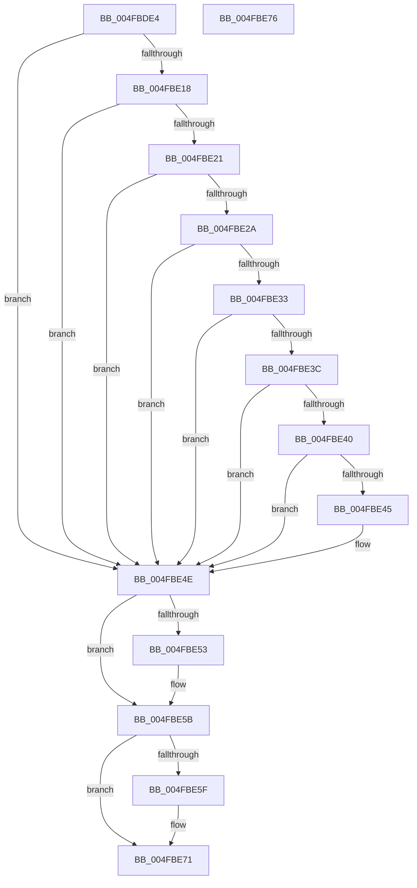

# PpmHeteroHgsEvaluateContainmentDecision

- RVA: `0x004FBDE4`–`0x004FBE77` (길이 `147` bytes)
- VA: `0x00000001404FBDE4`
- 실행 섹션: `.text`
- PDB 이름 있음: `예`; PDB Function 태그: `아니요`
- unwind 정보 RVA: `0x0005D2F4`
- 디코드: `37`개 명령, `147/147` bytes 표시
- 미해석 바이트: `0` (있으면 어셈블리에 `.byte`로 보존)

> 이 문서는 커널 이미지의 기계어와 PDB 기호를 분석해 생성했습니다. 4번과 5번은 함수 원형과 자료형을 바이너리 사용 방식에서 추정한 C 해석이며 원본 소스 복구 결과는 아닙니다.

## 1. Dependencies

- 직접 호출 지점: **2**; 고유 호출 대상: **2**
- 직접 호출자로 확인된 함수: **1**
- RIP 상대 이미지 참조: **7**

### Outgoing calls
- `0x004FBDF6` → [PpmHeteroHgsEvaluateContainmentMinPolicyDecision](../4C/PpmHeteroHgsEvaluateContainmentMinPolicyDecision_function_004C8638.md) (function, `0x004C8638`)
- `0x004FBE6C` → [PpmEventHgsContainmentPolicyChange](../5D/PpmEventHgsContainmentPolicyChange_function_005DAA94.md) (function, `0x005DAA94`)

### Direct callers
- [PpmHeteroHgsCheckContainmentDecision](../3B/PpmHeteroHgsCheckContainmentDecision_function_003BEFF8.md) at `0x003BF023`

### Static image references
- `0x004FBDFB` → RVA `0x00FC501C` (`ALMOSTRO`; read)
- `0x004FBE09` → RVA `0x00FC5038` (`ALMOSTRO`; read)
- `0x004FBE10` → RVA `0x00FC501C` (`ALMOSTRO`; write)
- `0x004FBE18` → RVA `0x00FC5188` (`ALMOSTRO`; read)
- `0x004FBE21` → RVA `0x00FC6A86` (`ALMOSTRO`; read)
- `0x004FBE2A` → RVA `0x00F0E0F0` (`.data`; read)
- `0x004FBE33` → RVA `0x00F0B24C` (`.data`; read)

## 2. Other-region calls and transfers

- 다른 실행 섹션으로 향하는 call: **0**
- 별도 외부 분기/꼬리 이동을 확인하지 못했습니다.

## 3. Assembly (complete function range)

```asm
004FBDE4  48 83 EC 38                     sub rsp, 0x38
004FBDE8  4C 8B 99 00 05 00 00            mov r11, qword ptr [rcx + 0x500]
004FBDEF  45 8A 93 3B 03 00 00            mov r10b, byte ptr [r11 + 0x33b]
004FBDF6  E8 3D C8 FC FF                  call 0x1404c8638
004FBDFB  8B 15 1B 92 AC 00               mov edx, dword ptr [rip + 0xac921b]
004FBE01  45 33 C0                        xor r8d, r8d
004FBE04  8B CA                           mov ecx, edx
004FBE06  83 E1 F7                        and ecx, 0xfffffff7
004FBE09  83 3D 28 92 AC 00 04            cmp dword ptr [rip + 0xac9228], 4
004FBE10  89 0D 06 92 AC 00               mov dword ptr [rip + 0xac9206], ecx
004FBE16  75 36                           jne 0x1404fbe4e
004FBE18  83 3D 69 93 AC 00 01            cmp dword ptr [rip + 0xac9369], 1
004FBE1F  75 2D                           jne 0x1404fbe4e
004FBE21  44 38 05 5E AC AC 00            cmp byte ptr [rip + 0xacac5e], r8b
004FBE28  74 24                           je 0x1404fbe4e
004FBE2A  44 38 05 BF 22 A1 00            cmp byte ptr [rip + 0xa122bf], r8b
004FBE31  75 1B                           jne 0x1404fbe4e
004FBE33  44 39 05 12 F4 A0 00            cmp dword ptr [rip + 0xa0f412], r8d
004FBE3A  75 12                           jne 0x1404fbe4e
004FBE3C  84 C0                           test al, al
004FBE3E  75 0E                           jne 0x1404fbe4e
004FBE40  45 84 D2                        test r10b, r10b
004FBE43  75 09                           jne 0x1404fbe4e
004FBE45  83 C9 08                        or ecx, 8
004FBE48  89 0D CE 91 AC 00               mov dword ptr [rip + 0xac91ce], ecx
004FBE4E  F6 C1 08                        test cl, 8
004FBE51  75 08                           jne 0x1404fbe5b
004FBE53  41 C7 43 04 02 00 00 00         mov dword ptr [r11 + 4], 2
004FBE5B  3B D1                           cmp edx, ecx
004FBE5D  74 12                           je 0x1404fbe71
004FBE5F  44 88 44 24 28                  mov byte ptr [rsp + 0x28], r8b
004FBE64  44 8A C8                        mov r9b, al
004FBE67  44 88 54 24 20                  mov byte ptr [rsp + 0x20], r10b
004FBE6C  E8 23 EC 0D 00                  call 0x1405daa94
004FBE71  48 83 C4 38                     add rsp, 0x38
004FBE75  C3                              ret
004FBE76  CC                              int3
```

## 4. C-style interpretation (structured pseudocode)

```c
__int64 __fastcall PpmHeteroHgsEvaluateContainmentDecision(__int64 a1, __int64 a2, int a3)
{
    __int64 result;
    __int64 v_rsp;
    unsigned __int8 v_stack_m10;
    unsigned __int8 v_stack_m18;

    v_rsp = (v_rsp) - (56);
    result = PpmHeteroHgsEvaluateContainmentMinPolicyDecision(a1, a2, a3, a4);
    a3 = 0;
    a1 = (unsigned int)(((unsigned int)((unsigned int)((unsigned int)(*(unsigned int *)(v_rip + 11309595))))) & (0xFFFFFFF7ULL));
    *(unsigned int *)(v_rip + 11309574) = (unsigned int)(a1);
    if ((*(unsigned int *)(v_rip + 11309608)) != 4) goto loc_004FBE4E;
    if ((*(unsigned int *)(v_rip + 11309929)) != 1) goto loc_004FBE4E;
    if ((*(unsigned __int8 *)(v_rip + 11316318)) == 0) goto loc_004FBE4E;
    if ((*(unsigned __int8 *)(v_rip + 10560191)) != 0) goto loc_004FBE4E;
    if ((*(unsigned int *)(v_rip + 10548242)) != 0) goto loc_004FBE4E;
    if ((unsigned __int8)(result) != 0) goto loc_004FBE4E;
    if ((unsigned __int8)(*(unsigned __int8 *)(*(unsigned __int64 *)(a1 + 1280) + 827)) == 0) {
        a1 = (unsigned int)((a1) | (8));
        *(unsigned int *)(v_rip + 11309518) = (unsigned int)(a1);
    }
    if ((((unsigned __int8)(a1)) & (8)) == 0) {
        *(unsigned int *)(*(unsigned __int64 *)(a1 + 1280) + 4) = 2;
    }
    if (((unsigned int)((unsigned int)(*(unsigned int *)(v_rip + 11309595)))) != ((unsigned int)(a1))) {
        v_stack_m10 = 0;
        a4 = (unsigned __int8)(result);
        v_stack_m18 = (unsigned __int8)(*(unsigned __int8 *)(*(unsigned __int64 *)(a1 + 1280) + 827));
        result = PpmEventHgsContainmentPolicyChange(a1, (unsigned int)(*(unsigned int *)(v_rip + 11309595)), a3, a4);
    }
    v_rsp = (v_rsp) + (56);
    return result;
}
```

## 5. (Beta) C Style

```c
int64_t PpmHeteroHgsEvaluateContainmentDecision(void *Arg1, int64_t Arg2, int32_t Arg3)
{
    uint8_t *arg1 = (uint8_t *)Arg1;

    int64_t result;
    int64_t local_rsp;
    uint8_t v_stack_m10;
    uint8_t v_stack_m18;

    local_rsp = (local_rsp) - (56);
    result = PpmHeteroHgsEvaluateContainmentMinPolicyDecision(Arg1, Arg2, Arg3, a4);
    Arg3 = 0;
    Arg1 = (uint32_t)(((uint32_t)((uint32_t)((uint32_t)(*(uint32_t *)(v_rip + 0xAC921B))))) & (0xFFFFFFF7ULL));
    *(uint32_t *)(v_rip + 0xAC9206) = (uint32_t)(Arg1);
    if ((*(uint32_t *)(v_rip + 0xAC9228)) != 4) goto loc_004FBE4E;
    if ((*(uint32_t *)(v_rip + 0xAC9369)) != 1) goto loc_004FBE4E;
    if ((*(uint8_t *)(v_rip + 0xACAC5E)) == 0) goto loc_004FBE4E;
    if ((*(uint8_t *)(v_rip + 0xA122BF)) != 0) goto loc_004FBE4E;
    if ((*(uint32_t *)(v_rip + 0xA0F412)) != 0) goto loc_004FBE4E;
    if ((uint8_t)(result) != 0) goto loc_004FBE4E;
    if ((uint8_t)(*(uint8_t *)(*(uint64_t *)(arg1 + 0x500) + 0x33B)) == 0) {
        Arg1 = (uint32_t)((Arg1) | (8));
        *(uint32_t *)(v_rip + 0xAC91CE) = (uint32_t)(Arg1);
    }
    if ((((uint8_t)(Arg1)) & (8)) == 0) {
        *(uint32_t *)(*(uint64_t *)(arg1 + 0x500) + 0x4) = 2;
    }
    if (((uint32_t)((uint32_t)(*(uint32_t *)(v_rip + 0xAC921B)))) != ((uint32_t)(Arg1))) {
        v_stack_m10 = 0;
        a4 = (uint8_t)(result);
        v_stack_m18 = (uint8_t)(*(uint8_t *)(*(uint64_t *)(arg1 + 0x500) + 0x33B));
        result = PpmEventHgsContainmentPolicyChange(Arg1, (uint32_t)(*(uint32_t *)(v_rip + 0xAC921B)), Arg3, a4);
    }
    local_rsp = (local_rsp) + (56);
    return result;
}
```

### 관측된 메모리 오프셋

구조체 형식이 확인되지 않은 접근은 인자 기준의 오프셋으로만 기록했습니다.

| 기준 인자 | 오프셋 표현 | 폭 (bit) | 접근 |
|---|---:|---:|---|
| `Arg1` | `+ 0x500` | `64` | `R` |

## 6. Execution-region graph

[열기: 2D/3D 그래프와 함수 탐색 컨트롤 패널](../../../control-panel.html?section=text&rva=0x004FBDE4&view=graph)

- 2D 그래프는 위에서 아래로 흐르고, 3D 그래프는 빈 공간을 드래그해 회전합니다. Shift+드래그는 이동, 휠은 확대·축소, 함수 노드 선택은 대상 보고서 이동입니다.

### Static fallback


