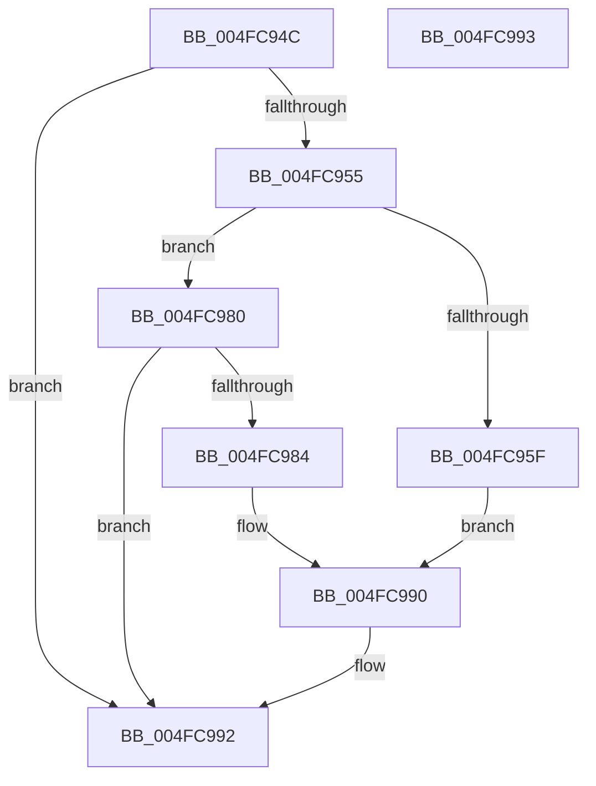

# PpmHeteroHgsProcessorThreadFeedbackInit

- RVA: `0x004FC94C`–`0x004FC994` (길이 `72` bytes)
- VA: `0x00000001404FC94C`
- 실행 섹션: `.text`
- PDB 이름 있음: `예`; PDB Function 태그: `아니요`
- unwind 정보 RVA: `0x000DB714`
- 디코드: `20`개 명령, `72/72` bytes 표시
- 미해석 바이트: `0` (있으면 어셈블리에 `.byte`로 보존)

> 이 문서는 커널 이미지의 기계어와 PDB 기호를 분석해 생성했습니다. 4번과 5번은 함수 원형과 자료형을 바이너리 사용 방식에서 추정한 C 해석이며 원본 소스 복구 결과는 아닙니다.

## 1. Dependencies

- 직접 호출 지점: **0**; 고유 호출 대상: **0**
- 직접 호출자로 확인된 함수: **2**
- RIP 상대 이미지 참조: **2**

### Outgoing calls
- 직접 디코드된 call 명령이 없습니다.

### Direct callers
- [PpmResetPerfEngineForProcessor](../44/PpmResetPerfEngineForProcessor_function_0044F7D0.md) at `0x0044F844`
- [PpmHeteroHgsProcessorInit](../5D/PpmHeteroHgsProcessorInit_function_005D8C08.md) at `0x005D8C5D`

### Static image references
- `0x004FC94C` → RVA `0x00FC6A96` (`ALMOSTRO`; read)
- `0x004FC955` → RVA `0x00FC5003` (`ALMOSTRO`; read)

## 2. Other-region calls and transfers

- 다른 실행 섹션으로 향하는 call: **0**
- 별도 외부 분기/꼬리 이동을 확인하지 못했습니다.

## 3. Assembly (complete function range)

```asm
004FC94C  80 3D 43 A1 AC 00 00            cmp byte ptr [rip + 0xaca143], 0
004FC953  74 3D                           je 0x1404fc992
004FC955  8A 05 A8 86 AC 00               mov al, byte ptr [rip + 0xac86a8]
004FC95B  3C 02                           cmp al, 2
004FC95D  75 21                           jne 0x1404fc980
004FC95F  48 83 64 24 08 00               and qword ptr [rsp + 8], 0
004FC965  B9 D4 17 00 00                  mov ecx, 0x17d4
004FC96A  C7 44 24 08 01 00 00 00         mov dword ptr [rsp + 8], 1
004FC972  48 8B 54 24 08                  mov rdx, qword ptr [rsp + 8]
004FC977  48 8B C2                        mov rax, rdx
004FC97A  48 C1 EA 20                     shr rdx, 0x20
004FC97E  EB 10                           jmp 0x1404fc990
004FC980  3C 01                           cmp al, 1
004FC982  75 0E                           jne 0x1404fc992
004FC984  B8 01 00 00 00                  mov eax, 1
004FC989  33 D2                           xor edx, edx
004FC98B  B9 00 05 00 C0                  mov ecx, 0xc0000500
004FC990  0F 30                           wrmsr
004FC992  C3                              ret
004FC993  CC                              int3
```

## 4. C-style interpretation (structured pseudocode)

```c
__int64 __fastcall PpmHeteroHgsProcessorThreadFeedbackInit(void)
{
    unsigned __int64 v_stack_p8;

    if ((*(unsigned __int8 *)(v_rip + 11313475)) == 0) goto loc_004FC992;
    if (((unsigned __int8)(*(unsigned __int8 *)(v_rip + 11306664))) != 2) goto loc_004FC980;
    v_stack_p8 = 1;
    a2 = (v_stack_p8) >> (32);
    goto loc_004FC990;
loc_004FC980:
    if (((unsigned __int8)(v_stack_p8)) != 1) goto loc_004FC992;
    a2 = 0;
loc_004FC990:
loc_004FC992:
    return 1;
}
```

## 5. (Beta) C Style

```c
void PpmHeteroHgsProcessorThreadFeedbackInit(void)
{
    uint64_t v_stack_p8;

    if ((*(uint8_t *)(v_rip + 0xACA143)) == 0) goto loc_004FC992;
    if (((uint8_t)(*(uint8_t *)(v_rip + 0xAC86A8))) != 2) goto loc_004FC980;
    v_stack_p8 = 1;
    a2 = (v_stack_p8) >> (32);
    goto loc_004FC990;
loc_004FC980:
    if (((uint8_t)(v_stack_p8)) != 1) goto loc_004FC992;
    a2 = 0;
loc_004FC990:
loc_004FC992:
    return 1;
}
```

## 6. Execution-region graph

[열기: 2D/3D 그래프와 함수 탐색 컨트롤 패널](../../../control-panel.html?section=text&rva=0x004FC94C&view=graph)

- 2D 그래프는 위에서 아래로 흐르고, 3D 그래프는 빈 공간을 드래그해 회전합니다. Shift+드래그는 이동, 휠은 확대·축소, 함수 노드 선택은 대상 보고서 이동입니다.

### Static fallback


