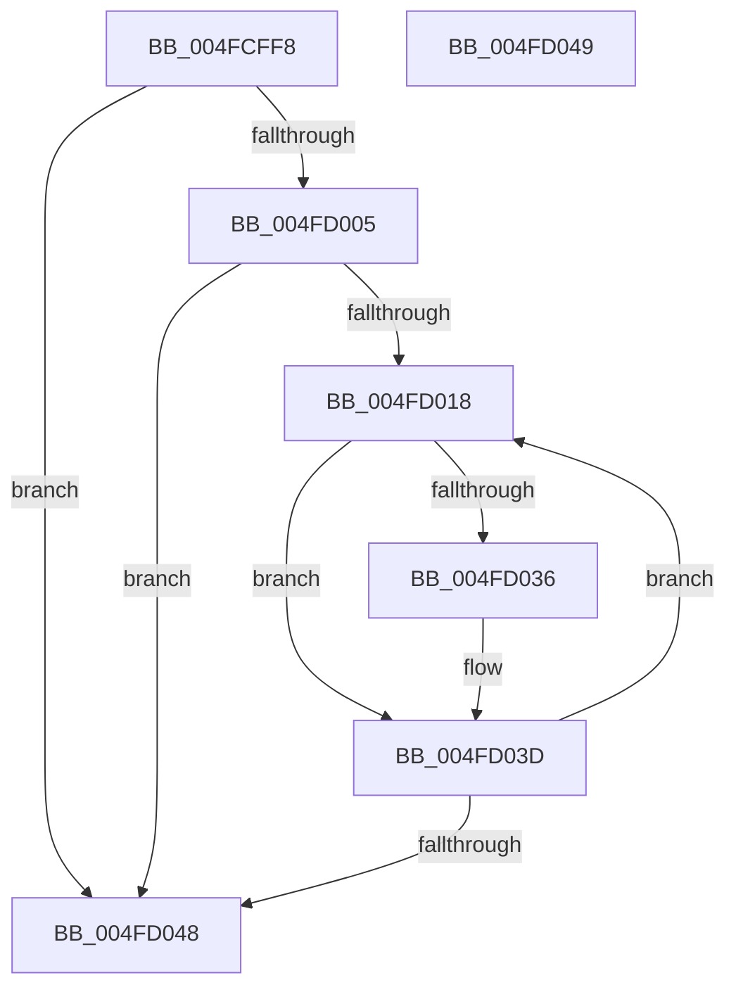

# PpmHeteroHgsUpdateContainmentGlobalHints

- RVA: `0x004FCFF8`–`0x004FD04A` (길이 `82` bytes)
- VA: `0x00000001404FCFF8`
- 실행 섹션: `.text`
- PDB 이름 있음: `예`; PDB Function 태그: `아니요`
- unwind 정보 RVA: `0x000DB714`
- 디코드: `22`개 명령, `82/82` bytes 표시
- 미해석 바이트: `0` (있으면 어셈블리에 `.byte`로 보존)

> 이 문서는 커널 이미지의 기계어와 PDB 기호를 분석해 생성했습니다. 4번과 5번은 함수 원형과 자료형을 바이너리 사용 방식에서 추정한 C 해석이며 원본 소스 복구 결과는 아닙니다.

## 1. Dependencies

- 직접 호출 지점: **0**; 고유 호출 대상: **0**
- 직접 호출자로 확인된 함수: **1**
- RIP 상대 이미지 참조: **3**

### Outgoing calls
- 직접 디코드된 call 명령이 없습니다.

### Direct callers
- [PpmHeteroUpdateHgsConfiguration](../3B/PpmHeteroUpdateHgsConfiguration_function_003BF344.md) at `0x003BFCBF`

### Static image references
- `0x004FCFF8` → RVA `0x00FC501C` (`ALMOSTRO`; read)
- `0x004FD005` → RVA `0x00F083E0` (`.data`; read)
- `0x004FD022` → RVA `0x00F083D8` (`.data`; read)

## 2. Other-region calls and transfers

- 다른 실행 섹션으로 향하는 call: **0**
- 별도 외부 분기/꼬리 이동을 확인하지 못했습니다.

## 3. Assembly (complete function range)

```asm
004FCFF8  8B 05 1E 80 AC 00               mov eax, dword ptr [rip + 0xac801e]
004FCFFE  44 8A D1                        mov r10b, cl
004FD001  A8 04                           test al, 4
004FD003  74 43                           je 0x1404fd048
004FD005  44 8B 05 D4 B3 A0 00            mov r8d, dword ptr [rip + 0xa0b3d4]
004FD00C  45 33 DB                        xor r11d, r11d
004FD00F  41 0F B7 D3                     movzx edx, r11w
004FD013  45 85 C0                        test r8d, r8d
004FD016  74 30                           je 0x1404fd048
004FD018  0F B7 C2                        movzx eax, dx
004FD01B  48 69 C8 10 05 00 00            imul rcx, rax, 0x510
004FD022  48 8B 05 AF B3 A0 00            mov rax, qword ptr [rip + 0xa0b3af]
004FD029  4C 8B 8C 01 00 05 00 00         mov r9, qword ptr [rcx + rax + 0x500]
004FD031  4D 85 C9                        test r9, r9
004FD034  74 07                           je 0x1404fd03d
004FD036  45 88 91 3B 03 00 00            mov byte ptr [r9 + 0x33b], r10b
004FD03D  66 FF C2                        inc dx
004FD040  0F B7 C2                        movzx eax, dx
004FD043  41 3B C0                        cmp eax, r8d
004FD046  72 D0                           jb 0x1404fd018
004FD048  C3                              ret
004FD049  CC                              int3
```

## 4. C-style interpretation (structured pseudocode)

```c
__int64 __fastcall PpmHeteroHgsUpdateContainmentGlobalHints(unsigned __int8 a1)
{
    __int64 v_r11;

    if ((((unsigned __int8)((unsigned int)(*(unsigned int *)(v_rip + 11304990)))) & (4)) == 0) goto loc_004FD048;
    v_r11 = 0;
    if ((unsigned int)((unsigned int)(*(unsigned int *)(v_rip + 10531796))) == 0) goto loc_004FD048;
loc_004FD018:
    a1 = (a1) * (0);
    if (*(unsigned __int64 *)(a1 + *(unsigned __int64 *)(v_rip + 10531759) * 1 + 1280) != 0) {
        *(unsigned __int8 *)(*(unsigned __int64 *)(a1 + *(unsigned __int64 *)(v_rip + 10531759) * 1 + 1280) + 827) = a1;
    }
    a2 = (unsigned __int16)((0) + 1);
    if (((unsigned int)((unsigned __int16)(a2))) < ((unsigned int)((unsigned int)(*(unsigned int *)(v_rip + 10531796))))) goto loc_004FD018;
loc_004FD048:
    return (unsigned __int16)(a2);
}
```

## 5. (Beta) C Style

```c
int64_t PpmHeteroHgsUpdateContainmentGlobalHints(void *Arg1)
{
    uint8_t *arg1 = (uint8_t *)Arg1;

    int64_t local_r11;

    if ((((uint8_t)((uint32_t)(*(uint32_t *)(v_rip + 0xAC801E)))) & (4)) == 0) goto loc_004FD048;
    local_r11 = 0;
    if ((uint32_t)((uint32_t)(*(uint32_t *)(v_rip + 0xA0B3D4))) == 0) goto loc_004FD048;
loc_004FD018:
    Arg1 = (Arg1) * (0);
    if (*(uint64_t *)(arg1 + *(uint64_t *)(v_rip + 0xA0B3AF) * 1 + 0x500) != 0) {
        *(uint8_t *)(*(uint64_t *)(arg1 + *(uint64_t *)(v_rip + 0xA0B3AF) * 1 + 0x500) + 0x33B) = Arg1;
    }
    a2 = (uint16_t)((0) + 1);
    if (((uint32_t)((uint16_t)(a2))) < ((uint32_t)((uint32_t)(*(uint32_t *)(v_rip + 0xA0B3D4))))) goto loc_004FD018;
loc_004FD048:
    return (uint16_t)(a2);
}
```

### 관측된 메모리 오프셋

구조체 형식이 확인되지 않은 접근은 인자 기준의 오프셋으로만 기록했습니다.

| 기준 인자 | 오프셋 표현 | 폭 (bit) | 접근 |
|---|---:|---:|---|
| `Arg1` | `+ 0x500 + rax*1` | `64` | `R` |

## 6. Execution-region graph

[열기: 2D/3D 그래프와 함수 탐색 컨트롤 패널](../../../control-panel.html?section=text&rva=0x004FCFF8&view=graph)

- 2D 그래프는 위에서 아래로 흐르고, 3D 그래프는 빈 공간을 드래그해 회전합니다. Shift+드래그는 이동, 휠은 확대·축소, 함수 노드 선택은 대상 보고서 이동입니다.

### Static fallback


