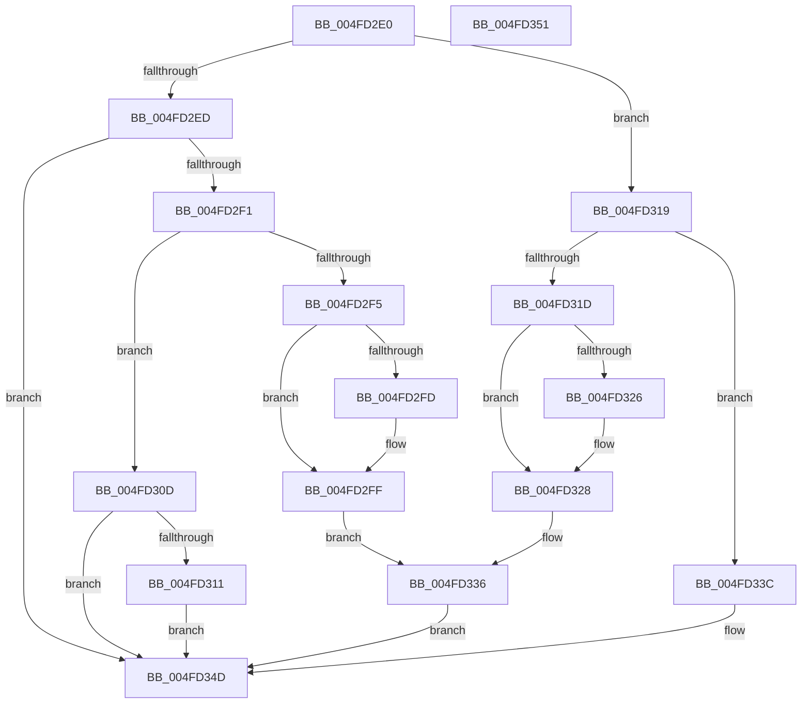

# PpmIdleIsStateDisabled

- RVA: `0x004FD2E0`–`0x004FD352` (길이 `114` bytes)
- VA: `0x00000001404FD2E0`
- 실행 섹션: `.text`
- PDB 이름 있음: `예`; PDB Function 태그: `아니요`
- unwind 정보 RVA: `0x000DB714`
- 디코드: `41`개 명령, `114/114` bytes 표시
- 미해석 바이트: `0` (있으면 어셈블리에 `.byte`로 보존)

> 이 문서는 커널 이미지의 기계어와 PDB 기호를 분석해 생성했습니다. 4번과 5번은 함수 원형과 자료형을 바이너리 사용 방식에서 추정한 C 해석이며 원본 소스 복구 결과는 아닙니다.

## 1. Dependencies

- 직접 호출 지점: **0**; 고유 호출 대상: **0**
- 직접 호출자로 확인된 함수: **3**
- RIP 상대 이미지 참조: **1**

### Outgoing calls
- 직접 디코드된 call 명령이 없습니다.

### Direct callers
- [PpmInstallNewIdleStates](../44/PpmInstallNewIdleStates_function_00446E80.md) at `0x00447125`
- [PpmInstallCoordinatedIdleStates](../../page/75/PpmInstallCoordinatedIdleStates_function_007552A0.md) at `0x00755494`
- [sub_00B3B244](../../page/B3/Unknown_function_00B3B244.md) at `0x00B3B398`

### Static image references
- `0x004FD2E0` → RVA `0x00FC531C` (`ALMOSTRO`; read)

## 2. Other-region calls and transfers

- 다른 실행 섹션으로 향하는 call: **0**
- 별도 외부 분기/꼬리 이동을 확인하지 못했습니다.

## 3. Assembly (complete function range)

```asm
004FD2E0  8B 05 36 80 AC 00               mov eax, dword ptr [rip + 0xac8036]
004FD2E6  45 33 C0                        xor r8d, r8d
004FD2E9  84 C9                           test cl, cl
004FD2EB  74 2C                           je 0x1404fd319
004FD2ED  85 D2                           test edx, edx
004FD2EF  74 5C                           je 0x1404fd34d
004FD2F1  3C 03                           cmp al, 3
004FD2F3  75 18                           jne 0x1404fd30d
004FD2F5  41 8D 48 07                     lea ecx, [r8 + 7]
004FD2F9  3B D1                           cmp edx, ecx
004FD2FB  73 02                           jae 0x1404fd2ff
004FD2FD  8B CA                           mov ecx, edx
004FD2FF  BA 01 00 00 00                  mov edx, 1
004FD304  C1 E8 08                        shr eax, 8
004FD307  D2 E2                           shl dl, cl
004FD309  84 C2                           test dl, al
004FD30B  EB 29                           jmp 0x1404fd336
004FD30D  3C 02                           cmp al, 2
004FD30F  75 3C                           jne 0x1404fd34d
004FD311  41 B8 01 00 00 00               mov r8d, 1
004FD317  EB 34                           jmp 0x1404fd34d
004FD319  3C 03                           cmp al, 3
004FD31B  75 1F                           jne 0x1404fd33c
004FD31D  B9 0F 00 00 00                  mov ecx, 0xf
004FD322  3B D1                           cmp edx, ecx
004FD324  73 02                           jae 0x1404fd328
004FD326  8B CA                           mov ecx, edx
004FD328  BA 01 00 00 00                  mov edx, 1
004FD32D  C1 E8 10                        shr eax, 0x10
004FD330  66 D3 E2                        shl dx, cl
004FD333  66 85 C2                        test dx, ax
004FD336  41 0F 95 C0                     setne r8b
004FD33A  EB 11                           jmp 0x1404fd34d
004FD33C  BA 01 00 00 00                  mov edx, 1
004FD341  45 0F B6 C0                     movzx r8d, r8b
004FD345  2A C2                           sub al, dl
004FD347  3A C2                           cmp al, dl
004FD349  44 0F 46 C2                     cmovbe r8d, edx
004FD34D  41 8A C0                        mov al, r8b
004FD350  C3                              ret
004FD351  CC                              int3
```

## 4. C-style interpretation (structured pseudocode)

```c
__int64 __fastcall PpmIdleIsStateDisabled(unsigned __int8 a1, int a2, int a3)
{
    __int64 result;

    a3 = 0;
    if (a1 == 0) goto loc_004FD319;
    if (a2 == 0) goto loc_004FD34D;
    if (((unsigned __int8)((unsigned int)(*(unsigned int *)(v_rip + 11305014)))) != 3) goto loc_004FD30D;
    if (a2 < ((unsigned int)(a3 + 7))) {
        a1 = a2;
    }
    result = (unsigned int)(((unsigned int)(*(unsigned int *)(v_rip + 11305014))) >> (8));
    a2 = (unsigned __int8)((1) << (a1));
    goto loc_004FD336;
loc_004FD30D:
    if (((unsigned __int8)(result)) != 2) goto loc_004FD34D;
    goto loc_004FD34D;
loc_004FD319:
    if (((unsigned __int8)(result)) != 3) goto loc_004FD33C;
    if (a2 < 15) {
        a1 = a2;
    }
    result = (unsigned int)((result) >> (16));
    a2 = (unsigned __int16)((1) << (a1));
loc_004FD336:
    a3 = ((((unsigned __int16)(a2)) & ((unsigned __int16)(result))) != 0) ? 1 : 0;
    goto loc_004FD34D;
loc_004FD33C:
    result = (unsigned __int8)((result) - (1));
    a3 = (unsigned __int8)(a3);
    if (((unsigned __int8)(result)) <= 1) { a3 = 1; }
loc_004FD34D:
    return (unsigned __int8)(a3);
}
```

## 5. (Beta) C Style

```c
int64_t PpmIdleIsStateDisabled(uint8_t Arg1, int32_t Arg2, int32_t Arg3)
{
    int64_t result;

    Arg3 = 0;
    if (Arg1 == 0) goto loc_004FD319;
    if (Arg2 == 0) goto loc_004FD34D;
    if (((uint8_t)((uint32_t)(*(uint32_t *)(v_rip + 0xAC8036)))) != 3) goto loc_004FD30D;
    if (Arg2 < ((uint32_t)(Arg3 + 7))) {
        Arg1 = Arg2;
    }
    result = (uint32_t)(((uint32_t)(*(uint32_t *)(v_rip + 0xAC8036))) >> (8));
    Arg2 = (uint8_t)((1) << (Arg1));
    goto loc_004FD336;
loc_004FD30D:
    if (((uint8_t)(result)) != 2) goto loc_004FD34D;
    goto loc_004FD34D;
loc_004FD319:
    if (((uint8_t)(result)) != 3) goto loc_004FD33C;
    if (Arg2 < 15) {
        Arg1 = Arg2;
    }
    result = (uint32_t)((result) >> (16));
    Arg2 = (uint16_t)((1) << (Arg1));
loc_004FD336:
    Arg3 = ((((uint16_t)(Arg2)) & ((uint16_t)(result))) != 0) ? 1 : 0;
    goto loc_004FD34D;
loc_004FD33C:
    result = (uint8_t)((result) - (1));
    Arg3 = (uint8_t)(Arg3);
    if (((uint8_t)(result)) <= 1) { Arg3 = 1; }
loc_004FD34D:
    return (uint8_t)(Arg3);
}
```

## 6. Execution-region graph

[열기: 2D/3D 그래프와 함수 탐색 컨트롤 패널](../../../control-panel.html?section=text&rva=0x004FD2E0&view=graph)

- 2D 그래프는 위에서 아래로 흐르고, 3D 그래프는 빈 공간을 드래그해 회전합니다. Shift+드래그는 이동, 휠은 확대·축소, 함수 노드 선택은 대상 보고서 이동입니다.

### Static fallback


