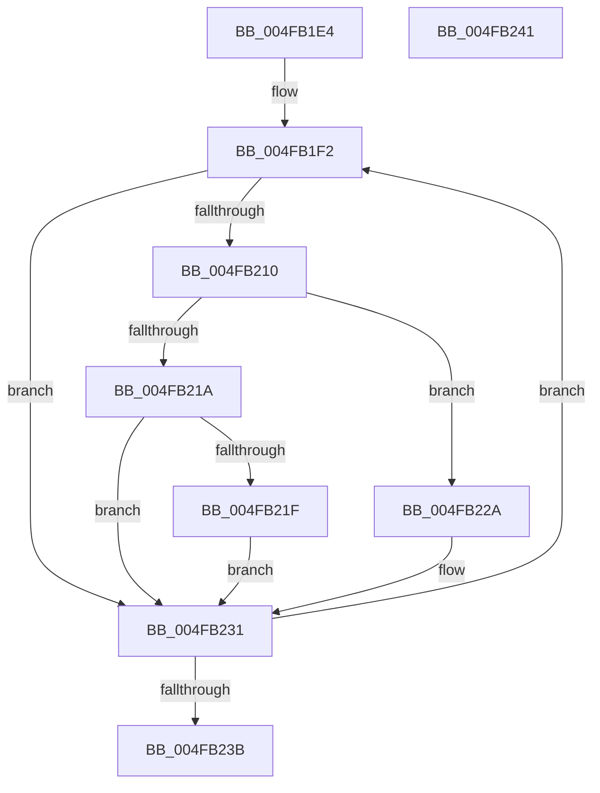

# PpmIdleUnlockProcessor

- RVA: `0x004FB1E4`–`0x004FB242` (길이 `94` bytes)
- VA: `0x00000001404FB1E4`
- 실행 섹션: `.text`
- PDB 이름 있음: `예`; PDB Function 태그: `아니요`
- unwind 정보 RVA: `0x000DB714`
- 디코드: `33`개 명령, `94/94` bytes 표시
- 미해석 바이트: `0` (있으면 어셈블리에 `.byte`로 보존)

> 이 문서는 커널 이미지의 기계어와 PDB 기호를 분석해 생성했습니다. 4번과 5번은 함수 원형과 자료형을 바이너리 사용 방식에서 추정한 C 해석이며 원본 소스 복구 결과는 아닙니다.

## 1. Dependencies

- 직접 호출 지점: **0**; 고유 호출 대상: **0**
- 직접 호출자로 확인된 함수: **1**
- RIP 상대 이미지 참조: **0**

### Outgoing calls
- 직접 디코드된 call 명령이 없습니다.

### Direct callers
- [PpmUnlockProcessors](../2D/PpmUnlockProcessors_function_002D15B0.md) at `0x002D166E`

### Static image references
- 디코드된 RIP-relative 메모리 참조가 없습니다.

## 2. Other-region calls and transfers

- 다른 실행 섹션으로 향하는 call: **0**
- 별도 외부 분기/꼬리 이동을 확인하지 못했습니다.

## 3. Assembly (complete function range)

```asm
004FB1E4  4C 8B C1                        mov r8, rcx
004FB1E7  0F 0D 09                        prefetchw byte ptr [rcx]
004FB1EA  8B 01                           mov eax, dword ptr [rcx]
004FB1EC  41 BA FF FF FF 00               mov r10d, 0xffffff
004FB1F2  8B D0                           mov edx, eax
004FB1F4  44 8B C8                        mov r9d, eax
004FB1F7  C1 E2 08                        shl edx, 8
004FB1FA  C1 FA 08                        sar edx, 8
004FB1FD  FF CA                           dec edx
004FB1FF  8B CA                           mov ecx, edx
004FB201  33 C8                           xor ecx, eax
004FB203  81 E1 00 00 00 FF               and ecx, 0xff000000
004FB209  33 CA                           xor ecx, edx
004FB20B  41 85 CA                        test r10d, ecx
004FB20E  75 21                           jne 0x1404fb231
004FB210  8B D0                           mov edx, eax
004FB212  C1 EA 18                        shr edx, 0x18
004FB215  83 FA 05                        cmp edx, 5
004FB218  74 10                           je 0x1404fb22a
004FB21A  83 FA 07                        cmp edx, 7
004FB21D  75 12                           jne 0x1404fb231
004FB21F  41 23 CA                        and ecx, r10d
004FB222  81 C9 00 00 00 06               or ecx, 0x6000000
004FB228  EB 07                           jmp 0x1404fb231
004FB22A  41 23 CA                        and ecx, r10d
004FB22D  0F BA E9 1A                     bts ecx, 0x1a
004FB231  F0 41 0F B1 08                  lock cmpxchg dword ptr [r8], ecx
004FB236  41 3B C1                        cmp eax, r9d
004FB239  75 B7                           jne 0x1404fb1f2
004FB23B  C1 E9 18                        shr ecx, 0x18
004FB23E  8A C1                           mov al, cl
004FB240  C3                              ret
004FB241  CC                              int3
```

## 4. C-style interpretation (structured pseudocode)

```c
__int64 __fastcall PpmIdleUnlockProcessor(__int64 a1)
{
loc_004FB1F2:
    a2 = (unsigned int)(((unsigned int)((unsigned int)((unsigned int)(*(unsigned int *)(a1))))) << (8));
    a2 = (unsigned int)((a2) >> (8));
    a2 = (unsigned int)((a2) - 1);
    a1 = (unsigned int)(((unsigned int)((unsigned int)(a2))) ^ ((unsigned int)((unsigned int)(*(unsigned int *)(a1)))));
    a1 = (unsigned int)((a1) & (0xFF000000ULL));
    a1 = (unsigned int)((a1) ^ ((unsigned int)(a2)));
    if ((((unsigned int)((unsigned int)(0xFFFFFFULL))) & ((unsigned int)(a1))) != 0) goto loc_004FB231;
    a2 = (unsigned int)(((unsigned int)((unsigned int)((unsigned int)(*(unsigned int *)(a1))))) >> (24));
    if (((unsigned int)(a2)) == 5) goto loc_004FB22A;
    if (((unsigned int)(a2)) != 7) goto loc_004FB231;
    a1 = (unsigned int)((a1) & ((unsigned int)((unsigned int)(0xFFFFFFULL))));
    a1 = (unsigned int)((a1) | (0x6000000ULL));
    goto loc_004FB231;
loc_004FB22A:
    a1 = (unsigned int)((a1) & ((unsigned int)((unsigned int)(0xFFFFFFULL))));
loc_004FB231:
    if (((unsigned int)((unsigned int)(*(unsigned int *)(a1)))) != ((unsigned int)((unsigned int)((unsigned int)((unsigned int)(*(unsigned int *)(a1))))))) goto loc_004FB1F2;
    a1 = (unsigned int)((a1) >> (24));
    return (unsigned __int8)(a1);
}
```

## 5. (Beta) C Style

```c
int64_t PpmIdleUnlockProcessor(void *Arg1)
{
    uint8_t *arg1 = (uint8_t *)Arg1;

loc_004FB1F2:
    a2 = (uint32_t)(((uint32_t)((uint32_t)((uint32_t)(*(uint32_t *)(arg1))))) << (8));
    a2 = (uint32_t)((a2) >> (8));
    a2 = (uint32_t)((a2) - 1);
    Arg1 = (uint32_t)(((uint32_t)((uint32_t)(a2))) ^ ((uint32_t)((uint32_t)(*(uint32_t *)(arg1)))));
    Arg1 = (uint32_t)((Arg1) & (0xFF000000ULL));
    Arg1 = (uint32_t)((Arg1) ^ ((uint32_t)(a2)));
    if ((((uint32_t)((uint32_t)(0xFFFFFFULL))) & ((uint32_t)(Arg1))) != 0) goto loc_004FB231;
    a2 = (uint32_t)(((uint32_t)((uint32_t)((uint32_t)(*(uint32_t *)(arg1))))) >> (24));
    if (((uint32_t)(a2)) == 5) goto loc_004FB22A;
    if (((uint32_t)(a2)) != 7) goto loc_004FB231;
    Arg1 = (uint32_t)((Arg1) & ((uint32_t)((uint32_t)(0xFFFFFFULL))));
    Arg1 = (uint32_t)((Arg1) | (0x6000000ULL));
    goto loc_004FB231;
loc_004FB22A:
    Arg1 = (uint32_t)((Arg1) & ((uint32_t)((uint32_t)(0xFFFFFFULL))));
loc_004FB231:
    if (((uint32_t)((uint32_t)(*(uint32_t *)(arg1)))) != ((uint32_t)((uint32_t)((uint32_t)((uint32_t)(*(uint32_t *)(arg1))))))) goto loc_004FB1F2;
    Arg1 = (uint32_t)((Arg1) >> (24));
    return (uint8_t)(Arg1);
}
```

### 관측된 메모리 오프셋

구조체 형식이 확인되지 않은 접근은 인자 기준의 오프셋으로만 기록했습니다.

| 기준 인자 | 오프셋 표현 | 폭 (bit) | 접근 |
|---|---:|---:|---|
| `Arg1` | `+ 0x0` | `8` | `R` |
| `Arg1` | `+ 0x0` | `32` | `R` |

## 6. Execution-region graph

[열기: 2D/3D 그래프와 함수 탐색 컨트롤 패널](../../../control-panel.html?section=text&rva=0x004FB1E4&view=graph)

- 2D 그래프는 위에서 아래로 흐르고, 3D 그래프는 빈 공간을 드래그해 회전합니다. Shift+드래그는 이동, 휠은 확대·축소, 함수 노드 선택은 대상 보고서 이동입니다.

### Static fallback


