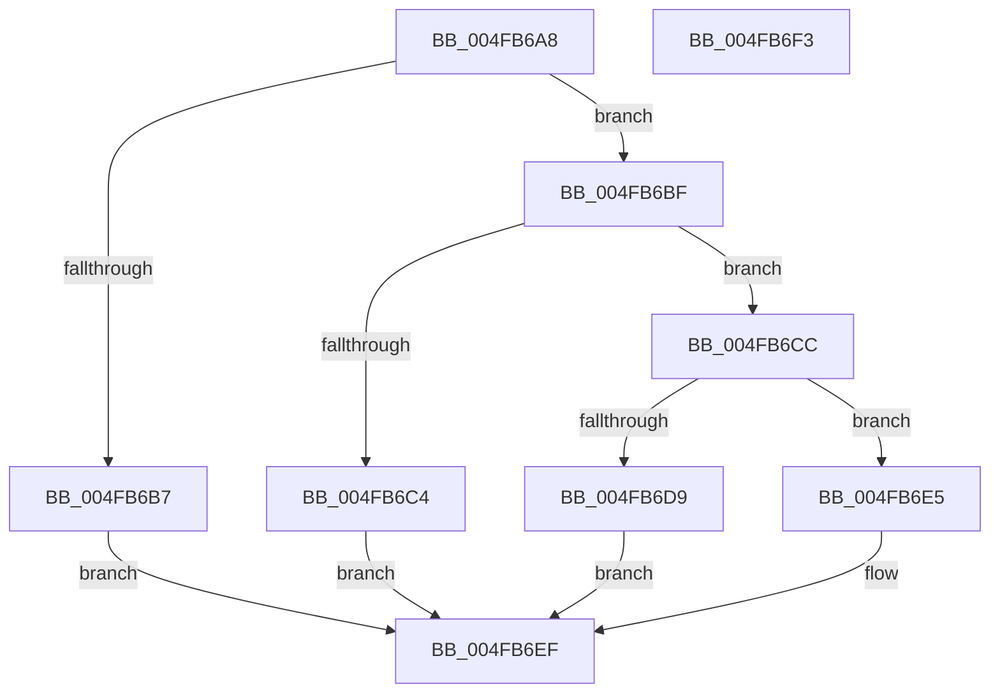

# PpmInternalPlatformIdleVeto

- RVA: `0x004FB6A8`–`0x004FB6F4` (길이 `76` bytes)
- VA: `0x00000001404FB6A8`
- 실행 섹션: `.text`
- PDB 이름 있음: `예`; PDB Function 태그: `아니요`
- unwind 정보 RVA: `0x000DB714`
- 디코드: `20`개 명령, `76/76` bytes 표시
- 미해석 바이트: `0` (있으면 어셈블리에 `.byte`로 보존)

> 이 문서는 커널 이미지의 기계어와 PDB 기호를 분석해 생성했습니다. 4번과 5번은 함수 원형과 자료형을 바이너리 사용 방식에서 추정한 C 해석이며 원본 소스 복구 결과는 아닙니다.

## 1. Dependencies

- 직접 호출 지점: **0**; 고유 호출 대상: **0**
- 직접 호출자로 확인된 함수: **1**
- RIP 상대 이미지 참조: **1**

### Outgoing calls
- 직접 디코드된 call 명령이 없습니다.

### Direct callers
- [PopPowerInformationInternal](../../page/A8/PopPowerInformationInternal_function_00A8B7C0.md) at `0x00A8C739`

### Static image references
- `0x004FB6A8` → RVA `0x00FC6AD0` (`ALMOSTRO`; read)

## 2. Other-region calls and transfers

- 다른 실행 섹션으로 향하는 call: **0**
- 별도 외부 분기/꼬리 이동을 확인하지 못했습니다.

## 3. Assembly (complete function range)

```asm
004FB6A8  4C 8B 05 21 B4 AC 00            mov r8, qword ptr [rip + 0xacb421]
004FB6AF  45 33 C9                        xor r9d, r9d
004FB6B2  4D 85 C0                        test r8, r8
004FB6B5  75 08                           jne 0x1404fb6bf
004FB6B7  41 B9 AB 00 00 C0               mov r9d, 0xc00000ab
004FB6BD  EB 30                           jmp 0x1404fb6ef
004FB6BF  41 3B 08                        cmp ecx, dword ptr [r8]
004FB6C2  72 08                           jb 0x1404fb6cc
004FB6C4  41 B9 EF 00 00 C0               mov r9d, 0xc00000ef
004FB6CA  EB 23                           jmp 0x1404fb6ef
004FB6CC  8B C1                           mov eax, ecx
004FB6CE  48 69 C8 C0 01 00 00            imul rcx, rax, 0x1c0
004FB6D5  84 D2                           test dl, dl
004FB6D7  74 0C                           je 0x1404fb6e5
004FB6D9  F0 42 81 4C 01 50 00 00 00 80   lock or dword ptr [rcx + r8 + 0x50], 0x80000000
004FB6E3  EB 0A                           jmp 0x1404fb6ef
004FB6E5  F0 42 81 64 01 50 FF FF FF 7F   lock and dword ptr [rcx + r8 + 0x50], 0x7fffffff
004FB6EF  41 8B C1                        mov eax, r9d
004FB6F2  C3                              ret
004FB6F3  CC                              int3
```

## 4. C-style interpretation (structured pseudocode)

```c
__int64 __fastcall PpmInternalPlatformIdleVeto(int a1, unsigned __int8 a2, __int64 a3, int a4)
{
    a4 = 0;
    if (*(unsigned __int64 *)(v_rip + 11318305) != 0) goto loc_004FB6BF;
    goto loc_004FB6EF;
loc_004FB6BF:
    if (a1 < (*(unsigned int *)(*(unsigned __int64 *)(v_rip + 11318305)))) goto loc_004FB6CC;
    goto loc_004FB6EF;
loc_004FB6CC:
    a1 = (a1) * ((unsigned int)(a1));
    if (a2 == 0) goto loc_004FB6E5;
    goto loc_004FB6EF;
loc_004FB6E5:
loc_004FB6EF:
    return (unsigned int)((unsigned int)((unsigned int)(0xC00000EFULL)));
}
```

## 5. (Beta) C Style

```c
int64_t PpmInternalPlatformIdleVeto(int32_t Arg1, uint8_t Arg2, int64_t Arg3, int32_t Arg4)
{
    Arg4 = 0;
    if (*(uint64_t *)(v_rip + 0xACB421) != 0) goto loc_004FB6BF;
    goto loc_004FB6EF;
loc_004FB6BF:
    if (Arg1 < (*(uint32_t *)(*(uint64_t *)(v_rip + 0xACB421)))) goto loc_004FB6CC;
    goto loc_004FB6EF;
loc_004FB6CC:
    Arg1 = (Arg1) * ((uint32_t)(Arg1));
    if (Arg2 == 0) goto loc_004FB6E5;
    goto loc_004FB6EF;
loc_004FB6E5:
loc_004FB6EF:
    return (uint32_t)((uint32_t)((uint32_t)(0xC00000EFULL)));
}
```

## 6. Execution-region graph

[열기: 2D/3D 그래프와 함수 탐색 컨트롤 패널](../../../control-panel.html?section=text&rva=0x004FB6A8&view=graph)

- 2D 그래프는 위에서 아래로 흐르고, 3D 그래프는 빈 공간을 드래그해 회전합니다. Shift+드래그는 이동, 휠은 확대·축소, 함수 노드 선택은 대상 보고서 이동입니다.

### Static fallback


