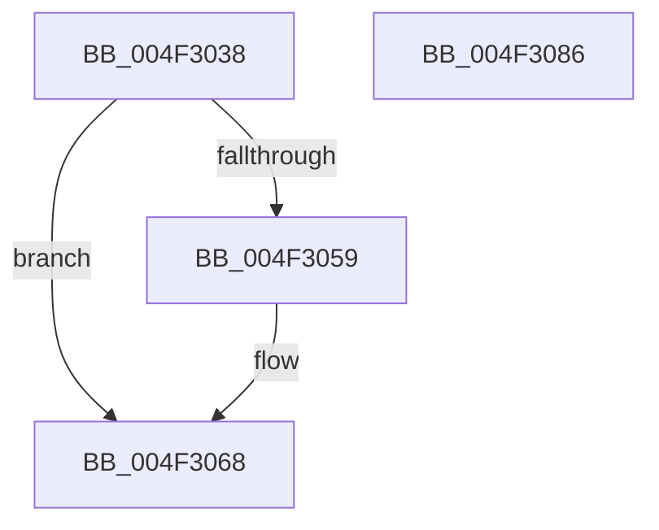

# PpmParkBuildTopologyCandidatesEx

- RVA: `0x004F3038`–`0x004F3087` (길이 `79` bytes)
- VA: `0x00000001404F3038`
- 실행 섹션: `.text`
- PDB 이름 있음: `예`; PDB Function 태그: `아니요`
- unwind 정보 RVA: `0x00060BC4`
- 디코드: `24`개 명령, `79/79` bytes 표시
- 미해석 바이트: `0` (있으면 어셈블리에 `.byte`로 보존)

> 이 문서는 커널 이미지의 기계어와 PDB 기호를 분석해 생성했습니다. 4번과 5번은 함수 원형과 자료형을 바이너리 사용 방식에서 추정한 C 해석이며 원본 소스 복구 결과는 아닙니다.

## 1. Dependencies

- 직접 호출 지점: **3**; 고유 호출 대상: **3**
- 직접 호출자로 확인된 함수: **1**
- RIP 상대 이미지 참조: **0**

### Outgoing calls
- `0x004F3050` → [KiAndAffinityExNoResult](../2C/KiAndAffinityExNoResult_function_002CF84C.md) (function, `0x002CF84C`)
- `0x004F3063` → [KiCopyAffinityEx](../2C/KiCopyAffinityEx_function_002CE860.md) (function, `0x002CE860`)
- `0x004F3071` → [KeAndAffinityEx2](../3C/KeAndAffinityEx2_function_003C0740.md) (function, `0x003C0740`)

### Direct callers
- [PpmParkComputeUnparkMaskEx](../5E/PpmParkComputeUnparkMaskEx_function_005E05E0.md) at `0x005E11D0`
- [PpmParkComputeUnparkMaskEx](../5E/PpmParkComputeUnparkMaskEx_function_005E05E0.md) at `0x005E1266`

### Static image references
- 디코드된 RIP-relative 메모리 참조가 없습니다.

## 2. Other-region calls and transfers

- 다른 실행 섹션으로 향하는 call: **0**
- 별도 외부 분기/꼬리 이동을 확인하지 못했습니다.

## 3. Assembly (complete function range)

```asm
004F3038  48 89 5C 24 08                  mov qword ptr [rsp + 8], rbx
004F303D  48 89 74 24 10                  mov qword ptr [rsp + 0x10], rsi
004F3042  57                              push rdi
004F3043  48 83 EC 20                     sub rsp, 0x20
004F3047  49 8B F0                        mov rsi, r8
004F304A  48 8B FA                        mov rdi, rdx
004F304D  48 8B D9                        mov rbx, rcx
004F3050  E8 F7 C7 DD FF                  call 0x1402cf84c
004F3055  85 C0                           test eax, eax
004F3057  75 0F                           jne 0x1404f3068
004F3059  0F B7 53 02                     movzx edx, word ptr [rbx + 2]
004F305D  4C 8B C6                        mov r8, rsi
004F3060  48 8B CB                        mov rcx, rbx
004F3063  E8 F8 B7 DD FF                  call 0x1402ce860
004F3068  4C 8B C3                        mov r8, rbx
004F306B  48 8B D7                        mov rdx, rdi
004F306E  48 8B CB                        mov rcx, rbx
004F3071  E8 CA D6 EC FF                  call 0x1403c0740
004F3076  48 8B 5C 24 30                  mov rbx, qword ptr [rsp + 0x30]
004F307B  48 8B 74 24 38                  mov rsi, qword ptr [rsp + 0x38]
004F3080  48 83 C4 20                     add rsp, 0x20
004F3084  5F                              pop rdi
004F3085  C3                              ret
004F3086  CC                              int3
```

## 4. C-style interpretation (structured pseudocode)

```c
__int64 __fastcall PpmParkBuildTopologyCandidatesEx(__int64 a1, __int64 a2, __int64 a3)
{
    __int64 result;
    __int64 v_rsp;
    unsigned __int64 v_stack_p10;
    unsigned __int64 v_stack_p8;

    v_stack_p8 = v_rbx;
    v_stack_p10 = v_rsi;
    v_rsp = (v_rsp) - (32);
    result = KiAndAffinityExNoResult(a1, a2, a3, a4);
    if ((unsigned int)(result) == 0) {
        a2 = *(unsigned __int16 *)(a1 + 2);
        a3 = a3;
        a1 = a1;
        result = KiCopyAffinityEx(a1, a2, a3, a4);
    }
    result = KeAndAffinityEx2(a1, a2, a1, a4);
    v_rsp = (v_rsp) + (32);
    return result;
}
```

## 5. (Beta) C Style

```c
int64_t PpmParkBuildTopologyCandidatesEx(void *Arg1, int64_t Arg2, int64_t Arg3)
{
    uint8_t *arg1 = (uint8_t *)Arg1;

    int64_t result;
    int64_t local_rsp;
    uint64_t v_stack_p10;
    uint64_t v_stack_p8;

    v_stack_p8 = local_rbx;
    v_stack_p10 = local_rsi;
    local_rsp = (local_rsp) - (32);
    result = KiAndAffinityExNoResult(Arg1, Arg2, Arg3, a4);
    if ((uint32_t)(result) == 0) {
        Arg2 = *(uint16_t *)(arg1 + 0x2);
        Arg3 = Arg3;
        Arg1 = Arg1;
        result = KiCopyAffinityEx(Arg1, Arg2, Arg3, a4);
    }
    result = KeAndAffinityEx2(Arg1, Arg2, Arg1, a4);
    local_rsp = (local_rsp) + (32);
    return result;
}
```

### 관측된 메모리 오프셋

구조체 형식이 확인되지 않은 접근은 인자 기준의 오프셋으로만 기록했습니다.

| 기준 인자 | 오프셋 표현 | 폭 (bit) | 접근 |
|---|---:|---:|---|
| `Arg1` | `+ 0x2` | `16` | `R` |

## 6. Execution-region graph

[열기: 2D/3D 그래프와 함수 탐색 컨트롤 패널](../../../control-panel.html?section=text&rva=0x004F3038&view=graph)

- 2D 그래프는 위에서 아래로 흐르고, 3D 그래프는 빈 공간을 드래그해 회전합니다. Shift+드래그는 이동, 휠은 확대·축소, 함수 노드 선택은 대상 보고서 이동입니다.

### Static fallback


