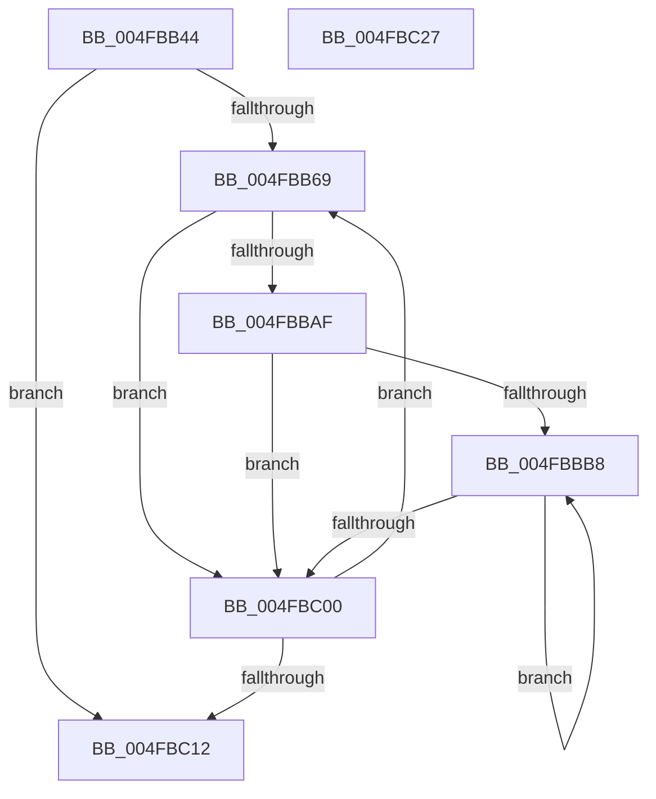

# PpmParkCompleteMakeup

- RVA: `0x004FBB44`–`0x004FBC28` (길이 `228` bytes)
- VA: `0x00000001404FBB44`
- 실행 섹션: `.text`
- PDB 이름 있음: `예`; PDB Function 태그: `아니요`
- unwind 정보 RVA: `0x0005C954`
- 디코드: `49`개 명령, `228/228` bytes 표시
- 미해석 바이트: `0` (있으면 어셈블리에 `.byte`로 보존)

> 이 문서는 커널 이미지의 기계어와 PDB 기호를 분석해 생성했습니다. 4번과 5번은 함수 원형과 자료형을 바이너리 사용 방식에서 추정한 C 해석이며 원본 소스 복구 결과는 아닙니다.

## 1. Dependencies

- 직접 호출 지점: **2**; 고유 호출 대상: **1**
- 직접 호출자로 확인된 함수: **1**
- RIP 상대 이미지 참조: **2**

### Outgoing calls
- `0x004FBBA1` → [memcpy](../6C/memcpy_function_006C6840.md) (function, `0x006C6840`)
- `0x004FBBF2` → [memcpy](../6C/memcpy_function_006C6840.md) (function, `0x006C6840`)

### Direct callers
- [PpmCheckMakeupSkippedChecks](../2D/PpmCheckMakeupSkippedChecks_function_002DA1D0.md) at `0x002DA2DD`

### Static image references
- `0x004FBB5A` → RVA `0x00F083E0` (`.data`; read)
- `0x004FBB73` → RVA `0x00F083D8` (`.data`; read)

## 2. Other-region calls and transfers

- 다른 실행 섹션으로 향하는 call: **0**
- 별도 외부 분기/꼬리 이동을 확인하지 못했습니다.

## 3. Assembly (complete function range)

```asm
004FBB44  48 89 5C 24 08                  mov qword ptr [rsp + 8], rbx
004FBB49  48 89 6C 24 10                  mov qword ptr [rsp + 0x10], rbp
004FBB4E  48 89 74 24 18                  mov qword ptr [rsp + 0x18], rsi
004FBB53  57                              push rdi
004FBB54  48 83 EC 20                     sub rsp, 0x20
004FBB58  33 ED                           xor ebp, ebp
004FBB5A  39 2D 80 C8 A0 00               cmp dword ptr [rip + 0xa0c880], ebp
004FBB60  0F B7 FD                        movzx edi, bp
004FBB63  0F 84 A9 00 00 00               je 0x1404fbc12
004FBB69  0F B7 C7                        movzx eax, di
004FBB6C  48 69 D8 10 05 00 00            imul rbx, rax, 0x510
004FBB73  48 03 1D 5E C8 A0 00            add rbx, qword ptr [rip + 0xa0c85e]
004FBB7A  44 8B 83 88 04 00 00            mov r8d, dword ptr [rbx + 0x488]
004FBB81  48 8B 83 70 04 00 00            mov rax, qword ptr [rbx + 0x470]
004FBB88  48 8B 93 58 04 00 00            mov rdx, qword ptr [rbx + 0x458]
004FBB8F  48 8B 8B 60 04 00 00            mov rcx, qword ptr [rbx + 0x460]
004FBB96  41 C1 E0 03                     shl r8d, 3
004FBB9A  48 89 83 78 04 00 00            mov qword ptr [rbx + 0x478], rax
004FBBA1  E8 9A AC 1C 00                  call 0x1406c6840
004FBBA6  40 38 AB A1 04 00 00            cmp byte ptr [rbx + 0x4a1], bpl
004FBBAD  74 51                           je 0x1404fbc00
004FBBAF  40 8A F5                        mov sil, bpl
004FBBB2  40 38 6B 0C                     cmp byte ptr [rbx + 0xc], bpl
004FBBB6  76 48                           jbe 0x1404fbc00
004FBBB8  40 0F B6 C6                     movzx eax, sil
004FBBBC  48 8D 0C 80                     lea rcx, [rax + rax*4]
004FBBC0  48 C1 E1 07                     shl rcx, 7
004FBBC4  48 03 8B 08 05 00 00            add rcx, qword ptr [rbx + 0x508]
004FBBCB  48 8B 81 58 02 00 00            mov rax, qword ptr [rcx + 0x258]
004FBBD2  44 8B 81 70 02 00 00            mov r8d, dword ptr [rcx + 0x270]
004FBBD9  48 8B 91 40 02 00 00            mov rdx, qword ptr [rcx + 0x240]
004FBBE0  48 89 81 60 02 00 00            mov qword ptr [rcx + 0x260], rax
004FBBE7  48 8B 89 48 02 00 00            mov rcx, qword ptr [rcx + 0x248]
004FBBEE  41 C1 E0 03                     shl r8d, 3
004FBBF2  E8 49 AC 1C 00                  call 0x1406c6840
004FBBF7  40 FE C6                        inc sil
004FBBFA  40 3A 73 0C                     cmp sil, byte ptr [rbx + 0xc]
004FBBFE  72 B8                           jb 0x1404fbbb8
004FBC00  66 FF C7                        inc di
004FBC03  0F B7 C7                        movzx eax, di
004FBC06  3B 05 D4 C7 A0 00               cmp eax, dword ptr [rip + 0xa0c7d4]
004FBC0C  0F 82 57 FF FF FF               jb 0x1404fbb69
004FBC12  48 8B 5C 24 30                  mov rbx, qword ptr [rsp + 0x30]
004FBC17  48 8B 6C 24 38                  mov rbp, qword ptr [rsp + 0x38]
004FBC1C  48 8B 74 24 40                  mov rsi, qword ptr [rsp + 0x40]
004FBC21  48 83 C4 20                     add rsp, 0x20
004FBC25  5F                              pop rdi
004FBC26  C3                              ret
004FBC27  CC                              int3
```

## 4. C-style interpretation (structured pseudocode)

```c
__int64 __fastcall PpmParkCompleteMakeup(void)
{
    __int64 result;
    __int64 v_rbp;
    __int64 v_rbx;
    __int64 v_rdi;
    __int64 v_rsi;
    __int64 v_rsp;
    unsigned __int64 v_stack_p10;
    unsigned __int64 v_stack_p18;
    unsigned __int64 v_stack_p8;

    v_stack_p8 = v_rbx;
    v_stack_p10 = v_rbp;
    v_stack_p18 = v_rsi;
    v_rsp = (v_rsp) - (32);
    v_rbp = 0;
    if ((*(unsigned int *)(v_rip + 10537088)) == 0) goto loc_004FBC12;
loc_004FBB69:
    v_rbx = (v_rbx) * (0);
    v_rbx = (v_rbx) + (*(unsigned __int64 *)(v_rip + 10537054));
    a3 = (unsigned int)(((unsigned int)(*(unsigned int *)(v_rbx + 1160))) << (3));
    *(unsigned __int64 *)(v_rbx + 1144) = *(unsigned __int64 *)(v_rbx + 1136);
    result = memcpy(*(unsigned __int64 *)(v_rbx + 1120), *(unsigned __int64 *)(v_rbx + 1112), a3, a4);
    if ((*(unsigned __int8 *)(v_rbx + 1185)) == 0) goto loc_004FBC00;
    if ((*(unsigned __int8 *)(v_rbx + 12)) <= 0) goto loc_004FBC00;
loc_004FBBB8:
    a1 = (0 + 0 * 4) << (7);
    a1 = (a1) + (*(unsigned __int64 *)(v_rbx + 1288));
    *(unsigned __int64 *)(a1 + 608) = *(unsigned __int64 *)(a1 + 600);
    a3 = (unsigned int)(((unsigned int)(*(unsigned int *)(a1 + 624))) << (3));
    result = memcpy(*(unsigned __int64 *)(a1 + 584), *(unsigned __int64 *)(a1 + 576), a3, a4);
    v_rsi = (unsigned __int8)((0) + 1);
    if (((unsigned __int8)(v_rsi)) < (*(unsigned __int8 *)(v_rbx + 12))) goto loc_004FBBB8;
loc_004FBC00:
    v_rdi = (unsigned __int16)((0) + 1);
    if (((unsigned int)((unsigned __int16)(v_rdi))) < (*(unsigned int *)(v_rip + 10536916))) goto loc_004FBB69;
loc_004FBC12:
    v_rsp = (v_rsp) + (32);
    return (unsigned __int16)(v_rdi);
}
```

## 5. (Beta) C Style

```c
void PpmParkCompleteMakeup(void)
{
    int64_t result;
    int64_t local_rbp;
    int64_t local_rbx;
    int64_t local_rdi;
    int64_t local_rsi;
    int64_t local_rsp;
    uint64_t v_stack_p10;
    uint64_t v_stack_p18;
    uint64_t v_stack_p8;

    v_stack_p8 = local_rbx;
    v_stack_p10 = local_rbp;
    v_stack_p18 = local_rsi;
    local_rsp = (local_rsp) - (32);
    local_rbp = 0;
    if ((*(uint32_t *)(v_rip + 0xA0C880)) == 0) goto loc_004FBC12;
loc_004FBB69:
    local_rbx = (local_rbx) * (0);
    local_rbx = (local_rbx) + (*(uint64_t *)(v_rip + 0xA0C85E));
    a3 = (uint32_t)(((uint32_t)(*(uint32_t *)(local_rbx + 0x488))) << (3));
    *(uint64_t *)(local_rbx + 0x478) = *(uint64_t *)(local_rbx + 0x470);
    result = memcpy(*(uint64_t *)(local_rbx + 0x460), *(uint64_t *)(local_rbx + 0x458), a3, a4);
    if ((*(uint8_t *)(local_rbx + 0x4A1)) == 0) goto loc_004FBC00;
    if ((*(uint8_t *)(local_rbx + 0xC)) <= 0) goto loc_004FBC00;
loc_004FBBB8:
    a1 = (0 + 0 * 4) << (7);
    a1 = (a1) + (*(uint64_t *)(local_rbx + 0x508));
    *(uint64_t *)(a1 + 0x260) = *(uint64_t *)(a1 + 0x258);
    a3 = (uint32_t)(((uint32_t)(*(uint32_t *)(a1 + 0x270))) << (3));
    result = memcpy(*(uint64_t *)(a1 + 0x248), *(uint64_t *)(a1 + 0x240), a3, a4);
    local_rsi = (uint8_t)((0) + 1);
    if (((uint8_t)(local_rsi)) < (*(uint8_t *)(local_rbx + 0xC))) goto loc_004FBBB8;
loc_004FBC00:
    local_rdi = (uint16_t)((0) + 1);
    if (((uint32_t)((uint16_t)(local_rdi))) < (*(uint32_t *)(v_rip + 0xA0C7D4))) goto loc_004FBB69;
loc_004FBC12:
    local_rsp = (local_rsp) + (32);
    return (uint16_t)(local_rdi);
}
```

## 6. Execution-region graph

[열기: 2D/3D 그래프와 함수 탐색 컨트롤 패널](../../../control-panel.html?section=text&rva=0x004FBB44&view=graph)

- 2D 그래프는 위에서 아래로 흐르고, 3D 그래프는 빈 공간을 드래그해 회전합니다. Shift+드래그는 이동, 휠은 확대·축소, 함수 노드 선택은 대상 보고서 이동입니다.

### Static fallback


