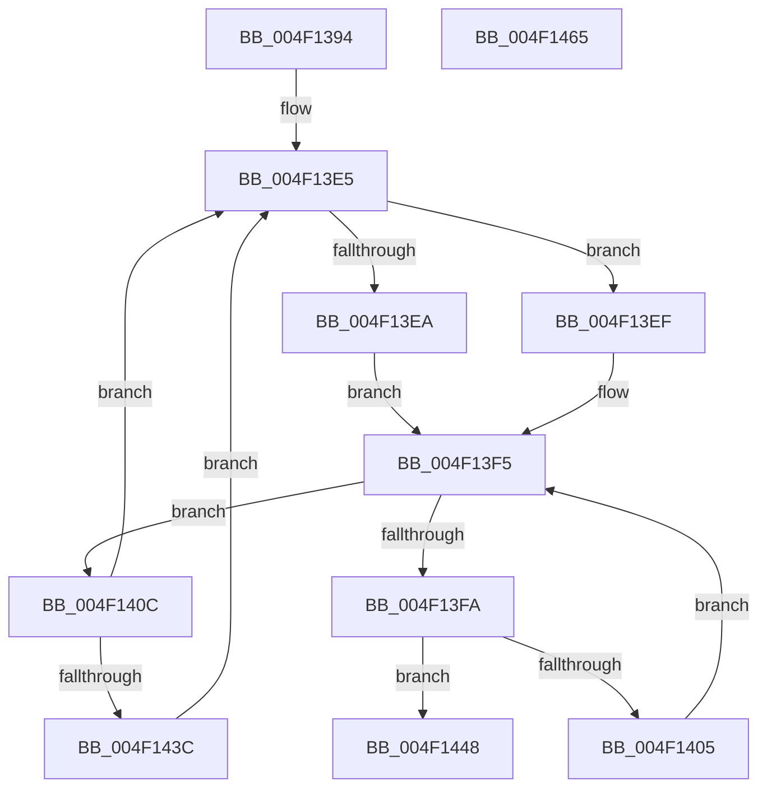

# PpmParkFindOverUtilizedProcessorsEx

- RVA: `0x004F1394`–`0x004F1466` (길이 `210` bytes)
- VA: `0x00000001404F1394`
- 실행 섹션: `.text`
- PDB 이름 있음: `예`; PDB Function 태그: `아니요`
- unwind 정보 RVA: `0x0005D79C`
- 디코드: `65`개 명령, `210/210` bytes 표시
- 미해석 바이트: `0` (있으면 어셈블리에 `.byte`로 보존)

> 이 문서는 커널 이미지의 기계어와 PDB 기호를 분석해 생성했습니다. 4번과 5번은 함수 원형과 자료형을 바이너리 사용 방식에서 추정한 C 해석이며 원본 소스 복구 결과는 아닙니다.

## 1. Dependencies

- 직접 호출 지점: **3**; 고유 호출 대상: **3**
- 직접 호출자로 확인된 함수: **1**
- RIP 상대 이미지 참조: **1**

### Outgoing calls
- `0x004F13C7` → [memset](../6C/memset_function_006C6C40.md) (function, `0x006C6C40`)
- `0x004F142E` → [KeGetPrcb](../2D/KeGetPrcb_function_002D85D0.md) (function, `0x002D85D0`)
- `0x004F1441` → [KeAddProcessorAffinityEx](../25/KeAddProcessorAffinityEx_function_0025B6F0.md) (function, `0x0025B6F0`)

### Direct callers
- [PpmParkCalculateCoreParkingMaskEx](../5D/PpmParkCalculateCoreParkingMaskEx_function_005DFBE0.md) at `0x005DFE41`

### Static image references
- `0x004F1422` → RVA `0x00F231B8` (`.data`; read)

## 2. Other-region calls and transfers

- 다른 실행 섹션으로 향하는 call: **0**
- 별도 외부 분기/꼬리 이동을 확인하지 못했습니다.

## 3. Assembly (complete function range)

```asm
004F1394  48 89 5C 24 10                  mov qword ptr [rsp + 0x10], rbx
004F1399  48 89 6C 24 18                  mov qword ptr [rsp + 0x18], rbp
004F139E  48 89 74 24 20                  mov qword ptr [rsp + 0x20], rsi
004F13A3  57                              push rdi
004F13A4  41 54                           push r12
004F13A6  41 55                           push r13
004F13A8  41 56                           push r14
004F13AA  41 57                           push r15
004F13AC  48 83 EC 20                     sub rsp, 0x20
004F13B0  4D 8B F0                        mov r14, r8
004F13B3  44 8B FA                        mov r15d, edx
004F13B6  45 0F B7 00                     movzx r8d, word ptr [r8]
004F13BA  48 8B F9                        mov rdi, rcx
004F13BD  49 C1 E0 03                     shl r8, 3
004F13C1  33 D2                           xor edx, edx
004F13C3  49 8D 4E 08                     lea rcx, [r14 + 8]
004F13C7  E8 74 58 1D 00                  call 0x1406c6c40
004F13CC  48 83 C7 30                     add rdi, 0x30
004F13D0  41 BD 01 00 00 00               mov r13d, 1
004F13D6  45 33 E4                        xor r12d, r12d
004F13D9  66 45 89 2E                     mov word ptr [r14], r13w
004F13DD  41 0F B7 DC                     movzx ebx, r12w
004F13E1  48 8B 77 08                     mov rsi, qword ptr [rdi + 8]
004F13E5  48 85 FF                        test rdi, rdi
004F13E8  74 05                           je 0x1404f13ef
004F13EA  0F B7 0F                        movzx ecx, word ptr [rdi]
004F13ED  EB 06                           jmp 0x1404f13f5
004F13EF  0F B7 CB                        movzx ecx, bx
004F13F2  41 03 CD                        add ecx, r13d
004F13F5  48 85 F6                        test rsi, rsi
004F13F8  75 12                           jne 0x1404f140c
004F13FA  66 41 03 DD                     add bx, r13w
004F13FE  0F B7 DB                        movzx ebx, bx
004F1401  3B D9                           cmp ebx, ecx
004F1403  73 43                           jae 0x1404f1448
004F1405  48 8B 74 DF 08                  mov rsi, qword ptr [rdi + rbx*8 + 8]
004F140A  EB E9                           jmp 0x1404f13f5
004F140C  48 0F BC D6                     bsf rdx, rsi
004F1410  0F B7 CB                        movzx ecx, bx
004F1413  0F B6 C2                        movzx eax, dl
004F1416  C1 E1 06                        shl ecx, 6
004F1419  48 0F B3 C6                     btr rsi, rax
004F141D  0F B6 C2                        movzx eax, dl
004F1420  03 C8                           add ecx, eax
004F1422  48 8B 05 8F 1D A3 00            mov rax, qword ptr [rip + 0xa31d8f]
004F1429  8B 2C 88                        mov ebp, dword ptr [rax + rcx*4]
004F142C  8B CD                           mov ecx, ebp
004F142E  E8 9D 71 DE FF                  call 0x1402d85d0
004F1433  44 39 B8 DC 89 00 00            cmp dword ptr [rax + 0x89dc], r15d
004F143A  72 A9                           jb 0x1404f13e5
004F143C  8B D5                           mov edx, ebp
004F143E  49 8B CE                        mov rcx, r14
004F1441  E8 AA A2 D6 FF                  call 0x14025b6f0
004F1446  EB 9D                           jmp 0x1404f13e5
004F1448  48 8B 5C 24 58                  mov rbx, qword ptr [rsp + 0x58]
004F144D  48 8B 6C 24 60                  mov rbp, qword ptr [rsp + 0x60]
004F1452  48 8B 74 24 68                  mov rsi, qword ptr [rsp + 0x68]
004F1457  48 83 C4 20                     add rsp, 0x20
004F145B  41 5F                           pop r15
004F145D  41 5E                           pop r14
004F145F  41 5D                           pop r13
004F1461  41 5C                           pop r12
004F1463  5F                              pop rdi
004F1464  C3                              ret
004F1465  CC                              int3
```

## 4. C-style interpretation (structured pseudocode)

```c
__int64 __fastcall PpmParkFindOverUtilizedProcessorsEx(__int64 a1, int a2, __int64 a3)
{
    __int64 result;
    __int64 v_r12;
    __int64 v_rbx;
    __int64 v_rdi;
    __int64 v_rsp;
    unsigned __int64 v_stack_p10;
    unsigned __int64 v_stack_p18;
    unsigned __int64 v_stack_p20;

    v_stack_p10 = v_rbx;
    v_stack_p18 = v_rbp;
    v_stack_p20 = v_rsi;
    v_rsp = (v_rsp) - (32);
    a3 = (*(unsigned __int16 *)(a3)) << (3);
    a2 = 0;
    result = memset(a3 + 8, a2, a3, a4);
    v_rdi = (a1) + (48);
    v_r12 = 0;
    *(unsigned __int16 *)(a3) = 1;
loc_004F13E5:
    if (v_rdi == 0) goto loc_004F13EF;
    goto loc_004F13F5;
loc_004F13EF:
    a1 = (unsigned int)((0) + (1));
loc_004F13F5:
    if (*(unsigned __int64 *)(v_rdi + 8) != 0) goto loc_004F140C;
    v_rbx = (unsigned __int16)((0) + (1));
    if (((unsigned int)((unsigned __int16)(v_rbx))) >= ((unsigned int)(a1))) goto loc_004F1448;
    goto loc_004F13F5;
loc_004F140C:
    a1 = (unsigned int)(((unsigned __int16)((unsigned __int16)(v_rbx))) << (6));
    a1 = (unsigned int)((a1) + (0));
    result = KeGetPrcb((unsigned int)((unsigned int)((unsigned int)(*(unsigned int *)(*(unsigned __int64 *)(v_rip + 10689935) + a1 * 4)))), a2, a3, a4);
    if ((*(unsigned int *)(result + 35292)) < ((unsigned int)((unsigned int)(a2)))) goto loc_004F13E5;
    result = KeAddProcessorAffinityEx(a3, (unsigned int)((unsigned int)((unsigned int)(*(unsigned int *)(*(unsigned __int64 *)(v_rip + 10689935) + a1 * 4)))), a3, a4);
    goto loc_004F13E5;
loc_004F1448:
    v_rsp = (v_rsp) + (32);
    return result;
}
```

## 5. (Beta) C Style

```c
int64_t PpmParkFindOverUtilizedProcessorsEx(void *Arg1, int32_t Arg2, void *Arg3)
{
    uint8_t *arg1 = (uint8_t *)Arg1;
    uint8_t *arg3 = (uint8_t *)Arg3;

    int64_t result;
    int64_t local_r12;
    int64_t local_rbx;
    int64_t local_rdi;
    int64_t local_rsp;
    uint64_t v_stack_p10;
    uint64_t v_stack_p18;
    uint64_t v_stack_p20;

    v_stack_p10 = local_rbx;
    v_stack_p18 = local_rbp;
    v_stack_p20 = local_rsi;
    local_rsp = (local_rsp) - (32);
    Arg3 = (*(uint16_t *)(arg3)) << (3);
    Arg2 = 0;
    result = memset(Arg3 + 8, Arg2, Arg3, a4);
    local_rdi = (Arg1) + (48);
    local_r12 = 0;
    *(uint16_t *)(arg3) = 1;
loc_004F13E5:
    if (local_rdi == 0) goto loc_004F13EF;
    goto loc_004F13F5;
loc_004F13EF:
    Arg1 = (uint32_t)((0) + (1));
loc_004F13F5:
    if (*(uint64_t *)(local_rdi + 0x8) != 0) goto loc_004F140C;
    local_rbx = (uint16_t)((0) + (1));
    if (((uint32_t)((uint16_t)(local_rbx))) >= ((uint32_t)(Arg1))) goto loc_004F1448;
    goto loc_004F13F5;
loc_004F140C:
    Arg1 = (uint32_t)(((uint16_t)((uint16_t)(local_rbx))) << (6));
    Arg1 = (uint32_t)((Arg1) + (0));
    result = KeGetPrcb((uint32_t)((uint32_t)((uint32_t)(*(uint32_t *)(*(uint64_t *)(v_rip + 0xA31D8F) + arg1 * 4)))), Arg2, Arg3, a4);
    if ((*(uint32_t *)(result + 0x89DC)) < ((uint32_t)((uint32_t)(Arg2)))) goto loc_004F13E5;
    result = KeAddProcessorAffinityEx(Arg3, (uint32_t)((uint32_t)((uint32_t)(*(uint32_t *)(*(uint64_t *)(v_rip + 0xA31D8F) + arg1 * 4)))), Arg3, a4);
    goto loc_004F13E5;
loc_004F1448:
    local_rsp = (local_rsp) + (32);
    return result;
}
```

### 관측된 메모리 오프셋

구조체 형식이 확인되지 않은 접근은 인자 기준의 오프셋으로만 기록했습니다.

| 기준 인자 | 오프셋 표현 | 폭 (bit) | 접근 |
|---|---:|---:|---|
| `Arg1` | `+ 0x8` | `64` | `R` |
| `Arg3` | `+ 0x0` | `16` | `R` |
| `Arg3` | `+ 0x0` | `16` | `W` |
| `Arg3` | `+ 0x8` | `64` | `R` |

## 6. Execution-region graph

[열기: 2D/3D 그래프와 함수 탐색 컨트롤 패널](../../../control-panel.html?section=text&rva=0x004F1394&view=graph)

- 2D 그래프는 위에서 아래로 흐르고, 3D 그래프는 빈 공간을 드래그해 회전합니다. Shift+드래그는 이동, 휠은 확대·축소, 함수 노드 선택은 대상 보고서 이동입니다.

### Static fallback


